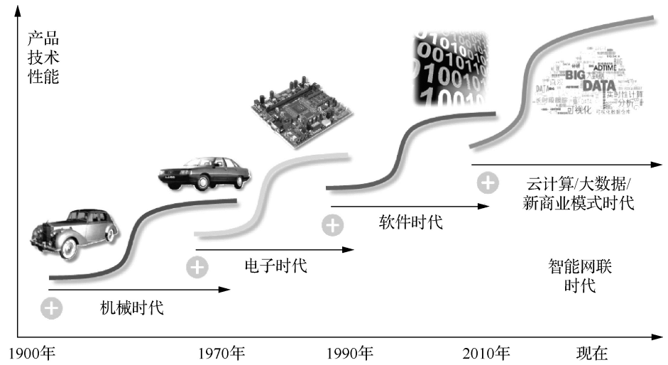
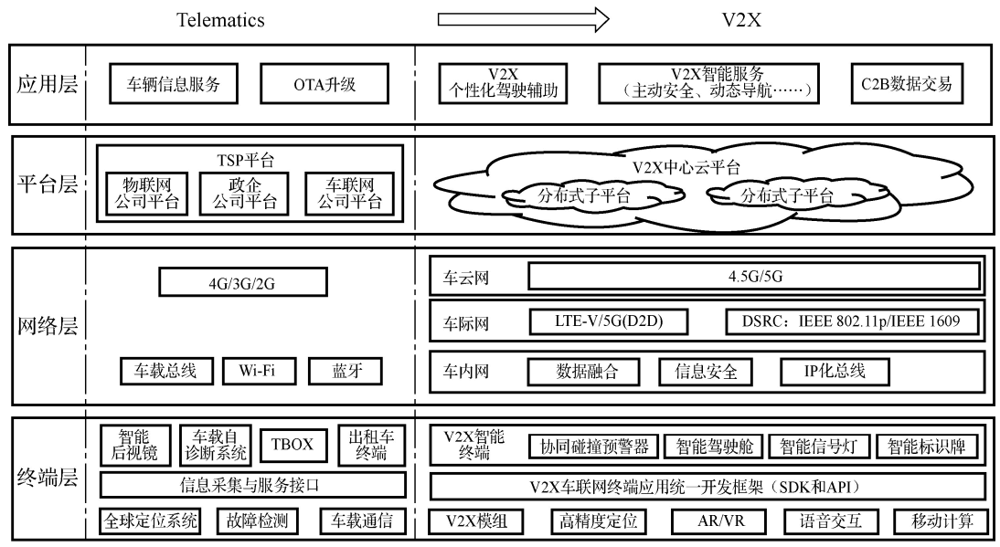
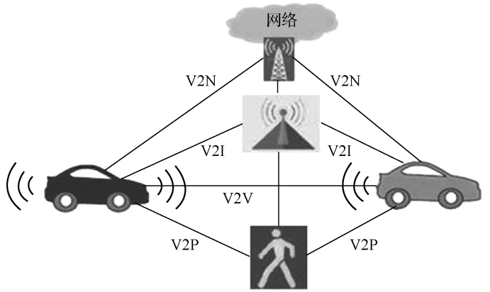
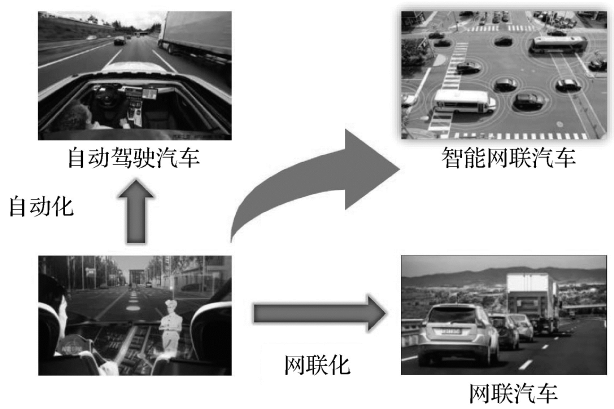
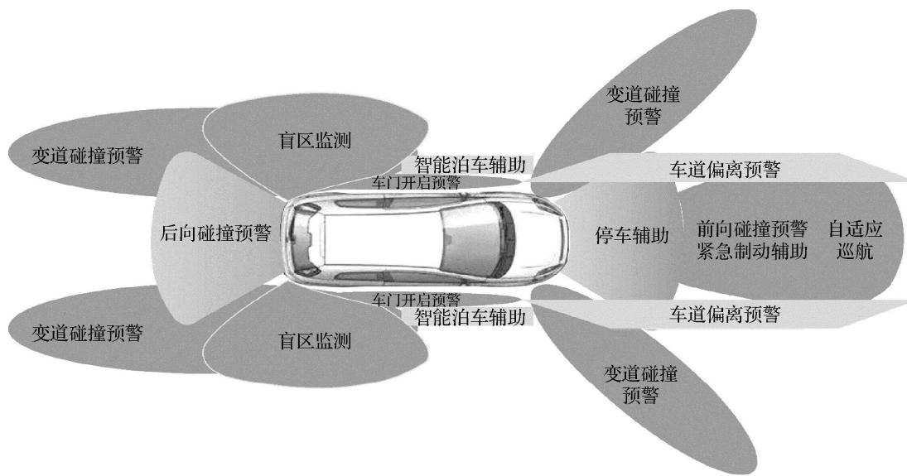
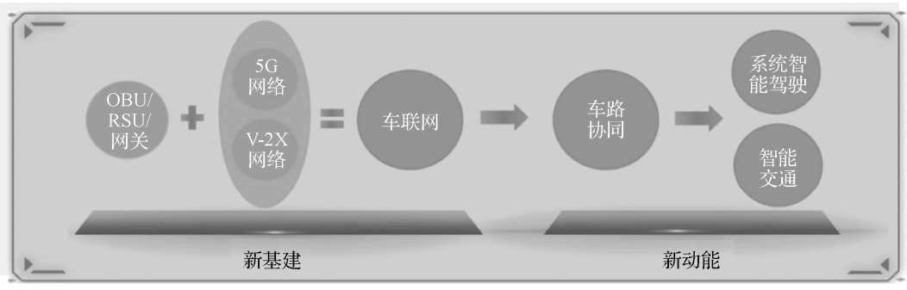

# 第1章 绪论

车路协同系统是包含智能网联汽车(intelligent and connected vehicle, ICV)与智能交通的综合系统,即由车辆、通信网络、路侧基础设施、云服务平台等组成的通信、感知、计算、决策控制系统。车路协同系统离不开智能网联汽车、车载单元与其他设备通信(vehicle-to-everything, V2X)车联网、路侧基础设施、云服务平台的支撑。本章将对车路协同系统中的V2X车联网与车路协同系统的基本概念、研究现状和发展趋势进行分析,让读者对车路协同系统有一个整体认识。

## 1.1 V2X车联网概述

### 1.1.1 V2X车联网简介

### 1.1.1.1 V2X车联网基本概念

如图 1.1 所示，车辆的发展经历了机械时代、电子时代、软件时代，现在正处于智能网联时代。每个时代的特征与相关行业的发展相关联。随着微电子、计算机、通信、人工智能与大数据等技术的不断发展及应用，车辆的智能化、网联

化成为其发展的主要趋势。智能网联汽车也是产业变革、两化融合、智慧城市及国家竞争力的重要体现。

车联网(internet of vehicle)的概念源于物联网,是物联网的一个重要应用,是以行驶中的车辆为信息感知对象,借助新一代信息通信技术,按照约定的通信协议和数据交互标准,实现车与X(即车与车、人、路、云、图)之间的网络连接,进行无线通信和信息交换,实现一个车联网中各个对象协同的综合系统。车联网通过车与车、车与路、车与云等互相联结,收集、处理并共享大量信息,为智能交通、智慧城市服务,提高人们行车安全与出行效率,提高城市的智能化程度,实现节能减排。

传统的车联网是指通过装载在车辆上的无线通信设备，实现在信息网络平台上对所有车辆的属性信息和静态、动态信息的提取及有效利用，主要以 Telematics [telecommunications (电信)与 informatics (信息)的合成词]为代表，并根据不同的功能需求对所有车辆的运行状态进行有效监管并提供综合服务。随着通信技术与应用的不断发展和融合，对车联网的理解也在不断深入。如今的车联网是指利用车载电子传感装置，通过移动通信技术、汽车导航系统、智能终端设备与信息网络平台，实现信息互联互通，从而对车、人、道路、环境等资源进行有效智能监控、调度、管理的网络系统，即 V2X 车联网。典型的 Telematics 车联网与 V2X 车联网的组成对比如图 1.2 所示。

OTA: over-the-air technology, 空中下载技术; TSP: telematics service provider, 汽车远程服务提供商; C2B: customer to business, 消费者到企业; TBOX: telematics box, 车载T-BOX; DSRC: dedicated short range communications, 专用短程通信; SDK: software development kit, 软件开发工具包; API: application programming interface, 应用程序接口; AR: augmented reality, 增强现实; VR: virtual reality, 虚拟现实; D2D: device to device, 设备到设备。

V2X车联网技术是车与车、车与路、车与人、车与服务平台等车与外界环境进行数据通信、信息交互的通信技术,属于车际网。V2X车联网技术是智能网联汽车、智能交通、智慧城市、无人驾驶等的技术保障和发展突破口,主要包括车-车(vehicle-to-vehicle,V2V)、车-基础设施(vehicle-to-infrastructure,V2I)、车-行人(vehicle-to-pedestrian,V2P)、车-互联网(vehicle-to-network,V2N),如图1.3所示。V2V是指通过车载终端进行车辆间的通信,车载终端可以实时获取周围车辆的车速、位置、行车情况等信息,车辆间可以构成一个互动的平台,实时交换文字、图片和视频等信息。V2V通信主要应用于车辆防碰撞预警、车-车协同等场景。V2I是指车载设备与路侧基础设施(如红绿灯、交通摄像头、路侧单元等)进行通信,路侧基础设施可以获取附近区域车辆、道路、行人、天气等信息并实时发布。V2I通信主要应用于实时信息服务、车辆监控管理、不停车收费、绿波通行控制等场景。V2P是指弱势交通群体(包括行人、骑行者等)使用用户设备(如手机、笔记本式计算机等)与车载设备进行通信。V2P通信主要应用于车-行人防碰撞预警、车-行人协同等场景。V2N是指车载设备通过接入网/核心网与云平台连接通信,云平台通过V2N与车辆之间进行数据交互,并对获取的数据进行存储和处理,提供车辆所需要的各类应用服务。V2N通信主要应用于车辆导航、交通事件信息发布、车辆远程监控、紧急救援、信息娱乐服务等场景。

## 1.2 V2X车联网的主要作用

智能化与网联化是未来汽车发展方向之一。2023年末全国民用汽车保有量33618万辆(包括三轮汽车和低速货车706万辆),其中私人汽车保有量29427万辆,民用轿车保有量18668万辆[1]。随着汽车保有量的不断增加,以及移动高速网络和物联网的发展,车载智能终端作为智能网联汽车的核心部件之一,可以使传统汽车实现车联网功能,实现车辆的远程管理,促进智能网联汽车的发展,未来可实现“智慧交通”,提高出行效率,减少交通事故。V2X车辆网的主要作用如下。

(1)提升交通安全。通过V2X车载终端设备、移动终端及智能路侧设备的多源感知融合,对道路环境实时状况进行感知、分析和决策,在可能发生危险或碰撞的情况下,智能网联汽车会进行提前告警,并可以结合先进驾驶辅助系统(advanced driving assistance system, ADAS)实现自动避障或刹车,提高安全性。

(2)提高交通运行效率。通过V2X增强交通感知能力,实现交通系统网联化、智能化,构建智慧交通体系,通过动态调配路网资源,实现拥堵提醒、优化路线诱导,为城市大运量公共运输工具及特殊车辆提供优先通行权限,提高城市交通运行效率。

(3)为智慧城市提供服务。车城协同是未来智慧城市建设的重要内容之一,通过V2X可将车辆与智慧城市的其他系统连接起来,打造城市综合监管平台与智慧出行平台,全面提升政府监管、服务运营、人民出行水平。

(4)支持实现自动驾驶。通过信息协同共享、分析和决策,为智能网联汽车提供碰撞预警等服务,为自动驾驶提供辅助决策能力,提升自动驾驶的安全性;降低车辆适应各种特殊道路条件的成本,加快自动驾驶落地。

V2X车联网可以把汽车变成驾驶员的一种工具，扩展感知范围，它可以在驾驶员察觉之前注意到突然跑上公路的动物，或者用V2X通信检测驾驶员难以察觉的拐角处的停车标志或者其他车辆并提醒驾驶员，还可以在有遮挡或者能见度不好的情况下对车辆周围的交通对象和交通信号了如指掌，安全高效地通过交通路口。

随着车联网技术向着智能化、网联化方向演进,通信技术也聚焦于智能网联汽车、自动驾驶等不同阶段的应用中。V2X车联网是汽车、电子、信息通信、交通运输和交通管理等行业深度融合的新兴产业形态,是培育新的经济增长点、加快新旧动能接续转换的重要载体。V2X通信技术作为智能网联汽车中的信息交互关键技术,主要用于实现车间信息共享与协同控制的通信保障。V2X从时间、空间维度方面扩大了车辆对交通与环境的感知范围,可见V2X能实现车辆与外界之间的信息共享,提前获知周边车辆的操作信息、交通控制信息、拥堵预测信息、视觉盲区等周边环境信息,能在避免交通事故、提升道路安全、缓解拥堵、提高交通效率、降低能耗、降低环境污染等方面取得显著效果。

当前智能汽车技术高速推进，辅助驾驶、自动驾驶技术也得到了快速发展且日益成熟，车辆防撞预警功能日渐完善。在车辆防撞预警领域，主要以自动驾驶为主要实现方案。目前，自动驾驶技术主要处在有条件的自动化和部分自动化阶段，主要采用以机器视觉、雷达为核心的车辆检测、识别、预警方案。该方案可以较为准确地识别出视距范围内的车辆，同时可以对识别车辆的距离、位置、速度进行检测。随着V2X车联网及智能网联汽车的发展，V2X技术在车辆防撞预

警领域的优势日渐明显,相较摄像头、雷达的视距范围内的车辆探测能力,V2X技术可以实现非视线(not line of sight, NLOS)范围内的车辆探测、扫描。

因此，通过将“人-车-路-云”交通参与要素有机地联系在一起，不仅可以支撑车辆获得比单车感知更多的信息，如解决非视距感知或非理想条件感知等问题，与传统车载激光雷达、毫米波雷达、摄像头、超声波等车载感知设备优势互补，为自动驾驶汽车提供雷达无法实现的超视距和复杂环境感知能力，促进自动驾驶技术的成熟和应用；还有利于构建智慧交通体系，如解决车辆优先级管理、交通优化控制等问题，促进汽车和交通服务的新模式、新业态发展。

## 1.3 V2X车联网主要通信技术

目前，V2X车联网通信技术标准主要有美国提出的专用短程通信（DSRC）和我国提出的蜂窝车联网（C-V2X）两类。作为一种专用短程通信标准，DSRC是基于IEEE 802.11p技术制定的，目前国际上已经形成欧洲CEN/TC278、美国ASTM/IEEE、日本ISO/TC204等DSRC标准化体系。DSRC车联网系统最初在美国、日本等进行了部署。1999年，美国率先将DSRC技术应用到智能交通领域，如车辆的碰撞预警、先进的车辆控制、交通调度，以及交通管理信息和电子不停车收费等场景中。

C-V2X 是基于第3代合作伙伴计划(the 3rd generation partnership project, 3GPP)标准提出的,它是基于4G/5G等长期演进(long term evolution, LTE)移动通信技术演进形成的车用无线通信技术,包含了两种通信接口:一种是车-人-路之间的短距离直接通信接口(PC5),另一种是终端-基站之间的通信接口(Uu接口),可实现长距离和更大范围的可靠通信。目前,C-V2X 是基于3GPP全球统一标准的通信技术,包含LTE-V2X和5G-V2X,从技术演进角度讲,LTE-V2X 支持向5G-V2X平滑演进。

表1.1对DSRC与C-V2X两种通信技术标准做了对比。

表 1.1 DSRC 与 C-V2X 两种通信技术标准对比

| 对比项 | DSRC | C-V2X |
| --- | --- | --- |
| 通信标准 | 802.11p | 蜂窝通信(LTE、5G) |
| 制定组织 | IEEE | 3GPP |
| 相关支持方 | 通用、丰田等车企, NXP(恩智浦)、Cohda Wireless(寇达无线)等芯片厂家支持 | 福特、通用、一汽、长安等车企, 华为、中兴、大唐、高通、Wireless 等通信企业 |
| 主要优势 | 技术标准制定早、测试应用早 | 通信距离覆盖范围更广、可靠性更高、时延更低、部分功能可复用4G/5G网络 |
| 应用国家/地区 | 美国、日本、欧洲等国家/地区 | 中国、美国、日本、欧洲等国家/地区 |

在车辆网联化方面,随着C-V2X车联网通信技术的快速发展,车辆网联化程度逐步加深。同时,C-V2X车联网通信技术及5G通信的发展进一步解决了车联网的组网、传输问题,网络时延进一步降低,车辆高速运行时的网络连接更加稳定,这些都进一步促进了车辆网联化发展,实现了“人-车-路-云”多平台的互联互通。

## 1.4 V2X车联网与智能网联汽车的关系

### 1) 智能汽车

智能汽车是一个集环境感知、规划决策、多等级辅助驾驶等功能于一体的综合系统,它集中运用了计算机、现代传感、信息融合、通信、人工智能及自动控制等技术,是典型的高新技术综合体。目前,人类对智能汽车的研究主要致力于提高汽车的安全性、舒适性,以及提供优良的人车交互界面。

### 2) 智能网联汽车

V2X车联网与智能汽车的有机联合,是搭载先进的车载传感器、控制器、执行器等装置,并融合现代通信与网络技术,实现车与人、车、路、后台等智能信息交换共享,实现安全、舒适、节能、高效行驶,并最终替代人来操作的新一代汽车。图1.4所示为智能网联汽车与自动驾驶汽车的关系,V2X车联网和智能汽车技术结合后就是智能网联汽车,其最终目标是实现无人驾驶。

### 3) ADAS

先进驾驶辅助系统(ADAS)会利用安装在车上的各式各样的传感器(毫米波雷达、激光雷达、单/双目摄像头及卫星导航),在汽车行驶过程中随时感应周围的环境,收集数据,进行静态及动态物体的辨识、侦测与追踪,并结合导航地图数据,进行系统的运算与分析,从而预先让驾驶员察觉到可能发生的危险,有效增加汽车驾驶的舒适性和安全性。

ADAS 的实用功能非常多,根据《道路车辆先进驾驶辅助系统(ADAS)术语及定义》[2] (GB/T 39263-2020)的分类,ADAS的功能分为信息辅助类与控制辅助类,其中信息辅助类包括前向碰撞预警(forward collision warning,FCW)、后向碰撞预警(rear collision warning,ROW)、车道偏离预警(lane departure warning,LDW)、变道碰撞预警(lane changing warning,LCW)、盲区监测(blind spot detection,BSD)、后方交通穿行提示(rear crossing traffic alert,RCTA)、前方交通穿行提示(front crossing traffic alert,FCTA)、车门开启预警(door open warning,DOW)等;控制辅助类包括紧急制动辅助(emergency braking assist,EBA)、智能泊车辅助(intelligent parking assist,IPA)、交通拥堵辅助(traffic jam assist,TJA)等。ADAS主要功能模块如图1.5所示。

中华人民共和国工业和信息化部(简称工业和信息化部)、中华人民共和国国家发展和改革委员会(简称国家发展改革委)、中华人民共和国科学技术部(简称科技部)联合印发《汽车产业中长期发展规划》[3],指导汽车产业的发展,将智能网联汽车作为我国汽车产业发展的抓手,明确智能网联汽车发展的方向,制定智能网联汽车发展计划。该规划中将车联网、C-V2X、5G通信作为智能网联汽车发展的重要突破口,深度融合互联网、物联网等技术,逐步推进智能网联汽车的发展、应用和部署,重视中国智能网联汽车产业创新联盟在智能网联汽车发展中的指导和协调作用,为智能网联汽车的技术研发、标准制定、测试规范等进行统一协调、部署[4]。

工业和信息化部、国家标准化管理委员会联合修订了《国家车联网产业标准体系建设指南(智能网联汽车)(2023版)》，其中确定了智能网联汽车标准体系，

同时组建了全国汽车标准化技术委员会智能网联汽车技术委员会,用以指导智能网联汽车标准的制定。另外,中国汽车工程学会制定了我国车联网应用层和应用数据交互标准《合作式智能运输系统车用通信系统应用层及应用数据交互标准(第一阶段)》(T/CSAE 53-2020)[4],以指导C-V2X车联网应用系统的统一和兼容[5]。

在车载设备、路侧设备建设方面,已经确定了我国智能网联汽车V2X通信频率、V2X通信数据交互格式与协议、车载设备与应用的统一接口。同时,我国提出了针对车联网与智能网联汽车通信的C-V2X通信标准,加速推进车联网与智能网联汽车向5G技术的演进。

## 1.5 国外 V2X 车联网产业和技术发展趋势

V2X 技术产业链由上、中、下游组成,上游为芯片、传感器等厂商;中游以主机厂、通信设备厂商为主;下游为通信服务等厂商。美国、日本和欧洲等国家/地区在 DSRC 车联网方面形成了较完善的产业链,并在产业链中上游形成强强联合。美国在中游拥有通用、福特等主机厂;欧洲依托博世、大陆、奥托立夫等配件商以及宝马、大众、沃尔沃等主机厂,在中上游也拥有较强优势;日本同样在中上游拥有丰田、本田、马自达等主机厂。多方聚焦中游,在应用技术区域形成三足鼎立的局面。

经过一系列的发展，V2X应用技术广泛应用在信息播报、驾驶安全、提高交通效率等方面。2016年3月，戴姆勒股份公司(现更名为梅赛德斯-奔驰集团股份公司)发布了高速公路自动驾驶连接(highway pilot connect)系统演示视频。资料中显示，在配备高速公路自动驾驶连接系统后，驾驶员可以将卡车的控制权交给卡车的内嵌系统，从而解放其双手。配备高速公路自动驾驶连接系统的卡车可以组成自动驾驶队列，进行编队行驶，车辆之间通过V2X通信与车辆传感器保持车辆间安全距离，从而确保队列行驶的安全性。同时，高速公路自动驾驶连接系统通过V2X通信实现对高速路况的应急处理，如前方临时占道时，汽车电控单元上会要求手动改变车道并发出高频的提示音，驾驶员可根据提示进行变道，若驾驶员未做出规避动作，则系统会自动制动并开启双闪。通用汽车公司在2017年推出支持V2V通信的凯迪拉克CTS轿车。

然而,由于大多数主机厂对应用技术的核心——控制技术依然采取保守态度,通过控制车辆执行机构的权限形成技术壁垒,因此大多数应用开发商在无法获取车辆控制机构的执行权的情况下,仅能通过声音及图像预警的方式实现功能的雏形,无法形成闭环控制系统。这对应用技术在车辆上的推广形成了不利的局面。

目前，美国有将近 50 个 DSRC 车联网示范项目，各个示范项目的道路长度

从几英里到几百英里不等(如美国怀俄明州的I-80走廊),车联网示范项目主要选取一些V2V、V2I、V2P用例进行示范应用。另外,虽然示范项目较多但V2X[车载单元(on board unit, OBU)+路侧单元(road side unit, RSU)]的实际部署数量还比较少,主要是因为其在商业模式上还需要探索。一些主要的示范项目如下。

美国密歇根州安娜堡市的车联网测试场:该测试场由密歇根大学交通研究所(university of Michigan transportation research institute, UMTRI)和美国交通运输部共同建立,在安娜堡市部署了3150个OBU和70个RSU,并将测试产生的关键数据提供给美国交通运输部用于分析和后续立法。

美国俄亥俄州哥伦布市的智慧城市项目:哥伦布市作为智慧城市挑战赛的获胜者,将对城市的基础设施进行全方位的升级与改造。目前,其在车联网方面仍在与美国交通运输部合作制定车联网方面的行动计划,并在2019年部署了3000个OBU和175个RSU。

##  1.6 我国 V2X 车联网通信技术发展状况

在产业方面，我国V2X车联网发展相对较晚，但发展迅速，在产业中下游聚集了大量的技术研发力量，而在上游的芯片行业依然较为薄弱，核心技术依然掌握在欧美厂商手中。

在C-V2X通信技术的研发方面,2016年,中国信息通信研究院、大唐电信、华为汽车、上汽集团、长安汽车、重庆邮电大学、清华大学、中国移动等8家单位联合参与制定了我国的LTE-V2X标准及样机的研制工作。2018年,我国开展了5G重大专项的项目实施工作,包括5G产品研发规模应用和5G芯片及通信模块相关的专项。在5G重大专项中,长安汽车作为整车企业参与了上海辰芯公司牵头的LTE-V2X通信模组及应用专项,负责LTE-V2X通信模组的应用测试工作;重庆邮电大学参与了中国电信牵头的5G产品研发规模应用专项,负责C-V2X关键技术研发及应用相关的工作。

LTE-V2X 标准分两个阶段完成。第一阶段优先完成基于终端直通(device to device, D2D)模式的 V2V 标准化,作为 3GPP R14 技术规范的一部分,第一阶段的标准于 2016 年 9 月已经完成;第二阶段完成 LTE-V2X 完整标准,包括基于蜂窝网的 V2V、V2I、V2P 通信等, 2017 年完成了应用标准的制定与发布。国内外通信企业,如华为、中信科智联、高通等在 2018 年开始陆续推出了 LTE-V2X 的芯片和模组。

在应用示范测试方面,自2016年上海汽车城的国家智能网联汽车示范区建立以后,各地的示范区、智能化试验场如同雨后春笋般出现。北京、重庆i-VISTA、武汉光庭、吉林启明信息等地的示范区建立,标志着中国的C-V2X智能网联产业

迈入技术测试、验证及示范的新阶段。2018年2月9日,“国家智能汽车与智慧交通(京冀)示范区海淀基地”作为北京市首个自动驾驶车辆封闭测试场,在工业和信息化部、北京市经济和信息化局、北京市交通委员会、北京市公安交通管理局、北京市科学技术委员会、北京市海淀区人民政府、北京智能车联产业创新中心、北京市海淀区汽车驾驶学校相关领导的见证下正式启用。百度、北汽新能源、北汽福田、恒润经纬、禾多科技等企业的自动驾驶车辆在海淀基地内的研发测试正式启动。2018年8月18日,首届i-VISTA自动驾驶汽车挑战赛在重庆召开,结合C-V2X技术,测试验证智能网联汽车车路协同及智能驾驶相关的功能。随着车联网与智能驾驶应用示范的推进,C-V2X车联网技术不断成熟,相关规范也在不断制定和完善中。

由于LTE-V2X技术可以平滑演进到5G-V2X及该通信技术优势,美国与欧洲各国逐渐注意到C-V2X车联网技术的重要性,加大了在C-V2X车联网方面的投入和研究。随着LTE、5G等通信技术的不断发展,许多依赖低时延、高可靠性的新应用有了发展空间,使得基于C-V2X通信的高等级智能辅助驾驶及自动驾驶成为可能。借助C-V2X无线通信技术,可突破单车智能在非视距感知、车辆信息共享等技术方面的瓶颈,助力实现汽车自动驾驶功能的应用,包括前向碰撞预警等主动安全类预警应用、高速编队行驶等部分自动驾驶应用以及面向未来的完全自动驾驶应用。

随着C-V2X及5G技术的发展，更大数据吞吐量、更低时延、更高安全性和更海量连接等特性，极大地促进了智能驾驶和智慧交通发展。通过5G+C-V2X搭建的“车-路-云”协同系统，一方面可以推动智能网联汽车快速发展，提供更安全、更智能的出行方式；另一方面可以有效赋能智能路况综合感知、动态协同交通控制等功能，为智能交通发展奠定基础。

## 1.2 车路协同系统简介

### 1.2.1 车路协同基本概念

#### 1. 什么是车路协同

由于信息感知的不完善,车辆存在视觉盲区,无法准确感知行人、障碍物、其他车辆的状态信息,容易发生交通事故。同时,一个智能交通系统应该能够有效地解决拥堵问题。目前的智能交通系统存在信息统计不准确与不实时,以致交通调度不合理而引起交通效率低下、交通事故响应不及时造成的拥堵现象严重等

问题。因此,提高交通场景中的感知识别精度与准确性,实时调度与快速处理交通事故,可以有效解决交通效率低下问题。因此,针对交通安全、交通效率、碳排放等问题,寻找最优解,让每个人的出行变得安全、高效、经济和绿色,是众多研究工作者的共同目标。

所谓车路协同，就是采用先进的无线通信和新一代互联网等技术，在车、路、人、环境之间全方位实施车-车、车-路、车-人等动态实时信息交互；同时采用先进的技术，通过协同感知识别、协同决策、协同控制等方法，在全时空动态交通信息采集与融合的基础上开展车辆主动安全控制和道路协同管理，充分实现“人-车-路-云”的有效协同，提高交通安全与交通效率，从而形成的安全、高效和环保的道路交通系统。

车路协同基于5G、C-V2X等通信技术，构建“人-车-路-云”高度协同的广覆盖与直连通信协同的融合网络互连环境，实现车路协同控制、车车协同编队、远程操作等高级/完全自动驾驶业务，最终支撑实现完全自动驾驶，从而助力智能驾驶和智能交通，如图1.6所示。

## 2 为什么需要车路协同

随着通信和互联网技术的快速发展，汽车智能化也在进一步升级。人们对驾驶安全的需求日益显著，互联网的加入增强了汽车的用户体验，提高了汽车的娱乐休闲、便捷出行、用户服务等属性，V2X车联网、辅助驾驶、智能网联汽车、自动驾驶等技术的快速发展也为实现驾驶安全需求提供了更多的途径。

交通运输业属于国民经济基础性、先导性、战略性和服务性行业，不仅是经济行稳致远的压舱石，还承载着人民群众对美好生活的向往。完善基于车路协同的智慧交通基础设施建设，加大投资力度，可以为各项经济活动的开展提供更完善、更全面的基础性服务。可以预见，大城市对交通基础设施的要求会越来越高。物理空间总是有限的，交通智能化是保持城市竞争力的必由之路。

在车路协同系统中，利用V2X车联网技术，再结合智能网联汽车、智能路侧

系统、云端大数据平台等，实现“人-车-路-云”协同感知与决策控制，可以有效提高交通效率和交通安全。通过测算，以车路协同为基础的智能交通，将提升15%~30%的通行效率。基于车路协同的智能交通，不仅可以提高通行效率，还可以降低能耗，减少空气污染，惠及每一个有出行需求的人。例如，通过建设高等级智能道路，大力发展车路协同和自动驾驶，构建安全、便捷、高效、低碳的智能化出行服务体系等，可以让城市更智能、更绿色。

智能网联汽车与智能交通发展是一个持续且漫长的过程，行人、智能车、非智能车和其他交通对象将长期成为未来道路交通的主要参与者。如何将这些交通参与者协同起来提高交通效率和交通安全将是需要解决的问题，可以通过C-V2X将交通参与者和路侧感知系统连接起来，以解决混合交通环境非智能体交通对象的环境感知问题，将单体智能变成群体智能以降低对交通参与者智能化的要求，利用人工智能、博弈论等算法提高交通安全和交通效率。

在车路协同系统中，V2X车联网可以为协同式智能网联汽车提供支撑，为协同式智能交通管理与信息服务(智能交通)提供支撑，也可以为汽车电商、后服务、智能制造等提供信息服务。

#  1.2.2 车路协同主要应用

随着汽车智能化与网联化的发展,其所涉及的感知识别、决策控制系统复杂性更高,与车身其他系统的信息交互、控制也越来越多,各方都希望其能变成一个模块化的、可移植的、便于管理的汽车子系统。汽车网联化能让“人-车-路”之间形成联系,解决“人-车-路-云”之间的信息孤岛问题,通过无线网络技术实现“人-车-路-云”相互之间的信息交换,组成一张无形的大网。以前的车联网主要以2G/3G/4G蜂窝通信技术为主,已经实现定位导航、远程通信、智能交通、车载娱乐、车辆诊断、远程控制、车队管理和紧急救援等功能。现在的车联网以C-V2X作为主要的通信方式,“高可靠、低时延”,可满足汽车智能驾驶、智能交通产业的需求。C-V2X低时延车联网在智能驾驶和智能交通方面的研究结果,推动了信息化与工业化融合,引领汽车产业商业模式创新,使交通工具演变成智能平台,将大大提升生产效率和交通效率。基于C-V2X的车路协同系统将车辆与路侧、云端协同起来,可提高交通安全、交通效率与交通信息服务。车路协同典型应用如图1.7所示。

图1.7 车路协同典型应用

#  1. 交通效率

随着当前社会的不断发展和进步,尤其是城市化的迅速发展,人们在享受城市化带来诸多便利的同时,不可避免地会遇到各式各样的问题,诸如环境污染、就业困难、住房紧张、道路拥堵等问题。提及道路,包括城市道路、区县道路及乡村道路都会必不可少出现的一个共同问题就是道路拥堵。当前城市化发展越来越快,城市车辆增长迅速,城市道路拥堵问题更加严重,尤其是在十字路口。为解决交通拥堵问题,世界各国都投入了巨大财力、人力、物力,采取了拓宽道路、修建高架和立交桥等相关措施。我国各级政府管理部门陆续出台各项政策来应对当前的交通堵塞问题。在国家层面上,国务院发布了《“十四五”现代综合交通运输体系发展规划》[6],明确了有关交通治理的工作任务与发展方向。在地方政府层面,各级政府都积极响应国家号召,以北京为首的城市已发布相关工作计划,明确了交通治理的具体任务和预期结果。目前,与发达国家相比,我国的交通管理水平还有较大差距,尤其是在城市交通信号灯的协同管理控制方面。基于此背景,提高交通信号协调控制能力就显得尤为重要。与其他措施相比,高效可靠的城市交通信号灯协同管理控制水平具有成本低、实时性强、效果显著、可操作性好等特点。

交通信号控制作为现代交通管理控制的一项先进技术手段,对缓解交通堵塞和提高交通通行效率具有重要作用。交通信号控制是指通过合理的信号变化,引导交通道路上车辆快速有效地通行。信号控制分为单点控制和多点控制,也就是

所谓的区域协调控制，其在对交叉口的协调控制中显得尤为重要，其通过将一条干道或整个区域内的交叉口连接起来，对整个区域内的交叉口进行联合控制，最大程度上使区域内的车辆通行顺畅、缓解交通拥堵。在将多个交叉口连接起来进行协调控制的方法中，绿波协调控制是较为有效的一种控制方式。绿波协调控制通过将一条主干道上的两个或多个交叉口连接起来进行协调控制，寻找交叉口之间的最佳相位差，满足协调干道上各个交叉口的交通需求。目前，对于如何改进现有交通信号协调控制理论，提出更高效、更贴合实际的交通控制方法显得尤为重要。

然而,现实中智能交通实时配时存在的主要问题是,交通对象与交通事件的实时统计监测存在困难,定位精度不高,监测统计不准确,事件分析响应慢等。由于缺乏系统地信息实时统计与分析,造成交通调度的依据数据不准确、不实时,因此路口实时交通调度与区域协同调度还存在困难。

通过车路协同技术对不同时段、不同车道的交通对象进行实时信息采集与统计,对交通信号灯进行实时动态配时、对不同路段车速进行动态引导、对车辆进行编队控制等,可提高交通通信效率。其应用主要包括红绿灯信息推送、红绿灯车速引导、前方拥堵提醒、路口视频/图片点播和道路事件提醒等。红绿灯信息推送和红绿灯车速引导可以向驾驶员推送前方红绿灯实时信息,推荐不停车通过红绿灯的建议车速,进而提升路口通行速度,减少车辆油耗;前方拥堵提醒和路口视频/图片点播功能对前方拥堵车道及拥堵路段进行提醒或提供前方路口的实时画面,从而引导车辆分流,提升出行效率,减少道路拥堵情况;道路事件提醒会提前通知驾驶员前方道路事故、施工、管制信息,也对易发事故路段进行提醒,从而提高行驶安全,减少道路拥堵和二次事故的发生。

在车路协同环境下,一些特殊车辆通行可以从交通调度层面得到实现,如公交车、救护车、消防车、紧急出警车辆等。通过C-V2X通信,实时获取车辆类型、位置、速度等信息,从中可以定位特殊车辆的车道、车辆位置、出警状态等信息,再结合交通信号灯的相位状态及剩余时间,动态调整特殊车辆所在车道的通行时间,从而提高通行效率。

## 2 交通安全

据中华人民共和国公安部(简称公安部)统计$^{[5]}$, 2021年全国机动车保有量达3.95亿辆,其中汽车3.02亿辆;机动车驾驶员达4.81亿人,其中汽车驾驶员4.44亿人。2021年全国新注册登记机动车3674万辆,新领证驾驶员2750万人。2014~2017年交通事故发生数分别为196812起、187781起、212846起、203049起;2014~2017年交通事故受伤人数分别为226430人、199880人、211882人、209654人,死亡人数分别为58523人、63772人、63093人、58022人。持续增

长的汽车保有量和机动车驾驶员人数，使得交通事故已经成为15~29岁青少年人群死亡的主要“杀手”。

同西方发达国家相比，我国汽车工业发展较晚，道路基础设施建设起步晚，设施不够完善。尽管近几年我国汽车交通事故已经较往年有所改善，在汽车保有量和机动车驾驶员人数不断快速增长的前提下，交通事故发生率趋于平稳并且略有下降，但是交通事故死亡率依然较高，表明我国道路交通状况仍待完善。

交通事故的产生,除了人为因素外,车辆之间的信息交互不及时也是重要原因。如果车辆之间可以通过实时通信方式获取其他车辆的位置信息(如遮挡情况下的车辆感知)、车辆状态信息(如紧急故障、制动踏板失灵、紧急制动、疲劳驾驶、变道等)、协同感知信息(如坑洼、障碍物、行人、动物等),驾驶员可以提前预判和操作,避免和减少交通事故的发生。

传统的主动安全应用是基于计算机视觉系统(摄像头、雷达等传感器,图像处理芯片和机器学习算法),实现前向碰撞预警、车道线保持等主动安全预警应用,如Mobileye(无比视)智能行车预警系统等。通过车联网的V2X通信,可以为车辆提供增强的行车环境感知能力,可以实时动态获取车辆周围的交通道路和交通对象情况,可以实现超视距的交通对象识别、预警、信息提示等,将感知范围扩大到车载传感器不可及的范围,提高驾乘安全,从而避免大多数碰撞事故,同时可以为面向自动驾驶的车辆协同控制提供支持。

## 3 自动驾驶

未来，随着5G、V2X、人工智能等新一代信息通信技术的不断成熟及应用，将逐步构建“人-车-路-云”高度协同的互联环境，实现车路协同控制、车辆协同编队、远程操作等高级/完全自动驾驶业务，移动出行服务将向着协同式、智能化方向发展，最终实现完全自动驾驶。

## 4 智慧城市

随着信息通信技术的不断发展，以车路协同为基础的智能交通系统成为未来智慧城市建设的重要标志，基于C-V2X的车路协同系统可以使城市信息服务便捷化、特色化，可提供更加完善的信息服务。通过车路协同系统，可以有针对性地为驾乘人员提供便捷和特色服务，如路径优化、近场支付、娱乐信息服务、驾驶行为分析与建议等。除此之外，汽车网联化使得车辆成为城市中的一个重要的信息感知与交互终端，同时结合城市其他网络系统，如移动互联网网络、物联网、智能家居、智能电网等，整个城市将成为一个庞大的信息交换平台。具备“车路协同”甚至“车城协同”的智慧城市能为居民提供高效、环保、智能、便捷的出行与生活体验，促进人与人、人与社会的和谐共处。

#  1.2.3 车路协同系统国内外研究现状

车路协同是未来智慧城市建设的重要内容之一，车路协同系统涉及智能网联汽车、C-V2X网络、智能交通、智慧城市等多个领域，是自动化、通信、计算机等多个学科的交叉融合。研究基于C-V2X通信的车路协同关键技术，可形成车城一体化融合协同控制技术体系，协同发展智慧城市与智能网联汽车，打造智慧出行平台，为未来城镇可持续发展提供技术支撑。

##  1. 国外车路协同系统发展状况

美国、欧洲各国、日本等通过战略规划,积极探索汽车智能网联与智能交通系统(intelligent transportation system, ITS)协同发展路径。2020年4月,美国发布《智能交通系统(ITS)战略规划2020—2025》,提出关注5G、V2X等创新技术的快速发展和应用。其后续发布了《自动驾驶对公路基础设施的影响》报告、《道路车辆协同自动驾驶相关术语分类方法和定义》标准等,明确打造车路协同系统对提高交通系统安全性、效率、可靠性,以及对加速自动驾驶部署的巨大作用,并积极推动C-V2X车路协同基础设施建设。

欧盟道路交通研究咨询委员会(European Road Transport Research Advisory Council, ERTRAC)已更新发布《网联、协作和自动化出行路线图(征求意见稿)》，提出面向2050年的网联、协作和自动驾驶的长远发展目标。此外，日本依托战略创新方案(strategic innovation project, SIP)项目，在东京开展了新一轮大规模示范项目，通过公共网络向车辆传递各种交通环境信息，验证V2N对自动驾驶的支持作用。

##  2.国内车路协同系统发展状况

中国城市规划设计研究院和中国信息通信研究院联合发布的《智慧城市基础设施与智能网联汽车协同发展的2021年度研究报告》指出,智能网联汽车与智慧城市协同发展成为必然趋势。我国在车路协同系统相关领域的研究已经走在世界前列,引领着技术发展和标准的制定。车路协同系统可以促进面向智能网联驾驶、智能交通等协同发展,催生大量新业态、新模式、新产业,提升交通安全与交通效率,赋能智慧城市与节能减排,推动智能网联汽车和智慧城市协同发展,有利于汽车强国、交通强国及新型城镇化建设。

我国智能网联新型基础设施建设取得初步进展,工业和信息化部先后批复重庆、无锡、天津、长沙等国家级车联网先导区,积极推进C-V2X车路协同基础设施建设、互联互通验证、规模化应用推广等。中华人民共和国住房和城乡建设部(简称住建部)和工业和信息化部确定北京、重庆、上海、广州、武汉、长沙等

16个城市为智慧城市基础设施与智能网联汽车协同发展试点城市，不断提升智慧城市基础设施智能化水平、实现不同等级智能网联汽车在特定场景下的示范应用。

目前,试点城市已开展一系列探索,并取得阶段性建设成效。但是还有相当一部分关键技术尚未解决,如“车-路-云”一体化融合控制系统中的信息共享、决策控制、资源协同还未形成统一的架构体系,无法实现系统之间的有效协同。

#  参考文献

[1]中华人民共和国国家统计局.中国统计年鉴2023[M].北京:中国统计出版社,2023.

[2] 国家市场监督管理总局，国家标准化管理委员会，道路车辆 先进驾驶辅助系统（ADAS）术语及定义：GB/T 39263—2020[S]. 北京：中国标准出版社，2020.

[3]中华人民共和国工业和信息化部,国家发展和改革委员会,中华人民共和国科学技术部.汽车产业中长期发展规划[EB/OL].(2017-04-25)[2023-08-18].https://www.gov.cn/xinwen/2017-04/25/content_5188815.htm.

[4]中国汽车工程学会.合作式智能运输系统车用通信系统应用层及应用数据交互标准(第一阶段):T/CSAE 53-2020[S].北京:中国汽车工程学会,2020.

[5]中华人民共和国国家统计局.中华人民共和国2021年国民经济和社会发展统计公报[EB/OL].(2022-02-28)[2023-08-20].https://www.gov.cn/xinwen/2022-02/28/content_5676015.htm.

[6] 国务院“十四五”现代综合交通运输体系发展规划[EB/OL].(2022-01-18)[2023-08-20].https://www.gov.cn/xinwen/2022-01/18/content_5669136.htm.

