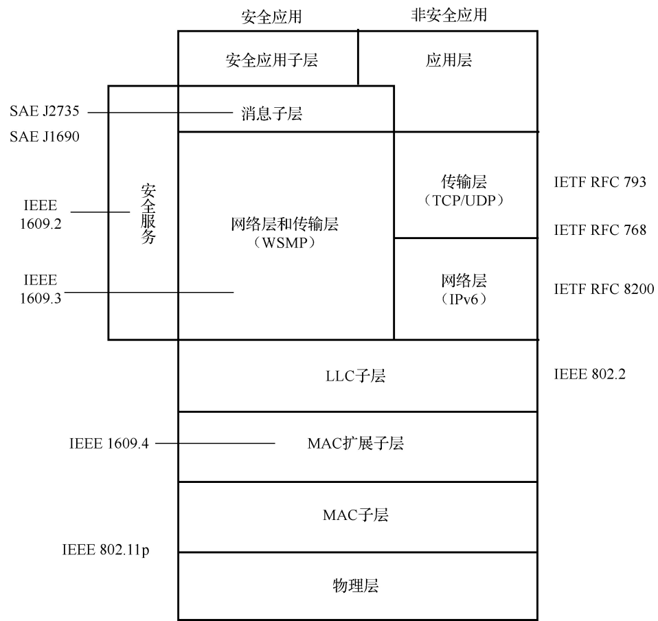
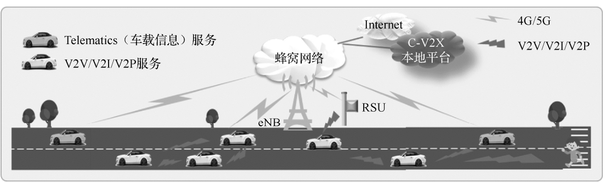
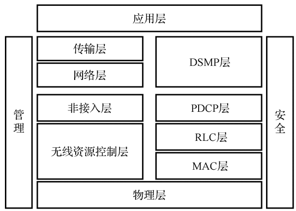
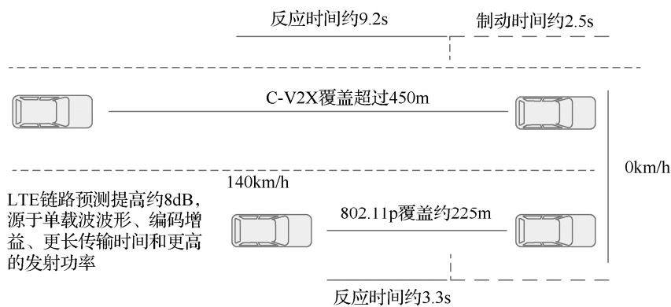

# 第2章 V2X通信技术分析

V2X 通信技术主要包括两种技术路线,一种是基于802.11p的DSRC通信技术,另一种是基于LTE-V2X和5G NR-V2X的C-V2X通信技术。本章将对这两种通信技术的通信网络架构、通信协议、通信频率等进行分析说明,读者可以了解这两种技术的特点和通信网络组成。

## 2.1 V2X车联网通信标准

### 2.1.1 DSRC 通信技术

从技术角度讲,DSRC 是一类短距离通信技术,是现代生活中不可或缺的专用短程通信技术,对短程(数十米的距离)中高速行驶的车辆进行识别和连接时是比较成熟、稳定的。例如,高速电子收费(electronic toll collection, ETC)专用通道就是实现车辆身份识别、电子扣费、不停车、免取卡和无人值守车辆的通道。

2002年,美国材料与试验协会(American Society for Testing and Materials, ASTM)通过了DSRC标准E2213-02,该标准于2003年9月作为ASTM E2213-03重新发布(现行标准是ASTM E2213-031 2018),在标准E2213-03的基础之上,IEEE 802.11p和IEEE 1609工作小组开始制定车载环境下的无线通信标准[1]。2006年,IEEE通过了IEEE 1609.1~1609.4系列标准。2010年7月,IEEE 802.11p标准正式发布,该标准是DSRC的物理层和MAC层标准,是针对ITS中的相关应用对IEEE 802.11标准的扩充延伸。2018年12月,IEEE 802.11p的演进版本IEEE 802.11bd开始标准化工作。其中,物理层关键技术尽可能重用IEEE 802.11ac 2013物理层技术,支持后向兼容IEEE 802.11p,支持10MHz和20MHz信道带宽,支持低密度奇偶校验(low density parity check,LDPC)和双载波调制(dual carrier modulation,DCM),支持训练序列(midamble)机制,支持MCS到256QAM,支持往返时间(round-trip time)测距等内容。MAC层关键技术包括支持新的物理层设计,支持后向兼容、与IEEE 802.11p共存,支持20MHz带宽信道接入性能提升和上层协议的接口等[2]。

基于IEEE802.11p技术改进的车联网无线接入层技术和标准主要包括物理层及MAC层的技术和标准。ETC指采用无线通信技术手段使得车道收费过程全自动化,当车辆通过收费口时,车载电子标签自动与安装在路侧或门架上的天线进行无线信息交互,并自动从用户账户扣除通行费。其中,ETC系统中车载电子标签与路侧收费设备之间的无线短距离通信也被认为是一种DSRC技术,但不同于IEEE 802.11p,这是一种低速率、低功耗的有源射频识别(radio frequency identification, RFID)通信技术$^{[3]}$。需要指出的是,V2X的V2I应用可以实现不停车收费,不需要单独的ETC。

DSRC 标准协议栈结构如图 2.1 所示。在 DSRC 协议栈中, IEEE 802.11p 协议定义了物理层(physical layer, PHY)和介质访问控制(medium access control, MAC)子层; IEEE 1609 系列标准定义了多信道操作、网络服务及各通信实体安全。由于 IEEE 802.11 系列标准仅支持低速移动场景,为支持车联网通信高速移动环境,IEEE 802.11p 协议基于 IEEE 802.11 系列标准进行了技术改进,制定了更严格的邻信道抑制指标,配合美国联邦通信委员会(Federal Communications Commission, FCC)的信道频谱规划,以 IEEE 802.11 补充协议的形式与 IEEE 802.11 协议一同发布。IEEE 802.11 中定义的基本业务集合(basic service set, BSS)适用于有接入点(access point, AP)的场景。在车联网高速移动的场景下,通过接入 AP 进行节点间通信可能导致通信连接持续时间短、通信不稳定。因此,IEEE 802.11p 的 MAC 子层采用增强分布式信道接入(enhanced distributed channel access, EDCA)支持差异化的服务质量(quality of service, QoS)需求,采用新的不属于 BSS 上下文(outside the context of a BSS, OCB)的通信模式,降低通信连接建立过程中的时延。IEEE 1609.4 在 MAC 子层之上定义了 MAC 扩展子层,支持多信道操作。

逻辑链路控制(logical link control, LLC)子层对IEEE 802.2协议进行了最小修改,其帧格式完全相同,可指示上层不同的传输类型。对于数据链路层之上的网络层和传输层,根据应用类型分类信息(安全应用和非安全应用),并提供两种传输方式。其中,IEEE1609.3定义了WAVE短消息(WAVE short message,WSM)和对应的WSM协议(WAVE short message protocol,WSMP)来支持DSRC安全应用的网络层和传输层的相关功能,并定义了WAVE服务通告(WAVE service advertisement,WSA)消息,用于通知给定地点的DSRC消息的可用性;非安全应用也可以使用WSMP,但主要通过传统的传输控制协议(transmission control protocol,TCP)/用户数据报协议(user datagram protocol,UDP)和IP栈进行传输。WSMP的协议头开销小,通常用于防碰撞的单跳消息;多跳消息可利用IPv6等路由功能实现[4]。

#  2.1.2 C-V2X通信技术

IEEE 802.11p可扩展性差以及无法很好地应对高速移动的车联网通信提出的挑战，与C-V2X相比，存在明显的性能差异和标准进展差异。最初，蜂窝车用无线通信技术中的LTE-V2X是基于4G蜂窝网络的V2X通信技术，就像是手机接入3G/4G网络一样。LTE-V2X针对车辆应用定义了两种通信方式：蜂窝通信方式(LTE-V-cell)——需要基站作为控制中心，以及直通通信方式(LTE-V-direct)——无须基站作为支撑，如图2.2所示。

蜂窝通信方式利用基站作为集中式的控制中心和数据信息转发中心,由基站完成集中式调度、拥塞控制和干扰协调等,可以显著提高 LTE-V2X 的接入和组网效率,保证业务的连续性和可靠性,主要用于道路事故/施工提醒、交通信号灯提醒、车速引导、动态地图等信息服务。直通通信方式利用车与车间的直接通信,针对道路安全服务的低时延及高可靠传输要求、节点高速运动、隐藏终端等挑战,进行了资源分配机制增强,用于车辆与周边车辆、路侧基础设施、行人等节点的

低时延、高可靠的通信，重点是满足前向碰撞预警、十字路口防碰撞预警、紧急车辆预警等行车安全类车联网应用需求。

目前，C-V2X的研究主要集中在LTE-V2X的应用和5G-V2X的研究上。5G网络能够在提供99.999%稳定性的同时实现小于1ms的通信时延，因此5G-V2X可以支持更多面向高度自动驾驶的车联网业务。3GPP针对C-V2X定义了车辆编队、传感器信息交互、先进驾驶和远程驾驶等业务场景，为将来实现更高级别的自动驾驶提供支撑。

C-V2X 标准协议栈架构如图 2.3 所示。在 C-V2X 协议栈中,数据以服务数据单元(service data unit, SDU)的形式来自上层,以协议数据单元(protocol data unit, PDU)的形式到达下层。专用短消息协议(dedicated short message protocol, DSMP)是为车路协同环境下专用短消息最优化操作专门设计的协议,主要用于在不同通信实体间传输数据。数据从一个通信实体发送,通过请求(request)分别经过应用层、网络层、数据链路层和物理层逐层完成数据的传递,数据在底层通过空中接口发送,到达接收端的接入层,在接收端实体再经过逐层传递,最终将数据传输到接收端的应用层,交付给各个应用。

分组数据汇聚协议(packet data convergence protocol, PDCP)实体用于维护编号和加密信息等。每个PDCP SDU被分配一个PDCP序列号并加密,以便使只有对等的PDCP实体才可以对其进行解码。PDCP的数据被发送到无线链路控制(radio link control, RLC)层。它被缓存在RLC传输缓冲区中,直到在MAC层的请求下以RLCPDU的形式发送。将一个流分配给节点上的一个PDCP和一个RLC实体,并同步发送端和接收端的PDCP/RLC实体。

RLC有 3种工作模式:透明模式(transparent mode, TM)、不确认模式(unacknowledged mode,UM)和确认模式(acknowledged mode,AM)。TM不执行任何操作,因此,RLC SDU与RLC PDU完全对应。UM在传输时对 PDU进行分割/连接,在接收时对 PDU进行重组、重复检测和重新排序。AM在此基础上增加了自动重复请求(automatic repeat request,ARQ)机制,以确保RLC PDU的可靠传输。

MAC层对来自不同流的RLC PDU进行调度和多路复用,并将它们封装为MAC传输块,通过物理层发送。物理层负责完成信道编码/解码、调制/解调、天线映射及其他典型的物理层功能。

在实际应用中,LTE-V-Cell技术可以为车辆提供高速数据的连续性传输,LTE-V-Direct技术可以实现车车之间的信息交互,避免车辆碰撞发生事故。车辆通过基站或路侧设备获得与远端 ITS服务器的IP地址接入;通过不同的基站或路侧设备时,通过云平台获得分发的远距离车辆的信息;车辆间直接交互与道路安全相关的低时延安全服务信息;当处于非视距场景时,车辆在十字路口由于建筑物的遮挡不能直接交互低时延安全业务,此时可以通过基站或路侧设备的转发来获得车辆间的道路安全信息。在上述场景中,可采用LTE-V-Cell模式和LTE-V-Direct模式进行通信。表2.1列出了LTE-V2X通信技术相关标准。

表 2.1 LTE-V2X 通信技术相关标准

| 分类 | 标准名称 | 标准等级 | 标准化组织 |
| --- | --- | --- | --- |
| 总体 | 《基于LTE的车联网无线通信技术 总体技术要求》(YD/T 3400—2018) | 行标 | CCSA |
| 应用层 | 《合作式智能运输系统专用短程通信 第3部分:网络层和应用层规范》(GB/T 31024.3—2019) | 国标 | CCSA 和 C-ITS |
| 应用层 | 《合作式智能运输系统 车用通信系统应用层及应用数据交互标准(第一阶段)》(T/CSAE 53—2020) | 团体标准 | SAE-China/C-ITS |
| 网络层 | 《合作式智能运输系统专用短程通信 第3部分:网络层和应用层规范》(GB/T 31024.3—2019) | 国标 | CCSA 和 C-ITS |
| 空口技术 | 《基于LTE的车联网无线通信技术空中接口技术要求》(YD/T 3340—2018) | 行标 | CCSA |
| 安全 | 《基于LTE的车联网通信安全技术要求》(YD/T 3594—2019) | 行标 | CCSA |

在可用性方面,DSRC通信技术具有不依赖网络基础设施(如具有安全性管理和互联网接入等功能)和自组的良好特性,所以基于DSRC标准的 V2X 网络稳定性强,不会因为传输瓶颈和单点故障的原因导致整个系统无法工作。虽然IEEE 802.11p有先发优势,有成熟的标准和良好的网络稳定性,但是C-V2X具有以下3个优点$^{[5]}$。

(1)远距离数据传输可达性更好。IEEE 802.11p网络采用多跳中继进行远距离数据传输,可能会受中继节点的影响,可靠性不高。LTE-V2X可利用LTE基站与云端服务器连接,进行如高清影音等类型数据的高速传输,具有更好的信息可达性。IEEE 802.11p与LTE-V2X通信距离对比如图2.4所示。

图2.4 IEEE 802.11p与LTE-V2X通信距离对比

(2)非视距传输可靠性更高。C-V2X可利用蜂窝基站转发的方式支持非视距场景,由于基站可高架、天线高度更高,因此可提高非视距场景的信息传输可靠性。C-V2X提供更安全的驾驶体验,可以延长驾驶员的反应时间,可以支持相对速度最高达500km/h的移动通信。

(3)网络建设和维护优势。尽管IEEE802.11p可利用现有的Wi-Fi基础进行产业布局，但是Wi-Fi接入点未达到蜂窝网络的广覆盖和高服务质量，不仅IEEE802.11p的新建路侧设备需要投入大量资金进行部署，IEEE 802.11p的V2X 通信安全相关设备、安全机制维护也需要新投入资金。C-V2X可以利用现有蜂窝通信网络中的基站设备和安全设备等进行升级扩展，支持车路通信和安全机制，可以利用已有蜂窝通信商用网络，支持安全证书的更新以及路侧设备的日常维护。

#  2.1.3 V2X车联网通信技术发展趋势

##  1.国外V2X车联网通信技术发展路线分析

美国早在2015年就推出了ITS的五年(2015—2019)规划[6]。规划主题为“改变社会前进方式”，技术目标是“实现网联汽车应用”和“加快自动驾驶”。该规

划定义了6个项目大类,包括加速部署(accelerating deployment)、网联汽车(connected vehicles)、自动驾驶(automation)、新兴能力(emerging capabilities)、互操作(interoperability)和企业数据(enterprise data)。其中,加速部署代表所有项目的最终目标,网联汽车、自动驾驶和新兴能力是技术发展的3条路径,互操作和企业数据是ITS发展的基石。

欧盟建立了C-ITS平台以在车联网的部署中发挥更加突出的作用。该平台是一个包括国家主管部门、C-ITS利益相关方和欧盟委员会在内的合作框架,以在欧盟范围内部署可互联互通的C-ITS达成共识。欧盟相关国家和道路运营管理机构为了协调部署和测试活动而建立了C-Roads平台,以共同制定和分享技术规范,并进行跨站点的互操作测试验证。

日本于2016年发布了高速公路自动驾驶和无人驾驶的实施路线报告书，于2020年在部分地区实现了自动驾驶功能。日本内务和通信部组建研究组推进车联网发展，日本汽车工业协会定义了车联网的潜在用例，日本跨部委战略创新促进计划（cross-ministerial strategic innovation promotion promotion program，SIP）在评估无线接入技术实现车联网用例的有效性，且日本已经进行了多个车联网联合测试。

自2014年下半年起，韩国开始在全国多个地区部署智能交通试点。韩国规划于2040年之前实现基于连接路与一切交通功能实体(connection of road to everything, CoRE)的智能交通，目前短期阶段重点实现交通事故多发地段的智能交通功能，部署智能道路交通试点，实现交通事故100%现场处理，将交通事故伤亡降低50%。

在V2X研究前期,美国、欧洲等国家/地区在DSRC技术方面进行了大量的研究及应用测试,积累了丰富的经验。但DSRC技术存在很多局限性,很难成为V2X技术的发展趋势。现如今,国内外主要倾向于发展与5G技术兼容性较好的5G NR-V2X和LTE-V2X这两项技术。

国际社会的顶层设计规划呈现三大特点:一是将V2X及相关产业视为战略性新兴产业,在国家层面开展顶层设计;二是强调V2X等新一代信息技术与传统汽车、交通、智慧城市等的融合创新发展;三是强制立法对部分重点领域大力推动和强力引领。国际社会通过开展V2X技术试验和应用示范拥有了大量的数据集,这些数据集一方面可以用于V2X技术通信性能和应用功能有效性的分析,另一方面可以进行与汽车、交通、智慧城市的应用融合示范和协同发展研究。目前,C-V2X通信技术已经写入3GPP标准,国际社会普遍倾向采用C-V2X车联网技术,这也为我国推进C-V2X发展,实现技术创新和产业发展的赶超提供了契机。

随着V2X车联网技术的演进和不断发展成熟，一方面，V2X车联网与智能网联汽车的结合能有效地提高交通系统的感知能力、信息双向交互能力；另一方面，C-V2X能提升智能网联汽车的感知、控制能力，推进辅助和自动驾驶车辆的

市场化进程。目前，C-V2X正在从信息服务业务向安全出行和交通效率业务发展，并逐步向支持实现自动驾驶的协同服务业务演进，而业务的推进进程取决于RSU的覆盖率。

随着LTE-V2X技术向5G-V2X的演进,可以提供超低时延(1ms)、超高传输速率、更多用户支持、更加丰富的应用场景及业务种类,这使得LTE-V2X正逐步取代并超越DSRC。

5G技术的发展将加快汽车智能化、网联化的发展，随着边缘计算、网络功能虚拟化、软件定义网络和网络切片等5G新兴技术的不断发展完善，未来车联网体系结构将会更加灵活，未来差异化性能指标带来的技术需求难题也将不断被攻克。

#  2. 我国 V2X 车联网通信技术发展状况

我国是全球最大的汽车生产国和销售国，且汽车行业正处在向新能源、智能网联和自动驾驶等转型升级的关键机遇期，未来汽车将是5G终端的最大用户。我国车企正处在“变道超车”的产业升级与变革机遇期，汽车工业经过多年与跨国公司的合资，已培育了相对完整的本土汽车产业供应链。大唐、华为等企业在车联网技术标准、样机开发、产业合作、应用示范等方面已取得主导地位和领先优势。与自动驾驶技术中常用的摄像头或激光雷达相比，V2X拥有更广的使用范围，能突破视觉死角和跨越遮挡物获取信息，同时可以和其他车辆及设施共享实时驾驶状态信息，并通过研判算法产生预测信息。另外，V2X是唯一不受天气状况影响的车用传感技术，无论雨、雾或强光照射都不会影响其正常工作。

C-V2X业务随着车路协同以及5G的逐步成熟向着更加安全、协同、智能、绿色的方向演进,是汽车、交通、通信、IT与互联网产业跨行业协同的重要发展方向。C-V2X车联网不断增强的广度和深度覆盖引入了更广泛的交通参与者和更复杂的驾驶工况,如"弱势交通参与者"的深入研究;而结合人工智能和机器学习、高精度定位等技术,配合高级自动驾驶和道路智能化的发展,加强了远程遥控驾驶、特殊工况无人驾驶等新业务的研究。可以预见,随着C-V2X车联网及C-V2X网联协同智能在C-V2X业务中发挥越来越重要的作用,其功能安全将面临巨大的挑战。

与此同时,为推动 C-V2X 业务和产业落地,政府及 C-V2X 车联网相关产业各方联合起来共同推动产业协同,在技术、法规、政策、商业模式等方面,结合 C-V2X 和 5G 商用,加快国内 C-V2X 车联网的发展。

(1)加强标准制定，促进产品研发。加快对增强业务场景的细分场景、主要技术要求、应用层数据交互需求的研究，加强相关标准制定工作，促进新业务与测试场景库的协作，促进相关产品研发，指导相关基础设施建设。

(2)加强安全保障，促进持续发展。智能网联汽车、智能交通、智慧城市等

相关行业在关注业务演进的同时,也注重新业务对通信安全、信息安全、功能安全等方面的新要求,完善安全防护能力,加强数据安全管理与身份可信认证。

(3)加强统筹协调，促进行业发展。为加快车联网应用推进路线图的制定，找准应用落地切入点与发展路径，中央各部委与各级政府制定了相关政策法规，分步实施，明确了各阶段优先实施的典型业务需求，促进了行业协调有序发展。

综上所述,随着我国5G与C-V2X技术的发展、基础设施的建设以及北斗导航系统组网成功,我国车联网技术的发展与应用日渐加快,相关部门建立了健全的法律法规,为车联网技术的发展保驾护航,使我国具备支撑汽车行业跨越性发展的能力。

#  3. C-V2X通信技术演进进程

面对车联网应用在通信时延、可靠性和数据速率等方面的更高需求,3GPP、欧洲电信标准组织(European Telecommunications Standards Institute, ETSI)、国际标准化组织(International Organization for Standardization, ISO)等国际标准化组织积极开展标准化工作。3GPP为车辆通信的增强进行了标准研究和开发。3GPP V2X标准化进展如图2.5所示。

图2.5 3GPP V2X 标准化进展

C-V2X技术在3GPP的标准化发展可以分为3个阶段[7]。第一个阶段,3GPP 14基于LTE-V2X标准化工作于2017年3月完成,面向基本的道路安全业务的通信需求,引入了工作在5.9GHz频段的直通链路(PC5接口)通信方式,并对公众移动蜂窝网的Uu接口进行了优化。第二个阶段,3GPP R15对LTE-V2X的增强标准化工作于2018年6月完成,主要是在PC5接口引入了载波聚合、高阶调制等技术以提升数据速率,并引入可降低时延的部分技术。3GPP R15的5G标准重点针对增强移动宽带场景,没有对V2X业务进行针对性设计和优化。第三个阶

段,支持5G-V2X的3GPP R16+版本标准于2018年6月启动研究,在2020年7月冻结,与LTE-V2X/LTE-eV2X形成互补关系。

(1) LTE-V2X 标准进展: 3GPP 已经完成对 R14 LTE-V2X 相关标准化工作, 主要包括业务需求、系统架构、空中接口技术和安全研究 4 个方面。在业务需求方面, 目前已经定义了包含车与车、车与路、车与人以及车与云平台的 27 个用例和 LTE-V2X 支持的业务要求, 并给出了 7 种典型场景的性能要求。在系统架构方面, 目前已经确定了在 PC5 接口的邻近服务 (proximity services, prose) 和 Uu 接口的 LTE 蜂窝通信的架构基础上增强支持 V2X 业务, 并明确增强架构至少要支持采用 PC5 接口传输的 V2X 业务和采用 Uu 接口传输的 V2X 业务。在空中接口技术方面, 目前已经明确了 PC5 接口的信道结构、同步过程、资源分配、同载波和相邻载波间的 PC5 和 Uu 接口共存、无线资源控制 (radio resource control, RRC) 信令和相关的射频指标及性能要求等, 并研究了如何通过增强 Uu 接口传输与 PC5 接口传输来支持基于 LTE-V2X 的业务。在安全方面, 目前已经完成了支持 V2X 业务的 LTE 架构增强的安全方面的研究。

(2) LTE-eV2X标准进展:LTE-eV2X是指支持V2X高级业务场景的增强型技术研究阶段(R15)。目标是在保持与R14后向兼容性的前提下,进一步提升V2X直通模式的可靠性、数据速率和时延性能,以部分满足V2X高级业务需求。标准TS 22.886中已经定义了25个用例共计五大类增强的V2X业务需求,包括基本需求、车辆编队行驶、半/全自动驾驶、传感器信息交互和远程驾驶。目前,正在进行的“3GPP V2X第二阶段标准研究”主要包括载波聚合、发送分集、高阶调制、资源池共享及减少时延、缩短传输时间间隔(transmission time interval,TTI)的可行性及增益等技术。

(3) 5G-V2X标准进展:该阶段是指基于5G NR的技术研究阶段(R16+),用于支持V2X的高级业务场景。5G-V2X与LTE-V2X在业务能力上体现了差异化,在5G-V2X支持更先进业务能力的同时,结合LTE能力,考虑对LTE-V2X进行增强。

主要标准化内容如下:基于PC5和Uu接口支持高级V2X业务;对PC5接口支持单播、组播和广播3种模式,以提供支撑不同业务的能力;NR-V2X支持覆盖范围内(in-coverage),部分覆盖(partial-coverage)和覆盖范围外(out-of-coverage)通信;NR-V2X基于通用的架构支持直通链路在中低频和毫米波频段工作;支持LTE-V2X和NR-V2X共存。此外,Uu接口网络引入了V2X通信切片、多接入边缘计算(multi-access edge computing,MEC)、服务质量(QoS)预测等特性,以满足车联网低时延、高可靠性、大带宽等需求。为满足车联网计算处理能力和跨服务平台互联互通等方面的需求,ETSI针对多接入MEC技术的服务场景、参考架构等开展了一系列标准化工作,2017年立项了“App 移动性

API 规范”“MEC对 V2X 支持研究”等项目;2018年启动了“V2X API 规范”项目,开展支持 V2X 的 MEC API 定义。

3GPP也将支持MEC功能作为5G网络架构设计的重要参考，3GPP SA1在2016年开启MEC平台需求研究，随后SA2、SA5分别从5G网络架构与MEC融合、MEC平台管理等角度启动研究。3GPP TS 23.501①中已经明确将支持边缘计算功能作为未来5G网络架构设计的重要参考。此外，LTE-V2X车联网技术与标准于2019年8月正式由ISO发布，标志着C-V2X技术纳入ISO定义的智能交通通信框，从而支持各设备之间基于C-V2X技术实现即时通信。

国内各行业协会和标准化组织高度重视我国C-V2X标准的推进工作,包括中国通信标准化协会(China Communications Standards Association, CCSA)、全国智能运输系统标准化技术委员会、中国智能交通产业联盟、车载信息服务产业应用联盟、中国汽车工程学会及中国智能网联汽车产业创新联盟等都已积极开展C-V2X相关研究及标准化工作,初步形成了覆盖C-V2X标准协议栈各层次、各层面的标准体系。

全国汽车标准化技术委员会、全国智能运输系统标准化技术委员会、全国通信标准化技术委员会和全国道路交通管理标准化技术委员会共同签署了《关于加强汽车、智能交通、通信及交通管理 C-V2X 标准合作的框架协议》，四方将建立高效顺畅的沟通交流机制，相互支持和参与标准研究制定，共同推动 C-V2X 等新一代信息通信技术在汽车、智能交通及交通管理中的应用。在各方的积极合作下，我国 C-V2X 标准化工作取得显著进展。一是核心技术和设备标准修订基本完成。CCSA 基本完成了 C-V2X 总体架构、空中接口、通信安全、网络层、消息层等技术标准和测试规范的制定，以及车载、路侧、基站、核心网等设备技术要求和测试方法等基础标准的制定，如表 2.2 所示。二是行业应用类标准随产业发展持续完善。全国汽车标准化技术委员会在智能网联汽车分技术委员会下设“网联功能及应用标准工作组”，推动 C-V2X 标准向汽车商用方向延伸，完成“智能网联汽车通信需求分析”研究。另外，交通运输和管理行业也在考虑相关技术及应用标准的制定。总体来看，行业应用类标准将在产业整个周期内长期、持续开展，支持商用的系统要求和应用标准还亟待制定。

表 2.2 CCSA C-V2X 核心技术标准

| 标准分类 | 标准名称 |
| --- | --- |
| 接入层协议 | 《基于LTE的车联网无线通信技术 总体技术要求》(YD/T 3400—2018) |
| 接入层协议 | 《基于LTE的车联网无线通信技术空中接口技术要求》(YD/T 3340—2018) |

续表

| 标准分类 | 标准名称 |
| --- | --- |
| 网络层协议 | 《基于LTE的车联网无线通信技术网络层技术要求》(YD/T 3707—2020) |
| 网络层协议 | 《基于LTE的车联网无线通信技术网络层测试方法》(YD/T 3708—2020) |
| 消息层协议 | 《基于LTE的车联网无线通信技术消息层技术要求》(YD/T 3709—2020) |
| 消息层协议 | 《基于LTE的车联网无线通信技术消息层测试方法》(YD/T 3710—2020) |
| 通信安全 | 《基于LTE的车联网通信安全技术要求》(YD/T 3594—2019) |
| 通信安全 | 《基于LTE的车联网无线通信技术安全证书管理系统技术要求》(YD/T 3957—2021) |
| 系统(平台) | 《面向LTE-V2X的多接入边缘计算总体需求和业务架构》(YD/T 4358—2023) |
| 系统(平台) | 《面向C-V2X的多接入边缘计算服务能力开放和接口技术要求(第一阶段)》(YD/T 4359—2023) |
| 系统(平台) | 《基于LTE的车联网无线通信技术MEC平台测试方法》(YD/T 4477—2023) |
| 设备 | 《基于LTE的车联网无线通信技术支持直连通信的车载终端设备技术要求》(YD/T 3756—2024) |
| 设备 | 《基于LTE的车联网无线通信技术支持直连通信的车载终端设备测试方法》(YD/T 3848—2021) |
| 设备 | 《基于LTE的车联网无线通信技术支持直连通信的路侧设备技术要求》(YD/T 3755—2020) |
| 设备 | 《基于LTE的车联网无线通信技术支持直连通信的路侧设备测试方法》(YD/T 3847—2021) |
| 设备 | 《基于LTE的车联网无线通信技术基站设备技术要求》(YD/T 3592—2019) |
| 设备 | 《基于LTE的车联网无线通信技术基站设备测试方法》(YD/T 3629—2020) |
| 设备 | 《基于LTE的车联网无线通信技术核心网设备技术要求》(YD/T 3593—2019) |
| 设备 | 《基于LTE的车联网无线通信技术核心网设备测试方法》(YD/T 3847—2021) |

国内各标准组织的相关标准化工作已支持形成我国C-V2X标准体系,包括应用定义及需求、总体技术要求、关键技术、信息安全等多个方面。但是,大部分标准是分散在不同的团体组织或行业标准化委员会内来开展研究制定的,仍然需要相互之间的统筹协同,以推进形成体系完整的统一国家标准。

#  2.1.4 V2X 通信频率分配

2002年,欧盟委托欧洲电子通信委员会(Electronic Communications Committee, ECC)将 5.795~5.805GHz 分配给初始的车-路系统,各国可以将该频段扩展至 5.815GHz。2008年,ECC为安全类相关的ITS应用分配了30MHz带宽(5875~5905MHz频段),并建议将 5.905~5.925GHz 频段作为安全类相关的ITS应用的扩展频段。另外,ECC建议为非安全类相关的ITS应用分配20MHz带宽(5855~5875MHz频段)。除了 5.9GHz频段外,63~64GHz频段(1GHz带宽)也被分配

给 ITS 应用以应对高级 ITS 应用对容量的需求,但由于传播特性差,迄今为止还没有技术或系统使用该频段。ITS-G5 标准可采用 5470~5725MHz 免许可频段,与无线接入系统共享频谱。欧洲车联网通信标准由欧洲电信标准组织(ETSI)制定,包括地理位置路由协议和用于支持在 5.9GHz 频段进行车与车通信的接入层协议,即 ITS-G5。ITS-G5 包括物理层和数据链路层。数据链路层分为两个子层:MAC 子层和 LLC 子层。物理层和 MAC 子层基于 IEEE 802.11p 演进而来,LLC 子层基于 IEEE 802.2 演进而来。ITS-G5 还引入了分散式拥塞控制以避免网络过载。

在频率分配方面,美国联邦通信委员会于1999年率先为基于IEEE 802.11p的ITS业务在5.9GHz频段划分了5.850~5.925GHz,带宽共计75MHz,共7个信道(每个信道10MHz)。其中,172号信道(5855~5865MHz)被指定为提供安全应用的车与车通信专用信道,178号信道(5885~5895MHz)为控制信道。FCC还考虑在176号信道上开展一些提供V2P应用及其他业务的试验。

日本在20世纪90年代末将5770~5850MHz划分为DSRC信道,主要用于车辆信息和通信系统、电子通信系统应用。2012年2月,日本无线工业及商贸联合会发布的规范《700MHz频段智能交通系统》(ARIB STD-T109)中将755.5~764.5MHz频段划分给ITS的道路安全应用,带宽为9MHz,中心频率为760MHz。目前,5800MHz频段中除了ETC/占用的频谱外,仍存在潜在频谱供更多的ITS技术使用,如C-V2X。

2018年10月,工业和信息化部为支持我国智能网联汽车产业发展,印发了《车联网(智能网联汽车)直连通信使用5905-5925MHz频段管理规定(暂行)》,规划了共20MHz带宽的专用频率资源,用于基于LTE演进形成的V2X智能网联汽车的直连通信技术,同时,对相关频率、台站、设备、干扰协调的管理作出了规定。

#  2.2 C-V2X通信网络架构

##  2.2.1 C-V2X 网络系统结构

C-V2X通信网络业务涉及云端、路侧端和车载端3个部分。其中,云端与第三方业务应用的信息中心为路侧端和车载端发送全局的业务控制、业务共享信息,并存储全局设施、环境、用户、业务信息;路侧端与路侧信号控制器或者边缘服务器相连,收集驾驶、交通环境状态信息,进行路侧决策并发送路侧业务控制到车载端;车载端收集路侧控制信息、全局信息、周边环境信息以进行动态感知及实时决策。

C-V2X系统架构如图2.6所示。

图2.6 C-V2X系统架构$^{[8]}$

SPAT: signal phase and timing message,信号灯消息;BSM: basic safety message，基本安全消息。

LTE-V2X是第一种蜂窝车联网(C-V2X)无线通信技术,定义了蜂窝通信方式和直连通信方式有机结合的系统架构及控制方式、物理层信道结构、资源分配方法和同步机制等关键技术,即确立了C-V2X的基本系统架构和技术原理。C-V2X的系统架构原理包括蜂窝通信方式、直连通信方式及其对应的Uu接口、PC5接口,如图2.7所示。

C-V2X技术在3GPP的标准化分为两个阶段,包括LTE-V2X和NR-V2X,二者互相补充,标准设计充分考虑了后向兼容性和前向兼容性。

(1) LTE-V2X: 3GPP R14 完成基于LTE-V2X 的标准化工作,在蜂窝通信中引入支持V2X短距直连通信的PC5接口,支持面向基本道路安全业务的通信需求,主要实现辅助驾驶和中低速自动驾驶功能。3GPP R15是对LTE-V2X的增强,支持部分车联网增强应用需求。

(2)NR-V2X:3GPP R16为支持高级V2X业务需求,研究基于5GNR的PC5接口和Uu接口的增强,已于2020年6月冻结$^{①}$,3GPP R17 NR-V2X标准化工作于2022年6月冻结。

图2.7 C-V2X 的系统架构原理

#  2.2.2 LTE-V2X 网络架构

基于PC5和LTE Uu的V2X架构参考模型[9]如图2.8所示。

参考点定义如下。

V1: V2X应用程序和 V2X应用程序服务器之间的参考点。

V2: V2X 应用程序服务器和操作员网络中 V2X 控制函数之间的参考点。V2X 应用程序服务器可以连接到属于多个公共陆地移动网(public land mobile network, PLMN)的 V2X 控制函数。

V3:启用V2X的用户设备(user equipment, UE)与运营商网络中的V2X控制函数之间的参考点。其基于TS 23.303第5.2条中定义的PC3参考点的服务授权和供应部分,适用于基于PC5的V2X和可选的基于Uu的V2X。

V4: 操作员网络中 HSS 和 V2X 控制函数之间的参考点。

V5: V2X应用程序之间的参考点。

V6: V2X 控制函数之间的参考点。

图2.8基于PC5和LTE Uu的V2X架构参考模型

LTE Uu:启用 V2X的用户设备(UE)和演讲的通用移动通信系统(universal mobile telecommunications system, UMTS)陆地无线接入网(evolved UMTS terrestrial radio access network, E-UTRAN)之间的参考点。

PC5: V2V、V2I和V2P服务的支持V2X的UE之间的参考点。

#  2.2.3 NR-V2X 网络架构

由 NR-V2X 的工作场景可知, NR-V2X 既可以工作在 5G 网络覆盖范围内, 又可以工作在 4G 网络覆盖范围内。NR-V2X 网络架构设计要能够灵活支持上述两种覆盖情况,具体参见 3GPP 标准 TS 23.287[10]。NR-V2X 参考网络架构如图 2.9 所示,相应参考接口的说明如表 2.3 所示。

在NR-V2X参考网络架构中,主要功能实体如下。

(1) V2X应用服务器:位于蜂窝网之外的V2X管理实体,提供对全局V2X通信(包括PC5及Uu)的策略和参数的管理功能,以及对V2X终端的签约信息和鉴权信息的管理功能。

(2)5G核心网:与V2X应用服务器连接,为蜂窝覆盖内的V2X终端提供对

V2X 通信的策略、参数配置及签约信息、鉴权信息的管理功能。与4G核心网不同,5G核心网采用服务化架构,各个网络功能可以独立演进和扩展,3GPP在NR-V2X 中将4G核心网中的V2X控制功能实体(V2X control function, VCF)放在5G核心网的策略控制功能(policy control function, PCF)中。相应的,对5G核心网的功能实体进行了扩展。

①统一数据存储库(unified data repository, UDR)功能扩展,用于存储 V2X通信所有参数配置的数据库,可以根据 V2X应用服务器的数据进行更新。

②统一数据管理(unified data management, UDM)功能扩展,用于V2X终端PC5接口通信的签约信息管理。

③策略控制功能扩展,用于V2X终端的鉴权信息管理,以及V2X通信(PC5和Uu)的策略和参数管理,其中,PCF通过UDR实现参数更新。

④接入和移动性管理功能扩展。一方面,根据PCF提供的V2X配置信息给终端提供PC5接口通信的策略和参数配置信息;另一方面,根据PCF和UDM提供的信息,管理终端PC5接口签约和授权状态的上下文信息。

⑤网络存储库功能(network repository function, NRF)扩展,主要根据V2X终端能力上报的信息,选择和发现对应的PCF配置。

(3) 4G核心网:与V2X应用服务器连接,通过VCF实体为蜂窝覆盖范围内的V2X终端提供V2X通信的策略和参数配置,以及签约信息和鉴权信息的管理。

(4) V2X终端:根据获取的V2X通信(PC5和Uu)的策略和参数配置信息,在PC5或者Uu接口上进行V2X通信。

图2.9 NR-V2X 参考网络架构

表2.3 NR-V2X 相应参考接口的说明

| 参考接口 | 说明 |
| --- | --- |
| V1 | 终端 V2X 应用与 V2X 应用服务器之间的参考接口 |
| V3 | 在 4G 网络中, 终端 V2X 应用与 V2X 控制功能实体 (VCF) 之间的参考接口 |
| V5 | 不同终端 V2X 应用之间的参考接口 |
| N1 | 在 5G 网络中, 从接入和移动性管理功能 (access and mobility management function, AMF) 到 V2X 终端之间的参考接口 |

NR-V2X终端的授权、策略和参数配置过程参见3GPP标准TS 23.287,当终端位于蜂窝网络覆盖范围内时,相应的授权和参数配置都是通过网络进行的。当终端位于蜂窝网络覆盖范围外时,只有当终端明确知道自己的地理位置信息时,才可以根据鉴权信息进行直通链路通信。NR-V2X的策略和参数配置信息中包括PC5无线接入技术(LTE-V2X PC5或NR-V2X PC5)选择策略的配置,不同V2X应用可以配置不同的PC5无线接入技术,从而实现LTE-V2X和NR-V2X的互补关系,而不是替代或者竞争关系。同时,在NR-V2X的策略和参数配置信息中,还包括V2X广播、多播和单播通信类型管理配置,以及PC5接口基于QoS流的参数配置。

V2X 终端获取 V2X 通信的鉴权、签约、策略配置和参数配置等信息的途径主要有以下4种,按照优先级从高到低排序,高优先级的信息可替代低优先级的信息。

①通过PCF获取的V2X配置信息(N1参考接口)。

②通过V2X应用服务器获取的V2X配置信息(V1参考接口)。

③通过全球用户身份卡(universal subscriber identity module,USIM)中存储的信息获取V2X配置信息。

④通过设备内预配置的信息获取V2X配置信息。

#  2.3 C-V2X PC5 通信技术

##  2.3.1 PC5 通信简介

C-V2X在PC5接口上的机制设计以LTE-D2D技术为基础,为支持V2X消息(特别是车辆之间的消息)广播、交换快速变化的动态信息(如位置、速度、行驶方向等),以及包括车辆编队行驶、传感器共享在内的未来更先进的自动驾驶应用,在以下方面进行了增强设计。

#  1.增强物理层结构，以便支持更高的速度

为了在高频段下支持高达500km/h的相对移动速度，解决高多普勒频率扩展以及信道快速时变问题，C-V2X对物理层结构进行了增强。

#  2. 支持全球卫星导航系统同步

为了保证通信性能,C-V2X的接收机和发射机需要在通信过程中保持相互同步。C-V2X支持包括全球导航卫星系统(global navigation satellite system, GNSS)、基站和车辆在内的多种同步源类型,通信终端可通过网络控制或调取预配置信息等方式获得最优同步源,以尽可能实现全网同步。C-V2X还支持最优同源的动态维护,使得终端可及时选取优先级更高的同步源进行时钟同步。

#  3.更加高效的资源分配机制及拥塞控制机制

作为C-V2X的关键核心技术,PC5接口支持调度式的资源分配方式(Mode-3)和终端自主式的资源分配方式(Mode-4)。此外,C-V2X还支持集中式和分布式相结合的拥塞控制机制,这种机制可以显著提升高密度场景下接入系统的用户数。

#  2.3.2 NR-V2X PC5 协议栈和信道映射关系

NR-V2X PC5 协议栈复用了 NR Uu 协议栈设计[11]。图 2.10 给出了 NR-V2X PC5 接口的用户面协议栈结构,用于承载 V2X 应用数据。

(1) V2X应用层:实现 V2X应用层信息的交互,进行 V2X应用消息的解析和组包。

(2) V2X网络层:支持IP/非IP传输方式。对于非IP传输,定义了V2X消息家族(V2X message family)字段,从而支持全球不同区域的V2X协议栈。对于IP传输,只支持IPv6,不支持IPv4。

(3)业务数据适配协议(service data adaptation protocol, SDAP)层:实现V2X业务的PC5 QoS流到直通链路无线承载的映射。

(4) PDCP层:复用现有Uu接口设计，实现V2X数据包或者信令的包头压缩、加密和完整性保护。

(5) RLC层:复用现有Uu接口设计，实现数据的分段和重传功能。

(6) MAC层:复用现有Uu接口设计,除了实现逻辑信道复用、混合自动重传请求和调度等相关功能外,还新增了PC5资源选择、数据包过滤、上行传输和直通链路传输之间的优先级处理以及直通链路的信道状态信息(channel state information, CSI)上报功能。

图2.10 NR-V2X PC5接口的用户面协议栈结构

(7) PHY 层: 负责直通链路物理信道的处理, 物理层以传输信道形式为 MAC 层提供服务。图 2.11 给出了 NR-V2X PC5 控制面协议栈结构, 其中包括非接入层 (non-access stratum, NAS) PC5 信令协议栈(PC5 signaling protocol stack, PC5-S) 和接入层 PC5 控制面协议栈(PC5 control plane protocol stack, PC5-C)。PC5-S 用于非接入层信令交互, 主要用于 PC5 单播的管理和控制。PC5-C 用于接入层的 RRC 层交互, 且 NR-V2X PC5 控制面的协议栈仅用于单播通信。NR-V2X PC5 接口中对 RRC 层进行了大量简化, 仅提供 V2X 终端之间的 PC5-RRC 信令交互、PC5-RRC 连接维护和释放、PC5-RRC 连接无线链路的失败检测等功能。

接入网维护的直通链路的无线承载分为两种——用于用户面数据传输的直通链路数据无线承载(sidelink data radio bearer, SL-DRB)、用于控制面传输的直通链路信令无线承载(sidelink signaling radio bearer, SL-SRB)。

PC5-S 协议栈用于 V2X 应用层触发的单播连接建立过程,在完成单播连接建立过程之后,PC5-C 通过 PC5-S 建立的单播通信 SL-SRB 进行 V2X 终端之间的RRC 层能力和参数配置交互。

NR-V2X PC5接口中逻辑信道、传输信道和物理信道之间的映射关系如图2.12所示。

(1)逻辑信道包括以下几种。

①直通链路广播控制信道(sidelink broadcast control channel, SBCCH),用于承载直通链路系统广播信息。

图2.11 NR-V2X PC5 控制面协议栈结构[11]

图2.12 NR-V2X PC5接口中逻辑信道、传输信道和物理信道之间的映射关系

② 直通链路控制信道(sidelink control channel, SCCH),用于承载终端之间的直通链路的高层控制信息。

③直通链路业务信道(sidelink traffic channel, STCH),用于承载终端之间的直通链路数据信息。

(2)传输信道包括以下几种。

①直通链路广播信道(sidelink broadcast channel, SL-BCH),用于承载SBCCH映射的内容。

②直通链路共享信道(sidelink shared channel, SL-SCH),是 V2X终端之间的主要传输信道,用于承载 SCCH和 STCH映射的内容。

(3)物理信道包括以下几种。

①物理直通链路广播信道(physical sidelink broadcast channel, PSBCH),承载SL-BCH信息,用于直通链路主系统信息块的传输(sidelink master information block, SL-MIB)。

②物理直通链路共享信道(physical sidelink shared channel, PSSCH),承载SL-SCH,用于业务数据传输和高层信令的传输。

③物理直通链路控制信道(physical sidelink control channel, PSCCH),承载物理层直通链路控制信息(sidelink control information, SCI),用于指示 PSSCH 的传输。

④物理直通链路反馈信道(physical sidelink feedback channel, PSFCH),承载物理层的直通链路的ACK/NACK信息。

#  2.3.3 NR-V2X PC5 广播管理

NR-V2X PC5 广播通信过程如图 2.13所示。V2X发送终端根据当前广播通信的V2X应用的业务标识及配置策略,确定对应的PC5链路的标识信息。

(1)二层的目标标识由广播通信模式下配置的V2X业务标识与二层目标标识的配置策略确定。

图2.13 NR-V2X PC5广播通信过程

(2)二层的源标识由V2X发送终端确定。根据当前自身签约的广播V2X业务集合,V2X接收终端确定需要监听的二层目标标识集合,在接入层根据确定的二层目标标识接收相应的V2X业务数据。

#  2.3.4 NR-V2X PC5 多播管理

在NR-V2X PC5多播通信中,有两种多播通信的类型,如图2.14所示,具体如下。

(1)面向连接的多播通信:面向连接是指发送终端有确定的目标接收终端组,即组播模式,需要明确知道哪些车辆是组内成员。组播通信仅在基于NR的PC5参考点上被支持,适用于所有类型的组,即应用层无连接组和应用层管理组。其中,对于应用层管理组,如果V2X应用层提供了组大小和成员ID,则V2X层将它们传递给AS层以进行组播控制。在这种类型中,由V2X应用层管理组标识的分配及组内成员的标识。其典型的应用场景是车辆编队行驶。

图2.14 NR-V2X PC5 多播通信的两种类型

(2)无连接的多播通信:V2X应用层没有明确的组管理机制,是一种基于距离的动态多播通信,V2X应用层不知道具体参与多播的成员信息。在无连接的多播通信中需要有通信距离参数。

NR-V2X PC5 多播通信过程如图2.15所示。在多播通信中，V2X发送终端确定二层目标标识的方式与广播情况下略有不同。其中，在面向连接的多播通信中，V2X应分配明确的组标识信息，二层的目标标识根据组标识信息获得；在无连接的多播通信中，二层的目标标识根据多播通信模式下配置的V2X业务标识与二层目标标识的配置策略来确定，这种方式与广播模式下的二层目标标识确定的方法是一致的，都由V2X发送终端确定。V2X接收终端根据当前自身PC5多播签约信息，确定支持的面向连接的多播通信标识，以及无连接的多播通信的二层目标标识集合，进行相应的V2X业务的接收。

图2.15 NR-V2X PC5 多播通信过程[10]

#  2.3.5 NR-V2X PC5 单播管理

仅在基于NR-V2X的PC5参考点上支持单播通信模式。NR-V2X PC5单播通信同样通过二层源标识和目标标识管理PC5单播链路。PC5单播连接建立过程包括单播链路连接建立、链路更新和链路释放。NR-V2X PC5单播连接建立过程如图2.16所示,其中,终端1为PC5连接建立的源用户,终端2为目标用户。PC5单播连接建立过程如下。

(1)在配置策略中配置了用于进行PC5单播连接建立的默认二层目标标识信息,此默认二层目标标识信息用于PC5单播连接建立的发起和信令交互。

(2)PC5单播通信的两个用户之间通过连接建立过程交互各自的二层源标识信息,形成各自的单播通信二层源标识和二层目标标识信息,具体过程如下。

①PC5连接的发起方,即源用户(终端1),通过PC5广播的方式发送直通链路单播通信请求消息,消息中包括终端1的V2X应用层标识信息和二层标识信息,以及可选的包含目标用户的标识信息。当直通链路单播通信请求中包含目标终端的标识信息时,为面向用户的单播连接建立过程;否则为面向V2X业务的单播连接建立过程,即对该业务感兴趣的用户会响应当前的单播连接建立请求。

图2.16 NR-V2X PC5 单播连接建立过程

②接收用户(终端2)根据默认的用于PC5-S信令交互的二层目标标识信息,检测直通链路单播通信请求。当终端1发送的直通链路单播通信请求中包含目标终端的标识信息,且目标终端的标识信息为终端2时,终端2反馈直通链路单播通信接收消息。当终端1发送的直通链路单播通信请求中不包含目标终端的标识信息时,对终端1发送的V2X业务感兴趣的其他终端会反馈直通链路单播通信接收消息。直通链路单播通信接受消息中包括终端2的V2X应用层标识信息和二层源标识信息。

(3)通过PC5单播通信的连接建立过程,终端1的二层目标标识信息为终端2的二层源标识信息,相应的,终端2的二层目标标识信息为终端1的二层源标识信息。

(4)在完成PC5-S层的直通链路单播连接建立过程之后，PC5-RRC层通过PC5-S建立的单播通信的SL-SRB进行V2X终端间的RRC层能力和参数配置的交互，配置直通链路的接入层参数。

当V2X通信通过PC5单播链路进行传输时,适合使用的原则如下。

①两个终端之间的PC5单播链路允许这些终端中的一对或多对对等V2X服务之间进行V2X通信。终端中使用相同PC5单播链路的所有V2X服务使用相同的应用层ID。

②一个PC5单播链路支持一种或多种 V2X服务类型,前提是这些 V2X服务类型至少与该 PC5单播链路的对等应用层 ID对相关联。

③ PC5单播链路支持使用单个网络层协议(如IP或非IP)的V2X通信。

④ PC5单播链路支持每流 QoS模型。如果多种 V2X服务类型使用 PC5单播链路,则由 PFI标识的一个 PC5 QoS流可以与一种以上的 V2X服务类型相关联。

当终端中的应用层需要PC5参考点上的单播通信模式的V2X服务类型发起数据传输时，存在以下两种情况。

①如果该PC5单播链路的对等应用层ID和网络层协议与终端中该V2X业务所需的对等应用层ID和网络层协议相同,则终端应重新使用现有的PC5单播链路,并按规定修改现有PC5单播链路,增加该V2X业务类型。

②UE应触发新PC5单播链路的建立。

成功建立PC5单播链路后,终端A和终端B使用同一对二层ID进行PC5-S信令消息交换和V2X业务数据传输。发送终端的V2X层向AS层指示传输是针对PC5-S信令消息(即直接通信请求/接受、链路标识符更新请求/响应/ACK、断开请求/响应、链路修改请求/接受、保持活动/ACK),还是V2X业务数据。

#  2.4 C-V2X Uu 通信技术

##  2.4.1 Uu接口

Uu 接口为终端和基站之间的通信接口,其特点是实现长距离和更大范围的可靠通信。为了更好地匹配 V2X 的业务特性,C-V2X 在 Uu 接口上主要对以下方面进行了功能增强。

###  1.上下行传输增强

上行传输支持基于业务特性的多路半静态调度,在保证业务传输高可靠性需求的前提下可大幅缩减上行调度时延。下行传输针对V2X业务的局部通信特性,支持小范围的广播,支持低时延的单小区点到多点传输(single cell point-to-multipoint, SC-PTM)和多播/组播单频网络(multicast/broadcast single frequency network, MBSFN)。此外,LTE-V2X支持核心网元本地化部署,并针对V2X业务特性定义了专用服务质量参数来保证业务传输性能。

###  2. MEC研究

针对具备超低时延、超高可靠性传输需求的车联网业务(如自动驾驶、实时高清地图下载等)，C-V2X可以采用MEC技术。目前，ETSI和3GPP都将其作

为重点项目，针对MEC整体框架、用户面选择、业务分流、移动性和业务连续性以及网络功能开放等关键方面进行了研究。

#  2.4.2 Uu分层协议

Uu 协议栈结构如图 2.17所示。

图2.17 Uu 协议栈结构

第一层:物理层(PHY),为高层的数据提供无线资源,如调制编码、正交频分复用(orthogonal frequency division multiplexing,OFDM)等。物理层实现数据的最终处理,如编码、调制、多输入多输出(multiple-in multiple-out,MIMO)、发射分集等。

第二层:数据链路层(MAC/RLC/PDCP),实现对不同的第三层数据的区分标识,为高层数据的传输提供必要的处理和有效的服务。其对控制面的RRC和NAS信令消息进行加密/解密和完整性校验;对于用户面,只进行加密/解密,为提高空中接口的效率,对用户的IP报文进行头压缩;RLC层对高层数据进行大小适配,保证可靠传送;MAC层负责无线资源的分配调度,如基于QoS的调度、信道的映射和复用。

第三层:网络层(RRC信令及用户面数据),控制接口服务的使用者。

NAS 是终端和移动性管理实体(mobility management entity, MME)之间交互的信令,主要承载的是 SAE 控制信息,如移动性管理信息和安全控制信息等,eNode 只负责对 NAS 信令的透明传输。NAS 信令分为 EPS 移动性管理(EPS mobility management, EMM),如注册和位置更新,以及 EPS 会话管理(EPS session management, ESM),如通话建立。

RRC层主要实现无线管理功能,如切换、接入、NAS信令处理,相当于eNodeB(简称eNB)的"司令部",负责对终端进行管理。

#  2.4.3 LTE Uu 传输或接收 V2V/P服务的 V2X消息

对应于关键问题“V2V服务和V2P服务的V2X消息传输/接收”和关键问题“eMBMS的延迟改进”,可以使终端通过LTE Uu发送V2X消息,V2X消息再通过LTE Uu转发给多个终端,如图2.18所示。

图2.18通过 LTE Uu传输 V2X消息[9]

为了减少使用 LTE Uu 传输 V2V/V2P 服务的 V2X 消息的时延,图 2.19 描述了时延改进的协议架构,即 LTE Uu 传输消息架构。对于上行链路/下行链路单播,可以考虑在 TS 23.401 中定义的 SIPTO,用于由终端发起的 V2X 消息的本地化路由。对于下行链路广播,本地 MBMS 可考虑对发送给终端的 V2X 消息进行本地化路由。建议该架构中的核心网络实体和 V2X 应用服务器位于接入网附近,以便延迟改进。

V2X应用车辆和V2X应用服务器传输数据的流程如下:V2X应用车辆通过LTE Uu接口与基站(eNB)进行数据交互,eNB可以通过核心网(EPC)、接入网(E-UTRAN)、多媒体广播多播业务(MBMS)3种方式进行数据传输,最后数据通过相应的接口送达V2X应用服务器。各接口的功能介绍如下。

S1-U接口: eNB和本地网关(local gateway, L-GW)/服务网关(service gateway, S-GW)之间的接口,用于承载用户面隧道和切换时 eNB之间的路径交换。该接口采用 GTP-U协议,下层为UDP。其中, GTP-U协议用于在 eNB和 S-GW之间进行用户数据的隧道传输,UDP用于封装用户数据。

S1-MME接口:eNB和MME之间的接口,用于传输用户数据和相应的用户面控制帧。该接口底层采用SCTP协议,应用层采用S1-AP协议。

图2.19 LTE Uu传输消息架构

S11 接口: MME 和 L-GW/S-GW 之间的接口,用于传输承载控制与会话控制等信息。该接口采用 GTPv2 的控制面协议 GTPv2-C,下层为 UDP。其中, GTPv2-C用于对 MME 和 S-GW 之间的信令消息进行隧道化封装,UDP 用于传输 MME 和 S-GW 之间的信令消息。

SGi接口:L-GW/S-GW和分组数据网络之间的接口,包括IMS核心网、外部公共或私人数据网,类似于Gi接口。

M1接口:多媒体广播多播业务网关(MBMS-GW)和eNB之间的用户面接口,对于MBSFN多小区传输,这里使用SYNC协议来保证MBMS内容同步。

SGmb接口:实体广播组播业务中心(BM-SC)和MBMS-GW用户面之间的接口,负责中转BM-SC与MBMS-GW控制面功能之间的信令。

SGimb 接口:BM-SC和 MBMS-GW用户面之间的接口,负责接收来自BM-SC的 MBMS 业务数据。

MB2接口: MBMS-GW和分组数据网络之间的接口,包括IMS核心网、外部公共或私人数据网等。

#  2.4.4基于 eMBMS和 LTE Uu的 V2X架构参考模型

基于 eMBMS和 LTE Uu的 V2X架构参考模型如图 2.20所示。

图 2.20基于 eMBMS和 LTE Uu的 V2X架构参考模型

参考点定义如下。

(1) V2XAS:用于V2X所需的网络相关操作的逻辑函数。

(2) VC1: V2XAS和终端上的应用程序客户端之间的参考点。

(3) VMB2: V2XAS和BM-SC之间的参考点。

(4) SGmb/SGimb/M1/M3:位于MBMS系统内部,并在TS 23.246 ${}^{[4]}$中定义。

(5) LTE Uu:启用 V2X的终端和 E-UTRAN之间的参考点。

#  参考文献

[1] STIBOR L, ZANG Y P, REUMERMAN H J. Evaluation of communication distance of broadcast messages in a vehicular ad-hoc network using IEEE 802.11p[C]//2007 IEEE wireless communications and networking conference, March 11-15, 2007, Hong Kong. IEEE, 2007: 254-257.

[2] NAIK G, CHOUDHURY B, PARK J M. IEEE 802. 11 bd & 5G NR V2X: Evolution of radio access technologies for V2X communications[J]. IEEE access, 2019, 7: 70169-70184.

[3]陈山枝，胡金玲，等.蜂窝车联网(C-V2X)[M].北京:人民邮电出版社，2020.

[4] KENNEY J B. Dedicated short-range communications(DSRC)standards in the united states[J]. IEEE, 2011, 99(7): 1162-1182.

[5]刘宗巍，匡旭，赵福全.V2X关键技术应用与发展综述[J].电讯技术，2019，59(1):117-124.

[6] CHAN E S, FISCHER S, SLOAN S, et al. Intelligent transportation systems(its)joint program office: strategic plan 2020–2025[R]. United States Department of Transportation Intelligent Transportation Systems Joint Program Office, 2020.

[7] IMT-2020(5G)推进组 C-V2X工作组.C-V2X白皮书[R].深圳:IMT-2020(5G)推进组 C-V2X工作组,2018.

[8]王天军，叶则南，曾繁俊，等.5G通讯技术在V2X中的应用[J].汽车实用技术，2020，45(23):20-22.

[9] 3GPP TR 23.785 V14.0.0. Technical specification group services and system aspects; study on architecture enhancements for LTE support of V2X services(Release 14)[S]. Sophia antipolis, France: ETSI, 2016.

[10] 3GPP TS 23.287 V16.2.0. Architecture enhancements for 5G system(5GS) to support vehicle-to-everything(V2X) services[S]. Sophia antipolis, France: ETSI, 2020.

[11] 3GPP TS 38.300 V16.1.0. NR and NG-RAN overall description; stage-2[S]. Sophia antipolis, France: ETSI, 2020.

