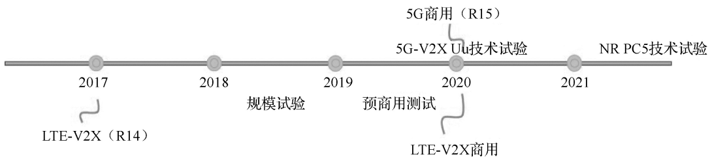
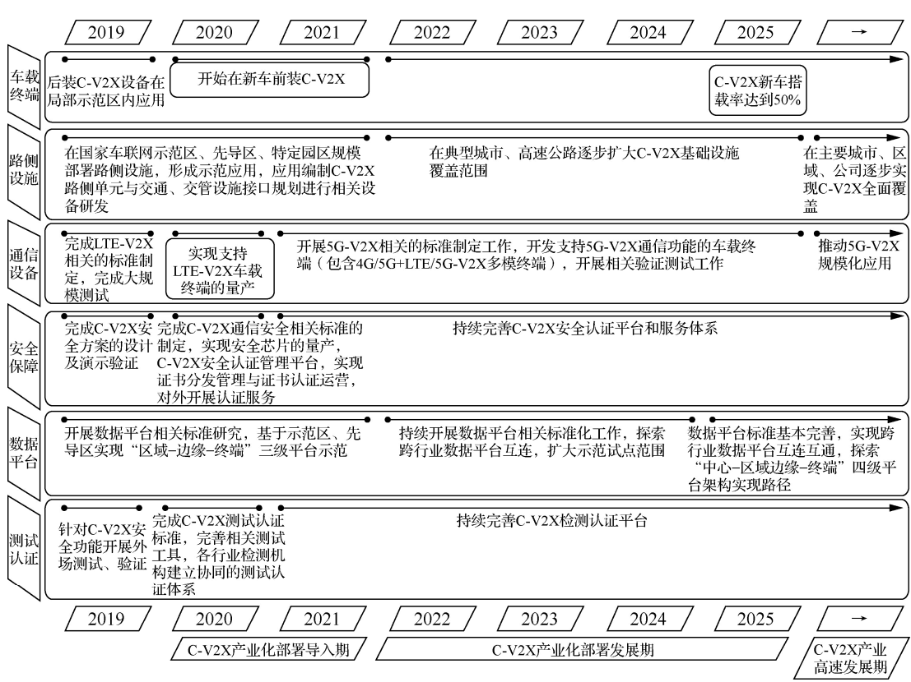

# 第3章 C-V2X车联网应用层标准分析

目前，我国C-V2X车联网应用层标准分为两个阶段。第一个阶段主要涵盖安全、效率、信息服务三大类共17个典型应用场景。第二个阶段包括面向安全、效率、信息服务、交通管理、高级智能驾驶等领域共12个典型应用场景。

## 3.1 C-V2X研究与应用现状

目前，世界各国对于智能网联汽车的研究不仅仅局限于政策的研究和技术的开发，美国、欧盟、日本和中国等多个国家/地区已经开始建设智能网联示范区或专业测试场，来进行智能网联汽车与智慧交通前沿技术研究和标准研究。C-V2X商业发展进程如图3.1所示。



C-V2X的研究与应用现状如下。

(1)核心芯片/模组和终端产品研发产业化基本成熟。一是中信科智联、华为、高通、移远、芯讯通、奥托通信等企业已对外提供基于LTE-V2X的商用芯片/模组;二是华为、中信科智联、中国移动、金溢、星云互联、东软、万集等厂商已经可以提供基于LTE-V2X的OBU、RSU硬件设备以及相应的软件协议栈。

(2)相关终端产品已具备商用基础,产业接受程度逐步提升。一是汽车厂商接受度达到较高水平,上汽集团、一汽集团、福特、通用、吉利汽车等逐步开发相关产品,大力推动新车的联网功能。2019年3月,福特宣布首款C-V2X车型于2021年量产;截至2023年底,福特的新一代蒙迪欧、EVOS、Mustang Mach-E、锐界PLUS等车型都搭载了C-V2X技术。2019年4月,上汽集团、一汽集团、


东风公司、长安汽车、北汽集团、广汽集团、比亚迪汽车、长城汽车、江淮汽车、东南汽车、众泰汽车、江铃集团新能源、宇通客车等13家车企共同发布了C-V2X商用路标:2020下半年至2021上半年陆续实现C-V2X汽车量产。此外,据佐思汽研究统计,从2020年C-V2X正式量产装车至今,中国国内已有超过20款量产车型搭载了C-V2X技术,预计2026年装配率可达10%,装配量可超过200万台。汽车厂商对C-V2X的接受程度越来越高,汽车产业具备了较好的产业推广环境。二是交通行业将其作为新技术选择,交通运输和交通管理行业的主管部门、科研机构和企业等纷纷表达了对C-V2X技术的支持,并在各个城市的车联网示范区、先导区与"双智"城市建设示范区等进行试验,但在具体设备产品应用和规模化示范中的推动工作仍需进一步加强。各地、各行业对平台与运营模式进行了积极探索,但目前还未形成成熟稳定的模式。

# 3.1.1 国家对C-V2X车联网发展规划

在C-V2X业务演进阶段,驾驶安全、交通效率、信息服务三大类业务结合车路协同的发展,相关政策法规正在制定与完善中,主要包括智能驾驶、通信频谱资源分配和用户隐私保障法律等相关法律法规。在智能网联汽车的发展过程中,智能化的定义随着技术发展不断更改及完善,关于汽车智能化设备的研发、应用、测试相关的法规还在不断制定和完善过程中,需要各级主管部门与研发单位共同参与。在车联网通信频谱资源分配方面,随着物联网技术的快速发展,对频谱资源的需求越来越多,而频谱空间是有限的,如何提高频谱的利用率是人们需要考虑的问题。高通公司曾经提出分配频段的方法,但由于不符合利用C-V2X改善道路交通的初衷而遭到汽车产业的普遍反对。从这可以看出,如今的通信资源是十分紧张的,要想使汽车在智能网联中占有一席之地,就必须加快C-V2X的开发和利用。同时,随着网联化的进一步推广,车辆的信息安全与用户隐私问题也逐渐暴露出来。装载C-V2X通信的汽车不像传统汽车,传统汽车的信息是封闭的,而装载C-V2X的汽车需要和其他车辆、基础设施及行人进行实时通信,使用装有C-V2X的汽车的信息安全与用户隐私数据更容易暴露在攻击者的视野范围内。所以,如何有效地保护车辆信息与用户隐私信息,是车联网应用推广中不可回避的问题。

工业和信息化部作为5G研发的主管部门,车联网的标准化也一直是由其主导的,主要标准基于C-V2X相关标准。随着车联网技术的不断成熟,国家产业扶持政策持续推进,按照车联网发展规划,2019~2021年路侧设施进行试点部署,完成安全、MEC、云控平台、测试等配套测试;2020年,C-V2X开始初步量产前装;到2025年,目标渗透率将达到50%,如图3.2所示。




2020年后,我国在C-V2X通信标准、应用示范方面取得了长足进步,逐步完善了C-V2X车辆网的相关技术验证测试规范、政策法规、应用标准的制定,分别在北京、天津、上海、重庆、无锡等地大力推进车联网先导区建设,为C-V2X车联网在智能网联汽车、智能交通、智慧城市建设全面推广等方面积累经验、打下基础。

目前，我国车联网的发展正在经历以下3个阶段。

2019~2021年为C-V2X产业化部署导入期。在这一阶段，C-V2X通信设备、安全保障、数据平台、测试认证可基本满足C-V2X产业化初期部署需求。同时，在国家车联网示范区、先导区及部分特定园区部署路侧设施，形成示范应用，车企逐步在新车前装C-V2X设备，鼓励后装C-V2X设备，车、路部署相辅相成，形成良性循环，C-V2X生态环境逐步建立，探索商业化运营模式。

2022~2025年为C-V2X产业化部署发展期。根据示范区、先导区建设经验,形成可推广的商业化运营模式,在全国典型城市和道路上进行推广部署,并开展应用。

2025年以后为C-V2X产业高速发展期。逐步实现C-V2X全国覆盖,建成全国范围内的多级数据平台,跨行业数据实现互连互通,提供多元化出行服务。


#  3.1.2 C-V2X 的典型应用场景

目前C-V2X的应用场景正从信息服务类应用向交通安全和效率类应用发展,并逐步向支持实现自动驾驶的协同服务类应用演进。

C-V2X典型的应用场景如下。

##  1.交通安全

交通安全是C-V2X最重要的应用场景之一,对避免交通事故、降低事故带来的生命财产损失有十分重要的意义。典型的交通安全应用场景包括交叉路口碰撞预警等。交叉路口碰撞预警是指在交叉路口,车辆探测到与侧向行驶的车辆有碰撞风险时,通过预警声音或影像提醒驾驶员以避免碰撞。典型的交通安全应用场景如表3.1所示。该场景下车辆需要具备广播和接收V2X消息的能力。

表3.1 典型的交通安全应用场景


| 交通安全应用场景 | 优先级 | 优先级 |
| --- | --- | --- |
| 交通安全应用场景 | 基本 | 扩展 |
| 前向碰撞预警 | √ |  |
| 跟车过近提醒 |  | √ |
| RSU提醒碰撞 |  | √ |
| 碰撞前警告(碰撞不可避免) |  | √ |
| 左转辅助/告警 | √ |  |
| 汇入主路辅助/碰撞告警 | √ |  |
| 交叉路口碰撞告警(有信号灯/无信号灯/非视距等,存在路侧单元) | √ |  |
| 交叉路口碰撞告警(有信号灯/无信号灯/非视距等,不存在路侧单元) | √ |  |
| 超车辅助/逆向超车提醒/借道超车 | √ |  |
| 盲区告警/换道辅助 | √ |  |
| 紧急制动预警(紧急电子制动灯) | √ |  |
| 车辆安全功能失控预警 | √ |  |
| 异常车辆告警(包含前方静止/慢速车辆) | √ |  |
| 静止车辆提醒(由交通意外、车辆故障等造成) | √ |  |
| 摩托车靠近告警 |  | √ |
| 慢速车辆预警(如拖拉机、大货车等) |  | √ |


#  2. 交通效率

交通效率是C-V2X的重要应用场景,也是智慧交通的重要组成部分,对于缓解城市交通拥堵、节能减排具有十分重要的意义。典型的交通效率应用场景包括车速引导等。车速引导是指路侧单元收集交通信号灯的配时信息,并将交通信号灯当前状态及当前状态剩余时间等信息广播给周围车辆。车辆收到该信息后,结合当前车速、位置等信息,计算出建议行驶速度,并向车主进行提示,以提高车辆不停车通过交叉路口的可能性。典型的交通效率应用场景如表3.2所示,该场景需要RSU具备收集交通信号灯信息,并向车辆广播V2X消息的能力,周边车辆需要具备收发V2X消息的能力。

表 3.2 典型的交通效率应用场景


| 交通效率应用场景 | 优先级 | 优先级 |
| --- | --- | --- |
| 交通效率应用场景 | 基本 | 扩展 |
| 减速区/限速提醒(隧道限速、普通限速、弯道限速) | √ |  |
| 减速/停车标志提醒(倒三角/“停”) |  | √ |
| 减速/停车标志违反警告 |  | √ |
| 车速引导 | √ |  |
| 增强导航(接入 Internet) |  | √ |
| 十字路口通行辅助 |  | √ |
| 专用车道动态使用(普通车动态借用专用车道)/专用车道分时使用(分时专用车道)/潮汐车道/紧急车道 |  | √ |
| 潮汐车道/紧急车道 |  | √ |
| 禁入及绕道提示(道路封闭、临时交通管制等) |  | √ |
| 车内标牌 | √ |  |
| 电子不停车收费 | √ |  |
| 自适应巡航(后车有驾驶员) |  | √ |
| 自适应巡航(后车无驾驶员) |  | √ |
| 货车/大车车道错误提醒 |  | √ |
| 协作式车队 |  | √ |


#  3.信息服务

信息服务是提高车主驾车体验的重要应用场景,是C-V2X应用场景的重要组成部分。典型的信息服务应用场景包括紧急呼叫业务等。紧急呼叫业务是指当出


现紧急情况(如安全气囊引爆或车辆侧翻等)时,车辆能自动或手动通过网络发起紧急救助,并对外提供基础的数据信息,包括车辆类型、交通事故时间及地点等。服务提供方可以是政府紧急救助中心、运营商紧急救助中心或第三方紧急救助中心等。典型的信息服务应用场景如表 3.3 所示,该场景需要车辆具备 V2X 通信的能力,并能与网络建立通信联系。

表 3.3 典型的信息服务应用场景


| 信息服务应用场景 | 优先级 | 优先级 |
| --- | --- | --- |
| 信息服务应用场景 | 基本 | 扩展 |
| 兴趣点提醒 |  | √ |
| 近场支付 | √ |  |
| 自动停车引导及控制 | √ |  |
| 充电站目的地引导(有线/无线电站) |  | √ |
| 电动汽车自动泊车及无线充电 |  | √ |
| 本地电子商务 |  | √ |
| 汽车租赁/分享 |  | √ |
| 电动车分时租用 |  |  |
| 媒体下载 |  | √ |
| 地图管理、下载/更新 |  | √ |
| 经济/节能驾驶 |  | √ |
| 即时消息(V2V) |  | √ |
| 个人数据同步 |  | √ |
| 求救/eCall业务 | √ |  |
| 车辆被盗/损坏(包括整车和部件)警报 | √ |  |
| 车辆远程诊断,维修保养提示 | √ |  |
| 车辆关系管理(接入Internet) |  | √ |
| 车辆生命周期管理数据采集 |  | √ |
| 按需保险业务(即开即交保) |  | √ |
| 车辆软件数据推送和更新 |  | √ |
| 卸货区管理 |  | √ |
| 车辆和 RSU 数据校准 |  | √ |
| 电子号牌 |  | √ |


#  4.自动驾驶

与现有的摄像头视频识别、毫米波雷达、激光雷达类似，V2X是获得其他车辆、行人运动状态(车速、制动、变道)的一种信息交互手段，且不容易受天气、障碍物及距离等因素的影响。同时，V2X有助于为自动驾驶的产业化发展构建一个共享分时租赁、车-路-人-云协同的综合服务体系。

人-车-路-云之间的全方位连接和高效信息交互，如协作式车队管理是指车队的车头从云端及周边车辆获取安全、交通环境、车载传感器等信息，形成车队行驶策略，从而完成整个车队的动态管理，确保车队安全、高效出行。协作式车队管理适用于网络覆盖下的城市及郊区道路。该应用能够有效提升车队管理效率，保证车队车头信息获取的全面性，既能从云端获取基于整体交通状况的行驶建议，又能通过车队内车辆间信息的共享交互实现近距离安全行驶，还能实时进行车队内及车队间灵活调控，实现安全与效率的同时提升。自动驾驶的主要应用场景包括车辆加入/离开车队、车辆编队融合/拆分等，如图3.3所示。


(a)车辆B加入/离开车队


(b)车辆编队融合/拆分

图3.3 自动驾驶的主要应用场景

典型的自动驾驶应用场景包括车辆编队行驶、远程遥控驾驶等。其中，车辆编队行驶是指头车为有人驾驶车辆或自主式自动驾驶车辆，后车通过V2X通信与头车保持实时信息交互，在一定的速度下实现一定车间距的多车稳定跟车，具备


车道保持与跟踪、协作式自适应巡航、协作式紧急制动、协作式换道提醒、出入编队等多种应用功能;远程遥控驾驶是指驾驶员通过驾驶操控台远程操作车辆行驶,搭载在车辆上的摄像头、雷达等,通过5G网络大带宽将多路感知信息实时传达到远程驾驶操控台,驾驶员对于车辆转向盘、加速踏板和制动踏板的操控信号通过5G网络的低时延高可靠实时传达到车辆上,轻松准确地对车辆进行前进、加速、制动、转弯、后退等驾驶操作。

#  3.2第一阶段应用层标准分析

##  3.2.1第一阶段应用层场景分析

在第一阶段中,应用层标准采用中国汽车工程学会的标准《合作式智能运输系统 车用通信系统应用层及应用数据交互标准(第一阶段)》(T/CSAE 53-2020)[1]中的 17个应用场景。第一阶段应用层各场景的基本性能要求如表 3.4所示。其中,各场景的通信方式将在各场景的描述中具体给出,表 3.4中只标注了类型。

表 3.4第一阶段各场景的基本性能要求


| 序号 | 应用 | 类型 | 主车最高车速/(km/h) | 通信方式 | 频率/Hz | 最大时延/ms | 定位精度/m | 通信范围/m | 适用通信技术 |
| --- | --- | --- | --- | --- | --- | --- | --- | --- | --- |
| 1 | 前向碰撞预警 | 安全 | 130 | V2V | 10 | 100 | 1.5 | 300 | LTE-V/DSRC/5G |
| 2 | 交叉路口碰撞预警 | 安全 | 70 | V2V/V2I | 10 | 100 | 1.5 | 150 | LTE-V/DSRC/5G |
| 3 | 左转辅助 | 安全 | 70 | V2V/V2I | 10 | 100 | 1.5 | 150 | LTE-V/DSRC/5G |
| 4 | 盲区预警/变道辅助 | 安全 | 130 | V2V | 10 | 100 | 1.5 | 150 | LTE-V/DSRC/5G |
| 5 | 逆向超车预警 | 安全 | 70 | V2V | 10 | 100 | 1.5 | 300 | LTE-V/DSRC/5G |
| 6 | 紧急制动预警 | 安全 | 130 | V2V | 10 | 100 | 1.5 | 150 | LTE-V/DSRC/5G |
| 7 | 异常车辆提醒 | 安全 | 130 | V2V | 10 | 100 | 1.5 | 150 | LTE-V/DSRC/5G |
| 8 | 车辆失控预警 | 安全 | 130 | V2V | 10 | 100 | 1.5 | 300 | LTE-V/DSRC/5G |
| 9 | 道路危险状况提示 | 安全 | 130 | V2I | 5 | 100 | 1.5 | 300 | LTE-V/DSRC/5G |
| 10 | 闯红灯预警 | 安全 | 70 | V2I | 5 | 100 | 1.5 | 150 | LTE-V/DSRC/5G |
| 11 | 弱势交通参与者碰撞预警 | 安全 | 70 | V2P/V2I | 5 | 100 | 1.5 | 150 | LTE-V/DSRC/5G |
| 12 | 紧急车辆提醒 | 效率 | 130 | V2V/V2I | 5 | 100 | 1.5 | 300 | LTE-V/DSRC/5G |
| 13 | 绿波车速引导 | 效率 | 70 | V2I | 5 | 200 | 1.5 | 150 | 4G/LTE-V/DSRC/5G |
| 14 | 限速预警 | 安全 | 130 | V2I | 1 | 100 | 1.5 | 300 | 4G/LTE-V/DSRC/5G |
| 15 | 车内标牌 | 效率 | 70 | V2I | 1 | 500 | 1.5 | 150 | 4G/LTE-V/DSRC/5G |
| 16 | 前方拥堵提醒 | 效率 | 130 | V2I | 1 | 500 | 5 | 150 | 4G/LTE-V/DSRC/5G |
| 17 | 汽车近场支付 | 信息服务 | 130 | V2I | 1 | 500 | 1.5 | 150 | 4G/LTE-V/DSRC/5G |


其中，低时延高频率场景主要包括前向碰撞预警、左转辅助和闯红灯预警等场景；高时延低频率场景主要包括绿波车速引导、前方拥堵提醒和智能汽车近场支付等场景。

#  1.低时延高频率部分场景介绍

##  1)前向碰撞預警

前向碰撞预警(FCW)是指主车(host vehicle, HV)在车道上行驶,与在正前方同一车道的远车(remote vehicle, RV)存在追尾碰撞危险时,FCW应用将对 HV驾驶员进行预警,适用于普通道路或高速公路等车辆追尾碰撞危险的预警。

触发FCW功能的HV和RV位置关系如图3.4所示,其中,HV和RV在同一车道,RV在HV的前方。该应用在直线车道或弯道车道均有效。


图3.4 触发FCW功能的HV和RV位置关系

FCW 基本流程如下。

(1)分析接收到的RV消息,筛选出位于同一车道前方(前方同车道)区域的RV。

(2)进一步筛选出处于一定距离范围内的RV作为潜在威胁车辆。

(3)计算每一个潜在威胁车辆的碰撞预计时间(time-to-collision, TTC)或防撞距离(collision avoidance range, CAR),筛选出与HV存在碰撞危险的威胁车辆。

(4)若有多个威胁车辆,则筛选出最紧急的威胁车辆。

(5) 系统通过人机交互界面(human machine interface, HMI)对 HV 驾驶员进行相应的碰撞预警。

FCW 数据交互需求(远车数据)如表 3.5 所示。

表 3.5 FCW 数据交互需求(远车数据)


| 数据 | 单位 | 备注 |
| --- | --- | --- |
| 时刻 | ms | — |
| 位置(经纬度) | deg | — |


续表


| 数据 | 单位 | 备注 |
| --- | --- | --- |
| 位置(海拔) | m | — |
| 车头方向角 | deg | — |
| 车体尺寸(长、宽) | m | — |
| 速度 | m/s | — |
| 三轴加速度 | $ \text{m/s}^2 $ | — |
| 横摆角速度 | deg/s | — |


#  2)左转辅助

左转辅助(left turn assistant, LTA)是指HV在交叉路口左转,与对向驶来的RV存在碰撞危险时,LTA应用将对HV驾驶员进行预警,适用于城市及郊区普通道路和公路的交叉路口。

触发 LTA 功能的 HV 和 RV 位置关系如图 3.5 所示。


图3.5 触发 LTA 功能的 HV和RV位置关系

LTA基本工作流程如下。

(1)分析接收到的RV消息,筛选出位于HV相邻车道迎面车辆(oncoming left)和远端车道迎面车辆(oncoming far left)区域的RV。

(2)进一步筛选出一定距离范围内的RV作为潜在威胁车辆。

(3)计算每一个潜在威胁车辆到达交叉口预计时间(time-to-intersection, TTI)和到达交叉口的距离(distance-to-intersection, DTI),筛选出与HV存在碰撞危险的威胁车辆。

(4)若有多个威胁车辆,则筛选出最紧急的威胁车辆。

(5) 系统通过 HMI对 HV驾驶员进行相应的碰撞预警。


LTA数据交互需求(远车数据)如表3.6所示。

表 3.6 LTA 数据交互需求(远车数据)


| 数据 | 单位 | 备注 |
| --- | --- | --- |
| 时刻 | ms | — |
| 位置(经纬度) | deg | — |
| 位置(海拔) | m | — |
| 车头方向角 | deg | — |
| 车体尺寸(长、宽) | m | — |
| 速度 | m/s | — |
| 三轴加速度 | $ \text{m/s}^2 $ | — |
| 横摆角速度 | deg/s | — |
| 转向信号 | — | 左转向灯是否激活 |


#  3)闯红灯预警

闯红灯预警(signal violation warning, SVW)是指HV经过有信号控制的交叉路口(车道),车辆存在不按信号灯规定或指示行驶的风险时,RLVW应用对驾驶员进行预警,适用于城市及郊区道路和公路的交叉路口、环道出入口和可控车道、高速路入口和隧道等有信号控制的车道。

当前方有大车遮挡视线(见图 3.6)或恶劣天气影响视线,或由于其他原因,使 HV无法对当前红灯或即刻到来的红灯做出正确判断时,RLVW检测 HV当前所处位置和速度等,通过计算预测车头经过路口停止线时信号灯的状态向驾驶员进行预警。


图 3.6被大车遮挡信号灯

SVW基本工作流程如下。

(1)具有短程、远程通信能力的路侧单元定时发送路口地理信息和信号灯实时状态信息。


(2) HV依据本身 GNSS地理信息，确定当前受管控信号的相位，并计算其与停止线的距离。

(3) HV依据当前速度和其他交通参数预估到达路口的时间。

(4)SVW将这些信息与接收到的红灯切换时刻及红灯保留时长信息进行对比分析，决定是否发出预警。

SVW 数据交互主要字段如表 3.7 所示。

表 3.7 SVW 数据交互主要字段（路侧数据）


| 数据 | 单位 | 备注 |
| --- | --- | --- |
| 时刻 | ms | — |
| 路口 ID | — | — |
| 入口 ID | — | — |
| 车道宽度 | m | — |
| 车道中心线位置 | — | — |
| 停车线位置 | — | — |
| 车道属性 | — | 左、直、右和掉头 |
| 车道所属相位 | — | — |
| 当前灯态 | — | 针对该车道每一个车道属性(允许行驶方向)的信号灯状态 |
| 红变绿剩余时间/绿变红剩余时间 | s | 可预测一个周期或两个周期 |
| 红绿灯配时是否自适应控制 | — | 自适应控制时,绿灯剩余时间会改变(周期内或下一个周期) |


#  2. 高时延低频率部分场景介绍

##  1)绿波车速引导

绿波车速引导(green light optimal speed advisory, GLOSA)是指当OBU的HV 驶向信号灯控制交叉路口,收到由路侧单元发送的道路数据及信号灯实时状态数据时,GLOSA应用将给予驾驶员一个建议车速区间,以使车辆能够经济地、舒适地(不需要停车等待)通过信号路口,适用于城市及郊区普通道路信号灯控制路口。

GLOSA 主要应用场景如图 3.7所示。

GLOSA 主要流程如下。

(1) HV从远处接近信号灯控制路口。

(2) 路侧通信设备发出局部道路数据信息，以及从路口信号灯处获得的信号灯数据信息和实时状态信息。

(3) GLOSA应用根据上述信息,给出HV前方信号灯的实时状态,并结合HV的定位和行驶状态信息,计算出通过路口的引导车速区间。


图 3.7 GLOSA 主要应用场景

(4) HV 根据收到的道路数据，以及本车的定位和运行数据，判定本车在路网中所处的位置和运行方向。

(5)判断车辆前方路口是否有信号灯,提取信号灯对应相位的实时状态;若有信号灯信息,则可直接显示给驾驶员。

(6) GLOSA应用根据本车的位置，以及信号灯对应相位的实时状态，计算本车能够在本次或下次绿灯期间不停车通过路口所需的最高行驶速度和最低行驶速度，并进行提示。

GLOSA数据交互需求(路侧数据)如表3.8所示。

表 3.8 GLOSA 数据交互需求（路侧数据）


| 数据集 | 包含数据单元 | 备注 |
| --- | --- | --- |
| 时刻 | — | 单位为ms |
| 道路数据集 | 节点 | 路口节点 |
| 道路数据集 | 路段 | 路口之间的路段 |
| 道路数据集 | 车道 | 路段中的车道 |
| 道路数据集 | 连接转向关系 | 路口处各路段出入连接关系 |
| 信号灯数据集 | 静态信息 | 信号灯周期、相位 |
| 信号灯数据集 | 实时状态信息 | 信号灯当前状态和倒计时 |
| 信号灯数据集 | 转向-相位关系 | 路口处转向和信号灯相位的对应关系 |


#  2)前方拥堵提醒

前方拥堵提醒(traffic jam warning, TJW)是指HV行驶前方发生交通拥堵


状况时，路侧单元将拥堵路段信息发送给 HV，TJW应用将对驾驶员进行提醒，适用于城市及郊区普通道路和高速公路拥堵路段的预警。

TJW 主要应用场景如图 3.8所示。


图3.8 TJW主要应用场景

TJW 主要流程如下。

(1) HV从远处接近相应的路侧单元,路侧单元周期性广播局部道路拥堵数据信息。

(2) TJW应用根据上述信息,结合本车的定位和行驶状态,计算出本车在路网中的位置,并判断前方是否拥堵,如果拥堵,则对驾驶员进行前方拥堵的提示。

TJW 数据交互需求(路侧数据)如表 3.9 所示。

表 3.9 TJW 数据交互需求(路侧数据)


| 数据 | 单位 | 备注 |
| --- | --- | --- |
| 拥堵起止点位置(经纬度) | deg | 路侧设备周期性广播 |
| 拥堵程度 | — | 分为5级:畅通、基本畅通、轻度拥堵、中度拥堵、严重拥堵;路侧设备周期性广播 |


#  3)汽车近场支付

汽车近场支付(vehicle near-field payment, VNFP)是一种汽车作为支付终端对所消费的商品或服务进行账务支付的服务方式。汽车通过V2X通信技术与路侧单元(RSU作为受理终端)发生信息交互,间接向银行金融机构发送支付指令,产生货币支付与资金转移行为,从而实现车载支付功能。其主要应用包括ETC、拥堵费、充电支付、停车支付、加油支付等汽车使用消费环节的付费需求。

图 3.9 为车辆在行驶中收费的支付流程。该系统的基本原理如下:首先, RSU广播“我是收费站”, OBU应答相应汽车信息(包括车辆识别码、车辆类型、车速、车辆尺寸等),并建立 P2P通信连接。其次, RSU立刻发送相应支付请求信息(包括 RSU标识、RSU地理位置信息、支付金额等), OBU收到 RSU支付请求后,内部在金融支付计算单元中进行处理,再发出应答支付信息(包括支付账户、支付金额、支付密钥等)。再次, RSU收到支付应答信息后,进行内部收费


处理,其中包括对支付账户的风险性检测,以及实时与后台系统交易确认(可选),如是否为黑名单账户,是否符合合法交易条件(如是否A品牌车在B品牌车4S店中消费)等。最后,RSU向OBU通知扣款(此时可选择是否传输电子发票等凭据),OBU做相应记录并结束通信。


图3.9车辆在行驶中收费的支付流程

VNFP数据交互需求(车辆数据与路侧数据)如表3.10所示。

表 3.10 智能 VNFP 数据交互需求（车辆数据与路侧数据）


| 数据集 | 数据 | 单位 | 备注 |
| --- | --- | --- | --- |
| 时间 | — | s | — |
| 车辆支付数据集 | 车辆识别码(vehicle identification number, VIN) | — | — |
| 车辆支付数据集 | 车辆类型 | — | — |
| 车辆支付数据集 | 车体尺寸(长、宽) | m | — |
| 车辆支付数据集 | 车速 | m/s | — |
| 路侧支付数据集 | RSU标识 | — | — |
| 路侧支付数据集 | RSU地理位置信息 | 经纬度 | — |
| 路侧支付数据集 | 支付信息 | 支付账户 | — |
| 路侧支付数据集 | 支付信息 | — | 支付金额 |
| 路侧支付数据集 | 支付信息 | — | 支付票据 |
| 路侧支付数据集 | 支付信息 | — | 支付密钥 |
| 路侧支付数据集 | 支付信息 | — | 其他摘要 |


#  3.2.2 C-V2X第一阶段标准消息定义

C-V2X第一阶段标准消息定义分类如表3.11所示。

表 3.11 第一阶段标准消息定义分类


| 序号 | 类型 | 作用 |
| --- | --- | --- |
| 1 | 基本安全消息(BSM) | 用来在车辆之间交换安全状态数据 |
| 2 | 地图消息(map message, MAP) | 向车辆传递局部区域的地图信息,包括局部区域的路口信息、路段信息、车道信息,以及道路之间的连接关系等 |
| 3 | 信号灯消息(SPAT) | 包含一个或多个路口信号灯的当前状态信息。结合MAP,为车辆提供实时的前方信号灯相位信息 |
| 4 | 路侧安全消息(roadside safety message, RSM) | 路侧单元将得到的周边交通参与者的实时状态信息整理成本消息体所定义的格式,作为这些交通参与者的基本安全状态信息 |
| 5 | 路侧信息(roadside information, RSI) | 由路侧单元向周围车载单元发布的交通事件信息及交通标志信息 |


路侧消息发送周期与数据包延时预算(packet delay budget, PDB)要求MAP、SPAT、RSM、RSI宜采用如下周期发送(周期应为100ms的整数倍)，且各情况下对应的PDB设置宜与发送周期保持一致。

(1) MAP: 小于或等于1s。

(2) SPAT:小于或等于500ms。

(3) RSM: 100ms。

(4) RSI:对于静态类, RSI为1s;对于半静态类, RSI为500ms;对于动态类, RSI为100ms。

##  1. BSM

BSM是使用最广泛的应用层消息之一,用来在车辆之间交换安全状态数据,车辆通过该消息的广播,将自身的实时状态告知周围车辆,以此支持一系列协同安全等应用。BSM主要字段及其含义如图 3.10所示。

BSM 消息是层层嵌套的结构，这里显示的是简化后的架构，BSM 除了车辆的基本信息外还有一些附加信息，如车辆安全辅助信息(vehicle safety extensions)中的车辆特殊状态位、历史轨迹、预测路线、灯光信息等。车辆安全辅助信息中最重要的就是车辆特殊状态位，其中包含了很多与安全相关的重要标志位，也是V2V应用所使用的重要信息来源。


图 3.10 BSM主要字段及其含义

#  2. MAP

MAP是由路侧单元广播,向车辆传递局部区域的地图信息,包括局部区域的路口信息、路段信息、车道信息,以及道路之间的连接关系等。单个地图消息可以包含多个路口或区域的地图数据。路口处的信号灯信息则在SPAT消息中详细定义。MAP主要字段及其含义如图3.11所示。


图 3.11 MAP 主要字段及其含义

#  3. SPAT

MAP 通常和 SPAT 搭配使用，SPAT 包含一个或多个交叉路口信号灯的当前


状态信息，为车辆提供实时的前方信号灯相位信息。SPAT主要字段及其含义如图 3.12所示。


图 3.12 SPAT主要字段及其含义

#  4. RSM

RSM 是路侧单元通过路侧本身拥有的相应检测手段,得到其周边交通参与者的实时状态信息(这里的交通参与者包括路侧单元本身、周围车辆、非机动车、行人等),并将这些信息整理成本消息体所定义的格式,作为这些交通参与者的基本安全状态信息(类似于BSM),广播给周边车辆,并支持这些车辆的相关应用。RSM主要字段及其含义如图 3.13 所示。


图 3.13 RSM主要字段及其含义


#  5. RSI

若想获取路段上更多的动态交通信息,则需要用到RSI。RSI适用于收集由路侧单元向周围车载单元发布的交通事件信息及交通标志信息。RSI主要字段及其含义如图3.14所示。


图 3.14 RSI 主要字段及其含义

RSI由路侧单元向周围车载单元发布交通事件消息及交通标志信息。例如，“前方事故”“前方路面结冰”等，可以用文本消息的方式向车载单元进行发布，车载单元在判定消息的生效区域时，根据自身的定位与运行方向，以及消息本身提供的区域范围来进行判定。在此信息体中，参考点位置表示本信息产生的位置点（标志标牌的放置位置或交通事件的发生位置），信息中其余的位置偏移量均基于该参考点测算。RSI用有序的位置点来表示该信息生效的车辆行进轨迹区段，用半径来表示区段的宽度以覆盖路段的宽度。


#  3.3第二阶段应用层标准分析

##  3.3.1 第二阶段应用层场景分析

在第二阶段中,应用层标准采用了中国汽车工程学会的标准《合作式智能运输系统 车用通信系统应用层及应用数据交互标准(第二阶段)》(T/CSAE 157-2020)[2]中的 12个应用场景。第二阶段应用层各场景的基本性能要求如表 3.12所示。其中,各场景的通信方式在各场景的描述中具体给出,表 3.12中只标注了类型。

表 3.12 第二阶段各场景的基本性能要求


| 应用 | 场景分类 | 最高车速/(km/h) | 频率/Hz | 最大时延/ms | 精度/m | 通信模式 | 通信范围/m | 主要消息 |
| --- | --- | --- | --- | --- | --- | --- | --- | --- |
| 感知数据共享 | 安全 | 120 | ≥10 | 100 | ≤1 | V2V/V2I | ≥200 | Msg_SSM |
| 协作式变道 | 安全 | 120 | ≥10 | 50 | ≤0.5 | V2V/V2I | ≥200 | Msg_VIR |
| 协作式车辆汇入 | 安全/效率 | 120 | ≥10 | 50 | 车侧≤0.5移动≤1 | V2I | ≥300 | Msg_RSCMsg_VIR |
| 协作式交叉路口通行 | 安全/效率 | 70 | ≥10 | 50 | ≤1 | V2I | ≥200 | Msg_RSC |
| 差分数据服务 | 信息服务 | — | ≥1 | 500 | — | V2I | ≥200 | Msg_RTCM |
| 动态车道管理 | 效率/交通管理 | 70 | ≥2 | 100 | ≤1.5 | V2I | ≥200 | Msg_RSC |
| 协作式优先车辆通行 | 效率 | 120 | ≥10 | 100 | ≤1.5 | V2I | ≥200 | Msg_VIRMsg_RSC |
| 场站路径引导服务 | 信息服务 | 25 | ≥2 | 100 | ≤0.5 | V2I | ≥200 | Msg_PAMMsg_VIR |
| 浮动车数据采集 | 交通管理 | 120 | — | 500 | ≤1.5 | V2I | ≥200 | Msg_BSMMsg_VIRMsg_SSM |
| 弱势交通参与者安全通行 | 安全 | 25 | ≥10 | 100 | ≤1 | P2X | ≥200 | Msg_PSM |
| 协作式车辆编队管理 | 高级智能驾驶 | 120 | ≥10 | 50 | ≤1 | V2V | ≥400 | Msg_CLPMM |
| 道路收费服务 | 效率/信息服务 | 120 | RSU≥1OBU≥10 | 100 | ≤0.5 | V2I | ≥200 | Msg_VPM |


###  1.协作式交叉口通行

协作式交叉口通行(cooperative intersection passing, CIP)是指装备有 OBU


的车辆(equipped vehicle, EV)和 RSU协作,安全、高效通过交叉口。EV向 RSU发送车辆行驶信息,RSU根据车辆行驶信息、目标交叉路口的信号灯信息、其他车辆上报的行驶信息及路侧感知信息,为EV生成通过交叉路口的通行调度信息并发送给EV,调度EV安全通过交叉口,适用于城市、郊区及封闭园区等的普通道路和公路的交叉路口、无信号灯等交叉路口的通行。

#  1) RSU 提前引导车辆换道行驶场景描述

具体场景描述如下:车辆EV行驶在转向车道,但EV的行驶意图是直行,此时直行车道行驶通畅,转向车道行驶缓慢或堵塞,如图3.15所示;EV将自身信息及行驶意图信息发送给RSU,RSU根据当前道路状况生成调度信息发送给EV;EV按照RSU生成的通行调度信息提前变道到直行车道等待,避免后续的加塞而影响交叉路口通行效率。


图 3.15 RSU 提前引导车辆换道行驶场景

#  2) RSU辅助车辆通过无信号灯控制的交叉路口场景描述

具体场景描述如下:车辆EV-1从远处驶向无信号灯控制的交叉路口,交叉路口附近设有RSU;车辆EV-1向RSU发送行驶状态信息和行驶意图信息,如图3.16所示;RSU根据EV-1上报的行驶信息、当前路口其他车辆上报的行驶信息,以及路侧传感器上报的感知信息,生成EV及其他所有接近路口的网联车辆的驾驶引导信息;RSU将对应的引导信息发送给车辆EV;EV-1收到RSU发送的驾驶引导信息后,结合自身行驶状态及道路信息、周围交通参与者信息,生成最终的驾驶行为策略或轨迹规划,安全有效地通过路口。


图 3.16 RSU辅助车辆通过无信号灯控制的交叉路口场景

#  3)协作式交叉口信号控制场景描述

具体场景描述如下: RSU通过与经过路口的EV进行数据交互,从微观的车辆运行和转向数据,结合路侧的交通感知信息,分析路口信号灯各相位对应的交通流状况,实时生成信号优化策略,如图3.17所示; RSU将优化策略下发给路口信号控制设备,由信号控制设备产生具体的相位、周期控制策略,实现路口通行效率的提升。


图3.17 协作式交叉口信号控制场景

#  2.场站路径引导服务

场站路径引导服务(guidance service in parking area, GSPA)是指在场站内部区域(如停车场、高速路服务站、加油站等), RSU通过V2I/I2V的方式,向进入的车辆提供站点地图信息、车位信息、服务信息等,并为车辆提供路径引导服务。

场站路径引导服务场景描述如下:车辆EV到达场站服务范围内,场站附近


设有 RSU,如图 3.18所示;车辆EV向 RSU发送入场/离场信息或服务请求(包括自身信息、入场/离场请求及意图信息等);场站 RSU收到EV发送的入场/离场请求信息或服务请求信息,根据车辆EV请求服务类型、当前场站内服务点的状态信息、地图信息为EV下发场站地图信息(包括场站内地图信息、各类车位信息和服务点信息),并为EV下发路径引导信息;车辆EV利用 RSU下发的地图服务信息,实现内部路径规划,前往目的地。


图 3.18 场站路径引导服务场景

#  3.协作式车辆编队管理

协作式车辆编队管理(cooperative platooning management, CPM)是指由手动驾驶或者自动驾驶的头车带领，其后由若干自动驾驶车辆组成，呈一个队列的行驶形态前进，车队成员保持一定的车距及稳定的车速，在有序行驶的状态下巡航。车辆编队系统需要实现车辆编队的过程管理和数据通信，包括创建车队、加入车队、编队巡航、离开车队、解散车队等状态的切换，此组建过程是动态开放式交互系统，不受系统边界限制。车辆编队行驶能减少车辆对驾驶员的需求，降低驾驶员的劳动强度，提高驾乘体验的安全性、舒适性、运输效率和燃油效率等，从而降低车辆油耗，减少大气污染。

##  1)创建车队场景描述

(1)自由车A处于静止或行驶状态时,发起广播“创建车队”指令,如图3.19所示。

(2)自由AA角色变换为领航车，并广播领航车信息表。

##  2)加入车队场景描述

自由车B接收到领航车A的组队信息后,如果想加入车队,则广播申请加入车队信息,否则不理会领航车A的组队信息。自由车B广播申请加入车队信息时,将申请状态设置为“申请加入车队”,设置其车队ID为领航车A的车队ID。


领航车A接收到自由车B申请加入车队的信息后，确认是否让自由车B加入车队。如果接受自由车B为成员，则执行以下流程；否则无须理会自由车B，自由车B的角色还是自由车类型。领航车A动作如下：

在车队成员管理信息中将车队申请状态置为"确认同意加入车队"状态,如图3.20所示;车队信息列表中增加跟随车ID,并向队内车辆广播更新后的车队状态。


图 3.19 自由车广播“创建车队”指令


图3.20领航车A广播(单播)确认同意加入车队信息

自由车B收到领航车A广播的确认同意加入该车队的回复后，自由车B动作如下：自由车B设置行驶状态为"加入车队"，广播状态信息，并驶入车队队尾；车辆B加入车队后进行跟驰，车辆B的属性及角色转变为"跟随车"，并设置行驶状态为跟驰状态，广播状态信息。车辆B加入完成后，领航车A将车辆B加入车队成员列表，完成整个加入过程。其他跟随车依先后顺序，重复以上动作，完成多辆自由车的加入，如图3.21所示。

#  3)车队巡航场景描述

所有车辆组成编队以后，车队由领航车带领，进入巡航状态。领航车对外发布领航车及编队基本信息表，跟随车对外发布跟随车基本信息表，如图 3.22所示。


图3.21多辆自由车加入车队成为跟随车


图3.22 车队巡航场景


#  4)离开车队场景描述

跟随车B向领航车A和所有跟随车广播申请离开车队指令。领航车A接收到跟随车B申请离开车队的指令并确认该指令后，允许跟随车B离开车队。跟随车B和领航车A的动作如下：跟随车B发起申请离开车队请求；跟随车B在收到领航车A确认离开车队的信息后，车辆设置行驶状态为"离队"并进行广播；直到完全离开车队，设置自身角色为"自由车";自由车B停止发送车队管理消息；领航车A收到跟随车B申请离开车队请求，如图3.23所示；领航车A确认跟随车B可以离开车队后，将跟随车B移出车队成员列表，并将其加入到离队列表中；当跟随车B完全离开车队，变为自由车后，领航车A组队信息表中删除跟随车B信息，并进行广播。


图 3.23 离开车队场景

#  5)解散车队场景描述

领航车A广播“解散车队”请求，随后领航车A动作如下：领航车A将信息表中的编队状态置为“申请解散车队”，并将车队中的所有成员加入离队列列表中，广播领航车信息表。

跟随车广播收到“解散车队”请求，随后跟随车动作如下：跟随车收到领航车A广播的解散车队请求；跟随车将自身状态设置为“离队中”并依次或自由离开车队；跟随车在离开车队后将自身角色设置为“自由车”；跟随车在远离车队后停止广播车队消息。

所有跟随车安全离开车队后，成功解散车队。领航车的角色变为"自由车"，停止发送领航车A的信息表，如图3.24所示。

在车辆组队的场景下，整体环境中包含4种车辆角色，即领航车、跟随车、尾车(可选)和自由车。其中，领航车定义为车辆组队场景中的头车，负责整个车队的管理工作，是整个组队场景中的数据源头，向所有跟随车提供车辆位置和车队流程确认等数据；跟随车为车辆组队场景中的头车之后的跟随车辆，是车辆


组队场景中的重要组成车辆; 尾车是车队中最后一辆车，根据需求可以设置该角色，也可以不设置该角色，此时可将尾车作为跟随车处理; 自由车为车辆组队场景之外的其他车辆，自由车不参与组队领航车的跟随车的数据交互确认。


图 3.24 解散车队场景

#  3.3.2 C-V2X第二阶段标准消息定义

消息层数据集用抽象语法标记(abstract syntax notation one, ASN.1)标准进行定义,以“消息帧-消息体-数据帧-数据元素”层层嵌套的逻辑进行制定。数据集交互的编码解码方式遵循非对齐压缩编码规则。第二阶段消息集对新出现的或在《基于LTE的车联网无线通信技术消息层技术要求》(YD/T 3709—2020[3],下文中均简称为“第一阶段”)定义的消息层内容基础上扩展的数据元素与数据帧进行了定义,其余数据元素与数据帧参考标准YD/T 3709—2020。消息层数据集以统一的消息帧格式打包;消息帧包含第一阶段中定义的5个消息,以及本节定义的第二阶段的扩展消息;第二阶段的扩展消息中包含9个新消息体,如图3.25所示。


图 3.25第二阶段的 9个新消息体


图 3.25 中的 msgFrameExt 消息体为与第一阶段消息不同或新增的消息体。

(1)地图消息(MAP):在第一阶段MAP消息的基础上进行了兼容性扩展,支持更复杂的道路结构表达,以及更精确的车道级地图数据,增加了对路段中车道数增减的情况,信号灯待转区、右转专用道、公交停靠车道等道路常见场景的支持,扩展了转向信息及路口车道间的连接关系等。

(2)路侧安全信息(RSI):在第一阶段RSI消息的基础上进行了兼容性扩展,增加了道路的辅助标志信息。

扩展消息(msgFrameExt):应用层及应用数据交互标准第二阶段消息。其中,包含9个消息体,如图3.26所示。


| SSM | RSC |
| --- | --- |
| VIR | RTCM |
| PAM | VPM |
| PSM | CLPMM |
| TEST |  |


图 3.26 扩展消息集包含的消息体

①交通参与者、道路障碍物和交通事件的感知共享消息(sensor sharing message, SSM):该消息可由 OBU、RSU及弱势交通参与者(vulnerable road user, VRU)发布。SSM由 RSU发送时,能够完全覆盖所有 RSM中的信息,因此在一些条件允许或者应用场景要求较高的地方,SSM可以替代 RSM使用。

②路侧协调消息(road side coordination, RSC):该消息通常用于广播、组播或单播,给车辆提供引导信息和驾驶决策支持。该消息可以针对单车进行引导,也可以面向特定的路段和车道符合条件的车辆进行引导。

③车辆意图和请求(vehicle intention and request, VIR)消息:用来进行车辆驾驶意图、优先请求、协作请求等信息的传递。

④国际海运事业无线电技术委员会(Radio Technical Commission for Maritime Services, RTCM)提供的路侧差分数据:提供差分数据服务。

⑤停车场地图(parking area map, PAM)消息:包含停车场内道路信息、车位信息等,以及路侧设备向车辆提供的停车场内引导信息。

⑥车辆支付消息(vehicle payment message,VPM):用来提供车辆和道路的道路收费及支付信息的交互。

⑦弱势交通参与者(行人、非机动车)的个体安全消息(personal safety message, PSM),由 VRU自身所携带的通信设备发送。

⑧ TEST 消息:提供测试使用的私有消息格式。


⑨编队管理消息(connectionless platooning management message, CLPMM): 用来进行车队场景下的管理信息交互。该消息可由车队领航车、跟随车或不属于车队的自由车广播,可用于进行车队建立、加入、离开、解散等。

#  3.3.3 V2X消息编码/解码

在C-V2X通信应用层标准中，V2X消息的表示采用ASN.1标准实现。ASN.1是一种ISO/ITU-T标准，描述了一种对数据进行表示、编码、传输和解码的数据格式。它提供了一整套正规的格式用于描述对象的结构，而不管语言上如何执行及这些数据的具体指代，也不用管到底是什么样的应用程序。

##  1. ASN.1 编码规则

ASN.1是定义抽象数据类型规格形式的标准,是用于描述数据的表示、编码、传输、解码的灵活记法。它提供了一套正式、无歧义和精确的规则,以描述独立于特定计算机硬件的对象结构。

ASN.1 是通信协议中描述数据传输的正式标记(notation), 它与语言实现和物理表示无关, 与应用的复杂度也无关。ASN.1 特别适用于表示现代通信应用中复杂的、变化的及可扩展的数据结构。ASN.1 的描述可以很容易被映射为C/C++/Java的数据结构, 可以被应用程序代码使用, 并得到运行时程序库的支持, 进而能够对编码和解码 XML 或 TLV 格式的, 或者一种非常紧凑的压缩编码格式进行描述。

ASN.1发送任何形式(音频、视频、数据等)的信息都必须以数字形式传送。ASN.1只能包含信息的结构方面(没有已经定义的或考虑到的处理数据值的操作),它不是一种编程语言。

###  1) ASN.1 与 C 语言的关系

在C-V2X车联网终端应用开发中，应用层业务采用C语言编写，但是要想实现不同厂家设备应用层数据的互连互通，对外发送的数据就要根据国家标准由C结构转换为ASN.1格式的数据，同时从接收设备接收到的ASN.1格式的数据要转换为C结构的数据，从而在设备端进行处理。

ASN.1格式的数据有多种编码方式，包括BER、DER、XER、PER等。

PER 编码又分为两种编码方式:对齐 PER (aligned PER, APER)与非对齐 PER (unaligned PER, UPER)编码方式。对于 UPER 编码方式,编码后的数据占用字节数少,但是其对数据的填充格式检查要求严格,所有数据的填充必须严格按照头文件中对数据成员的取值要求进行,否则调用 UPER 函数进行编码压缩时会报错。在 C-V2X 通信中,采用的是 UPER 编码方式。


国家标准的 V2X 消息 ASN.1 源码使用 ASN.1C 工具编译成.c 和.h 文件，编写程序时需要将这些编译出来的文件添加到车联网程序文件夹内。.c 和.h 文件可以分为两类：一类是和 ASN 编码/解码工具相关的工具类文件；另一类是和车联网应用层数据交互标准中定义的数据格式相关的应用类文件。填充应用层业务数据时需要调用第 2 类文件中定义的结构体，编码发送和解析收到的信息时调用第 1 类文件中的 BER、XER、PER、UPER 工具。

首先分析第2类文件中数据的调用方式。应用类文件中的.h文件是对 ITS 标准中的数据结构的实现，.c文件是对应的.h文件中的数据结构类型的调用函数限制和取值范围限制。.h文件中的结构体成员和ASN文件中的数据成员相对应，ASN文件中标注可选的数据成员在.h文件中以指针成员形式存在，代表此数据项是选择性填充的，如果填充，则需要为这些指针成员分配空间，若不填充，则不需要分配空间。

ASN.1 在一种高度抽象的层次上表示数据结构信息，各种应用程序无法直接对其进行操作和使用。因此，在实际应用中，需要先将 ASN.1 描述的数据结构转换为具体语言（如 C、C++、Java 等）的数据结构表示形式，再通过相应的 ASN.1 编码函数生成能在通信介质上传输的二进制码流，如图 3.27 所示。


图 3.27 ASN.1 描述的数据结构转换为C语言描述数据的工作原理

#  2) ASN.1 数据类型与定义

(1) 数据类型: ASN.1 中的一个重要概念就是类型。类型是一个非空的值的集合, 可以被编码后传输。相比于高级语言中复杂的数据结构, ASN.1 中的类型主要是为了数据的传输(如为 SEQUENCE 和 SET 定义 OPTIONAL 条目),而 BIT STRING 和 EMBEDDED PDV 则是为了通信专门设计的。

ASN.1中的基本数据类型如表3.13所示,更为复杂的数据类型可以由基本数据类型通过表3.14中的组合数据类型构造得到。


表 3.13 ASN.1 中的基本数据类型


| 数据类型 | 含义 |
| --- | --- |
| NULL | 只包含一个值 NULL, 用于传送一个报告或者作为 CHOICE 类型中的某些值 |
| INTEGER | 全部整数 (包括正数和负数) |
| REAL | 实数, 表示浮点数 |
| ENUMERATED | 标识符的枚举 (实例状态机的状态) |
| BIT STRING | 比特串 |
| OCTET STRING | 字节串 |
| OBJECT IDENTIFIER, RELATIVE-OID | 一个实体的标识符, 它在一个全世界范围的树状结构中注册 |
| EXTERNAL, EMBEDDED PDV | 表示层上下文交换类型 |
| STRING (除 BIT STRING、OCTET STRING 外) | 各种字符串, 有 NumericString、PrintableString、VisibleString、 ISO64String、IA5String、TeletexString、T61String、VideotexString、GraphicString、GeneralString、UniversalString、BMPString 和 UTF8String |
| CHARACTER STRING | 允许为字符串协商一个明确的字符表 |
| UTCTime、GeneralizedTime | 日期 |


表 3.14  组合数据类型


| 数据类型 | 含义 |
| --- | --- |
| CHOICE | 在类型中选择(相当于C语言中的联合体) |
| SEQUENCE | 由不同类型的值组成一个有序的结构(相当于C语言中的结构体) |
| SET | 由不同类型的值组成一个无序的结构 |
| SEQUENCE OF | 由相同类型的值组成一个有序的结构(相当于C语言中的数组) |
| SET OF | 由相同类型的值组成一个无序的结构 |


#  (2)类型定义。

<新类型的名称> : = <类型描述>

其中,<新类型的名称>是一个以大写字母开头的标识符;<类型描述>是基于基本数据类型或其他位置定义的类型。

例如:

Married ::= BOOLEAN
Age ::= INTEGER
Picture ::= BIT STRING
Form ::= SEQUENCE


```
    {
            name     PrintableString,
            age     Age,
            married     Married,
            marriage-certificate Picture OPTIONAL
    }

  Payment-method ::= CHOICE
  {
            check Check-number,
            credit-card SEQUENCE
            {
                number Card-number,
                expiry-date Date
            }
  }
```

注意:在 SEQUENCE和 SET定义中,最后一个成员结尾没有逗号“,”。

(3)类型约束(在PER编码中很关键):为了准确描述一个类型,需要对值的集合进行一定的限制。这用到了子类型约束,在类型之后用圆括号进行标识。

在PER/UPER编码方式中,编译器对类型约束的检查十分严格,即若类型的赋值超出约束范围,则由C转换为ASN.1编码时会失败。尤其需要注意INTERGER、SEQUENCE、BIT STRING这3种类型的约束范围。

例如:

```
GNSSstatus ::= BIT STRING{...}(SIZE(8))
Lottery-number ::= INTERGER(1..49) // 取值为 1~49
Lottery-draw ::= SEQUENCE SIZE(6)OF Lottery-number
Upper-case-words ::= IA5String(FROM("A".."Z"))
Phone-number ::= NumericString(FROM("0".."9")) (SIZE(10))
Coordinates-in-plan ::= Coordinates(WITH COMPONENTS {..., z
ABSENT})
```

有约束的数据类型仍然是数据类型,可以用在任何一个可以使用数据类型的位置。

因为版本升级，在新的描述中，出现新的成员被加入到 SEQUENCE、SET 或者 CHOICE 或者在上述类型基础上添加约束而衍生的子类型时，两个连接的机器（特别是在开放网络中）不一定使用的是相同版本描述而生成的编码/解码器。为了防止一方因收到过多或者过少数据而出现错误，ASN.1中用符号“…”来标


记可能以后是其他数据类型的位置。这样即使是旧的编码/解码器也不会因为描述扩充而导致编码/解码错误。

例如:

```
Type ::= SEQUENCE
{
        component1    INTERGER,
        component2    BOOLEAN, -- version 1
      ...
}
```

①单值约束。最简单的子类型约束就是单值约束,即将一个类型限制为一个值,以圆括号将该值列在类型声明之后。

例如:

```
        Two ::= INTERGER(2)
        Day ::= ENUMERATED
          {monday(0),tuesday(1),wednesday(2),thursday(3),friday(4),satur
    rday(5),sunday(6) }
        Wednesday ::= Day(wednesday)
        FourZ ::= IA5String("ZZZZ")
        Afters ::= CHOICE
          {
            cheese IA5String,
            dessert     ENUMERATED
            {
                profiterolles(1), sabayon(2),fraisier(3)
            }
        }
        CompulsoryAfters ::= Afters(dessert:sabayon)
```

②值域约束。对于数学中的整数和实数,可以用区间来约束。ASN.1中使用“..”来表示区间,使用“<”来限定边界。

例如:

$$ \begin{array}{l} \text{Number} ::= \text{INTERGER} \\ \text{From 3 to 15 ::= Number(3..15)} \\ \text{From 3 excluded To 15 excluded ::= Number(3<..<15)} \end{array} $$

其中,关键字MIN和MAX用来表示基本类型的最小值、最大值。

③大小约束。大小约束主要用于对类型内存空间大小进行约束,以及对基本类型进行约束。


例如:

Exactly 31 BitsString ::= BIT STRING(SIZE(31))
String Of 31 Bits At The Most ::= BIT STRING(SIZE(0..31))
Even Length String ::=IA5String(SIZE(EvenNumber))
NonEmptyString ::= OCTET STRING(SIZE(1..MAX))

在这段代码中,前两个类型定义的区别在于,第二个类型定义的长度是一个区间,从0到31;第一个类型定义的长度固定是31。

对 SEQUENCE OF 和 SET OF 的约束如下。

ListOfStringsOf5Characters::=SEQUENCE OF PrintableString (SIZE(5))
ListOf5UniqueNumbers::=SET SIZE(5) OF INTEGER (1..100)

#  2. ASN.1 C 库编码/解码 API 函数

##  1) PER/UPER 编码函数

(1) uper_encode()函数原型如下。

asn_enc_rval_t
uper_encode(struct asn_TYPE_descriptor_s *type_descriptor,
void *struct_ptr,
asn_app_consume_bytes_f *consume_bytes_cb,
void *app_key
);
```

函数说明:

uper_encode()函数用于进行 UPER 编码,所有 ASN.1 类型的 UPER 编码均可调用该函数。

参数说明:

① type_descriptor: 要编码的 struct_ptr 结构的类型描述符,可以在 struct_ptr 结构所在的.c文件中找到。

②struct_ptr:待编码的结构,即待编码的内容。

③cb:回调函数,将编码生成的二进制数据存储到app_key指向的地址中。

④app_key:回调函数的参数,一般用于存放编码结果。

返回值说明:

返回编码生成的字节数。当返回值为-1时,表示编码失败。

注意: 返回值类型 asn_enc_rval_t 原型如下。

typedef struct asn_enc_rval_s {
ssize_t encoded; // 编码的字节数, 值为-1 时表示未能对该结构进行编码


/*下述成员只有在 encoded 为-1 时有效*/
struct asn_TYPE_descriptor_s *failed_type;//编码失败的结构类型描述符
void *structure_ptr;//指针指向编码失败的结构
} asn_enc_rval_t;
```

(2) per_encode_to_buffer()函数原型如下。

```
  asn_enc_rval_t uper_encode_to_buffer(
              struct asn_TYPE_descriptor_s *type_descriptor,
              void *struct_ptr,
              void *buffer,
              size_t buffer_size
  );
```

函数说明:

uper_encode_to_buffer()函数是uper_encode()函数的变体,可将编码结果存放到指定缓冲区中。

参数说明:

① type_descriptor:要编码的struct_ptr结构的类型描述符,可以在struct_ptr结构所在的.c文件中找到。

②struct_ptr:待编码的结构,即待编码的内容。

③ buffer:用于存放编码结果的指定缓冲区。

④ buffer_size:指定缓冲区的大小。

返回值说明:

和uper_encode()函数返回值相同,返回编码生成的字节数。当返回值为-1时,表示编码失败。

(3) uper_encode()函数与 uper_encode_to_buffer()函数的对比。

这两个函数的功能相同，其区别主要体现在传入参数不同上：$uper_encode()$ 函数需要传入自定义的回调函数及回调函数的传入参数；$uper_encode_to_buffer()$ 函数使用 $per_coder.c$ 文件中内置的回调函数 $encode_to_buffer_cb()$,并显性地指定编码结果存放的缓冲区。

2) PER/UPER 解码函数

(1) uper_decode()函数原型如下。

asn_dec_rval_t uper_decode(struct asn_codec_ctx_s *optCodec_ctx,
struct asn_TYPE_descriptor_s *type_descriptor,
void **struct_ptr,
const void *buffer,


size_t size,
int skip_bits,
int used_bits
);

#  函数说明:

uper_decode()函数用于进行 UPER 解码,所有 ASN.1 类型的 UPER 解码均可调用该函数。

#  参数说明:

① opt_codec_ctx:可选项,用于占用栈空间的边界检查,值为0时表示禁用该选项。

② type_descriptor:要解码的struct_ptr结构的类型描述符,可以在struct_ptr结构所在的.c文件中找到。

③struct_ptr:指向解码的目标结构的指针,解码后的内容存放到对应的结构体中。

④ buffer: 待解码的数据内容。

⑤ size:待解码的数据内容大小。

⑥skip_bits:未使用的前导位数,值为0~7。

⑦used_bits:未使用的尾部位数,值为0~7。

返回值说明:

返回值包含返回解码的状态和消耗的字节数。其中，解码的状态包括成功、未完成及失败，解码未完成表示需要再次调用该函数。

注意: 返回值类型 asn_dec_rval_code_e 原型如下。

```
enum asn_dec_rval_code_e {
  RC_OK, //解码成功
  RC_WMORE, //需要更多数据，再次调用函数结果代码
  RC_FAIL //解码失败
};
typedef struct asn_dec_rval_s {
  enum asn_dec_rval_code_e code; //需要更多数据，再次调用函数结果代码
  size_t consumed; //消耗的字节数
} asn_dec_rval_t;
```

(2) uper_decode_complete()函数原型如下。

asn_dec_rval_t uper_decode_complete(struct asn_codec_ctx_s
*optCodec_ctx,
struct asn_TYPE_descriptor_s *type_descriptor,


void **struct_ptr,
const void *buffer,
size_t size
);

#  函数说明:

该函数用于进行 UPER解码,即用于解码一个完整的编码,完整的编码至少包含1字节,且其值是8bit的整数倍。

#  参数说明:

① opt_codec_ctx:可选项,用于占用栈空间的边界检查,值为 0时表示禁用该选项。

② type_descriptor: 要解码的 struct_ptr 结构的类型描述符,可以在 struct_ptr 结构所在的.c文件中找到。

③struct_ptr:指向解码的目标结构的指针,解码后的内容存放到对应结构体中。

④ buffer: 待解码的数据内容。

⑤ size:待解码的数据内容大小。

返回值说明:

和 uper_decode()函数的返回值相同,包含返回解码的状态和消耗的字节数。其中,解码的状态包括成功、未完成及失败,解码未完成表示需要再次调用该函数。

(3) uper_decode()函数与 uper_decode_complete()函数的对比。

uper_decode_complete()函数中调用了uper_decode()函数,并将参数skip_bits与used_bits 均置为0,相对于uper_decode()函数,该函数解码的对象是一个完整的编码,完整的编码至少包含1字节,且其值是8bit的整数倍。

#  3. PER/UPER 编码/解码 API 函数调用示例

这里以MAP消息编码作为实例,说明下列API函数的调用方法。

```
    MessageFrame_t * msg = (MessageFrame_t *)calloc(1, sizeof(MessageFrame_t));
    uint8_t MapMsg[512] = { 0 };
    asn_enc_rval_t enc;
    asn_dec_rval_t rval;
```

其中, msg 是转换为 C 结构的 ASN.1 消息帧结构, 类型描述符为 asn_DEF_MessageFrame; MapMsg 数组用于存储编码后的二进制数据流; enc 为编码函数


的返回结构,包含编码成功的标志位和字节数;rval是解码函数的返回结构,包含解码成功的标志位。

编码示例：

```
enc = uper_encode_to_buffer(&asn_DEF_MessageFrame, msg, MapMsg, sizeof(MapMsg));
if(enc.encoded == -1){
    fprintf(stderr, "Could not encode MessageFrame(at %s)\n",
                       enc.failed_type ? enc.failed_type->name : "unknown");
else {
    fprintf(stderr, "Created %s with PER encoded MessageFrame\n",
                " ");
}
```

解码示例:

```
        asn_codec_ctx_t *opt_codec_ctx = 0;
        rval=uper_decode_complete(opt_codec_ctx, &asn_DEF_MessageFrame,
(void **)&msg, MapMsg, 256);
        if(rval.code == RC_OK){
                printf("\n ------ decode ASN success------\n");
        }
```

#  参考文献

[1]中国汽车工程学会.合作式智能运输系统 车用通信系统应用层及应用数据交互标准(第一阶段):T/CSAE 53-2020[S].北京:中国汽车工程学会,2020.

[2] 中国汽车工程学会.合作式智能运输系统 车用通信系统应用层及应用数据交互标准(第二阶段):T/CSAE 157-2020[S].北京:中国汽车工程学会,2020.

[3]中华人民共和国工业和信息化部.基于LTE的车联网无线通信技术 消息层技术要求:YD/T 3709-2020[S].北京:人民邮电出版社,2020.

