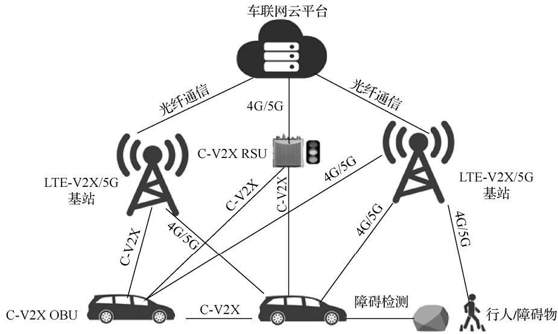
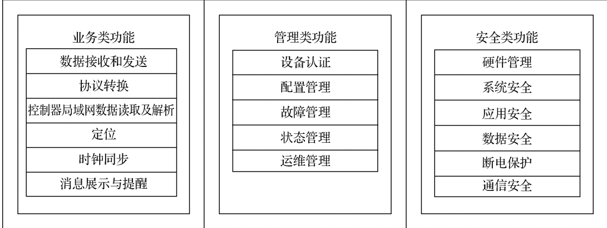
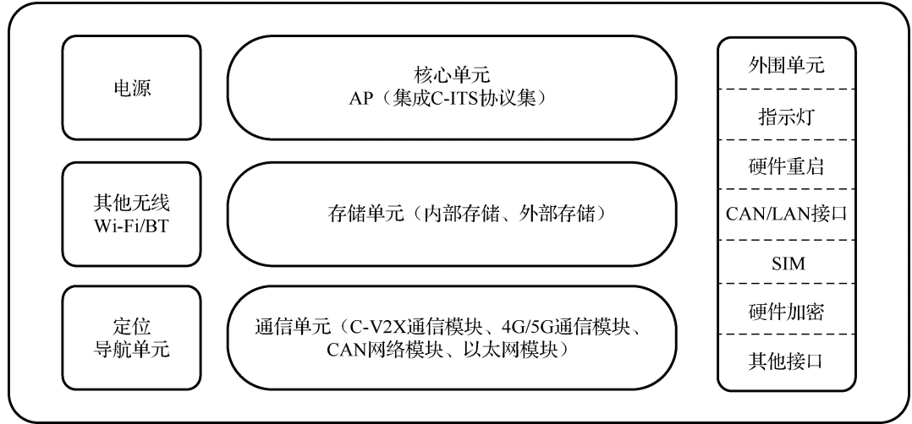

# 第4章 C-V2X车联网系统主要功能分析

C-V2X车联网系统终端按照位置不同主要划分为3个部分:C-V2X OBU、C-V2X RSU、车联网云平台(cloud platforms of Internet of vehicles, CPIV),如图4.1所示。其中,V2X OBU和V2X RSU负责车辆、路侧和其他交通对象之间信息交互;C-V2X车联网云平台是一个大的服务平台,拥有大量的车联网数据信息,负责信息分析处理与监测控制,如车辆的远程监控、路侧系统的远程监控、事件分析与处理、区域交通调度等[1]。

C-V2X OBU: V2X OBU搭载在智能汽车上,可获取车身的基本安全信息。V2X OBU包含高精度定位、惯性导航及V2X通信模块。在V2X OBU中,通过获取车身安全信息、高精度定位信息及V2X通信获取的周围其他交通环境信息,在车辆智能决策控制系统中进行融合,实现安全、效率及服务三大车联网应用场景功能。

C-V2X RSU: V2X RSU 主要用于智能交通与车路协同相关的信息感知、决策与控制信息服务,为智能驾驶与交通效率提供服务。V2X RSU 主要由C-V2X通信、高精度定位、信息显示等模块组成。其中,C-V2X通信模块用于交通信息的广播和转发;高精度定位模块用于路侧时空同步服务与高精度定位。同时,

C-V2X RSU还与路侧MEC、智能交通系统、显示屏等基础设施进行信息交互，实现车路协同控制。

车联网云平台:车联网云平台主要用于对C-V2X RSU及C-V2X OBU进行管理,以及对场景中的交通对象进行信息分析处理,并建立数据分析与处理模型,实现车路协同防撞预警、交通信息推送、交通调度、编队组队控制等服务。

#  4.1 OBU主要功能分析

## 4.1.1 OBU基本功能

OBU 的基本功能包括业务、管理和安全3类,其中,业务类功能围绕 V2X 业务的实现,用于完成 BSM 消息的上报、V2X 消息的接收与解析、车身数据的读取与解析、消息的展示与提醒;管理类功能负责完成设备的认证、管理与维护[2];安全类功能负责实现 OBU 自身,以及 OBU 与其他交互对象之间信息交互的安全保护。OBU 功能框图如图 4.2 所示。

###  1. OBU 数据接收和发送

OBU 支持数据的接收,包括通过PC5接收RSU广播的数据、通过PC5接收的其他OBU广播的消息、通过PC5接收的弱势交通参与者广播的消息,以及通过Uu接收的车联网云平台下发的数据;OBU也支持数据的发送,包括通过PC5广播的自身BSM消息和通过Uu向车联网云平台上传数据[3]。

###  2. OBU 协议转换

车辆自身的数据类型复杂多样，要想保证数据的正确接收和解析，就需要进

行协议转换,它将车身控制器局域网(controller area network, CAN)数据、Wi-Fi/蓝牙(bluetooth, BT)数据、C-V2X 数据等数据格式转换为中间件中指定的标准格式,因此需要对各种异构网络数据格式和中间件标准格式进行相互转换,以方便上层应用的开发使用。

#  3. OBU时钟同步

时钟同步在C-V2X中发挥着重要作用。根据其同步原理,可将时钟同步方法分为两类:主从同步和互同步[4]。

主从同步的主要思想是网络中所有节点的时间与主控节点(时间参考节点)保持同步。首先,在网络节点中选取主控节点,随后主控节点广播带有自身时间信息的分组。其次,所有收到分组的节点在获取主控节点时间信息后与其保持同步。对于采用主从同步的不同时钟的同步方法,其区别主要是对主控节点的选取和维护方法不同。这种方法存在两个缺点:一是依赖主控节点,当主控节点位置发生变化或离开网络时,对网络同步性能影响较大;二是当网络规模较大、跳数较多时,远端节点的同步精度受累积误差的影响较大[5]。因此,主从同步更适用于静态拓扑或拓扑变化较慢的小型网络。但如果能对远端节点采取一定的时间补偿措施,则此类方法也可在一定条件下应用于大型网络。

互同步是一种分布式时钟同步方法，其主要思想是网络中所有节点依据彼此的时间信息进行时钟调节，而不依赖于某个特殊节点。这种方法无须选取主控节点，每个节点都广播带有自身时间信息的分组，当节点收到邻节点的时间信息后，根据彼此的时间偏差调节时钟，最终实现同步。互同步的节点广播时间信息的方式以及对邻节点时间信息的处理方式与主从同步不同。互同步不受主控节点限制，因此更适用于移动多跳网络。

OBU采用主从同步方法时,可以OBU自带的GNSS模块作为同步时钟基准,为OBU与其他设备提供同步时钟源以进行同步。如果车载系统中存在多个GNSS模块,则需要根据系统设计时的优先级确定同步时钟源。

#  4. OBU定位

车辆定位是实现智慧交通、自动驾驶的必要条件。随着C-V2X应用从辅助驾驶到自动驾驶的发展，其性能要求在可靠性、时延、移动速度、数据速率、通信范围及定位精度等方面发生了变化。与其他应用不同，定位信息是保证与车联网位置相关业务可靠性的基本要素之一[6]。

在车联网中,道路安全、交通效率、信息服务、自动驾驶等不同应用类型具有不同的定位性能指标需求。作为移动的实体,车辆会经历不同的道路环境和场景,包括高速公路、城市道路、封闭园区及地下车库等,不同的场景对定位技术的要求各不相同[7]。

#  5. OBU的安全与管理类功能

车联网 V2X 交互基本上是通过无线通信的方式传输消息的,然而,车联网无线通信网络的开放性、无线链路的脆弱性、网络拓扑的动态变化、节点计算能力有限及广播等特性,使 OBU 在外部网络通信中可能遭受恶意用户和攻击者的伪造、篡改、窃听及重放等各种类型的攻击。攻击者不仅可以从外部网络进行攻击,还可以入侵 OBU 和车联网内部子系统,从而窃取、篡改隐私数据以及破坏信息的完整性[8]。所以,OBU 需支持硬件加/解密,满足认证、鉴权、数据的加密,应具备固件芯片的物理写保护功能,防止固件被篡改;OBU 系统应使用安全的通信协议保障管理通道安全,支持防攻击保护,防止设备参数或数据内容被攻击,以避免影响 OBU 设备的正常运行;支持设备参数防篡改,以防止影响设备的正常工作,同时支持对接收和发送的消息进行高速加/解密处理,防止被篡改或伪造后发送虚假的数据;支持在运行状态遇到异常断电时的数据自动保存,以防止数据丢失。

#  4.1.2 OBU 硬件架构

硬件设备层为 OBU 系统提供了整个硬件支撑[9]。硬件设备层涵盖了 OBU 的底层硬件设备,主要包括 3 种无线通信方式:自组网通信,即通过 LTE-V2X 模组进行 V2X 通信; 4G/5G 模组移动蜂窝通信;人机交互通信,如 Wi-Fi/BT(blue tooth,蓝牙)。除此之外,还需要车身通信接口,目前主要以 CAN 和以太网接口为主,OBU 可以通过这些接口获取所需的车身状态信息。OBU 的硬件架构如图 4.3 所示。

OBU 硬件由通信单元、存储单元与核心单元组成,支持 V2X 通信、定位,外部支持状态指示、硬件重启、数据与调试接口、CAN接口、以太网接口、用户识别(subscriber identity module,SIM)卡和硬加密功能。中央控制单元是 C-V2X OBU 的数据处理中心,主要承担 OBU 正常运转的运算和控制工作,是 OBU 硬件层的核心部件。

OBU的通信单元主要包括V2X通信模块、4G/5G网络通信模块、CAN网络模块、以太网模块等。

Wi-Fi/BT通信模块:HMI可通过Wi-Fi/BT访问OBU,用于与人机交互设备进行数据交互。

定位导航单元主要包括高精度 GPS/北斗导航系统(beidou navigation satellite system, BDS)定位模块、惯性导航模块,用以提供车辆的位置、方向、速度和时间等信息。高精度 GPS/BDS定位模块会结合 RSU的差分基站提供厘米级、亚米级差分定位精度,主要负责为 OBU 提供时间校准和位置信息获取服务,实现高精定位等功能。惯性导航模块主要用于辅助高精度 GPS/BDS定位,解决信号不佳或缺失等问题,有效降低在城区高楼林立环境下多路径效应的影响。

#  4.1.3 OBU 软件架构

##  1.软件架构

C-V2X OBU 的信息来源有 V2X、4G/5G、CAN、蓝牙、Wi-Fi 等多种通信模块,而把应用开发的所有工作都放在一起必然会造成模块的臃肿和模块内部的紊乱,是不可行的。OBU 属于嵌入式产品,系统资源有限。针对 OBU 通信的多源异构性与消息格式的异构性,遵循软件高内聚、低耦合的设计要求,利用分层设计思想,OBU 软件架构如图 4.4 所示。OBU 的系统软件架构包括 Linux 内核层、通信协议中间件层、V2X 消息中间件层、算法软件开发工具包(software development kit, SDK)层和应用层。

在 OBU 应用开发过程中,为了提高应用关键开发效率,按照上述分层结构进行设计。其中,通信协议中间件层主要用于实现 V2X 消息的信息加/解密、压缩编码、车身信息的解析、高精度定位处理及通信管理等功能,为上层 V2X 中间件层提供访问接口。

V2X消息中间件层在V2X消息接收过程中负责按照应用层标准对从通信协议中间件层获取的V2X消息进行解析,并填充到对应的数据结构中。在V2X消息发送时,通过该层将需要发送的消息填充到对应数据结构中并调用通信协议中间件层进行压缩编码及发送。

算法SDK层主要是将应用相关的算法打包,通过函数接口参数将相关的参数传递给算法对应的库函数,并返回输出结果。接口参数采用标准的应用层消息数据结构,为应用层提供格式化的数据和底层服务的接口。

图4.4 OBU软件架构

应用层主要负责应用逻辑的处理。应用层的主要功能是数据接收与发送处理、防撞预警判断、交通信息提醒等。应用层对中间件分发的应用数据进行处理,进行防撞预警判断,并将结果推送到HMI端,提醒驾驶员安全驾驶[10]。

#  2.中间件层

中间件层位于Linux内核层和算法SDK层之间,用于屏蔽底层通信设备的异构性,向上层应用提供统一的开发接口,实现应用软件层和硬件设备层之间的数据收发。中间件层采用了以数据为中心的“发布/订阅”设计模式,通过构建中间件层,可以使得应用层易于裁剪,其功能得以实现和扩展,Linux内核层的功能优化完善不会影响应用层,从而实现了设计的解耦,大大降低了复杂或苛刻系统对数据共享的集成难度。中间件层主要用于解决C-V2X车联网OBU不同业务功能和通信网络多样性的问题$^{[11]}$。

针对C-V2X车联网应用需求而设计开发的OBU中间件架构如图4.5所示。该中间件可分为6个主要部分:线程管理组件、中间件组件总线、信息安全组件、消息代理组件、异构通信网络管理组件和日志管理组件。其中,线程管理组件主

要针对中间件对并行化工作线程进行管理，提高中间件运行效率；中间件组件总线主要负责中间件的组件管理和初始化工作，提供应用访问接口；消息代理组件主要负责消息的分发，是中间件的核心；异构通信网络管理组件主要负责异构网络的事件监听、消息格式的转换、通信接口的选择等，为上层应用提供统一的消息格式；信息安全组件主要负责信息安全，提供数据的加/解密等功能；日志管理组件负责记录中间件的运行情况，应用层软件定期将日志管理文件发送给车联网云平台。

图4.5针对C-V2X车联网应用需求而设计开发的OBU中间件架构

#  1)中间件组件总线

中间件组件总线是应用层和中间件的桥梁，也是中间件初始化的入口。通过中间件组件总线，HMI可以获取底层数据。因此，中间件组件总线成为了上层应用与底层通信网络的“桥梁”。中间件组件总线的主要职能如下。

(1)中间件的初始化工作，是中间件工作的起点。

(2) 负责管理各个组件, 通信时查找组件列表, 提供应用层与组件的通信接口。

(3)创建线程池,利用线程池的管理机制对多个子线程进行有效管理与调度,提供中间件的并行调度机制。

#  2) 消息代理组件

消息代理组件采用基于发布/订阅分发模型，该模型包含消息发布者和订阅者，发布者发布消息，订阅者订阅消息，发布者也可以是订阅者。发布/订阅分发

模型可以使发布者和订阅者之间彼此独立，保证发布者发布的消息快速、准确地传送给订阅该消息的所有订阅者。

发布者和订阅者是通过主题来关联的。每个主题拥有唯一的主题标识。因此主题是发布者和订阅者实体的“桥梁”。当发布者发布的消息与订阅者的主题匹配时，就建立了通信关系，并为这些实体设定服务质量参数，为通信实体提供较高质量的服务能力，以此解决网络通信延迟等问题。对于每个应用实体而言，每个实体只需关注消息的发布与订阅，无须关注实体之间的消息传递。

#  4.2 RSU主要功能分析

车联网是一种移动自组织网络，可以有效提升交通安全、交通效率、舒适驾驶、信息娱乐等服务。交通信息对于驾驶员驾驶车辆特别有用，如事故警告或道路拥堵警告。然而，自组织网络的一些特殊特性，如车辆的移动性和较短的传输范围，导致车辆与车辆之间的连接时间非常短。为了避免这种情况，RSU被用作路边的固定装置和缓冲点，称为车辆到基础设施通信。RSU是车路协同系统的重要组成部分，也是突破车路协同技术的关键所在，其主要功能是采集当前的道路状况、交通状况等信息，通过网络将信息传递至指挥中心或路侧处理单元进行处理，并裁定相关信息通过网络传递到有相应信息请求的车载终端，辅助驾驶员进行驾驶。因此，RSU需要具有的功能如下。

(1)设备异构性处理:路侧端除了RSU外,还装备有多种传感器、路侧MEC、交通基础设施等,因而RSU需要具有管理从不同设备连接通信和收集数据的功能。

(2)数据快速分发:传感器模块或通信模块会获取大量交通数据,RSU需要保证处理的交通安全类信息的时效性,优先处理分发高优先级消息。

(3)统一的通信标准: RSU与I2V通信时应该遵从统一通信标准,从而实现与车辆、其他交通参与者的无障碍沟通。

(4)远程升级维护:RSU当前应用功能还处于初级阶段,需要根据发展需要进行定期应用更新。传统的升级方式是人工到现场完成升级,难度大,成本高。而RSU需要具备远程升级应用软件的功能,减少人力运营成本。

##  4.2.1 RSU基本功能

RSU 的基本功能包括业务、管理和安全3类,其中,业务类功能围绕 V2X 业务的实现,汇集路侧交通设施和道路交通参与者的信息上传至 V2X平台,并将 V2X消息广播给道路交通参与者;管理类功能负责完成设备的认证、管理与维护;

安全类功能负责实现 RSU 设备自身，以及 RSU 与其他交互对象之间信息交互的安全保护。RSU 业务类功能如图 4.6 所示。

图4.6 RSU业务类功能

RSU 接收来自车辆 OBU 和路侧设施产生的交通信息,根据交通场景的需要,通过PC5或者Uu接口,以标准化的形式发送给相应的交通实体;交通设备接入为了达到更好的交换交通场景信息的目的,通过各种硬件和软件结合的方式,将交通场景中所需的信息源产生的交通数据汇集到RSU后,通过标准化的协议发送到车辆OBU中使用。常用的交通设备包括信号灯控制器、雷达、人工智能(artificial intelligence,AI)事件检测相机和交通信息告示牌等。由于交通设备与RSU之间的接口尚未完全统一、协议不标准,因此RSU需要提供对各种接口协议适配的能力。对于收到的来自车辆OBU和路侧各种交通设备的信息,RSU通过分析可以提炼出路况状态的实时报告,进而可以交通事件的形式,发送给与之相关的其他RSU和OBU,从而改善通行效率和交通安全。RSU本身可以通过GNSS进行高精度定位[12-13],以用于各类消息。RSU可以把接收到的来自RTCM数据源的消息广播给车载OBU,实现车载OBU的高精度定位。MEC作为RSU的能力扩展单元,除了能提升RSU的计算和存储能力外,还能引入更多的本地应用,丰富交通场景的业务需求。同时,在RSU上应用分布式的业务应用设计模型,通过MEC数据汇聚后接入核心车联网云平台集中处理展现,能实现整个城市或者地区的交通路网动态规划调整。

RSU管理类和安全类功能如图4.7所示。RSU配置了专用的硬件加密模块,作为安全管理的基础器件提供本地的加/解密功能。为了防范入侵和网络攻击,RSU需要从设备系统和网络环境等多方面考虑安全问题,除了对系统固件进行必要的加固防范,对于设备暴露的硬件通信接口也要通过软件系统进行锁定和禁用。对于本地和远端的管理维护行为,除了必要的双向账号验证外,还要求对全过程实施通信承载加密,防止第三方截取数据。RSU支持硬件加密,可满足对认证、鉴权、数据的加密;应具备固件芯片的物理写保护的功能,防止固件被篡改。其系统应使用安全的通信协议保障管理通道安全;支持防攻击保护,防止设备参数或数据内容被攻击,影响RSU的正常运行。RSU支持设备参数防篡改,以防止影响设备的正常工作;同时支持对接收和发送的消息进行高速加/解密处理,以防止消息被篡改或伪造后导致设备发送虚假的数据。RSU也支持在运行状态遇到异常断电时的数据自动保存,以防止数据丢失。

图4.7 RSU管理类和安全类功能

RSU 支持路侧交通基础设施数据和道路交通参与者数据的收集,包括通过有线或无线方式收集路侧交通设备数据,通过PC5接收车辆数据和弱势交通参与者数据,以及通过Uu或光纤接收平台下发数据等。RSU支持路侧交通设施和V2X消息等数据的发送,包括通过Uu或光纤向平台上报数据、通过PC5广播从平台接收的数据、高精度定位辅助数据的转发等;RSU收集的数据类型复杂多样,为保证数据的正确接收和解析,RSU支持数据的协议转换,转换的数据包括通过有线方式收集的路侧交通设施数据和通过PC5监听的交通参与者数据,转换后的数据格式满足国家标准的要求。

#  4.2.2 RSU 硬件架构

路侧设备通过传感器和通信设备采集交通信息，分析处理后通过多种通信技术将这些信息发送给周边车辆和车联网云平台，如图4.8所示。

图4.8 RSU硬件架构

(1) RSU 融合了5G网络通信能力和传统RSU的功能,可实现5GNR与PC5数据的互连互通;可有效地支撑车联网中需要大数据回传和单位时间内大量重复数据下发的应用场景的通信需求;可实现与以太网的实时互动,满足上层应用平台对数据的收集、分析和处理;可构建广覆盖与直连通信协同的融合网络,保障智慧交通业务的连续性。

(2) RSU提供PC5网络覆盖,通过PC5广播收集汇聚的平台、道路、车辆等信息,为范围内的车辆、行人等提供V2X消息;可实现对部分依赖Uu传输的车联网数据的分流,将原有的单播改为PC5广播,减少5G网络资源的占用。同时,PC5可监听范围内的广播的V2X消息,实现路侧、车辆等信息的收集与汇聚。

(3)处理单元是路侧设备分析和处理不同网络通信数据的中心,通过接入的V2X通信模块与V2X车辆和其他V2X设备通信,通过蜂窝通信模块与车联网云平台通信,通过自身物理接口(串口、网口)与道路传感器通信,对获取的数据进行处理后分发给车辆和车联网云平台。定位模块负责为路侧设备提供时间校准和位置信息获取服务。

(4) 数据接收与数据发送:虚拟自组网是智能交通系统中的一项新兴技术。基于Uu的RSU的V2X消息发送/接收如图4.9所示。

图4.9基于Uu的RSU的V2X消息发送/接收

#  4.2.3 RSU 软件架构

路侧设备对通过通信设备和传感器采集局部道路地图、车辆基本安全信息、道路提醒、信号灯状态、交通参与者信息和高精度定位差分数据进行处理，与装有V2X通信设备的车辆进行通信，向驾驶员提供实时的道路状况、交通拥堵状况等信息。除此之外，路侧设备通过移动蜂窝通信方式向车联网云平台发送道路环境数据，同时接收车联网云平台发送的通知消息并通过V2X通信设备广播，以及接收信号灯配时信息逆向控制信号灯状态。

从 RSU 硬件架构和所处理的信息类型来看，RSU 负责管理与之相连的各种设备之间的通信信息并与之交互。

图4.10所示为基于轻量级中间件的RSU软件架构。该软件架构采用了发布/订阅模型,整合了应用消息分发业务和底层通信业务,为应用层屏蔽了路侧设备的底层通信网络细节,并设计了消息优先级调度分发方法,提高对紧急性高的消息的响应速度。在此架构的基础上,设计实现了RSU的应用层安全应用开发和远程升级。从功能上看,RSU软件架构包括应用程序层、路侧设备中间件层、Linux

系统层和硬件设备层,各层根据位置完成分配的功能,形成一个灵活且易扩展的系统结构。下面主要介绍 RSU 软件架构中前两层的内容。

图4.10基于轻量级中间件的RSU软件架构

#  1.应用程序层

通过对路侧设备的应用场景和硬件结构的分析可知，路侧设备需要执行多种任务，所以其内部部署的应用软件较多。从应用软件性质上看，路侧设备应用程序层的软件可以分为两类：车联网应用和应用安全升级控制应用。

##  1)车联网应用

车联网应用根据应用任务的紧急性可以进一步划分为信息服务类应用和安全类应用。其中，信息服务类应用包括广告信息推送、车流量信息统计、ETC等;安全类应用包括道路地图发布、信号灯信息发布、道路危险信息预警、差分定位信息转发、车辆安全信息转发等辅助驾驶的应用。

##  2)应用安全升级控制应用

应用安全升级控制应用在路侧设备中以守护进程的形式运行，负责记录路侧设备中运行的车联网应用软件的版本号，并定期通过车联网云平台检查和下载应用软件的更新包，控制路侧设备车联网应用的安全更新。

#  2. 路侧设备中间件层

路侧设备连接管理的通信设备和传感器的类型及数量根据任务定位来配置,应用程序层运行的软件随之不同。以路侧设备连接管理的传感器为例,分为道路温度传感器、湿度传感器、风速传感器、摄像头等,路侧设备获取这些传感器采集的数据后,经过本地分析或发送给车联网云平台分析处理,获得道路运行的实时情况。

在嵌入式平台上，路侧设备一般以多进程或多线程的方式分别管理连接传感器。这些数据需要被快速处理，以提高应用程序响应速度及减少数据传输时间。因此，路侧设备中间件层需要提供高效的管理机制来处理这些信息。

路侧设备 RSU 中间件层位于 Linux 系统层和应用程序层之间,封装了路侧设备提供的底层通信接口,屏蔽了底层通信设备类型的异构性,向应用程序层软件开发提供统一的接口,完成硬件设备层和应用程序层间的数据收发控制。路侧设备中间件层总体架构如图 4.11 所示。

图4.11 RSU中间件层总体架构

##  1) 通信网络管理层

通信网络管理层位于Linux系统层之上,主要由通信网络监听模块和通信接口选择模块组成。通信网络管理层主要完成路侧设备通信模块的数据收发通道的

管理，并将收到的通信模块数据转换为标准格式后，发送给其上的消息代理层，以及将收到的应用程序层消息通过通信模块对外发送。应用开发者无须考虑复杂的异构网络的区别，只需要考虑消息的提取和发送即可。图 4.12所示的 RSU 调用底层通信接口发送应用层消息和图 4.13所示的 RSU 通信模块消息接收/转换。路侧设备的车联网应用需要通过底层通信模块获取外界的交通环境信息，并将处理后的信息通过通信模块发送。车联网应用程序与底层通信模块通过消息代理层进行数据交换。

图4.12 RSU调用底层通信接口发送应用层消息

如图4.13所示,通信网络监听模块监听不同通信模块的接收通道的消息。每一个通信模块接收的消息的类型和内容固定,因此将消息主题预先存储在一个配置文件中,中间件启动时读取配置文件,根据配置文件的消息类型描述完成通信模块消息主题的发布及注册。通信网络监听模块收到主题消息后,将主题消息发送给消息代理层,消息代理层分析消息主题的类型,查询主题/订阅者映射表后,发送给订阅此主题消息的所有应用程序。

#  2) 消息代理层

消息代理层是路侧设备车联网应用程序与附属的通信单元、数据感知单元和车联网云平台之间通信的“桥梁”。消息代理层由3部分组成:消息发布者(publisher)、消息订阅者(subscriber)和消息代理(message agent, MA)。消息代理层为应用程序层和底层通信模块通过监听程序提供统一的标准接口进行主题

消息的发布和订阅，这样应用程序层和底层通信模块建立起了一种松耦合的数据流向。

图4.13 RSU通信模块消息接收/转换

消息是发布/订阅分发模型中的最小通信单位,消息发布者和消息订阅者以消息完成通信。消息本身含有多种属性,包括长度、紧急性、时效性、时效时间、抢断性。其中,长度指消息的长度;紧急性指消息的紧迫程度;时效性指消息仅在一定时间内起作用,按照时效性可以将消息分为不断更新的动态消息、部分变化的半静态消息和标定不变的静态消息;时效时间是消息产生后的有效作用时间;抢断性指最急需处理的紧急消息。

消息发布者和消息订阅者在消息代理中注册之后，消息代理建立消息主题/订阅者信息表，存储发布者发布的主题消息与订阅该类消息的订阅者的关联信息。消息发布者将主题消息发送给消息代理，消息代理会对消息进行内部存储。消息代理通过查询消息主题/订阅者信息表，匹配双方的消息主题，将收到的消息转发给对应的消息订阅者，直到消息订阅者取消订阅该类主题。

消息发布者向消息代理发送消息时,注册信息中包括消息的紧急性等属性信息。消息代理根据属性信息计算主题消息的优先级,优先将高优先级的消息发送给消息订阅者。

图4.14所示为RSU消息代理层的软件架构。消息代理层主要包括消息接收模块、消息存储管理模块和消息调度分发模块三大功能模块以及主题/订阅者映射表。系统内的不同应用程序利用消息队列进行主题消息的通信。

图4.14 RSU 消息代理层的软件架构

#  4.3车联网云平台主要功能分析及架构分析

##  4.3.1车联网云平台功能分析

车联网云平台的目标是通过连接道路上的智能路侧设备以及移动车辆终端设备，实现车辆与人、车、路、云、图的智能信息交换共享，以及交通基础设施的数字化。车联网云平台需要提供业务、设备运维管理、安全、云边协同、能力开放与演进等五大功能。

###  1.大数据业务功能

车联网云平台需具有以下大数据业务功能:建立交通事件监测、事件分析、智能通知体系,将交通信息下发至RSU,RSU转发给OBU,主要场景为车内标牌、恶劣天气类事件等;提供城市/区域交通实时监控与分析,覆盖交通事故数、连接车辆数、拥堵路段、车型分布、车流量、事故高发路段排行、在线设备数等重要指标;通过车载与路侧的摄像头、雷达设备获取实时交通道路数据,结合

AI算法识别路面交通事件,将交通事件下发到RSU和OBU,并将事件转发给交管部门,主要应用场景为异常车况及异常路况类事件、交通道路事故等。

#  2.设备运维管理功能

车联网云平台设备运维管理功能包含以下内容:提供RSU、交通基础设施等设备状态实时监控,实时掌握设备情况,为运营管理人员提供日志分析、故障诊断工具,实现对故障进行快速定界定位,助力设备对故障进行及时处理;针对路侧红绿灯、北斗地基增强设备、边坡监测设备、路况诱导设备、气象监测设备等进行管理,平台侧对设备状态进行监测和管理。

#  3.安全能力

多中心容灾：在业务容量大、可靠性要求高的情况下，要求主备设备间采用双光纤连接，主备设备各有独立IP，业务可做到负荷分担，确保关键数据安全，保持设备数据一致性。

身份安全:应确保车路协同业务中的安全性,具备应对不明身份入侵者威胁的能力;具备完整的身份安全认证机制,防止匿名证书,防止隐私泄露等，实现可信的车路通信。

行为安全:具备车辆异常行为检测的能力;可搜集车辆和边缘节点上报的数据进行综合决策;可检测车辆恶意行为,并对恶意行为的不同分级采取对应处理。

区块链技术的应用:可与保险公司等第三方平台一起组成联盟链，保证车辆全生命周期内信息的存储，保证数据不可篡改、真实可信。

#  4. 云端协同能力

车端、路侧通过视频和雷达等感知数据来分析交通事件、交通流,对交通对象识别、定位和轨迹跟踪,完成实时分析信息推送给车辆,并上报给 C-V2X 云端平台进行监控和管理。云端平台需要支持必要的云边端协同能力,包括协同感知、协调决策与控制等,可实现云上控制的边缘计算的软件部署和更新。

#  5.能力开放与演进

车路协同平台具备交通融合感知能力和智能仿真分析能力，可为城市规划、交通管理、应急管理、共享出行、居民服务等业务提供数据接口和服务。云平台还需要提供数据开放接口，用户通过使用车路协同平台的接口，可以完整地使用车路协同平台的所有功能，包括交通事件、边缘设备等资源的创建、查询、修改和删除，以及车辆行驶数据查询、RSU设备新增查询等功能。

#  4.3.2 C-V2X车联网云平台架构分析

C-V2X车联网云平台拥有大量的数据信息，所有的数据都要汇聚到该平台上，并由平台进行分析处理，以开发相应的应用，如车辆的远程监控、路侧设备的远程监控等。

在车联网云平台上，云端可以连接第三方业务应用的信息中心，为路侧端和车载端发送全局的业务控制、业务共享信息，并存储全局设施、环境、用户、业务信息；路侧端与路侧信号控制器或者边缘服务器相连，收集驾驶、交通环境状态信息，进行路侧决策并发送路侧业务控制到车载端；车载端收集路侧控制信息、全局信息、周边环境信息并进行动态感知及实时决策。C-V2X车联网云平台的架构如图4.15所示。

图4.15 典型C-V2X车联网云平台的架构

从图4.15中可以看出典型C-V2X车联网云平台整体主要由路侧设备/车载终端、用户中心和信息平台等组成。其中,路侧设备/车载终端是C-V2X车联网的主要组成部分,也是直接与驾乘人员接触的设备,其功能是车联网功能的直接体现。在整个架构中,车载终端的主要功能是采集车辆数据,通过GNSS定位的位置来采集信息和通过车辆CAN总线进行信息采集,然后通过移动蜂窝网络与平台建立TCP/UDP连接,对采集到的数据进行实时上传。C-V2X车联网信息平台主要有5部分:通信服务器、调度器、应用服务器、数据库服务器和Web服务器。

从C-V2X车联网信息平台的扩展性、移植性、兼容性、操作性和稳定性等性能出发,结合系统的功能需求,C-V2X车联网信息服务平台综合信息系统主要由5部分组成,如图4.16所示。

图4.16 C-V2X车联网信息服务平台综合信息系统

其中,通信服务器主要实现车载终端、路侧设备与应用服务器之间的数据转发。通信服务器有四大功能:数据的接收,通信服务器接收车载终端和路侧设备获取到的车辆信息,车载终端和路侧设备获取到车辆信息之后,先按照数据的重要程度对数据进行分类处理,再打包选择采用TCP或者UDP方式把数据发送给通信服务器;数据的解析,通信服务器在接收到车载终端和路侧设备发送过来的数据后,按照预先定义好的数据格式对数据进行解析;数据接口的调用,通信服务器在接收到由终端设备和路侧设备发送的数据之后,调用应用服务器提供的接口对数据进行相应的处理;数据的转发,通信服务器可以接收由各种客户端(包括PC、移动终端)发送的数据指令,并把此数据指令转发给车载终端或路侧设备。路侧设备、车载终端和其他物体与C-V2X车联网信息服务平台综合信息系统进行信息交互时采用的是移动蜂窝网络(3G/4G/5G)技术。应用服务器、Web服务器和数据库服务器之间进行通信时是以以太网的方式进行的。

根据C-V2X车联网信息服务平台综合信息系统的功能需求,考虑平台的扩展性、移植性、兼容性、操作性和稳定性等性能,结合系统成本和开发难易程度,选择基于Java开源技术路线和.net平台来开发V2X车联网云平台,平台软件具有跨操作系统运行的友好特征,能够很好地支持主流的Linux、Windows、UNIX系列的服务器操作系统。选择以Java和C#作为开发语言,既有利于开发软件的轻量化,占用系统资源少,又使得系统容易扩展,如果升级到大型系统,则升级硬件和稍微更改软件配置即可。C-V2X车联网云平台的软件架构如图4.17所示,其主要分为4层:基础软件层、核心应用服务层、应用逻辑层和展现层。

图4.17 C-V2X车联网云平台的软件架构

基础软件层:包含应用服务器、Web服务器和数据库服务器。

核心应用服务层:包含应用集成接口(与其他平台进行信息交互提供的接口)、基础应用服务(信息查询服务、认证与授权服务等)、应用开发组件(日志管理、安全管理、异常管理等)。

应用逻辑层(根据客户需求整合核心应用服务层的信息实现相应功能):车辆远程监控、信息服务、货车综合管理等。

展现层:通过网页的形式向用户或者开发人员展示应用逻辑层的功能结果，以及与地图交互的一些功能展示。

利用C-V2X车联网云平台上传的数据，与其他合作方进行数据共享，该平台提供车联网数据的存储和分布式处理能力，用于数据分析与统计、数据挖掘和商业智能等，分析挖掘出有价值的信息，构建模块化的分析模型，如驾驶员驾驶行为分析、远程诊断与预警等，进而形成基础应用服务。其主要应用有路侧设备及其附设设备的管理和车载远程监控。以车载远程监控服务为例，其基础应用服务需具有的典型功能如图4.18所示。

在图4.18中,云端可以连接第三方业务应用的信息中心,为路侧端和车载端发送全局的业务控制、业务共享信息,并存储全局设施、环境、用户、业务信息;路侧端与路侧信号控制器或者边缘服务器相连,收集驾驶、交通环境状态信息,进行路侧决策并发送路侧业务控制到车载端;车载端收集路侧控制信息、全局信息、周边环境信息进行动态感知及实时决策。

图4.18 车载远程监控服务基础应用服务需具有的典型功能

#  参考文献

[1]唐慧.基于V2X车联网信息平台关键技术研究与实现[D].重庆:重庆邮电大学,2018.

[2] 董振江,古永承,梁健,等.C-V2X车联网关键技术与方案概述[J].电信科学,2020,36(4):3-14.

[3] 董金玮，苑寿同，胡鑫，智能网联先导区道路交叉口车路协同系统设计[J].时代汽车，2021(6):191-194.

[4]王波，叶晓慧，赵玉亭，等.自组织网络时钟同步研究综述[J].计算机科学，2010，37(5): 5.

[5]吴承治，罗正华.浅析AdHoc网络的时钟同步协议[J].现代传输，2013(6):9-17.

[6] 刘琪,洪高风,邱佳慧,等.基于5G的车联网体系架构及其应用研究[J].移动通信,2019,43(11):8.

[7]万金鸣，康诚，岳承翰.GNSS-RTK定位技术在智能网联汽车测试中的应用研究[J].运输经理世界，2020(14):2.

[8]刘晓龙.车联网OBU多级安全架构及通信方案研究[D].镇江:江苏大学,2018.

[9]张号.V2X路侧设备软件技术的设计与实现[D].重庆:重庆邮电大学,2019.

[10]杨允新.基于V2X的车路协同系统防撞预警研究与实现[D].重庆:重庆邮电大学,2019.

[11] 蒋健春,欧小龙.一种V2X车载终端消息自适应调度管理系统及方法:CN110267228B[P].2022-03-22.

[12] 蒋健春，贾敬森.一种基于C-V2X、雷达与视觉的智能路侧感知系统:CN112767475B[P].2022-10-18.

[13] 蒋健春，奚川龙.一种多功能V2X智能路侧基站系统:CN111554088B[P].2022-03-22.

