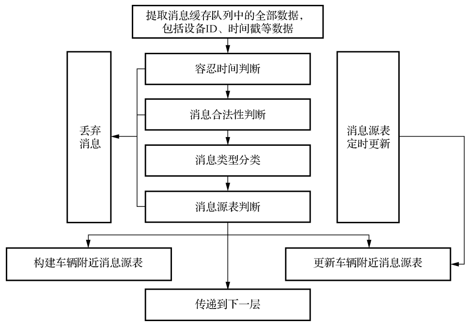
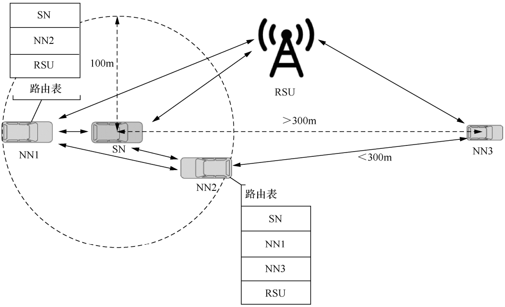
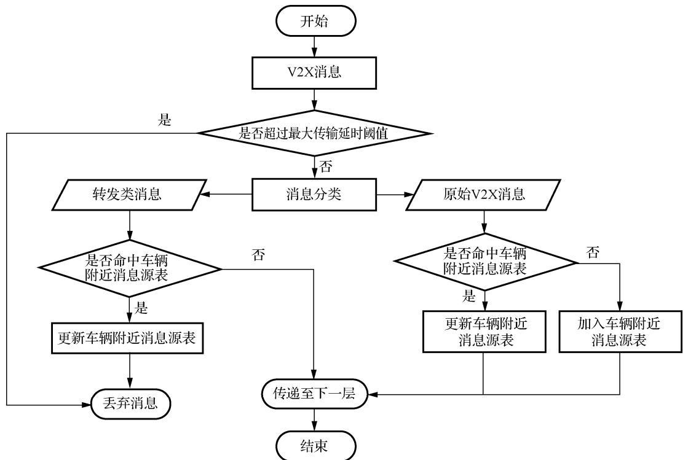
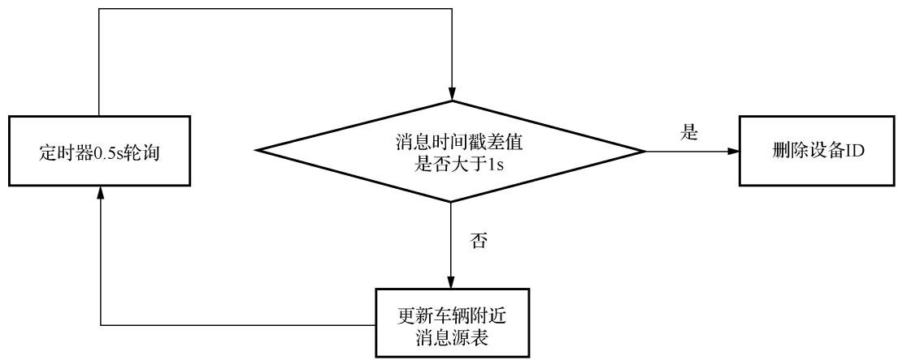
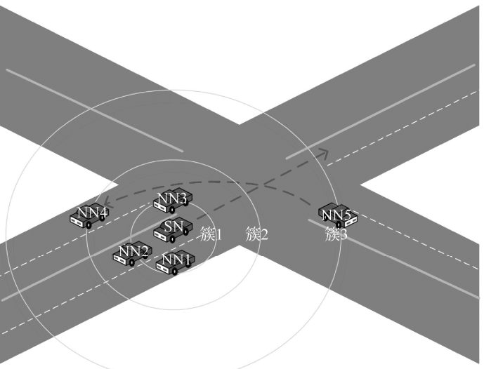
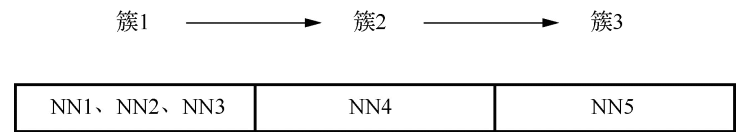

# 第5章 车辆V2X消息接收预处理

在V2X车联网系统中,智能网联汽车行驶在道路上时会收到网络中广播的海量V2X消息,其消息特征是数量大、种类多。由于终端硬件性能有限,如果每一条消息都按照统一队列"先进先出"的思想来处理,势必会造成消息延误,因此合理对消息进行分类和过滤处理,设计相对可靠的预处理体系非常关键,这样可提升终端对重要消息的实时处理能力,提高V2X网联汽车整体的安全性。本章通过设计消息过滤模型和消息关联性聚类模型的消息预处理机制,生成消息优先级队列,以此优先级队列作为防撞预警中目标威胁评估方法的消息处理序列,以提高车载终端对V2X消息的处理能力。

## 5.1 V2X消息预处理研究现状分析

### 5.1.1 V2X车联网消息预处理现状

C-V2X 通信技术通过 Uu 接口和 PC5 接口实现端到端的信息交互,两者相辅相成,互相配合,共同构建车辆自组网(vehicular ad-hoc network, VANET)。VANET 的网络节点是智能网联汽车,一个 VANET 由通信范围内的智能网联汽车共同组成。因为车辆在实际交通中的时空位置属性是不断变换的,VANET 中的网络节点拓扑结构存在频繁变化问题,并且实际交通道路场景存在大规模的 V2X 设备,所以,信道资源利用、链路访问控制、消息预处理策略等研究领域备受行业内关注。

Fakhav 等[1]通过提出基于车辆消息队列的周期检查策略来建立 V2V 链路的方法,以合理分配 V2V 的信道资源。车辆消息队列的周期检查策略的核心思想为利用信噪比(signal to interference plus noise ratio, SINR)限制和总网络加权最小的约束,从而使车辆选定适宜 V2V 链路的信道。同时,为了解决大规模 V2X 设备接入的应用场景下数据传送的稳定性问题,Zhang 等[2]提出了一个基于全双工非正交多址接入(full-duplex non-orthogonal multiple access,FD-NOMA)分布式非全双工 V2X 系统模型,然而,传统的Uu用户连接管理架构依赖于云计算来实现,这显然不能保证数据接入的实时性。Emara 等[3]在 Zhang 的基础上针对

FD-NOMA架构,提出了利用移动边缘计算技术来降低V2X设备间的通信延迟的设想,但由于其存在大量的计算卸载策略,设备间的配合难以实现资源同步和计算资源等待。

海量的设备接入不可避免地会出现消息拥塞的问题[4]。Liu等[5]针对目前LTE网络采用正交多址接入方式,不能充分地使用带宽资源导致高密度的无线局域网中出现的数据拥挤问题,提出了一种基于非正交多址接入(non-orthogonal multiple access, NOMA)的传输方案。Huang等[6]针对车联网中冗余的消息出现的消息拥塞问题,提出一种数据概率上传选择方案来应对同一个物体被频繁探测到的多次广播数据造成的网络高负载和高延迟问题,以降低通信开销。

为了更高效地利用通信资源。Zheng等[7]针对V2X信道资源分配问题,将该问题解耦成3个阶段,分别对这3个阶段设计算法并得出联合求解算法,确认其收敛及最优性。Wang等[8]围绕Uu及VANET模式的共存,设计了一种基于能量感知的频谱共存方案,减少了数据冲突的风险。通信资源的共享可以提高C-V2X车联网的稳定性和安全性[9]。Sial等[10]设计了便捷计算的分析框架,使得V2V通信链路和附近的车辆可通过计算关联概率来选择是使用PC5模式还是使用Uu模式。

以上学者对V2X信道资源进行了大量研究,通过合理利用信道资源的方式来保证V2X通信网络的可靠性。

每台V2X设备都有周期性消息和非周期性消息,且消息种类繁多,从消息传输层面上考虑,因为信道资源的局限性,这些消息在传输过程中会有传输竞争,所以设定多个消息种类的优先层次可降低问题的出现,以保障辅助安全类消息的传输可靠性。为实现安全消息在网络割裂情况下的有效传播,本章参考文献[11]提出了基于区域广播的VANET机会路由转发算法,不同于点对点的传播方式,该转发算法结合机会路由中车辆“存储-携带-转发”的通信方式来实现安全消息可靠传输的目的。此外,针对不同优先级消息在VANET中的传播性能[12],Khabazian[13]提出了一种基于消息生成-消失的性能分析模型,为消息的优先级研究提供了一种新的参考方法。该模型通过控制在系统稳态下低优先级并行发送的数据的概率分配、高优先级的节点数目和每个跳跃的发送间隔来减少C-V2X设备的报文传输次数,以缓解消息阻塞。

#  5.1.2 消息关联性聚类研究现状

在 C-V2X 通信中, V2X 消息可分为安全类消息和服务类消息两大类。因为 OBU 计算能力有限, 高关联度的安全类消息应当比其他消息优先处理, 但在预处理方法中存在关联性消息聚类效果差和时效性不佳的问题。

针对以上问题,研究者提出了多种解决方案,本章参考文献[14]针对消息处理优先级提出了一种基于信号强度的$k$均值聚类(k-means)算法,采用假定两车之间接收消息的信号强度与车间距离成线性反比的关系[15],根据车辆间距离划分消息关联度,这种方案能实现简单场景中的消息关联性聚类,但在实际交通环境中应用效果较差。在实际交通环境中,两车间的信号强度与车间距离不成线性关系,且远处车辆的消息关联度不一定比近处车辆的消息关联度低,例如,前方车辆与本车发生车道资源争抢,而较近处车辆保持安全行驶时。

本章参考文献[16]也是对近邻的 BSM 消息进行优先级排序,但消息聚类时对不同类型的消息做同样的聚类处理是有缺陷的,因为如果在车联网领域中将娱乐类消息和安全警示类消息视作同一优先级进行处理,那么很可能错过安全警示类的消息而威胁系统安全。本章参考文献[17]针对远距离目标威胁因子获取精确性存在的交通安全隐患问题,提出了 V2X 无线通信技术和雷达技术相结合的方案,该方案能较为精确地获取远处车辆的消息相关度,但在消息预处理的时效性上得不到保证。本章参考文献[18]、[19]采用了批处理的方式,虽然保障了预处理的时效性,但在车联网的应用中仍存在一定的局限性,批处理的方法虽然具有一次性处理一组报文的优势,但如果一组报文中包含不合法的报文,则会导致全部报文遗失。本章参考文献[20]利用 k-means 算法对消息进行分类,由此将消息分为各种优先级别,但在每次迭代处理过程中,新的簇心的选取采用随机策略,其算法收敛具有不确定性,难以适应车联网对消息实时的需求。

针对上述问题，作者提出根据车辆轨迹交叉可能性和距离因素的 k-means++算法，该算法在初始化阶段对簇心的选取策略优于传统的 k-means算法，提升了计算效率。通过将与轨迹交叉的可能性和距离作为聚类因素，合理降低了近距离无威胁的车辆的消息关联度，相应地提高了远距离有威胁的车辆的消息关联度。

#  5.2 V2X消息过滤模型

消息过滤的目的是过滤掉冗余、过时的消息，为下一步的消息关联性聚类提供数据清洗，避免噪点数据影响聚类结果。作者提出的消息过滤模型如图5.1所示，主要方法为通过构建车辆附近消息源表反映附近通信车辆，使每辆车自维护附近车辆数据，当车辆接收到每个V2X数据后，通过判断消息类型，并查询车辆附近消息源表，来决定是否需要丢弃消息继续进行处理。这样可以过滤掉大部分的无效消息，减轻OBU的计算压力。

消息过滤模型的过滤步骤概括如下。

(1)对消息进行常规校验,包括时间有效性校验、合法性校验、一致性校验。通过剔除过时的、冗余的、无效的V2X消息,以避免不必要的查表操作。

(2)对检验通过的有效消息进行分类,通过与车辆附近消息源表进行对比的方式,决定是否需要更新消息源表中该设备的信息。

(3)附近消息源表在固定时间间隙内执行自维护程序，以保证数据的准确性。

#  5.2.1 V2X消息过滤模型的典型应用场景

根据路由情况，V2X消息可以分为两大类：原始V2X消息（也称基础V2X消息，即未经过路由装置转发的V2X消息）和转发类消息。

在图5.2所示的交通环境中,为了方便描述,只研究一辆车接收、缓存并过滤周围车辆发来的V2X消息的情况。这里将这辆车称为源节点(source node, SN),将其他车辆称为邻居节点(neighbor node, NN),这里定义的车辆均是具备V2X通信能力的智能车辆。根据本章参考文献[16]可知车与车、车与RSU之间分别通过PC5通信协议和Uu通信协议进行数据交互,为方便描述,假设C-V2X的PC5通信方式的最大距离为300m,车辆每间隔100ms广播一条消息。

图5.2 智能车辆、RSU同时参与的交通环境

NN1、NN2与SN之间的距离都小于100m, V2X消息不需要进行路由中转,它们之间通过PC5接口直接进行数据交互;而NN3与SN的距离大于300m,它们之间必须通过RSU进行中转广播通信。

在不考虑协同转发策略的情况下,SN有可能接收到的V2X消息存在重复冗余的情况,例如,SN既收到了NN3经过RSU路由转发的V2X消息,又收到了NN3经过NN2路由转发的V2X消息,甚至出现SN收到了经过RSU转发给NN1和NN2再转发到SN的多级路由消息,这显然造成了SN的重复消息接收。在实际交通环境中,每辆车的信息处理量会随着周围车辆的数量增长呈指数级增加,这大大降低了车联网的健硕性。

#  5.2.2车辆附近V2X消息源表的构建方法

为了解决车载终端接收到的消息冗余问题，节省宝贵的计算资源，以及考虑到车辆在行驶过程中网络拓扑结构变化迅速的特点，作者设计了一种车辆附近消息源表来过滤重复转发的消息，其作用是让本车 OBU 能够短时记忆感知到的其他智能车辆，类似于关联车辆的小型数据库系统，并采取一定的策略来动态更新数据[21]。

区别于数据库系统的数据持久化,车辆附近消息源表存在随机存取存储器(random access memory,RAM)中,RAM中的数据在运算过程中无须磁盘输入

输出(input output, IO),计算会非常迅速。下面给出消息过滤的详细步骤及其车辆附近消息源表的自更新方法。消息过滤模型的过滤流程如图5.3所示。

V2X的失效消息可以分为过时消息、非法消息、错误传输消息等。车载终端应首先排除失效消息以确保接收到的消息的及时性和可靠性。对V2X消息进行过滤后再进行车辆附近消息源表的构建的步骤如下。

(1) 将接收到的 V2X 消息提取时间戳 $T_{rv}$, 并判断当前系统本地时间 $T_{hv}$ 与 $T_{rv}$ 的差值 $\Delta t$ (单位为 s) 是否超过消息最大传输延时阈值。

$$ \Delta t = T_{hv} - T_{rv} \qquad (5.1) $$

这里设定的消息最大传输延时阈值为1s。若 $\Delta t\ge 1$，则认为这是过时消息，已经不能反映目标的实时状态，应当丢弃；若 $\Delta t<1$，则进行下一步处理。

(2)根据消息是否经过转发将 V2X消息分为转发类消息和原始 V2X消息(即未经过V2X网络节点路由转发的消息),并提取 V2X消息的发送源设备ID与车辆附近消息源表进行比对,以决定该消息是否加入内存缓冲区,设计加入缓冲区的目的是批量移动数据高效地传输数据。车辆附近消息源表的构建规则如下。

①若是转发类消息,且该设备ID不存在车辆附近消息源表中,则将该设备加入车辆附近消息源表并将该消息接收到内存缓冲区。此时,该消息的源发送设

备距离本车较远，还无法通过PC5接口进行直连通信，威胁评估程度不大，但仍具有很高的消息价值。

②若是转发类消息,且该设备ID存在于车辆附近消息源表中,则更新车辆附近消息源表时间戳后丢弃该转发消息。该消息存在车辆附近消息源表中,说明在自更新策略间隙时间内已经收到过该设备ID的原始数据。

③若是原始V2X消息,且该设备ID已经存在于车辆附近消息源表中,则将其时间戳更新并接收及处理该消息。

④若是原始V2X消息,且该设备ID不在车辆附近消息源表中,则接收并处理消息,将该设备ID和消息发送时间加入车辆附近消息源表中。

(3)由于车辆在行驶过程中车辆自组网在不断变化,为了避免自组网中存在过时V2X设备,使得转发类信息被过滤,影响安全驾驶,需要采取一定的策略确保车辆附近消息源表中数据的真实性和实时性。这里采取自更新策略对车辆附近消息源表进行数据更新,其流程如图5.4所示。

图5.4自更新策略流程

自更新策略通过构建一个定时器以固定时间(如0.5s)间隔轮询车辆附近消息源表中的记录,对比记录中消息时间戳与本地时间差值$t = t_{hv} - t_{rv}$ (其中,t用于表达时间差,单位为s; $t_{hv}$表示OBU的本地时间; $t_{rv}$表达接收消息的发送时间戳),如果t>1,则将设备ID从表格中删除;否则会存留相关的设备信息。

#  5.3 V2X消息关联性聚类模型

关联性聚类的目的是将接收到的V2X广播消息根据相关联程度划分梯度队列并将相关联程度高的消息划分到同一队列中进行聚集。当进行多次迭代后,最终对聚类消息集合的优先级顺序按照一定的规则进行界定,这样就将所有待处理

消息划分到k个优先级队列中。对于待处理消息集合,威胁评估等应用会根据优先级聚类消息调度策略按序处理[22]。

#  5.3.1 V2X环境中的消息聚类分析

作者考虑的是大密度车流量的无 RSU 交通调度的无信号灯的研究场景，如图 5.5 所示。为了便于分析，根据本章参考文献[14]，视两车之间接收消息的信号强度与车间距离成反比，但若仅仅是通过消息信号强度来假定车间距离从而界定优先级顺序，则有可能出现意料之外的优先级处理顺序。例如，本章参考文献[15]基于距离聚簇预处理的方式将图 5.5 中的 SN 周围的车辆划分为以下各簇。

①簇1车辆:NN1、NN2、NN3。

②簇2车辆:NN4。

③簇3车辆:NN5。

图5.5 消息关联性聚簇分析

SN正通过没有信号灯的十字路口,SN右前方的NN5正在左转,而和SN同向车道的NN1、NN2正同向行驶,和SN逆向车道的NN3、NN4正相向行驶。很明显,NN1与NN2在SN后方同向行驶,它们对于SN的威胁可以忽略不计,因此它们的消息关联度是很低的,即便有威胁,SN也无法做到规避。而NN3与NN4在另一车道相向行驶,与SN轨迹无交叉可能性,威胁并不大。若按照基于距离聚簇预处理的方式,聚簇后的消息簇如图5.6所示,其消息处理顺序为簇1、簇2、簇3,这样的处理顺序反而将与SN关联度最高的NN5置于最低优先级,这显然不能达到预期的结果。

图5.6 聚簇后的消息簇

#  5.3.2 基于 $k-means++$ 算法的消息关联性聚类模型

为了解决 5.3.1 小节中所述问题并考虑到消息处理的及时性，消息关联性聚类模型将本车与目标的相对距离及角度和(相对方位夹角与相对航向角的角度之和)作为聚簇参数。使用上述两个关键性因素作为消息相关性判断可以较好地反映实际交通环境中可能存在道路资源发生争抢，且距离很近极有可能发生碰撞危险的情况，从而更好地为威胁评估应用提供服务。

传统$k$-means算法每次迭代需要根据距离函数求解全部数据点与聚簇中心点的距离，因此其时间复杂度$O(tknm)$与对象数目$n$值和迭代次数$t$值成正比。本小节通过对$k$-means算法进行迭代次数优化和数据稀疏减少算法时间复杂度，加速聚类中心的生成[23]。

##  1.模型介绍

模型采用$k-means++算法来进行车路协同环境中的关联性消息聚类。作者主要针对初始化质心和数据参数的选取方法,设计了车路协同环境中面向于V2X消息的$k-means++算法。

在 V2X 消息预处理领域中不需要过多的优先级消息队列,因此这里选定的 k 值聚类数目为 4 (即 4 个优先级队列),它们的含义分别如下。

①紧急队列(emergency queue)。

②高优先级队列(high priority queue)。

③中优先级队列(medium priority queue)。

④低优先级队列(low priority queue)。

接下来介绍关联性聚类模型的详细过程，初始化质心的优化选取方法如下。

(1)随机选择输入数据点集合之中的某个数据点,充当首个聚类中心 $\mu_1$。

(2)对于数据集中的其余数据点 $x_i$ ,计算它与 $\mu_i$ 的欧几里得距离 $D(x_i)$ 。

$$D(x_i) = \|x_i - \mu_i\| \qquad (5.2)$$

(3) 在计算结果中选择 $D(x_i)$ 较大的数据点作为新的聚类中心,因其具备一定程度的分散性,故将 $D(x_i)$ 相对偏大的数据点选定为聚类中心的概率偏高。

(4)重复步骤(2)和步骤(3),直至获得 k个聚类质心。

(5)基于前述操作所获得的k个质心,执行k-means算法。

在步骤(3)中,为了避免选择到样本空间边缘的点,减少质心迁移的次数从而减少距离点的计算,选择 $D(x_i)$ 较大的而不是最大的数据点。为了减少迭代次数,新的质心选择策略可以根据样本点数目n和k的值来界定,具体的界定方法如下。

假设需要聚类的V2X消息总条数为n,聚类数目k为4,簇内平均数据点数目为n/k个。

第一次迭代,计算出n-1个样本点距离第一个簇心$W_1$的距离数组$D(d_i$为$X_i$与$W_1$的距离),再对数组D进行排序操作,排序后数组元素$d_i$依次增大,$D=\{d_1,d_2,\dots,d_{n-1}\}$ ($d_1<d_2<\dots<d_{n-1}$)。

第二次迭代,选取 $X_i$ 作为新质心,其中

$$i=\left\lfloor\frac{n-1}{2k}\right\rfloor \quad (5.3)$$

第 t 次迭代, 选取 $X_j$ 作为新质心, 其中

$$j = \left\lfloor \frac{n-t+1}{2k} \right\rfloor \quad (5.4)$$

对于给定的样本集P,将其划分为4个优先级队列,k-means算法针对聚类所得到的簇为$C = \{C_1, C_2, C_3, C_4\}$,划分的平方误差为

$$E = \sum_{i=1}^{k} \sum_{x \in C_i} \|x - \mu_i\|^2 \quad (5.5)$$

式中, $k=4$; E越小表示数据集样本中相似程度越高,当E局部最小时,算法收敛。其中, $\mu_i$为簇中心,其计算公式如下。

$$ \mu_i = \frac{1}{|c_j|} \sum_{x \in c_j} x \qquad (5.6) $$

式中, $c_j$ 为聚类簇; $|c_j|$ 为簇的个数; $x$ 为样本数据点。

#  2.聚类参数和数据稀疏

下面讲解聚类参数相对距离与角度和数据获取方式以及计算方法。

##  1)目标V2X设备的相对距离

汽车CAN总线是各个传感器和电控系统的数据传输总线,因此OBU可以从本车CAN总线获取高精度定位消息,结合解析得到的BSM对应的目标设备的经纬度位置信息,可以计算出本车与V2X设备的相对距离,相对距离公式如下。

$$ \text{Dis} = 2R \times \arcsin \left[ \cos(\alpha_{\text{lat}}) \cos(\beta_{\text{lat}}) \cos^2 \left( \frac{\alpha_{\text{long}} - \beta_{\text{long}}}{2} \right) + \sin^2 \left( \frac{\alpha_{\text{lat}} - \beta_{\text{lat}}}{2} \right) \right] \quad (5.7) $$

式中，$R$为地球半径，取平均值，约为6371km；$\alpha$、$\beta$分别表示本车与目标车辆；long、lat分别表示经度和纬度。

在对 k-means++算法进行数据稀疏时，根据对消息的筛选避免计算复杂的三角函数，可以提高程序执行效率。数据稀疏的判别函数如式(5.8)所示。式(5.9)用于确定目标相对距离，以及消息类型参数与该 V2X 消息是否参与消息聚类之间的关系，具体描述如下。

(1)若是原始V2X消息,则参与消息聚类;否则进行以下判定。

(2)如果两车距离超过250m,则认为消息低关联性,直接进入最低优先级队列,不参与消息聚类;反之,参与消息聚类。

$$H(d,c) = \left(1 - \frac{d}{250}\right)^{1-c} \quad (5.8)$$

$$ \Phi = \begin{cases} 1, & H(d,c) \ge 0 \\ 0, & H(d,c) < 0 \end{cases} \qquad (5.9) $$

式中，$d$为距离，单位为m；$c$代表接收到的消息类型，若是转发类消息，则$c=0$，否则$c=1$。

根据 H(d, c)的值确定该消息是否参与消息聚类。 $\Phi$ 为消息参与聚类系数,分为以下两种情况。

①根据式(5.9)可知,当目标发送设备与本车的相对距离 $d<250~m$ 时,$H(d,c)$ 恒大于 0,表示该消息加入聚类队列。这符合在车路协同环境中距离较近,无论消息是否经过转发,都具有判别优先级价值的情况。

②当  $d\geqslant 250~m$  时,如果消息类型为转发类消息,即  $c=0$  ,则  $H(d, c)<0$  ,该消息直接进入最低优先级队列。这符合在车路协同环境中接收到较远距离的转发类消息的处理预期。同理,如果消息类型为原始 V2X消息,即 c=1,则 $H(d, c)>0$  ,该消息参与消息聚类。这表明该消息无论距离多远,如果是通过 PC5直连通信的,则参与消息聚类,并划分优先等级。

#  2)本车与目标车辆角度和

同样的，可以从CAN总线中获取本车航向角信息，结合解析得到的BSM对应的目标设备的航向角信息，可以计算出本车与目标车辆的相对航向角。当两个交通参与者都在争抢道路资源(即时空轨迹存在交叉)时，存在如下特性：当两角之和越大时，轨迹出现交叉的概率较小。相对航向角与方位角的具体公式如下。

$$\theta_c = \theta_{rv} - \theta_{hv} \qquad (5.10)$$

式中，$\theta_c$为相对航向角；$\theta_{rv}$为目标设备航向角；$\theta_{hv}$为本车航向角。航向角是指航向与正北方向顺时针的夹角，相对航向角换算公式如下。

$$ \theta_c = \begin{cases} \theta_c + 360, & \theta_c < -180 \\ 360 - \theta_c, & \theta_c > 180 \\ |\theta_c|, & -180 \le \theta_c \le 180 \end{cases} \quad (5.11) $$

相对方位夹角公式如下。

$$ \theta_p = \tan^{-1} \left[ \frac{\sin(\beta_{\text{long}} - \alpha_{\text{long}}) \cos\beta_{\text{lat}}}{\cos\alpha_{\text{lat}} \sin\beta_{\text{lat}} - \sin\alpha_{\text{lat}} \cos(\beta_{\text{long}} - \alpha_{\text{long}})} \right] \quad (5.12) $$

式中，$\theta_p$表示相对方位夹角；$\alpha_{long}$、$\alpha_{lat}$表示本车经度和纬度；$\beta_{long}$、$\beta_{lat}$表示目标设备经度和纬度。

本车与目标车辆角度和公式如下。

$$\theta = \theta_c + \theta_p \qquad (5.13)$$

#  3.车联网环境中的k-means消息聚类模型

在车联网环境中,先从消息接收缓存中获取到全部消息,经过消息过滤后的有效消息集合为 $P=\left\{P_1, P_2,\ \dots, P_n\right\}$ , OBU 维护的两条聚类线程分别为线程 $L_1$ 和线程 $L_2$ ,并分别进行如下处理。

(1) 线程 $L_1$ 负责解析接收的消息并提取消息ID、消息类型、经度及纬度和航向角信息。分别计算以下两部分数据,得到新的消息信号强度Q,并放入缓存中。

①将接收到的 V2X消息的原始消息 P_i与安全系数 r组合,若是安全警示类的消息,则 r=1;若是其他类型的消息,则 r=0。

②通过式(5.7)计算出本车与目标设备的相对距离,通过式(5.10)~式(5.13)计算出本车与目标设备的相对方位角与相对航向角之和 $\theta$ ,组成消息集 $Q=\left\{P_i,r_i,\lambda_i\right\}$  $(1\leqslant i\leqslant n)$  。

(2)线程 $L_2$ 负责将 $r=0$ 或者 $\Phi=0$ 的消息放入最低优先级,不参与消息聚类。

(3)通过每一次递归迭代,计算簇中心。

(4)在每一次递归的最后,需要重新计算中心点  $C_i$  和误差函数(sum of squared errors, SSE),计算公式分别如式(5.14)和式(5.15)所示。

$$C_i = \frac{C_{\text{LS}}^i}{C_n^i} \qquad (5.14)$$

$$SSE = \frac{\sum (C_{SS}^i - (C_{LS}^i)^2)}{C_n^i} \quad (5.15)$$

式中，$C_n^i$表示点的数目；$C_{LS}^i$表示所有点的线性和；$C_{SS}^i$表示所有点的平方和。

如果SSE小于0.001,则停止本次迭代,并认为算法收敛,已经达到聚类最优;否则返回步骤(3)。

(5)输出聚类后的消息集合 $R=\left\{R_1, R_2,\cdots, R_n\right\}$ ,簇心集合为 $C=\left\{C_1, C_2,\cdots, C_n\right\}$ 。

根据式(5.16)确定各个簇的优先等级。  $\sigma$  越小,表示对应优先等级越大。

$$ \sigma = \sum_{n=1}^{m} \tau_i C_{km} \quad (5.16) $$

式中, $\tau_i C_{km}$ 为簇心 $C_k$ 的 $m$ 项维度所占比例的和。例如, 聚簇后有簇心 $C_1$ 坐标为 $(x_1, y_1, z_1)$, 其对应的 $\sigma_{c_1} = \frac{x_1}{\max(X)} + \frac{y_1}{\max(Y)} + \frac{z_1}{\max(Z)}$, $\max(X)$ 为维度 $X$ 中的最大值, $\max(Y)$、$\max(Z)$ 同理, 按照 $\sigma$ 从小到大依次映射优先级队列即可。

#  5.3.3基于优先级的聚类消息调度策略

作者根据周围车辆的数量分别采用了两种不同的调度方法。一种是在车辆不多的情况下的调度方法，这种情况下车辆自组网中消息的数量不足以使 OBU 计算资源紧张，可采用简单调度方法：设置所有优先级队列的数据读取频率保持一致，并根据优先级队列依次处理消息。

另一种则是在车辆较多的复杂路况下的调度方法。其会先判断对应优先级队列是否阻塞，如果阻塞，则进入次高优先级并根据队列权值提高相应读取频率，再采用随机概率调度处理队列消息。

优先级队列调度流程如图 5.7所示.

采用随机概率调度处理队列消息的方法是使用一条包含9个节点的单向链表A(节点1~节点6的数据域中存放$Q_1$队列的入口地址,节点7和节点8存放$Q_2$队列的入口地址,最后节点9存放$Q_3$队列的入口地址)来随机访问节点。具体步骤如下。

(1)生成新的单向链表A。

(2)随机读取一个节点,并根据数据域入口地址处理相应队列。

图 5.7 优先级队列调度流程

(3)删除该节点。

(4)如果该单向链表不为空，则重新链接链表，并跳转至步骤(2);否则跳转至步骤(1)。

随机概率调度策略在满足处理 $Q_1 \sim Q_3$ 队列的概率随机性的同时,不会因为高优先级的高概率事件而使低优先级队列等待太久,使得队列的处理总是呈现周期性,即9次队列处理为一个循环,其中, $Q_1$ 队列必然被处理6次, $Q_2$ 队列必然被处理2次,而 $Q_3$ 队列必然被处理1次,但队列处理先后次序不定。

#  1.优先级队列的权值划分

完成消息关联性聚类后会得到优先级划分方法，对应优先级等级代表了消

息的紧要程度。这里对各类优先级进行了排序,获得了四大队列,具体信息详见表 5.1。

表 5.1 优先级队列分布

| 优先级队列 | 队列元素优先级等级 |
| --- | --- |
| $Q_{1}$ | 最高(紧急)优先级、高优先级 |
| $Q_{2}$ | 高优先级、中优先级 |
| $Q_{3}$ | 中优先级、低优先级 |
| $Q_{4}$ | 低优先级、普通 |

应用程序层会从优先级最高的队列 $Q_1$ 中抽取信息并在队列为空时进行下一条优先队列的信息处理,直至全部的优先队列信息被处理完。然而,OBU的消息处理能力是有限的,在安全行驶过程中,为了满足实时性和安全性要求,对消息处理速度要求非常高。此外,由于受硬件性能的制约,在复杂的交通状况下,车载终端无法在广播周期内完成所有的V2X处理,若是运用优先级相对最高的队列抢占策略,则会造成应用程序层始终忙碌于处置各类高威胁消息,从而忽视了威胁程度较低的信息,进而忽视了可能的威胁。因此,采用不同权值的消息比例调度策略可以更好地解决以上问题。

采用不同权值的消息比例调度策略时,首先要对不同优先级队列使用不同的权值分配方法。从表 5.1中可以看出,在优先级队列 $Q_1 \sim Q_3$ 中缓存的消息都要进行实时处理,其中, $Q_1$ 队列中的消息是最高优先级的紧要消息,因此要优先处理。其权值分配具体如下。

队列 $Q_1$ 的权值为 $p_1 = \frac{100}{t_p}$ (其中, $t_p$ 是应用程序层处理一条 V2X 消息所用的时间, 单位为 ms); 队列 $Q_2$、队列 $Q_3$ 的权值分别为 $p_2 = \frac{100}{3t_p}$、$p_3 = \frac{100}{6t_p}$, 权值关系尽可能满足 $p_1 = 3p_2 = 6p_3$; 而队列 $Q_4$ 中的所有消息都无须进行实时处理, 只需定期进行处理即可。$Q_4$ 队列的处理策略如下: 每处理完 $p_4 = \frac{100\gamma}{t_p}$ 条 V2X 消息后处理一次本队列中的消息, $\gamma$ 是任意数, 权值关系尽可能满足 $p_4 = n(p_1 + p_2 + p_3)$, $n$ 为正整数。

这样分配权值的结果使得 $Q_1$ 可以最大程度地先得到处理而又不遗漏低优先级队列的消息处理。

#  2. 多车复杂环境和队列拥塞状况的判定

本书根据车辆应用程序层的消息处理能力、V2X报文的广播频率、车辆附近消息源表中有效对象数量和优先级队列的个数来判断周边车辆的数量是否满足多车复杂路况的情景，以决定采取何种消息调度策略。这里采取的判别路况环境的方法如式(5.17)所示。

$$ \varepsilon = t_p \frac{fk}{n-1} - 1 \qquad (5.17) $$

式中, $f$ 表示 V2X 消息广播频率, 单位为 Hz; $k$ 表示车辆附近消息源表中有效对象的个数; $t_p$ 表示评估一条 V2X 消息威胁值所用的时间, 单位为 s; $n$ 表示优先级队列个数。

在V2X车联网中,终端的BSM对于实时性的要求相对较高,所以选定BSM频率为基本参照。因为车辆附近消息源表在不断自更新维护,而参数$k$的物理意义是车辆附近消息源表中的有效对象的个数,再结合消息发送频率和单位消息处理速度可以较为真实地反映当前CPU是否处于超负荷状态。假设$f=10$, $k=100$, $n=5$(预留一个最低优先级队列容量), $t_p$为0.008s(8ms)。根据式(5.17)可知,此时$\varepsilon=1$。

当 $\varepsilon \ge 0$ 时,表明本车应用程序层未能在 V2X 广播间隔之中处理所有的 V2X 消息,将当前车辆所处环境划定为复杂环境范畴。

当 $\varepsilon<0$ 时,表明该阶段的实际环境中车辆较少,可以在 V2X 广播间隔之中对各类获取的 V2X 消息进行实时处理。

这样，结合优先级队列实时长度、优先级队列权值及优先级队列扩容因子可对消息优先级队列的拥塞状况进行判定。

$$ \eta = N - \sigma p \qquad (5.18) $$

式中，N表示优先级队列的实时长度；p表示优先级队列的权值；$\sigma$表示优先级队列的扩容因子。

可以将 $\sigma$ 设定为2、3、4。当 $\eta<0$ 时,意味着其进入拥塞状态;若 $\eta \ge 0$,则意味着其有充足的缓存。

为了防止绝大多数消息被缓存在一个优先级队列中,从表 5.1中可以看出,大多数优先级队列都有着两大优先级的隶属关系,因此可依据拥塞状况与隶属度来划分消息的优先级,避免消息过度集中。

#  5.4 消息预处理系统功能测试和性能分析

##  5.4.1 功能测试

在仿真测试环境中,测试车辆接收到200条原始V2X消息,通过式(5.7)和式(5.13)的V2X消息预处理结果对比,如图5.8所示。其中,各子图的横坐标均为角度和,纵坐标均为距离。

(a)未经处理的V2X消息

(b)预处理后的V2X消息

(c)使用$k-means$算法聚类后的V2X消息

(d)使用$k-means++$算法聚类后的V2X消息

图5.8 V2X消息预处理结果对比

图5.8(a)表示测试车辆接收到的未经处理的V2X消息数据图,共200条消息;图5.8(b)表示预处理后的V2X消息数据图。

图5.8(c)表示使用k-means算法聚类后的V2X消息数据图。

图5.8(d)表示使用k-means++算法聚类后的V2X消息数据图。

图5.8(b)的数据为图5.8(a)的200条原始数据经过消息预处理模型后得到的消息数据,不难看出图5.8(b)的消息密度明显减少了,统计得到有效消息数为108条。其中,过滤掉的92条消息包含过时V2X消息、重复转发的V2X消息。图5.8(c)和图5.8(d)的消息数据是对图5.8(b)数据分别采用k-means

算法和 k-means++算法聚类后得到的消息数据。因为算法逻辑不同，因此获得的聚类队列略有差异。图 5.8 中优先级队列数量为 4。

在聚类后的消息中,优先级队列需要根据式(5.16)确定。对于图5.8(d),簇心 $C_1=(63.2,70.6), C_2=(75.3,181), C_3=(184,68), C_4=(188,191.2)$,其中角度和与距离维度中最大的值分别为269.3、249.5。由此可以计算出各个簇的优先级。根据式(5.16),得到 $\sigma_{c_1} \approx 0.5176$, $\sigma_{c_2} \approx 1.0051$, $\sigma_{c_3} \approx 0.9558$, $\sigma_{c_4} \approx 1.4644$。因为 $\sigma_{c_1} < \sigma_{c_3} < \sigma_{c_2} < \sigma_{c_4}$,故队列优先级顺序由高到低依次为 $Q_{C_1} > Q_{C_3} > Q_{C_2} > Q_{C_4}$。

#  5.4.2 性能分析

作者以消息时间作为消息预处理的分析依据。当消息入队时记录当前系统时间为 $t_{start}$ ,消息被预处理机制处理完成时记录当前系统时间为 $t_{end}$ ,则该消息处理所用的时间 $t=t_{end}-t_{start}$ 。客户端接收到原始V2X消息的具体信息如图5.9所示,其中各参数说明如下。

timestamp: 消息的时间戳(即消息发送时间)。

Join_team_time: 消息入队时的当前系统时间(即消息入队时间)。

Finish_time: 消息聚类完成时的当前系统时间(即消息聚类完成时间)。

ID: 消息来源设备的唯一标识。

图 5.9 客户端接收到原始 V2X 消息的具体信息

对接收到的数据采用不同的聚类算法,很容易得出k-means和k-means++算法在对V2X消息进行聚类时的效率对比,如图5.10所示。在对数据进行10次对比试验后,得出k-means算法的平均处理速度为0.015743s;k-means++算法的平均处理速度为0.011900s。后者的算法效率相较于前者的算法效率提升了$(0.015743-0.011900)/0.015743 \approx 24.4\%$。

以下分别对消息有无进行预处理的不同情况展开对比研究，分析消息预处理的必要性。依然采用本节所示场景中的200条数据，根据是否开启消息预处理对应用程序层的处理耗费进行研究。设置的模拟系数依然保持不变，即V2X转发系数为30%，过时消息系数为10%。

图 5.10 聚类算法的效率对比

在进行多次对比试验后有无消息预处理的情况对比如图5.11所示,依据设置的V2X消息广播周期是100ms,即每秒广播10条消息,研究仿真环境中15辆车在1s内产生的共150条V2X消息,加上$\zeta=0.3$的转发消息和其余干扰消息,按照测试车辆1s内共接收200条V2X消息进行计算。每条消息在应用程序层进行处理时需要$t_p$ms,则不经过消息预处理时处理完该消息需要$t_l=200t_p$ms。根据5.4.1小节的测试结果,200条数据使用$k-means++$算法进行处理的时间大致为12ms,而进行消息预处理后,应用程序层处理完这些消息的时间$t_2=12+[(1-\zeta)\times 200]t_p$,令$t_{sub}=t_2-t_1$,得到公式$t_{sub}=3-50\zeta t_p$。若$t_{sub}<0$,则证明进行消息预处理是不划算的;反之,证明进行消息预处理节约了时间成本。消息预处理的划算与否和以下两个因素有极大关系:需要过滤消息的占比$\zeta$,这取决于V2X网络的当前状态;每条V2X消息在应用程序层的处理时间。

图 5.11 多车环境无消息预处理机制

200条V2X消息有无消息预处理所消耗的总时间的对比如图5.12所示。在$\zeta=0.3$的情况下,无消息预处理的消耗总时间大约为350ms,有消息预处理的消耗总时间大约为217ms。结合图5.12可知,在复杂多车路况环境中有消息预处理的消耗总时间显著偏低。

图 5.12 200条 V2X消息有无消息预处理所消耗的总时间的对比

根据式(5.17)可以判断 OBU 在广播周期之中能否处理完所有的车辆数据,若在复杂多车路况环境中无消息预处理进而造成消息拥塞,则新获取的V2X消息处理无法在一个V2X周期内完成,伴随时间的增长,推迟处理的消息数目线性增加,从而使报文的延迟时间直线上升,这将显著影响整个车联网的安全性及可靠性。

V2X周期内消息处理数对比如图5.13所示,对于聚类后的消息队列$Q_1 \sim Q_3$,根据5.3.3小节的内容,能够得出两个优先级队列依据权值6:2:1进行处理,应用程序层会在$Q_1 \sim Q_4$中进行循环处理,结合前面的介绍,可得出一个轮询周期为9次优先级队列消息读取,空的优先级队列会被应用程序层跳过。在某一优先级队列拥塞时会直接进入下一优先级队列,不会在消息接收缓存中停留。根据拥塞场景中的对比仿真实验,无消息预处理的消息的延迟大于52ms,原因在于优先级队列有先进先出的规则,后面接收的消息必须等待前面各类消息均处理完成后才能进行处理。但有消息预处理与优先级的调度策略,在仿真持续进行过程中,处理的耗时没有提升,处理延迟最大为45ms,和无消息预处理状况对比,数据延迟显著减少。如图5.13所示,一个V2X周期内有消息预处理的实际消息处理数目和车辆数目接近,这使得消息吞吐规模大幅度提升,可以有效避免先前消息未及时处理而引发的消息处理的延迟,使得最终的安全性得到保障。

图 5.13 V2X周期内消息处理数对比

#  参考文献

[1] FAKHAV A, FAN P Z, ZAHID K. A novel low-latency V2V resource allocation scheme based on cellular V2X communications[J]. IEEE transactions on intelligent transportation systems, 2019, 20(6): 2185-2197.

[2] ZHANG D, LIU Y W, DAI L L, et al. Performance analysis of FD-NOMA-based decentralized V2X systems[J]. IEEE transactions on communications, 2019, 67(7): 5024-5036.

[3] EMARA M, FILIPPOU M C, SABELLA D. MEC-assisted end-to-end latency evaluations for C-V2X communications[C]. European conference on networks and communications(EuCNC), Ljubljana, 2018: 1-9.

[4] 林家瑞.基于威胁评估的C-V2X车载单元消息预处理方法的研究与设计[D].重庆:重庆邮电大学,2021.

[5] LIU G, WANG Z Q, HU J W, et al. Cooperative NOMA broadcasting/multicasting for low-latency and high-reliability 5G cellular V2X communications[J]. IEEE internet of things journal, 2019, 6(5): 7828-7838.

[6] HUANG H, LI H Y, SHAO C P, et al. Data redundancy mitigation in V2X based collective perceptions[J]. IEEE access, 2020, 8: 13405-13418.

[7] ZHENG H Y, LI H, HOU S J, et al. Joint resource allocation with weighted max-min fairness for NOMA-enabled V2X communications[J]. IEEE access, 2018, 6: 65449-65462.

[8] WANG P F, DI B Y, ZHANG H L, et al. Cellular V2X communications in unlicensed spectrum: harmonious coexistence with VANET in 5G systems[J]. IEEE transactions on wireless communications, 2018, 17(8): 5212-5224.

[9] CHETLUR V V, DHILLON H S. Coverage and rate analysis of downlink cellular vehicle-to-everything(C-V2X) communication[J]. IEEE transactions on wireless communications, 2019, 19(3): 1738-1753.

[10] SIAL M N, DENG Y S, AHMED J, et al. Stochastic geometry modeling of cellular V2X communication over shared channels[J]. IEEE transactions on vehicular technology, 2019, 68(12): 11873-11887.

[11]闵宗茹,冯建国,张芳,等.一种基于区域广播的VANET机会路由协议[J].信息技术与信息化,2014(3):10.

[12] SHAH S A A, AHMED E, XIA F, et al. Adaptive beaconing approaches for vehicular ad hoc networks: a survey[J]. IEEE systems journal, 2016, 12(2): 1263-1277.

[13] KHABAZIAN M, AISSA S, MEHMET A M. Performance modeling of message dissemination in vehicular ad hoc networks with priority[J]. IEEE journal on selected areas in communications, 2010, 29(1): 61-71.

[14] MEIRELES R, BOBAN M, STEENKISTE P, et al. Experimental study on the impact of vehicular obstructions in VANETs[C]//2010 IEEE vehicular networking conference. Jersey City, 2010: 338-345.

[15] RUI M, BOBAN M, STEENKISTE P, et al. Experimental study on the impact of vehicular obstructions in VANETs[C]//2010 IEEE vehicular networking conference. Jersey City, 2011.

[16] HAMIDA E B, JAVED M A. Channel-Aware ECDSA signature verification of basic safety messages with K-Means clustering in VANETs[C]/2016 IEEE 30th international conference on advanced information networking and applications(AINA), Crans-Montana, 2016.

[17] KHABAZ S, TRANG N, PUJOLLE G, et al. A new clustering-based radio resource allocation scheme for C-V2X[C]. 2021 Wireless days (WD), Paris, 2021.

[18] LIN X, LI X. Achieving efficient cooperative message authentication in vehicular ad hoc networks[J]. IEEE transactions on vehicular technology, 2013, 62(7): 3339-3348.

[19] HORNG S J, TZENG S F, PAN Y, et al. b-SPECS+: batch verification for secure pseudonymous authentication in VANET[J]. IEEE transactions on information forensics and security, 2013, 8(11): 1860-1875.

[20]裴玉,荆涛,霍炎,等.车联网环境下基于过滤算法的消息认证方案[J].信息通信技术,2017,11(1):66-72.

[21]蒋建春，林家瑞，王建军，等.一种车载终端V2X消息过滤与转发系统:CN112584353B[P].2022-07-15.

[22] 付一豪,鲍泓,徐成.自动驾驶汽车碰撞威胁评估算法研究进展[C]/中国计算机用户协会网络应用分会2020年第二十四届网络新技术与应用年会论文集,2020:164-168.DOI:10.26914/c.cnkihy.2020.031796.

[23] 蒋建春,林传钰,李振东,等.一种基于k-means算法的V2X消息聚类方法及系统:CN114549886A [P].2022-05-27.

