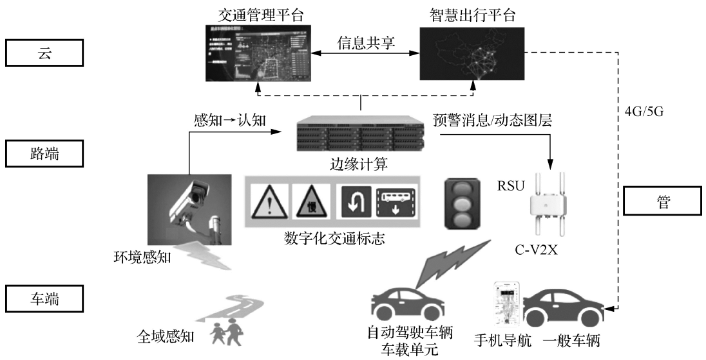

# 第6章 车路协同路侧感知关键技术

车路协同路侧感知是车路协同辅助安全、交通效率信息的重要来源，可以为车辆感知范围进行补充，提高车辆和路侧感知的范围与准确性，是车路协同系统的重要环节。路侧感知可以有效扩展车辆的感知范围，解决感知盲区问题。本章主要针对路侧感知中的关键技术进行分析，结合车路协同系统工程应用中的实际需求，研究了基于毫米波和相机的路侧对象感知算法，为车路协同防撞预警和交通调度提供基本的数据支撑。

## 6.1 车路协同系统架构

###  6.1.1 车路协同系统硬件架构

车路协同系统在C-V2X车联网的基础上增加了路侧基础设施、交通对象、云端信息处理等环节，主要实现车路协同的感知识别、信息分析处理、决策控制等功能。车辆通过车载感知设备、车身网络和C-V2X通信获取车辆状态与环境感知等信息，通过本地或者云端处理，部分结果用于本车的决策控制，部分结果通过C-V2X通信分享给其他车辆、路侧和云端，为车辆本地决策控制和协同感知提供数据支撑。路侧MEC通过路侧感知设备，如毫米波雷达、激光雷达、摄像机、相机等，识别及计算路侧感知的交通与环境信息，通过信号灯控制器获取交通信号状态，并将这些信息通过C-V2X通信分享给其他车辆，用于协同感知和交通信息广播，或者上传给云平台进行监控。云平台通过OBU或者RSU获取感知的车辆、道路环境、交通状态等数据，对数据进行统计分析，输出分析结果，为决策控制提供依据；并推送道路提醒、交通信息到相应的路侧设备，如图6.1所示。

车路协同系统依托 C-V2X 终端、激光雷达、毫米波雷达、摄像头、相机、MEC、交通信号灯等设备，实现车与人、车、路、网立体的网联系统，能够极大地改善交通的安全性，提高交通效率。车路协同系统通过“端-管-云”3层架构实现环境感知、数据融合计算、决策控制，从而提供安全、高效、便捷的智慧交通服务。

#  1.端——端侧基础设施

端:指交通服务中实际参与的实体元素,包括具有通信功能的OBU、RSU、手机等,具有感知功能的摄像头、雷达等,以及路侧交通基础设施中的信号灯、公告牌、电子站牌等。

在车联网场景中,根据端侧设备在整体系统中的功能和作用,可以分为三大类:通信类、感知识别类和基础设施类。车路协同场景中端侧设备的类型如表6.1所示。

表6.1 车路协同场景中端侧设备的类型

| 序号 | 类型 | 设备名称 |
| --- | --- | --- |
| 1 | 通信类 | OBU |
| 2 | 通信类 | RSU |
| 3 | 通信类 | 移动终端 |
| 4 | 通信类 | ETC |
| 5 | 感知识别类 | 激光雷达 |
| 6 | 感知识别类 | 高清相机 |
| 7 | 感知识别类 | 毫米波雷达 |
| 8 | 感知识别类 | 环境监测感知终端 |
| 9 | 感知识别类 | 路侧 MEC |

续表

| 序号 | 类型 | 设备名称 |
| --- | --- | --- |
| 10 | 基础设施类 | 信号灯与控制机 |
| 11 | 基础设施类 | 电子站牌 |
| 12 | 基础设施类 | GNSS地面基站 |

#  1) 通信类端侧设备

OBU和RSU是车路协同系统的基本通信设备,提供V2X通信和定位功能,在此基础上实现基于车路协同的辅助安全、交通效率和信息服务等应用。OBU和RSU是集成C-V2X功能的网联设备,用以实现车、路、云平台之间的全方位连接。OBU主要用于发送车辆的状态、位置等信息,接收车辆、道路、云端的消息。RSU主要实现交通信息的推送,通过V2I通信将该路段的限速、交通标牌、危险提醒、信号灯状态等广播给周围车辆;在一些V2V信号遮挡的路段转发V2V数据,提高车辆感知范围;同时,接收云平台的交通危险警示信息、调度信息并通过V2I通信推送给周围车辆,提高驾驶安全和交通效率。

#  2) 感知识别类端侧设备

感知识别类端侧设备部署的对象包含感知识别单元和决策控制单元。端侧感知可以分为车载感知和路侧感知两部分,对交通对象与环境进行感知识别,为实现“聪明的车”和“智慧的路”提供数据基础。路侧感知识别单元可由一系列路侧感知设备与处理设备构成,如雷达、相机等感知设备,实现对本地交通环境和状态的实时感知,包括信号灯信息、交通参与者信息、交通事件信息、定位信息等。路侧决策控制单元在设备端有多种实现方式,可以融合到 RSU 内,可以是路侧 MEC 单元,还可以是区域的计算中心,负责对本地或区域的数据进行处理、存储,以及应用、服务的计算与发布。

#  3)基础设施类端侧设备

基础设施类端侧设备是实现交通体系智能化的关键因素,主要包括路侧基础设施和路侧电子交管设施,如信号灯及其控制机、电子站牌、GNSS地面基站等。路侧基础设施可以与道路子系统中的路侧决策控制单元、云控中心、车辆决策控制系统等进行数据交互。路侧电子交管设施主要包含交通信号控制、交通视频监视、交通流信息采集、交通违法监测记录、交通信息发布等。

#  2.管——网络通信能力

管:指实现交通各实体元素互连互通的网络,包括4G/5G、V2X,网络支持根据业务需求灵活配合,同时保障通信的安全可靠。

C-V2X车联网为车路协同搭建了设备之间的连接通道。在C-V2X通信机制V2N场景中,联网车辆的车载4G/5G模组通过Uu无线接口实现车与网的互连,通过PC5接口与其他车辆和路侧设施通信。

基于 LTE-V2X的PC5接口与基于 5G NR的PC5接口的对比如表 6.2 所示。

表 6.2 基于 LTE-V2X的 PC5 接口与基于 5G NR 的 PC5 接口的对比

| 对比项 | 对比项 | 基于 LTE-V2X 的 PC5 接口通信 | 基于 5G NR 的 PC5 接口通信 |
| --- | --- | --- | --- |
| 共同点 | 共同点 | 低时延,覆盖范围小;资源调度,网络侧协助、自感知;LTE 网络覆盖范围内外可用 | 低时延,覆盖范围小;资源调度,网络侧协助、自感知;LTE 网络覆盖范围内外可用 |
| 不同点 | 交互方式 | 广播 | 广播、点播、多播 |
| 不同点 | 帧结构 | 子载波间隔固定、子帧长度固定 | 子载波间隔可灵活配置、子帧长度灵活可变 |
| 不同点 | 调制方式 | QPSK、16QAM | QPSK、16QAM、64QAM |
| 不同点 | 波形 | SC-OFDM | OFDM |
| 不同点 | 信令、数据复用方式 | FDM | TDM |
| 不同点 | 重传方式 | 基于盲感知的数据重传 | 标准混合自动重传请求 |
| 不同点 | 调度单元 | 子帧 | slot、mini-slot、multi-slot |
| 不同点 | 业务支持 | 交通安全类、交通效率类 | 交通安全类、交通效率类、信息娱乐类 |

#  3. 云——云平台

云平台是实现数据汇集、计算、分析、决策及基本运维管理功能的平台，根据业务需求可部署在边缘侧或中心云。云平台主要功能介绍请参考4.3节。

在“端-管-云”新型车路协同系统架构中，车端和路端将实现基础设施的全面信息化，形成底层与顶层的数字化映射；5G与C-V2X联合组网构建广覆盖蜂窝通信与直连通信协同的融合网络，保障智慧交通业务连续性；人工智能和大数据实现海量数据分析与实时决策，建立车路协同的一体化管控平台。基于分层架构的管控平台如图6.2所示。

##  1) 端设备

车端设备主要包括通信终端、环境感知设备、决策控制设备等，主要用于获取车辆数据处理及同步、车辆数据通信、定位等信息，获取车辆运行状态和环境感知信息，实现车辆环境信息感知识别、车辆辅助安全与驾驶控制等功能。

图6.2基于分层架构的管控平台

(1) OBU主要负责车-车、车-路、车-云等的通信,包括信息的过滤、转发、信息加/解密处理、高精度定位等,是车辆与外界信息交互的主要设备。

(2)车载环境感知识别设备主要包括车载毫米波雷达、激光雷达、超声波雷达、车载摄像头等设备,负责感知车辆周围与车内环境、进行驾驶员行为监测等工作,为驾驶过程中可视范围的对象进行识别监测、行为分析等提供信息源。

(3)决策控制设备主要用于在辅助驾驶或者自动驾驶过程中提供决策控制功能,其通过运行算法模型,对环境感知信息进行分析处理,根据决策控制逻辑输出相关决策控制命令。目前,该部分设备主要由车载AI计算平台来完成。

#  2)路侧基础设施

路侧基础设施主要包括C-V2X系统所定义的RSU、路侧感知单元和路侧计算决策单元、路侧交管设施等。路侧基础设施可以与道路子系统中的电子交管设施、中心子系统、车辆子系统和个人子系统进行数据交互。

(1) RSU是集成C-V2X功能的路侧网联设施,用以实现路与车、路与人、路与云平台之间的全方位连接。 RSU还可以实现交通信息的推送,包括该路段的道路危险状况、交通标牌、交通信号灯以及通过云平台推送的实时交通状况等。

(2)路侧感知单元可由一系列路侧感知设备与处理设备构成,实现对本地交通环境和状态的实时感知,包括信号灯信息、交通参与者信息、交通事件信息、定位信息等。

(3)路侧计算决策单元在设备端有多种实现方式，可以融合到 RSU内，也可

以是路侧MEC单元，还可以是区域的边缘计算中心，负责对本地或区域的数据进行处理、存储，以及应用、服务的计算与发布。

(4)路侧交管设施主要包含交通信号控制、交通视频监视、交通流信息采集、交通违法监测记录、交通信息发布等。

#  3)基于大数据与AI的云平台

随着车联网的快速发展，针对C-V2X的数据平台搭建不可或缺。数据平台可以汇聚多源数据，采用大数据与AI技术对V2N/I2N/P2N等各类应用数据进行深入分析、挖掘，提取关键信息，做出决策，并将决策指令及时推送到OBU和RSU，为C-V2X系统高效运行提供必要支撑。

C-V2X 数据平台能够实现对接入网络的所有路侧设施、感知设备和智能网联汽车的监管，云平台从全局角度掌握整体车、路的运行态势，主要实现车辆信息的统计、交通危险与调度信息的实时推送等功能；云平台还可以通过路侧设备推送生活推荐服务，既能提高驾驶安全，又能提高驾驶员出行效率。

目前，车路协同数据云平台可以分为以下几种。

(1)交通行业数据平台:主要围绕交通监测与信息服务展开,致力于交通管理、道路运输和应用服务。

(2)示范区数据平台:致力于解决智能驾驶技术和道路交通环境的适应性发展问题，基于车路协同、交通大数据等新技术与新产品应用示范，为实验验证与测试评估而研究开发的智能驾驶大数据一体化平台。

(3)整车制造企业数据平台:整车企业联合系统平台开发商结合C-V2X技术共同建设的大数据分析平台,充分利用了更多的车联网数据进行分析、决策,提供智能辅助驾驶服务,并为其他系统提供获取模型分析结果的数据接口,满足了车联网数据使用者的各种需求,使车联网数据价值最大化。

(4)网络运营商数据平台:网络运营商与通信设备商、汽车厂商深度合作建设的大数据平台,致力于推动远程驾驶、智能调度等云-网-端协同场景的应用。

(5)科技企业数据平台:百度、华为等科技企业同国内外的车企、运营商等相关合作伙伴建设的大数据平台,致力于基础数据平台的研究和探索。

总的来说,当前车联网数据平台的搭建依托于智能交通及智能网联测试示范区、行业部门、企业建设,为车路协同系统提供服务,实现了设施设备的全局管控和运行态势监测。

#  6.1.2 车路协同业务体系架构

城市场景中的车路协同业务架构主要由路侧终端、边缘端、云端和外部应用组成,如图6.3所示。其中,一个路侧边缘计算平台会连接多组路侧感知设备,一个区域计算平台会连接多个路侧边缘计算平台,一个业务运营平台会连接多个区域计算平台。

图6.3 车路协同业务体系架构

车路协同业务场景如表6.3所示。

表6.3 车路协同业务场景汇总

| 序号 | 场景名称 | 类型 | 选自标准 |
| --- | --- | --- | --- |
| 1 | 限速预警 | 交通安全类 | T/CSAE 53—2020 |
| 2 | 闯红灯预警 | 交通安全类 | T/CSAE 53—2020 |
| 3 | 绿波车速引导 | 交通效率类 | T/CSAE 53—2020 |
| 4 | 前方拥堵提醒 | 交通效率类 | T/CSAE 53—2020 |
| 5 | 交叉路口碰撞预警 | 交通安全类 | T/CSAE 53—2020 |
| 6 | 左转辅助 | 交通安全类 | T/CSAE 53—2020 |
| 7 | 弱势交通参与者碰撞预警 | 交通安全类 | T/CSAE 53—2020 |
| 8 | 车内标牌 | 交通效率类 | T/CSAE 53—2020 |
| 9 | 道路危险状况提示 | 交通安全类 | T/CSAE 53—2020 |

续表

| 序号 | 场景名称 | 类型 | 选自标准 |
| --- | --- | --- | --- |
| 10 | 协作式优先车辆通行 | 交通效率类 | T/CSAE 157—2020 |
| 11 | 动态车道管理 | 交通效率类 | T/CSAE 157—2020 |
| 12 | 感知数据共享 | 交通安全类 | T/CSAE 157—2020 |
| 13 | 协作式变道 | 交通安全类 | T/CSAE 157—2020 |
| 14 | 协作式车辆汇入 | 交通安全类 | T/CSAE 157—2020 |
| 15 | 协作式交叉路口通行 | 交通安全类 | T/CSAE 157—2020 |
| 16 | 场站路径引导服务 | 信息服务类 | T/CSAE 157—2020 |
| 17 | 差分数据服务 | 信息服务类 | T/CSAE 157—2020 |
| 18 | 浮动车数据采集 | 交通管理类 | T/CSAE 157—2020 |
| 19 | 基于路侧感知的“僵尸车”识别 | 交通安全类 | T/CSAE 158—2020 |
| 20 | 基于协同式感知的异常驾驶行为识别 | 交通安全类 | T/CSAE 158—2020 |
| 21 | 基于路侧协同的自动驾驶车辆“脱困” | 交通安全类 | T/CSAE 158—2020 |
| 22 | 基于路侧感知的交通状况识别 | 交通效率类 | T/CSAE 158—2020 |
| 23 | 高精地图版本对齐及动态更新 | 信息服务类 | T/CSAE 158—2020 |

#  6.2 车路协同路侧感知关键技术

##  6.2.1 路侧感知系统架构分析

目前,路侧感知主要以雷达+视觉的组合方式进行环境感知,雷达主要包括毫米波雷达、激光雷达,视觉部分主要以红外高清摄像机为主,有单目、双目深度相机和热成像相机等。目前,激光雷达在成本和使用寿命等方面还存在一些劣势,路侧雷达主要以毫米波雷达为主[1]。

路侧基于毫米波雷达和相机信息融合的车辆目标检测系统主要包含4部分,分别为毫米波雷达检测模块、相机传感器检测模块、RSU、路侧MEC[2],图6.4所示为路侧车辆目标检测系统示意图。

图6.4中的毫米波雷达主要用于对目标进行检测,以获得有效区域目标的速度、加速度和位置信息,相机主要用于对交通路口车辆目标进行实时检测并对检测到的目标进行分类识别,RSU通过GPS模块获得目标位置信息,根据位置信息对有效区域目标进行初选,路侧MEC对相机和毫米波雷达输入的目标数据进行融合处理,包括相机坐标系和雷达坐标系转换、时间同步机制处理及数据关联。总之,毫米波雷达和相机的融合使获得的目标具有深度信息[3]。

图6.4路侧车辆目标检测系统示意图

图6.5所示为路侧车辆目标检测系统功能结构,主要分析了路侧检测系统各个模块的功能需求,其中主要包括毫米波雷达检测模块、相机传感器检测模块以及C-V2X路侧单元(RSU)的功能分析与设计。

#  1.毫米波雷达检测模块

毫米波雷达检测模块的功能就是获得目标速度、位置等信息，但毫米波雷达易受杂波影响而产生虚假目标，甚至出现漏检、误检的情况，因此需要设计一种毫米波雷达滤波算法来提高检测的精度，其中主要包括数据解析、卡尔曼滤波和虚假目标剔除算法。毫米波雷达滤波算法将在6.3.2小节中进行详细介绍。

#  2. 相机传感器检测模块

相机传感器检测模块主要用于对丰富的图像信息进行特征提取,并通过网络模型训练和基于卷积神经网络(convolutional neural network, CNN)的目标检测算法对目标进行检测分类,但相机传感器检测模块无法获得目标的深度信息,因此需要通过相机和毫米波雷达的融合实现信息互补。相机和毫米波雷达的融合主要包括对相机和毫米波雷达采样时间和空间的校准及数据关联。

图6.5 路侧车辆目标检测系统功能结构

#  3. C-V2X路侧单元(RSU)

RSU主要负责采集交通信息，包括高精度定位信息、交通灯数据及道路环境信息，并将采集到的交通信息通过V2X通信向周围车辆广播。本节主要介绍获取车辆位置信息，并将获取到的高精度定位信息发送到路侧MEC，同时结合毫米波雷达信息对有效区域目标进行筛选，得到初选目标的过程。

#  6.2.2 路侧感知关键技术与理论基础

本小节将对作者需要运用的滤波算法、目标检测算法及多传感器融合技术相关基础理论进行介绍，其中，滤波算法主要包括最近邻滤波算法、卡尔曼滤波法等。

#  1.滤波算法

##  1)最近邻滤波算法

毫米波雷达会因许多噪声的影响而使目标检测产生误差,需要对检测目标进行滤波处理,最近邻滤波算法[4]能在杂波环境中对目标进行跟踪滤波,通过设定相关波门剔除一部分杂波,并与距离目标坐标最近的数据进行关联。其中,相关波门[5](correlation wave gate)是指跟踪空间中以下时刻目标的预测位置为中心的区域,用于确定目标测量点的可能范围。统计距离定义为信息向量的加权范数的公式如下。

$$ \begin{aligned} \mathbf{d}^2[x(k)] &= \left[ \mathbf{X}(k) - \hat{\mathbf{X}}(k|k-1) \right]^T \mathbf{S}^{-1}(k) \left[ \mathbf{X}(k) - \hat{\mathbf{X}}(k|k-1) \right] \\ &= \mathbf{w}(k)^T \mathbf{S}^{-1}(k) \mathbf{w}(k) \end{aligned} \quad (6.1) $$

式中, $S^{-1}(k)$为协方差矩阵; $w(k) = X(k) - \hat{X}(k|k-1)$为滤波器残差; $d^2[x(k)]$是量测点X(k)与波门中心 $\hat{X}(k|k-1)$之间的统计距离。最近邻滤波算法的核心思想如下:当只有一个目标在设定的波门内时,对此目标进行航迹更新;当相关波门内有多个目标时,将距离最近的目标作为选择对象;当相关波门内没有出现目标时,将预测目标作为新的航迹。图6.6所示为最近邻滤波算法示意图。

图6.6 最近邻滤波算法示意图

最近邻滤波算法计算量小，易于实现，但这是一种次优滤波算法，只能保证局部意义上的最优，如果在波形密集的环境中出现多个目标相近或者航迹交叉的情况，则离预测位置最近的有效目标有可能是其他目标点，此时就会出现目标匹配错误的现象，因此最近邻滤波算法可应用于稀疏环境中的目标跟踪。

##  2)卡尔曼滤波法

卡尔曼滤波器$^{[6]}$主要用于非平稳、多维的参数预测问题，且当目标方程为线

性方程时可以取得最优估计。对于系统的输入输出,为了更好地表示两者之间的关系,通常将观测的目标用状态方程表示,将毫米波雷达检测过程用量测方程表示,因此,需要设计系统运动模型来构建系统的状态方程[7]。构造目标运动模型既要符合目标实际的运动情况,又要满足实时处理的要求。对于做匀速直线运动的目标,可将其运动状态表示为如下形式。

$$ \begin{bmatrix} x' \\ x'' \end{bmatrix} = \begin{bmatrix} 0 & 1 \\ 0 & 0 \end{bmatrix} \begin{bmatrix} \mathbf{x} \\ x' \end{bmatrix} + \begin{bmatrix} 0 \\ 1 \end{bmatrix} v(t) \quad (6.2) $$

式中, $x$ 表示目标坐标方向向量; $x'$ 表示目标速度分量; $x''$ 表示目标加速度分量; $v(t)$ 为符合均值为零的高斯分布。目标的运动状态由状态向量 $X(k) = [x?x']^T$ 表述, 则可得离散时间系统中的目标状态方程, 即

$$X(k+1) = \begin{bmatrix} 1 & T \\ 0 & 1 \end{bmatrix} X(k) + V(k) \quad (6.3)$$

式中，$T$是采样时间；$V(k)$表示高斯白噪声序列。通过目标状态方程可以进一步得到系统的状态转移矩阵$W(t)$，即

$$W(t) = \begin{bmatrix} 1 & T \\ 0 & 1 \end{bmatrix} \qquad (6.4)$$

进一步的,可将匀加速模型的目标状态方程表示为

$$ \begin{bmatrix} x' \\ x'' \\ x''' \end{bmatrix} = \begin{bmatrix} 0 & 1 & 0 \\ 0 & 0 & 1 \\ 0 & 0 & 0 \end{bmatrix} \begin{bmatrix} x \\ x' \\ x'' \end{bmatrix} + \begin{bmatrix} 0 \\ 0 \\ 1 \end{bmatrix} v(t) \quad (6.5) $$

毫米波雷达传感器的观测过程表示为量测方程，即

$$Z(k+1) = E(k+1)X(k+1) + V(k+1) \quad (6.6)$$

式中, $Z(k+1)$ 表示观测向量; $E(k+1)$ 表示量测矩阵; $V(k+1)$ 表示量测噪声序列。进一步使用状态变量法表示离散时间线性系统,如图6.7所示。

图6.7 离散时间线性系统

前面描述了系统状态方程，接下来对卡尔曼滤波法进行实际运用。卡尔曼滤波

波法的工作原理如下:根据上一时刻的目标值对当前时刻的状态值进行估计,再结合观测值综合输出最优结果,以此降低噪声的影响。下面对卡尔曼滤波法进行具体的推算。

(1)状态向量的预测方程为

$$X'(k+1|k) = F(k)X'(k|k) \qquad (6.7)$$

(2)预测的误差协方差矩阵为

$$P(k+1|k) = F(k)P(k|k)F^T(k) + Q(k) \quad (6.8)$$

(3)利用雷达 $k+1$ 时刻的量测值 $Z(k+1)$ ,得到残差为

$$v(k+1) = Z(k+1) - H(k+1)X'(k+1|k) \quad (6.9)$$

(4)协方差矩阵为

$$S(k+1) = H(k+1)P(k+1|k)H^T(k+1) + R(k+1) \quad (6.10)$$

(5)卡尔曼增益为

$$K(k+1) = P(k+1|k)H^T(k+1)S(k+1)^{-1} \quad (6.11)$$

(6)对状态向量的预测值进行修正,状态向量更新为

$$X'(k+1|k+1) = X'(k+1|k) + K(k+1)v(k+1) \quad (6.12)$$

在卡尔曼滤波过程中, $X'(k+1|k)$ 为最佳预测值, $X'(k+1|k+1)$ 是最佳滤波值, 代表状态 $X(k+1)$ 的线性无偏最小方差估计, $P(k+1|k)$ 为预测信号协方差矩阵, $P(k+1|k+1)$ 是最小均方误差矩阵, $K(k+1)$ 为最佳卡尔曼滤波增益。总之, 通过卡尔曼滤波法可以对系统状态进行估计, 结合观测值得到最优结果。

#  2.目标检测算法

目前,目标检测算法得到了快速发展[8],并在一定程度上取得了很大突破。常用的目标检测算法可分为以下几类:Haar-like特征[9]+Adaboost 车辆目标检测算法; Two-stage目标检测算法[10],该算法分两步对目标进行检测,生成成候选框,再通过卷积神经网络进行样本分类,主要包括R-CNN算法、Fast R-CNN算法和Faster R-CNN算法[11]; One-stage目标检测算法,该算法直接通过卷积神经网络进行目标检测,主要包括单次多边框检测(single shot multiBox detector, SSD)、YOLO(you only look once)系列算法。相对来说,Two-stage目标检测算法比One-stage目标检测算法的检测速度要低一些,但准确度要高一些。

##  1) Haar-like 特征+Adaboost 车辆目标检测算法

目前，基于 Haar-like 特征和 Adaboost 车辆目标检测算法的应用场景较多，其训练的多级分类器检测方法$^{[12]}$在实时性和准确性方面有一定的优势。在基于图

像的车辆目标检测应用中，该算法先对目标样本进行 Haar-like 特征提取，再使用 Adaboost 算法对提取的特征进行分类并得到强分类器，最后对得到的多个强分类器进行级联得到车辆目标检测分类器。

(1) Haar-like特征。Haar-like特征经常用来描述目标的特征,常见的人脸检测算法中就运用了 Haar-like特征,并结合积分图对人脸进行检测。随着对目标检测算法性能要求的提高,人们对 Haar-like特征进行了扩展,扩展后的特征主要分为以下4类:边界特征、中心环绕特征、线特征和对角特征,如图6.8所示。

图6.8 Harr-like扩展后的特征

图6.8中每种特征都由黑白矩形组成,进一步对黑白矩形像素灰度值进行计算,通过对像素灰度值做差计算得到特征值。在实际设计矩形大小时,矩形的类别、矩形的大小和矩形的位置都是影响矩阵特征值的因素,一个图像窗口内的矩阵特征会因矩形的类别、大小和位置排列组合的不同而不同。在进行特征值计算时,需要获得特征数量,式(6.13)为特征数量计算公式。

$$N = XY \left( W + 1 - w \frac{X + 1}{2} \right) \left( H + 1 - h \frac{Y + 1}{2} \right) \quad (6.13)$$

式中，$X$表示特征矩形在水平方向的变换比例；$Y$表示特征矩形在垂直方向的变换比例；$N$表示特征数量；$W$和$H$分别表示样本图像的宽度和高度；$w$和$h$分别表示特征矩形的宽度和高度。

进一步对特征值进行计算,在实际处理过程中,由于特征值的计算量很大,造成计算效率低,无法满足应用要求,因此采用构造积分图的方法来解决这一问题。图6.9所示为Haar-like矩阵特征积分图,通过对图像进行积分构造得到积分图,减少了求取像素值的运算次数,因而提高了计算特征值的速率$^{[13]}$。

在图 6.9中, Sum(x,y)表示像素点(x,y)左上方所有像素点像素值之和, $I(x,y)$表示点(x,y)处的像素值,则有

$$ \mathrm{Sum}(x,y) = \sum_{x' \le x,y' \le y} I(x',y') \quad (6.14) $$

采用增量计算积分图，即

$$ \mathrm{Sum}(x, y) = \mathrm{Sum}(x, y - 1) + \mathrm{Sum}(x - 1, y) + I(x, y) - \mathrm{Sum}(x - 1, y - 1) \quad (6.15) $$

边界条件为

$$ \text{Sum}(-1, y) = \text{Sum}(x, -1) = \text{Sum}(-1, -1) = 0 \qquad (6.16) $$

进一步，计算 Haar-like 特征值$Z$，可得

$$Z = \text{Sum}(x-1, y-1) + \text{Sum}(x+w-1, y+h-1) \\ - \text{Sum}(x-1, y+h-1) - \text{Sum}(x+w-1, y-1) \qquad (6.17)$$

图6.9 Harr-like矩阵特征积分图

(2) Adaboost分类算法。Adaboost分类算法是在 Boosting算法的基础上发展而来的。Boosting算法基于概率近似正确学习模型,其主要思想是通过样本集训练出多个弱分类器,并对多个弱分类器进行加权计算得到最终结果。Adaboost分类算法通过集成同样的算法训练不同的弱分类器,将其结合为强分类器[14]。图6.10所示为 Adaboost分类算法的流程图。

图6.10 Adaboost 分类算法的流程图

Adaboost分类算法的处理过程主要分为以下5个步骤。

①对样本的权值 W进行初始化。

$$W_{i,j}(k) = \begin{cases} \frac{1}{2j} y_i = 0 \\ \frac{1}{2p} y_i = 1 \end{cases} \qquad (6.18)$$

式中, p表示正样本数; j表示负样本数; i=1,2, ..., n。

②进一步对样本权值进行归一化处理,得到新的权值。

$$W_{t,i} = \frac{w_{t,i}}{\sum_{i=1}^{n} \sum_{t=1}^{T} w_{t,i}} \qquad (6.19)$$

③训练分类器z,计算分类器权值错误率 $\xi_t$ 。

$$ \xi_t = \sum w_i |z(x_i) - y_i| \quad (i=1,2,\dots,n; t=1,2,\dots,T) \quad (6.20) $$

④更新样本的权值,获得新的权值。

$$w_{i+1} = w_i \varepsilon_t^{1-S_i} \quad (i=1,2,\dots,n; t=1,2,\dots,T) \qquad (6.21)$$

式中, $\varepsilon_t = e_t / (1-e_t)$; $S_i = 0$ 时表示样本 $x_i$ 分类正确, $S_i = 1$ 时表示样本 $x_i$ 分类错误。

⑤通过加权平均将多个弱分类器组合成强分类器 H(x)。

$$H(x) = \begin{cases} 1, & \sum_{t=1}^{T} \lambda_t h_t(x) \ge \frac{1}{2} \sum_{t=1}^{T} \lambda_t \\ 0, & \text{其他} \end{cases} \quad (6.22)$$

式中, $\lambda_t = \log \varepsilon_t$ 。

Adaboost分类算法的核心思想就是将弱分类器训练组合成强分类器,根据权值对弱分类器进行选择,该权值也可视为选择弱分类器的概率$^{[15]}$。在训练强分类器的过程中,对样本设定不同的权值,通过不断改变样本的权值使得分类结果准确,从而可知,通过不断地改变样本权值增加了训练样本数量,使得分类结果更可靠。

#  2) Two-stage 目标检测算法

(1) R-CNN算法。随着CNN的普遍运用,一些学者和企业将其用在了目标检测算法[16]中。图6.11所示为R-CNN(即region-CNN)算法的使用过程,该算法利用图像分类问题来代替目标检测场景的问题,将滑动窗口对应区域提取并直接利用CNN进行图像分类,从而实现目标检测,其中滑动窗口大小不一致,在图像中根据设置的移动长度进行上、下、左、右滑动。

图6.11 R-CNN算法的使用过程

在目标检测过程中，由于不知道目标的大小，不能确定滑动窗口的大小，从而需要设置大小不一致的窗口，但这会增加较大的计算量，使得目标检测实时性不高。

(2) Fast R-CNN算法。R-CNN算法的计算量大,不能满足实时性要求,而Fast R-CNN[17]算法相对于R-CNN算法的优势在于检测速度较快,并针对计算量大的问题进行了优化处理。R-CNN算法计算量大的主要原因是在提取目标特征时存在重复的计算,针对这一问题,Fast R-CNN算法从以下几个方面对其进行了改进:对目标感兴趣区域(region of interest, ROI)进行简化处理,结合候选框映射功能解决了空间金字塔池化[18](spatial pyramid pooling, SPP)网络训练的短板;使用具有更好分类效果的 Softmax(归一化指数函数)模块代替支持向量机(support vector machine, SVM)分类算法;将R-CNN中的边界框回归改为使用Smooth Loss(平滑损失)函数。

图6.12所示为Fast R-CNN算法的使用过程,其先通过深度卷积生成特征图,进一步划分正负样本[19],再通过选择性搜索算法得到候选框,最后将提取的目标特征送入R-CNN子网络进行分类和回归处理。

图 6.12 Fast R-CNN算法的使用过程

(3) Faster R-CNN算法。Faster R-CNN算法为了提升检测框的生成速度而选择使用全卷积网络(region proposal network, RPN)生成检测框,并没有使用滑动窗口和选择性搜索算法,因为选择性搜索算法对一幅图像提取候选框时大概需要2s,比较耗时。RPN可以生成多个候选框,有利于目标分类并在一定程度上提高了检测准确度。图6.13所示为Faster R-CNN算法获取候选框的流程图。

图6.13 Faster R-CNN算法获取候选框的流程图

Faster R-CNN[20]算法的执行主要包括以下步骤。

对图像大小为 $X \times Y$ 的原始图像进行标准化,得到标准大小的图像集。

利用CNN对经过标准化处理的图像进行特征提取,其中CNN中包含卷积层、激活层和池化层。

将得到的特征图(feature map)送入RPN,并对特征图进行多次卷积操作,生成预测框,计算出对应的边界框回归偏移量。

送入后续的全连接和 Softmax 模块完成目标分类任务。

#  3) One-stage 目标检测算法

R-CNN 系列算法属于 Two-stage 目标检测算法范畴,需要经过目标区域提取和目标分类两个阶段,虽然可以保证较高的检测精度,但是检测速度通常比较慢,接入视频之后,图像传输速度达不到实时的要求。针对 Two-stage 目标检测算法的缺点, One-stage 目标检测算法被提出,其中以 $YOLO^{[21]}$ 算法为主要代表。本书采用 YOLOx 作为相关感知识别的测试验证设计思想,YOLOx 选择直接输入整幅图像到网络中,直接回归出边框的位置和目标所属的类别,YOLOx 的网络结构如图 6.14 所示,其中 CBM 是 YOLO 网络结构中的最小组件,由 Conv+Bn+Mish 激活函数三者组成,CBL 由 Conv+Bn+Leak_relu 激活函数组成,SPP 采用最大池化方式进行多尺度融合。

YOLOx 网络使用卷积神经网络来替代 Inception 模块实现跨通道信息融合, 并在 GoogleNet 网络的结构基础上进行了扩展。YOLOx 网络是在独立的单元网格中进行目标检测的, 其原理是把输入的原始图像划分为多个单元网格, 若某个目标的中心位置落在某个单元网格中, 则对应的单元网格对该目标进行检测。在检测过程中, 每个单元网格负责预测多个边界框, 同时预测边界框的置信度, 置信度可被表示为待检测目标的概率 $P_r(Object)$ 和该边界框与真实位置交并比(intersection over union, IOU)的乘积。包围框与目标真实框之间的交集和并集

之比即为交并比。当检测框中不存在目标时, $P_r(Object)=0$,当检测框中存在目标时, $P_r(Object)=1$,置信度定义为

$$ \text{Confidence} = P_r(\text{Object}) \times \text{IOU}_{\text{pred}}^{\text{truth}} \qquad (6.23) $$

图6.14 YOLOx的网络结构

置信度的设计从两个方面进行考虑,一是考虑边界框含有目标的可能性大小,二是考虑边界框的准确度。如图6.15所示,网络预测的包围框具有5个预测参数,分别为预测框中心坐标(x,y),预测框的宽(w)、高(h),以及当前位置存在一个目标的置信度。

图6.15真实框和预测框

#  (1)主干网络与特征融合网络。

YOLOx 的主干网络使用的是 CSPDarkNet[22], 特征融合网络使用的是 PAFPN[23], 两者均来自 YOLOv5。

①主干网络CSPDarkNet。CSPDarkNet结合了跨阶段局部网络CSPNet和YOLOv3主干网络DarkNet,是一种高效主干网络,能在训练中引入更为丰富的梯度信息组合,从而减少网络所需的实际计算量。CSPDarkNet的网络结构组成

如表6.4所示。从网络结构组成进行分析，CSPDarkNet由4种卷积结构组成，其分别是ConvBlock、Focus、CSPBottleneck和SPPBottleneck。假设网络的输入图像大小为36x640像素x640像素，在经过表6.4中各结构的顺序处理后，将得到多尺度输出特征P3、P4和P5，其对应的特征大小分别为256x80像素x80像素、512x40像素x40像素和1024x20像素x20像素。网络输出的多尺度特征将作为特征融合网络的输入。

表6.4 CSPDarkNet 的网络结构组成

| 输入大小* | 结构类型 | 瓶颈数量 | 残差连接 | 步长 | 输出特征 |
| --- | --- | --- | --- | --- | --- |
| 3×640×640 | Focus | — | — | 2 | — |
| 64×320×320 | ConvBlock | — | — | 2 | — |
| 128×160×160 | CSPBottleneck | 3 | True | 1 | — |
| 128×160×160 | ConvBlock | — | — | 2 | — |
| 256×80×80 | CSPBottleneck | 9 | True | 1 | P3 |
| 256×80×80 | ConvBlock | — | — | 2 | — |
| 512×40×40 | CSPBottleneck | 9 | True | 1 | P4 |
| 512×40×40 | ConvBlock | — | — | 2 | — |
| 1024×20×20 | SPPBottleneck | — | — | 1 | — |
| 1024×20×20 | CSPBottleneck | 3 | False | 1 | P5 |

*本列数字单位为mm。

ConvBlock 的网络结构如图 6.16 所示,其由卷积层 Conv2d、批归一化层 BatchNorm2d 和激活函数 SiLU 组成,是 CNN 中最为常见的一种卷积结构。ConvBlock 的参数主要包括输入通道数、输出通道数、卷积核大小、步长和填充大小等。其中,填充大小固定为卷积核大小整除 2,以使卷积所得特征的大小与卷积核大小无关。在 YOLOx 网络中,ConvBlock 也是 CSPDarkNet、PAFPN 和检测头部网络的基本组成部分。

图 6.16 ConvBlock 的网络结构

Focus 的网络结构如图 6.17 所示,其先通过 4 个 Slice (切片) 层从不同的宽高偏移位置对输入图像的空间维度进行步长为 2 的切片,使得图像的空间分辨率减半,但通道数增加为原来的 4 倍,再使用 Concat 层拼接切片的图像张量,经过ConvBlock 得到输出特征。在 CSPDarkNet 中,Focus 用于对输入图像执行下采样操作。相较于直接使用 ConvBlock 进行下采样的方式,Focus 可保留更多的图像信息,能在仅增加少量计算量的情况下有效提升网络的表示能力。

图 6.17 Focus 的网络结构

CSPBottleneck 的网络结构如图 6.18 (a) 所示,其包括左、右两个分支。其中,左侧分支仅用 ConvBlock 对输入特征进行降维,使得输入特征的通道数减半;右侧分支先执行与左侧分支相同的降维操作,再使用若干个 Bottleneck 处理降维后的特征。Bottleneck 的网络结构如图 6.18 (b) 所示,其使用两个 ConvBlock 对输入特征进行卷积得到输出特征;当具有残差连接时,输出特征会再与输入特征逐元素进行相加操作。CSPBottleneck 在将左、右两个分支所得特征通过 Concat 层拼接后,最后经过 ConvBlock 得到输出特征。与使用若干个 Bottleneck 直接处理特征的方式相比,CSPBottleneck 所需的计算量更少,且能获得更好的检测性能。

(a) CSPBottleneck的网络结构

(b) Bottleneck的网络结构

图6.18 CSPBottleneck与Bottleneck的网络结构

SPPBottleneck 的网络结构如图 6.19所示,其在主干网络中以插件的形式存在,用于融合模型的深层特征,增强模型对不同尺寸目标的特征提取能力。

SPPBottleneck 先用 ConvBlock 对输入特征进行降维,再用三个池化核大小分别为5×5、9×9和13×13的最大池化层 MaxPool2d 处理降维后的特征,经 Concat 层拼接各分支特征后,最后经过 ConvBlock 得到输出特征。在增加少部分计算量的情况下,SPPBottleneck 能有效提升网络的检测性能,因此被广泛应用于目标检测。

图6.19 SPPBottleneck的网络结构

②特征融合网络PAFPN。PAFPN的网络结构如图6.20所示。其由自顶向下和自底向上的两部分网络组成。在自顶向下的网络中,从输入特征P5开始,通过卷积、上采样和拼接操作,先后与输入特征P4和P3进行特征融合,并得到融合后的中间特征。在自底向上的网络中,从P3对应的中间特征开始,通过卷积、下采样和拼接操作,先后与P4和P5对应的中间特征进行特征融合,最终得到特征大小与输入特征相同的输出特征C3、C4和C5。在YOLOx网络中,PAFPN使用的每个CSPBottleneck均包括3个无残差连接的Bottleneck。在特征金字塔网络(feature pyramid network, FPN)的基础上,PAFPN通过引入额外的自底向上网络通路,能更好地提升网络的表示能力。

(2) 分类与回归特征解耦的检测头部网络。YOLOx 的检测头部网络结构如图6.21所示,其用3个参数不共享的网络分别处理特征融合网络PAFPN输出的多尺度特征C3、C4和C5。假设网络预测了C个类别,对于空间大小为 $H$、$W$ 的单个尺度特征,首先用ConvBlock对输入特征进行降维,以减少后续网络的计算量。其次,分别用两组包括两个ConvBlock的网络卷积特征,得到解耦的分类与回归分支[24]。对于分类分支,用Conv2d卷积得到分类预测。对于回归分支,用两个Conv2d分别卷积得到置信度和边框回归预测。分类与回归特征解耦的检测头部网络的优点是能明显地提升模型的收敛速度,并能缓解分类和回归特征存在冲突的问题。

图6.20 PAFPN的网络结构

图6.21 YOLOx的检测头部网络结构

(3)模型压缩算法。现阶段目标检测算法主要依赖于深度学习对深度卷积网络进行大量的数据训练,以便在视频流的处理上取得较高的精度。然而,深度学习模型的参数量通常较多,计算量巨大,需要借助模型压缩算法减少模型所需的计算量与存储空间,从而满足AI应用的实时性需求。目前,模型压缩几乎是模型部署的必要步骤,而主流的模型压缩算法包括结构化剪枝、知识蒸馏(knowledge distillation)和低精度量化等。

①结构化剪枝。结构化剪枝通过移除网络中的部分卷积核或整组通道参数,以减少模型的参数和计算量。在结构化剪枝方法中,以通道为裁剪单位的剪枝方法最为常见,其通常包括通道筛选和精度恢复两个步骤。其中,通道筛选的目的是通过特定方法,如 L1 范数惩罚和最小绝对收缩和选择操作(least absolute shrinkage and selection operator, LASSO)回归[25]等,鉴别在当前任务中网络参数的重要性,通常认为低重要性的通道参数不会对网络的性能产生太大影响,可以被安全去除;精度恢复指在完成通道筛选及裁剪低重要性的部分通道参数后,微调剩余的网络参数,从而恢复网络因参数裁剪而丢失的精度。此外,还有一些无须微调的通道剪枝方法,其在训练中逐步筛选通道,并同时恢复网络的精度。

典型的通道剪枝方法如图6.22所示,其在待裁剪的CNN中插入通道缩放因子(channel scaling factor),并在训练中对其施加稀疏惩罚,用于自适应评估网络通道的重要性。图6.22(a)所示为通道裁剪前的示意图。其中,通道缩放因子的部分元素趋近于零,表明对应通道的重要性相对较低。图6.22(b)所示为通道裁剪后的示意图,其通过裁剪网络中相对低重要性的部分通道参数,以得到紧凑的网络。但此时网络的精度会相应下滑,还需对其进行微调。

(a) 通道裁剪前的示意图

(b)通道裁剪后的示意图

图6.22 典型的通道剪枝方法

②知识蒸馏。知识蒸馏引入了教师网络和学生网络的概念,其将教师网络的输出作为软标签,用于监督学生网络的学习,达到将教师网络的知识传递给学生网络的目的。教师网络的性能通常优于学生网络,模仿教师网络的输出,能使

学生网络获得比自身更好的性能。利用此特性,可将大网络视作教师网络,并将裁剪参数得到的小网络视作学生网络,从而实现模型压缩的效果。

在目标检测任务中应用知识蒸馏时,较为通用的做法是通过图6.23所示的方式,使用L2范数$^{[26]}$或KL散度$^{[27]}$等蒸馏损失(distillation loss),让学生网络模仿教师网络的多尺度特征特性。通常情况下,性能越好的教师网络蒸馏得到的学生网络性能也就越好。此外,教师网络可以不是单独存在的,能通过与学生网络共享部分或全部网络结构的方式进行高效蒸馏。

图6.23知识蒸馏

P1~P5:知识蒸馏的阶段层级;Neck&Head:深度学习网络的不同部分,Neck用于融合不同尺度的特征,Head用于生成回归和分类分数。

③低精度量化。目前主流的深度学习框架如 PyTorch和 TensorFlow等,使用的默认数据类型均为32位浮点数。通常,网络在单次推理过程中要进行上亿次浮点数计算,对设备的算力和存储带宽都有较高要求。对于算力与存储资源受限的嵌入式设备而言,使用32位浮点数计算的方式非常低效。通过低精度量化可将网络的参数和激活值替换为低带宽、定点的整数,从而加快网络计算,并降低所需的存储带宽,达到显著提升模型推理效率的目的。尽管低精度量化会不可避免地降低模型精度,但是结合专用的计算库或硬件加速器可成倍地加速模型推理。目前,常见的低精度量化类型包括Int8、Int4和二值。其中,工业界主要以Int8量化为主,典型代表包括Google的TensorFlow Lite量化方案[28]和NVIDIA的TensorRT量化方案等。

#  3.多传感器融合技术

单一传感器的检测结果往往存在不同层面的缺陷,利用多个传感器提供的信息进行融合可以在某种程度上弥补单一传感器检测结果的不足,感知单个传感器系统所不能感知的信息特征,从而扩展系统处理信息的能力,并通过信息互补来增强系统的可靠性。对多个传感器信息进行融合可以降低外界干扰的影响,保证系统的稳定性,使系统可以稳定高效地工作;在多传感器信息融合过程中,可通过多传感器获取更加全面、更加精确、不同时刻的目标状态数据。目前,多传感器融合模型主要包括多传感器融合功能模型、多传感器融合结构模型、多传感器融合数学模型、数据关联技术和数据决策技术[29]。下面对多传感器融合功能模型和多传感器融合结构模型进行介绍。

##  1)多传感器融合功能模型

美国国防部提出了对信息融合在信息处理时有很大实用性的通用数据融合处理模型,最开始被应用在一个防御系统中,其模型[30]如图6.24所示。

图6.24多传感器融合功能模型

多传感器融合功能模型的每个模块的基本功能如下。

(1)信息源:传感器信息获取的来源,来自不同局部的传感器,如路侧设备、相机、毫米波雷达、光电传感器、全球定位系统等。

(2) 信息预处理:对收集的多个传感器的原始数据进行噪声滤波、野值剔除、时间同步、空间对准及分类处理等,从而减小计算量,提高融合精度。

(3)第一级处理:进行数据关联、数据融合和属性融合,提取目标主要特征和参数信息,用于对目标进行识别和判决。

(4)第二级处理:根据当前条件进一步提取目标信息,对目标进行初步判决。

(5)第三级处理:信息调整分配和信息综合判断,即实时监控系统各个环节,分配和调节多传感器获取的量测信息。

(6)信息接口/交互:信息交互和控制,针对融合功能模型的各个环节设计计算机交互和控制界面。

(7)数据库管理系统:为了方便系统信息调用,对数据进行整理和存储。

#  2)多传感器融合结构模型

在多传感器融合结构模型中,需要根据实际要求对融合体系结构进行设计,根据传感器种类、传感器的组合形式来选择不同的结构,所选取的结构需要确保能提高信息融合的准确度、降低系统计算量,因此一般主要考虑位置级和属性级融合$^{[31]}$的结构模型。

(1)位置级融合结构模型。位置级融合结构模型主要分为以下3种类型:集中式融合结构模型、分布式融合结构模型和混合式融合结构模型。

①集中式融合结构模型处理的内容主要包括数据预处理、时空转换/对准、数据关联/融合、匹配状态和决策输出。图6.25所示为集中式融合结构模型。集中式融合结构模型适用于同类特征数据融合，能够对各个传感器的优势进行互补，充分发挥各自的优点，但这一结构模型对数据关联的要求很高，计算较复杂。

图6.25 集中式融合结构模型

②分布式融合结构模型与集中式融合结构模型在处理过程方面有所不同,分布式融合结构模型侧重于各个传感器检测的结果,并对各个传感器处理得到的结果进行融合决策。图6.26所示为分布式融合结构模型,其中信息融合中心主要对目标数据进行综合处理,获得相应的融合结果,强调局部传感器的判决处理能力[32]。在分布式融合结构模型中,因为数据处理主要集中在局部传感器模块,所以对整个系统而言,系统负载较轻,但数据融合准确度不高。

图6.26分布式融合结构模型

③混合式融合结构模型将经局部传感器处理的数据和没有经局部传感器处理的原始观测数据传入信息融合中心进行处理,如图6.27所示。混合式融合结构模型结合了集中式融合结构模型和分布式融合结构模型的特点,平衡了计算速度、通信带宽、存储容量、处理精度和可靠性[33]等因素之间的关系,但是稳定性较差。

图6.27 混合式融合结构模型

对位置级融合结构模型的3种类型进行比较，如表6.5所示，集中式融合结构模型和分布式融合结构模型在精确度、带宽要求、融合难度、控制难度和扩展性方面的表现截然不同，而混合式融合结构模型综合了集中式融合结构模型和分布式融合结构模型的特点。

表6.5 3种位置级融合结构模型的对比

| 融合结构模型 | 精确度 | 带宽要求 | 融合难度 | 控制难度 | 扩展性 |
| --- | --- | --- | --- | --- | --- |
| 集中式融合结构模型 | 高 | 高 | 困难 | 简单 | 困难 |
| 分布式融合结构模型 | 低 | 低 | 简单 | 困难 | 容易 |
| 混合式融合结构模型 | 中等 | 中等 | 中等 | 中等 | 中等 |

(2) 属性级融合结构模型。在目标识别中,通过多传感器融合技术可以获得更丰富的目标属性特征,进而能够更好地进行决策,对目标的检测关键在于对目标特征属性的提取,并将具有不同属性特征的数据通过分类融合算法进行综合处理[34],最后融合决策输出最优目标结果。属性级融合结构模型可分为数据级、特征级和决策级3种。

①数据级融合结构模型主要是对多传感器的原始数据进行融合处理,其中包括特征提取和目标属性决策[35]。图6.28所示为数据级融合结构模型,在对数据进行融合之前需要对目标数据进行关联[36],从而保证多个传感器检测的数据来自同一目标,为下一步的信息融合提供可靠有效的数据。

图6.28 数据级融合结构模型

②与数据级融合结构模型相比，特征级融合结构模型的计算量更小，更容易实现，在实际中运用更加广泛。图6.29所示为特征级融合结构模型，其先对各个传感器检测的目标进行特征提取，再进行数据关联，最后进行目标属性决策，融合输出特征提取结果。

图6.29 特征级融合结构模型

③在融合过程中,决策级信息融合${[37]}$是最重要的环节之一,也是国内外学者研究的重点。在决策级融合结构模型(图6.30)中,每个传感器先独立对目标进行检测,完成目标数据预处理、特征提取和属性决策,为了进一步提高目标的判别精度,在数据送到信息融合中心之前需要对各个传感器获得的判决信息进行数据关联处理,信息融合中心获取关联处理后的数据后完成判决过程,并获得最终融合结果。

图6.30 决策级融合结构模型

在选择融合结构模型时,选择的依据主要如下:传感器的类型是否满足性能要求、传感器数据预处理难度和整体系统可靠性。3种属性级融合结构模型的对比如表6.6所示[38],其中,数据级融合结构模型的精确度高,但数据处理比较复杂,实现融合难度大;特征级融合结构模型在精确度和实时性方面比较平衡,

统稳定性较好;决策级融合结构模型的精确度低,但没有集中处理数据,系统计算负载小,实时性好。

表6.6 3种属性级融合结构模型的对比

| 融合结构模型 | 精确度 | 融合难度 | 鲁棒性 | 计算量 | 实时性 | 信息损失 |
| --- | --- | --- | --- | --- | --- | --- |
| 数据级融合结构模型 | 高 | 难 | 差 | 大 | 差 | 小 |
| 特征级融合结构模型 | 中 | 中 | 中 | 中 | 中 | 中 |
| 决策级融合结构模型 | 低 | 易 | 好 | 小 | 好 | 大 |

#  6.3基于毫米波雷达和相机信息融合模型

单目视觉传感器检测目标存在漏检、误检问题,且单一的视觉传感器无法提供准确的目标距离和速度信息,并存在气候、光线等环境影响问题,同时,毫米波雷达在目标检测过程中存在大量空信号、无效目标和杂波干扰信号,导致目标检测存在偏差。针对这些问题,作者设计了毫米波雷达与相机信息融合的车辆检测模型,并对毫米波雷达和相机传感器在时间和空间上进行了同步/对准,同时针对在不同环境中相机和毫米波雷达的检测精确度会发生变化这一问题设计了一种自适应目标检测算法,使得检测过程始终保持着较高的精确度,增强了目标检测系统的鲁棒性。

##  6.3.1 毫米波雷达和相机信息融合框架

图6.31所示为毫米波雷达和相机信息融合框架，先将雷达数据和图像进行时空转换，再将其投影到图像上，生成雷达检测的车辆ROI，最后结合机器视觉检

图6.31毫米波雷达和相机信息融合框架

测的车辆ROI,采用信息融合关联算法判断雷达和机器视觉检测的ROI的关联度,根据关联度的高低决策融合输出结果。

#  6.3.2毫米波雷达和相机空间对准

在进行毫米波雷达和相机融合之前,需要将三维世界坐标系中的目标位置信息转换到图像显示的目标坐标系中,以实现毫米波雷达和相机空间坐标系的统一。在进行坐标系转换的过程中,主要涉及毫米波雷达坐标系、三维世界坐标系和相机坐标系。在这3种坐标系中,需要先将毫米波雷达坐标系转换映射到相机坐标系,再将相机坐标系转换为三维世界坐标系,图6.32所示为各个坐标系之间的关系。通过坐标系转换,将毫米波雷达的目标数据映射到相机的视频图像上,产生目标区域,在进行空间对准的过程中,需要设计一个测距模型来实现空间融合,并使用相机的标定参数进行修正。

图6.32 各个坐标系之间的关系

##  1.毫米波雷达坐标系和三维世界坐标系的转换

通过毫米波雷达对目标进行检测，可以获得车辆目标的距离、速度等信息。图6.33所示为毫米波雷达坐标系和三维世界坐标系之间的关系。

图6.33 毫米波雷达坐标系和三维世界坐标系之间的关系

图6.33中, $O_w - X_w Y_w Z_w$ 是三维世界坐标系, $X_s O_s Y_s$ 是毫米波雷达坐标系, 点P为目标, 为了更好地判断目标在毫米波雷达坐标系与三维世界坐标系中的位置关系, 将其投影至 $X_w O_w Z_w$ 平面, 如图6.34所示, 点P在毫米波雷达坐标系中的位置为$(L, \alpha)$, 在三维世界坐标系中的位置为$(X_w, Y_w, Z_w)$, 则有如下坐标转换关系。

$$ \left\{ \begin{aligned} X_w &= L \cdot \sin \alpha \\ Y_w &= -H \\ Z_w &= Z_0 + L \cdot \cos \alpha \end{aligned} \right. \qquad (6.24) $$

图6.34毫米波雷达目标投影至三维世界坐标系

#  2. 相机坐标系和三维世界坐标系的转换

在对相机坐标系和三维世界坐标系进行转换之前,需要将三维世界坐标系中的目标位置映射到图像坐标系中,图6.35所示为几个坐标系之间的位置关系,其中$O_c - X_c Y_c Z_c$为相机坐标系,$O_w - X_w Y_w Z_w$为三维世界坐标系,$UO_0V$为像素坐标系,XOY为图像坐标系。

图6.35 几个坐标系之间的位置关系

对相机坐标系和三维世界坐标系进行转换时主要包括三维世界信息与二维图像信息之间的转换,具体可以分为以下几种坐标系之间的转换。

#  1)相机坐标系和图像坐标系之间的转换

通过相机坐标系和图像坐标系之间的位置关系可知,通过相机成像得到图像坐标系 XOY,该成像平面平行于相机坐标系,设车辆目标为$P(X_a, Y_a, Z_a)$,将相机坐标原点 O与车辆目标 P连接起来,其在图像中的交点为 P(x,y),则将三维世界坐标系中车辆坐标的位置 P投影至图像坐标系中时,有

$$x = \begin{cases} \frac{fX_a}{Z_a} \\ \frac{fY_a}{Z_a} \end{cases} \qquad (6.25)$$

进一步对以上公式进行转换得到齐次坐标和矩阵，即

$$Z_a \begin{bmatrix} x \\ y \\ 1 \end{bmatrix} = \begin{bmatrix} f & 0 & 0 & 0 \\ 0 & f & 0 & 0 \\ 0 & 0 & 1 & 0 \end{bmatrix} \begin{bmatrix} X_a \\ Y_a \\ Z_a \\ 1 \end{bmatrix} \quad (6.26)$$

#  2) 图像坐标系和像素坐标系之间的转换

图6.36所示为图像坐标系和像素坐标系之间的关系,其中,$O_1(x_0,y_0)$为相机镜头光轴$Z_a$与图像坐标系平面的交点,设$(u_0,v_0)$是交点$O_1$在图像坐标系$uO_0v$中的坐标,在x轴上的像素大小对应为dx,在y轴上的像素大小为dy,则通过式(6.27)可将图像坐标系转换为像素坐标系。

$$ \left\{ \begin{aligned} u &= \frac{x}{dx} + u_0 \\ v &= \frac{y}{dy} + v_0 \end{aligned} \right. \qquad (6.27) $$

进一步通过式(6.25)~式(6.27)的变换,可得像素坐标系和相机坐标系的转换关系如下。

$$ \begin{bmatrix} u \\ v \\ 1 \end{bmatrix} = \begin{bmatrix} \frac{1}{dx} & 0 & -u_0 \\ 0 & \frac{1}{dy} & v_0 \\ 0 & 0 & 1 \end{bmatrix} \begin{bmatrix} x \\ y \\ 1 \end{bmatrix} \quad (6.28) $$

图6.36 图像坐标系和像素坐标系之间的关系

#  3)三维世界坐标系和相机坐标系之间的转换

在交通路口对相机进行标定之前,需要对相机位置进行固定,此时相机位置 $O_c - X_c Y_c Z_c$ 就确定了,进一步可得到相机成像平面为 $X_c O_c Y_c$,相机坐标系的 $Z_c$ 轴为相机镜头的光轴。对相机坐标系进行旋转和平移可得到对应的三维世界坐标系,式(6.29)~式(6.32)为车辆目标在三维世界坐标系中的坐标($X_a, Y_a, Z_a$)和相机坐标系中的坐标($X_b, Y_b, Z_b$)之间的转换过程。

首先,目标位置绕X轴旋转变换后,有

$$[X_a, Y_a, Z_a] = [X_b, Y_b, Z_b] \begin{bmatrix} 1 & 0 & 0 \\ 0 & \cos\alpha & \sin\alpha \\ 0 & -\sin\alpha & \cos\alpha \end{bmatrix} = [X_b, Y_b, Z_b]R_X \quad (6.29)$$

其次，目标位置绕Y轴旋转变换后，有

$$[X_a, Y_a, Z_a] = [X_b, Y_b, Z_b] \begin{bmatrix} \cos\beta & 0 & -\sin\beta \\ 0 & 1 & 0 \\ \sin\beta & 0 & \cos\beta \end{bmatrix} = [X_b, Y_b, Z_b]R_Y \quad (6.30)$$

再次,目标位置绕Z轴旋转变换后,有

$$[X_a, Y_a, Z_a] = [X_b, Y_b, Z_b] \begin{bmatrix} \cos\chi & \sin\chi & 0 \\ -\sin\chi & \cos\chi & 0 \\ 0 & 0 & 1 \end{bmatrix} = [X_b, Y_b, Z_b]R_Z \quad (6.31)$$

最后,综合以上各式,可得三维世界坐标系$X_a Y_a Z_a$与对应的相机坐标系$X_b Y_b Z_b$的转换关系如下。

$$ \begin{bmatrix} X_a \\ Y_a \\ Z_a \\ 1 \end{bmatrix} = \begin{bmatrix} \mathbf{R} & \mathbf{T} \\ \mathbf{0}^T & 1 \end{bmatrix} \begin{bmatrix} X_b \\ Y_b \\ Z_b \\ 1 \end{bmatrix} \quad (6.32) $$

式中,矩阵 R 是  $3\times 3$  的正交单位矩阵;旋转矩阵为  $R_X R_Y R_Z$  ,三维零向量 $\mathbf{0}^T=[0\ 0\ 0]^T$  ; T则是三维的平移向量矩阵。

#  4)三维世界坐标系和像素坐标系之间的转换

通过以上坐标系的转换,确定了相机坐标系和三维世界坐标系的关系,通过坐标转换得到三维世界坐标$(X_b, Y_b, Z_b)$和像素坐标$(u, v)$之间的关系为

$$ \begin{aligned}\begin{bmatrix}u\\ v\\ 1\end{bmatrix}&=\begin{bmatrix}\frac{1}{dx}&0&u_0\\ 0&\frac{1}{dy}&v_0\\ 0&0&1\end{bmatrix}\begin{bmatrix}f&0&0&0\\ 0&f&0&0\\ 0&0&1&0\end{bmatrix}\begin{bmatrix}\boldsymbol{R}&\boldsymbol{T}\\\boldsymbol{0}^\mathrm{T}&1\end{bmatrix}\begin{bmatrix}X_b\\ Y_b\\ Z_b\\ 1\end{bmatrix}\\&=\begin{bmatrix}w_x&0&u_0&0\\ 0&w_y&v_0&0\\ 0&0&1&0\end{bmatrix}\begin{bmatrix}\boldsymbol{R}&\boldsymbol{T}\\\boldsymbol{0}^\mathrm{T}&1\end{bmatrix}\begin{bmatrix}X_b\\ Y_b\\ Z_b\\ 1\end{bmatrix}\end{aligned}\qquad(6.33) $$

式中,包含了相机的内部参数和外部参数, $w_x = f / dx$, $w_y = f / dy$。

本小节对毫米波雷达和相机的空间坐标进行了转换,保证两个传感器处于同一坐标系,下面对毫米波雷达和相机采样时间进行对准。

#  6.3.3毫米波雷达和相机采样时间对准

由于毫米波雷达和相机采样频率不一样，在服务器接收到毫米波雷达和相机采集的数据时，收到的可能是同一目标不同时刻的数据，这会使后期两个传感器的数据融合产生较大误差，甚至产生错误检测结果，因此需要对毫米波雷达和相机进行时间同步操作，使得匹配的目标数据是同一目标同一时刻的数据。图 6.37所示为统一毫米波雷达和相机采样频率示意图，通过该图可知，当间隔一帧取一次毫米波雷达数据时，正好和间隔两帧取视频数据（即相机数据）实现了同步。

图6.37 统一毫米波雷达和相机采样频率示意图

这里使用的毫米波雷达的工作频率只有20Hz,而相机的采样频率是毫米波雷达的近两倍,为了实现时间上的同步,需开启多线程处理方式保证毫米波雷达和相机数据融合。图6.38所示为毫米波雷达和相机采样时间对准的过程。首先,根据毫米波雷达工作频率低于相机工作频率这一依据,每次先接收毫米波雷达的目标信息;其次,通过触发相机采集线程采集相应时刻的图像数据,一般情况下,当毫米波雷达采集线程触发后,立即采集当前时刻的图像信息,进一步将采集到的目标数据传送到信息融合处理线程;最后,对融合结果进行显示。整个对准过程保证了采集的数据在时间上是同步的,为后面毫米波雷达和相机数据融合做好了准备。

图6.38毫米波雷达和相机采样时间对准的过程

#  6.3.4相机的镜头畸变及标定

##  1.相机镜头畸变分析

在使用相机之前，需要对相机进行标定以得到内部参数和外部参数来进行相机校正，这是因为相机的镜头是曲面形状的，在实际道路安装过程中会产生非线性畸变，使得用户得到的成像图像和实际图像产生较大偏差，因此需要根据相机的成像原理进行镜头修正，以改善畸变带来的不良影响。

相机镜头的畸变分为切向畸变和径向畸变两种类型。

切向畸变主要是因为相机镜头的曲面形状使得成像平面和实际图像平面不平行,从而导致图像变形,如图6.39所示。

图6.39 相机镜头的切向畸变

通过调用 OpenCV 函数库,可以得到切向畸变的模型,即

$$ \begin{cases} x'' = x + [2p_1xy + p_2(r^2 + 2x^2)] \\ y'' = y + [p_1(r^2 + 2y^2) + 2p_2xy] \end{cases} \qquad (6.34) $$

式中, $(x",y'')$表示畸变点在成像仪上的原始位置; $(x,y)$表示畸变校正后新的位置; $p_1$、$p_2$表示相机镜头的切向畸变系数; $r$表示以光轴中心的点为原点的半径。

相机的径向畸变主要是因为相机镜头的径向曲率变化造成了图像变形,如图6.40所示。在实际测试过程中,当对远处线条进行拍摄时,图像会发生弯曲。径向畸变又分为桶形畸变和枕形畸变,当以相机坐标为中心原点坐标时,距离中心原点越近,相机成像的畸变程度越小。

图6.40相机镜头的径向畸变

通过调用 OpenCV 函数库,可以得到径向畸变的模型,即

$$ \begin{cases} x' = x(1+k_1r^2+k_2r^4+k_3r^6) \\ y' = y(1+k_1r^2+k_2r^4+k_3r^6) \end{cases} \qquad (6.35) $$

式中, $(x,y)$ 表示图像上某点的坐标; $(x',y')$ 表示经过畸变校正后图像上点 $(x,y)$ 的新坐标; $k_1$、$k_2$、$k_3$ 表示相机的径向畸变系数; $r$ 表示图像上某点到图像中心原点的距离。

#  2.相机标定

对相机进行标定主要是为了获得相机内部参数和外部参数,相机内部参数是

与相机自身特性相关的参数,如相机的焦距和像素大小等;相机外部参数是在世界坐标系中的参数,如相机的位置、旋转方向等。总的来说,对相机进行标定就是根据相机成像原理模型建立相机图像坐标和实际目标位置之间的关系,其中涉及图像坐标系和三维世界坐标系位置对应关系。图6.41所示为小孔成像原理,此成像原理可简单描述为将三维世界坐标转换为二维的相机坐标。通过小孔成像原理,可以得到相机拍摄的目标车辆图像和实际三维世界坐标系中的车辆位置之间的关系。

图6.41小孔成像原理

当前对相机进行标定的方法有很多，比较常见的有算法最优法、矩阵变换法、张定友标定法和分离差分法。为了满足需求且考虑算法的稳定性，实际标定过程中使用了张定友标定法。图 6.42 所示为张定友标定法的流程图。

图6.42张定友标定法的流程图

在对相机进行标定时，先通过相机的内部参数获得初始值，再通过畸变参数进行校正，因为在标定畸变参数之前标定了内部参数，所以在获得内部参数时产生了误差，为了使误差较小，这里采用平均值法来优化内部参数。

使用张定友标定法时,需要利用的工具为MATLAB。在MATLAB工具中对相机进行标定,采用棋盘网格图像作为标定参照,图6.43所示为标定所选用的棋盘网格图像,进一步通过标定获得模型参数,为下一步的数据融合做好准备。

对选用的棋盘进行修正,先选用 3cm  $\times 2cm$  的方格,再使用相机从不同角度

进行拍摄，将拍摄的图像保存并导入到 Toolbox 文件夹中，进一步通过 MATLAB 工具获得棋盘灰度图像并提取方角点进行校正，如图 6.44所示。

图6.43标定所选用的棋盘网格图像

图6.44 棋盘网格图像方角点提取及校正

利用 MATLAB 的标定函数,通过图像信息便可以获得相机的镜头参数,通过实际测试,标定得到相机内部参数矩阵 M 为

$$ M = \begin{bmatrix} 1102.3 & 0 & 785.24 & 0 \\ 0 & 1254.5 & 621.12 & 0 \\ 0 & 0 & 1 & 0 \end{bmatrix} \quad (6.36) $$

相机镜头畸变参数向量$R$为

$$R = [-0.28125 \ -0.31252 \ -0.00096 \ -0.00102] \quad (6.37)$$

旋转矩阵 $T$ 为

$$T = \begin{bmatrix} 0.195423 & -0.061235 & 0.0324587 \\ 0.892568 & 0.0012025 & -0.695212 \\ 0.095624 & 0.036782 & -0.854982 \end{bmatrix} \quad (6.38)$$

平移向量S为

$$S = [3.4528741 - 0.145829 \ 0.321584] \quad (6.39)$$

#  6.3.5 ROI 目标一致性检测

对毫米波雷达和相机进行联合标定后,接下来的工作就是对雷达与相机检测的目标进行数据融合,首先需要将毫米波雷达检测到的目标投影到视觉图像上,然后根据数据关联算法进行匹配。设毫米波雷达检测到的目标车辆坐标为$(R, \alpha)$,通过坐标转换将其投影到图像坐标系中的坐标为$(x_0, y_0)$,此坐标为毫米波雷达检测到目标的中心位置坐标。进一步,在设置检测目标毫米波雷达ROI 大小时,考虑到公交车、货车、轿车的宽度和高度不一致,需要设置合理的宽高比例以保证投影框尽可能包含检测的目标,通过有关统计资料可知,一般宽高比例$\beta$为0.7~1.3,在实验中,设定目标车辆宽度$W=2.0m$,宽高比例$\beta=1.2$,根据坐标系转换关系可以得到毫米波雷达检测的目标在图像的左上角的坐标$(x_1, y_1)$以及检测框宽度$w$和高度$h$为

$$ \left\{\begin{aligned}w&=f\times W\times(R\cdot\cos\alpha)^{-1}\times\mathrm{d} x\\ h&=f\times\beta\times W\times(R\cdot\cos\alpha)^{-1}\times\mathrm{d} y\\ x_1&=x_0-w\times 0.5\\ y_1&=y_0-h\times 0.5\end{aligned}\right.\qquad(6.40) $$

式中, $w$ 为 ROI 宽度; $f$ 为相机镜头焦距; $(R, \alpha)$ 为检测目标在毫米波雷达坐标系中的坐标; $h$ 为 ROI 高度; $(x_1, y_1)$ 为 ROI 左上顶点的坐标; $(x_0, y_0)$ 为毫米波雷达检测的目标在图像坐标系目标的中心点坐标。

通过式(6.40)得到了毫米波雷达检测到的目标投影至图像上的ROI,采用数据关联算法结合相机检测的目标ROI对目标进行综合决策判断,若毫米波雷达和相机检测的为同一目标,则两者的关联度会很高,根据这一依据设定合适的阈值综合判决输出两个目标ROI中的目标是同一目标的可能性。图6.45给出了毫米波雷达和相机数据关联模型。

图6.45中,长×宽为 $s \times h$ 的ROI为相机检测窗口,长×宽为 $x \times y$ 的ROI为毫米波雷达检测窗口, $O_w$ 为相机检测的目标中心, $O_c$ 为毫米波雷达检测的目标中心,毫米波雷达和相机重合部分的面积为R,如式(6.41)所示,通过该方法可实现毫米波雷达和相机的数据关联。

图6.45毫米波雷达和相机数据关联模型

$$ \left\{ \begin{aligned} & |x_c - x_w| = \Delta x_0 < a \\ & |y_c - y_w| = \Delta y_0 < b \\ & R / S_c = \delta < K \end{aligned} \right. \qquad (6.41) $$

式中，$x_c$、$y_c$为图6.45中的$O_c$点坐标；$x_w$、$y_w$为图6.45中的$O_w$点坐标。$O_c$和$O_w$分别为毫米波雷达检测ROI和相机检测目标ROI的中心；$a$、$b$、$K$为阈值，该阈值根据实际情况进行合理设置；$S_c$为相机检测窗口的面积。当满足上式条件时，认为毫米波雷达和相机数据关联匹配成功。

#  6.4毫米波雷达和相机自适应目标检测算法设计

在不同场景中,如雨雾天气、晴朗天气等,毫米波雷达和相机检测精度会随着环境变化而产生变化,这种变化会对检测结果产生较大误差,因此需要设计一种基于交互式多模型(interacting multiple model, IMM)算法的自适应目标检测模型,改变模型分配权值,使得目标检测保持较高检测精度,并适应不同的环境。

##  6.4.1交互式多模型算法设计

IMM算法的核心思想是根据不同场景变化实现模型之间的自动转换和识别[39],该算法是在贝叶斯理论[40]的基础上研究而来的,能够实现对机动模型的实时检测,通过加权平均获得最优估计状态,其主要内容包括设置模型滤波器、分配权值系数和更新模型概率。

图6.46所示为交互式多模型算法原理,该算法会先根据系统特征建立模型集,再通过模型转换条件概率实现模型之间的切换,接着加权融合各个模型滤波器计算出概率模型最优估计值,最后输出融合结果,实现模型之间的切换,提高系统的鲁棒性。

图6.46交互式多模型算法原理

IMM算法中的主要模块是子模型滤波器[41]的设计,滤波器性能的好坏直接影响着融合结果的准确性,各个模型之间的数据通过模型框架进行交互。搭建数据交互模型框架,并对模型系统进行定义,即

$$X(k) = \Phi[k | k-1, m(k-1)]X(k-1) + w[k-1, m(k-1)] \quad (6.42)$$

$$Z(k) = H[k, m(k)]X(k) + v[k, m(k)] \quad (6.43)$$

式中, $X(k)$ 表示 $k$ 时刻状态变量估计值; $\Phi[k|k-1,m(k-1)]$ 表示有效模式下的状态转移矩阵; $m(k)$ 表示采样时刻 $k$ 的有效模式; $w[k-1,m(k-1)]$ 表示系统过程噪声; $Z(k)$ 表示观测向量; $H[k,m(k)]$ 表示有效模式下的观测矩阵; $v[k,m(k)]$ 表示系统观测噪声。设系统模型为 $M=\{m_1,m_2,\dots,m_n\}$，且系统状态转换模型符合马尔可夫过程，则基于马尔可夫链的 $m$ 个模型转移概率矩阵为

$$Z = \left| w_{ij} \right|_{m \times m} \qquad (6.44)$$

式中，Z表示转移概率矩阵；$w_{ij}$表示无条件约束下第i个模型向第j个模型跳转的概率，根据马尔可夫过程的性质可以得到总跳转概率之和为1。

#  6.4.2基于交互式多模型的自适应目标检测

自适应检测的关键在于如何分配各个模型的权值，由于IMM算法能够利用多个模型准确描述混合系统，符合实际中系统状态随时变化的特性，因此可以通过转移概率使得过去时刻不匹配的模型向正确模型跳转。图6.47所示为模型跳转示意图。

图6.47 模型跳转示意图

其中，模型1为雨雾天气场景，相机检测精度低，根据以毫米波雷达为主、相机为辅的条件设置权值；模型2为晴朗天气场景，根据毫米波雷达和相机综合因素设置权值。模型跳转的关键在于转移概率矩阵，转移概率矩阵指导模型间的跳转，接下来对转移概率进行计算。

设现有观测条件下 $m_j(k-1)$ 到 $m_i(k)$ 的条件转移概率为

$$p_r\{m_i(k) | m_j(k-1), z^{k-1}\} = \mu_{j|i}(k | k-1) \quad (6.45)$$

由贝叶斯公式可以得到基于模型 $\bar{i}$ 的状态变量估值后验概率密度函数为

$$p[x(k)|m(k)=i,z^k]=\frac{p[z(k)|x(k),m(k)=i,z^{k-1}]}{p[z(k)|m(k)=i,z^{k-1}]} p[x(k)|m(k)=i,z^{k-1}]\quad(6.46)$$

模型$i$的概率为

$$ \mu_i(k) = \frac{p[z(k) | m(k) = i, z^{k-1}]}{p[z(k) | z^{k-1}]} p[m(k) = i, z^{k-1}] \quad (6.47) $$

模型 i 的预测概率为

$$ \mu(k | k-1) = p[m(k) = i | z^{k-1}] = \sum_{j=1} p[m(k) \\ = i | m(k-1) = j, z^{k-1}] p[m(k-1) = j | z^{k-1}] \quad (6.48) $$

由以上各式可得到k时刻系统其他模型j跳转到真实模型i的混合概率为

$$ \mu_{j|i}(k|k-1) = p[m(k) = i|z^{k-1}] = \frac{\pi_{ij}\mu_j(k-1)}{\sum_{j=1}^{M} \pi_{ij}\mu_j(k-1)} \quad (6.49) $$

通过式(6.45)~式(6.49)的推导得到了IMM算法模型间的交互概率,它指导模型跳转,并为模型间交互概率更新计算提供更新条件。

#  6.5基于毫米波雷达和相机信息融合测试验证

##  6.5.1 毫米波雷达和相机信息融合测试

本小节通过前面的调试准备工作,需要对实验设备进行实际的实验操作。这里通过在某交通路口试验来对融合模型进行验证,首先运行相机工程项目,得到使用相机单独进行目标检测的结果,如图6.48所示,从此图中可以看到仅使用相机进行车辆目标检测出现了较大偏差。

图6.48 使用相机单独进行目标检测的结果

下面进行毫米波雷达和相机融合试验。图6.49所示为融合检测结果,图中左边灰色小方块表示毫米波雷达检测到的目标,从中还可以看到通过毫米波雷达和相机的融合使得检测到的目标具有深度信息,从融合检测结果来看融合算法能够有效检测到目标,且没有出现虚假目标,说明此实验使用的融合方式和算法具有一定的有效性。

图6.49融合检测结果

两种检测方案性能对比如表6.7所示。可以看到，融合后的检测结果明显优

于单独使用相机进行目标检测的结果,优化处理后的YOLOx算法检测时间为31.7ms,融合后算法的检测时间为29.6ms,且在检测精度上提高了6%。

表6.7 两种检测方案性能对比

| 检测方案 | 算法 | 检测时间/ms | 检测精度 |
| --- | --- | --- | --- |
| 相机 | 优化后 YOLOx 算法 | 31.7 | 86% |
| 融合方案 | 毫米波雷达+YOLOx 算法 | 29.6 | 92% |

进一步,对通过试验保存下来的毫米波雷达和相机数据进行分析来验证算法的有效性。图6.50所示为目标速度曲线和目标距离曲线。

(a)目标速度曲线

(b)目标距离曲线

图6.50 目标速度曲线和目标距离曲线

从以上实验结果可知，作者所设计的毫米波雷达和相机融合模型能够弥补相机漏检、误检以及毫米波雷达产生虚假目标等不足，且通过数据融合可以得到更加精确的目标数据，如速度、距离等信息。

#  6.5.2毫米波雷达和相机在不同场景中的自适应检测实验

为了体现在不同场景中毫米波雷达和相机自适应目标检测的性能,这里选择某交叉路口的交通进行白天和夜间测试,图6.51所示为白天场景中毫米波雷达和相机自适应检测结果,图6.52所示为夜间场景中以相机为主的检测结果,图6.53所示为夜间场景中以毫米波雷达为主的检测结果。

图6.51 白天场景中毫米波雷达和相机自适应检测结果

图6.52夜间场景中以相机为主的检测结果

图6.53夜间场景中以毫米波雷达为主的检测结果

通过以上实验可知,在夜间进行车辆检测时,如果以相机为主进行车辆目标检测,则由于相机受光线影响较大,相机在车辆排队重叠时会产生漏检的情况;如果以毫米波雷达为主进行车辆目标检测,则在车辆处于队列状态时能够更多地检测出目标车辆。因此,在夜间光线较弱的情况下,对毫米波雷达分配的权重应该大于相机的权重。以上实验验证了在不同场景中通过模型切换提高了系统的检测性能。

#  参考文献

[1]蒋建春,贾敬森.一种基于C-V2X、雷达与视觉的智能路侧感知系统:CN112767475B[P].2022-10-18.

[2] 蒋建春，奚川龙，一种多功能 V2X 智能路侧基站系统：CN111554088B[P]. 2022-03-22.

[3] 蒋建春，王旭华，基于激光雷达和摄像机的路沿检测方法：CN108519605B[P]. 2021-09-07.

[4] LI Q B, YUAN W, LI W J. Method for fine pattern recognition of space targets using the entropy weight fuzzy-rough nearest Neighbor algorithm[J]. Journal of applied spectroscopy, 2021, 87(6): 1018-1022.

[5] HU X, LI Y, SHAN J, et al. Road centerline extraction in complex urban scenes from lidar data based on multiple features[J]. IEEE transactions on geoscience and remote sensing, 2014, 52(11): 7448-7456.

[6] SHI Y, YANG Z, ZHANG T, et al. An adaptive track fusion method with unscented Kalman filter[C]//2018 IEEE international conference on smart internet of things(SmartIoT), Xi’an, 2018: 250-254.

[7] KULIKOV G Y, KULIKOVA M V. The accurate continuous-discrete extended Kalman filter for radar tracking[J]. IEEE transactions on signal processing, 2016, 64(4): 948-958.

[8] SONG W J, YANG Y, FU M Y, et al. Real-time obstacles detection and status classification for collision warning in a vehicle active safety system[J]. IEEE transactions on intelligent transportation systems, 2018, 19(3): 758-773.

[9] HASELHOFF' A, KUMMERT A, SCHNEIDER G. Radar-vision fusion for vehicle detection by means of improved Haar-like feature and adaboost approach[C]. 15th European signal processing conference, Poznan, September 2007: 2070-2074.

[10] GOSWAMI A, LEE C S G. Design of an interactive multiple model based two-stage multi-vehicle tracking algorithm for autonomous navigation[C]/2015 IEEE intelligent vehicles symposium(IV), Seoul, 2015: 261-266.

[11] ZENG L, XU X, CAI B, et al. Mufti-scale convolutional neural networks for crowd counting[C]//2017 IEEE international conference on image processing(ICIP). IEEE, Beijing, 2017: 465-469.

[12] NEUMANN D, LANGNER T, ULBRICH F, et al. Online vehicle detection using Haar-like, LBP and HOG feature based image classifiers with stereo vision preselection[C]/2017 IEEE intelligent vehicles symposium(IV), Los Angeles, 2017: 773-778.

[13] 奚川龙.基于路侧毫米波雷达和相机信息融合的车辆目标检测研究[D].重庆:重庆邮电大学,2021.

[14] WANG X M, LIANG Y Y, ZHAO X J, et al. Lip AUS detection by boost-SVM and gabor[J]. Journal of software, 2012, 7(9): 1968-1974.

[15] 姜雨含.毫米波雷达和机器视觉融合的前方车辆检测与跟踪算法研究[D].重庆:重庆大学,2019.

[16] ZHANG J P, ZHANG J M, YU S. Hot anchors: a heuristic anchors sampling method in RCNN based object detection[J]. Sensors, 2018, 18(10): 24-53.

[17] YAN H, WANG X, LIU Y, et al. A new face detection method based on faster RCNN[J]. Journal of physics: conference series, 2021, 1754(1): 22-39.

[18] LI C J, ZHOU P. Improved faster RCNN object detection[J]. World scientific research journal, 2020, 6(3): 74-81.

[19] JI S F, HAN R P, WEI J F, et al. Clothing image detection and recognition based on faster RCNN. Proceedings of 2019 2nd international conference on communication, Network and Artificial Intelligence(CNAI 2019)[C]// Advanced science and industry research center: science and engineering research center, 2019: 8-18.

[20] PENG C, ZHAO K, LOVELL B C. Faster ILOD: incremental learning for object detectors based on faster RCNN[J]. Pattern recognition letters, 2020, 140: 109-115.

[21]张富凯,杨峰,李策.基于改进YOLOv3的快速车辆检测方法[J].计算机工程与应用.2019,55(2):12-20.

[22] BOCHKOVSKIY A, WANG C Y, LIAO H Y M. YOLOv4: optimal speed and accuracy of object detection[J]. arXiv: 2004. 10934.

[23] LIU S, QI L, QIN H F, et al. Path aggregation network for instance segmentation[C]//2018 IEEE/CVF conference on computer vision and pattern recognition, Salt Lake City, 2018: 8759-8768.

[24]胡浪.面向智能路侧边缘计算的车辆行人视觉目标检测算法研究[D].重庆:重庆邮电大学,2022.

[25] CHEN J, ZHU Z, LI C, et al. Self-adaptive network pruning[C]/International conference on neural information processing. Springer, Cham, 2019: 175-186.

[26] ZHANG L F, MA K S. Improve object detection with feature-based knowledge distillation: towards accurate and efficient detectors[C]/International conference on learning representations. Addis Ababa, 2020.

[27] GUO J Y, HAN K, WANG Y H, et al. Distilling object detectors via decoupled features[C]//2021 IEEE/CVF conference on computer vision and pattern recognition(CVPR), Nashville, TN, 2021: 2154-2164.

[28] JACOB B, KLIGYS S, CHEN B, et al. Quantization and training of neural networks for efficient integer-arithmetic-only inference[C]//Proceedings of the IEEE conference on computer vision and pattern recognition. Salt Lake City, 2018: 2704-2713.

[29]马平,吕锋,杜海莲,等.多传感器信息融合基本原理及应用[J].控制工程,2006,13(1):48-51.

[30] ROECKER J A, THEISM D K. Multiple sensor tracking architecture comparison[J]. IEEE aerospace and electronic systems magazine, 2014, 29(9): 28-33.

[31] LAI Q F, YUAN H, WEI D Y, et al. A multi-sensor tight fusion method designed for vehicle navigation[J]. Sensors, 2020, 20(9): 52-79.

[32]康健.基于多传感器信息融合关键技术的研究[D].哈尔滨:哈尔滨工程大学,2013.

[33]周芳,韩立岩.多传感器信息融合技术综述[J].遥测遥控,2006,27(3):1-7.

[34] WANG K. A new multi-sensor target recognition framework based on dempster-shafer evidence theory[J]. International journal of performability engineering, 2018, 14(6): 63-69.

[35] MAHLER R. Random sets: unification and computation for information fusion-a retrospective assessment[C]//The 7th international conference on information fusion. Stockholm, Sweden, 2004: 1-20.

[36] LEE S, CHO D. Efficient data association for multiple vehicles tracking[J]. Applied mechanics and materials, 2012, 12(26): 2426-2431.

[37] GONG T, YAN H. Multi-sensor information fusion and application[J]. Applied mechanics and materials, 2014, 3365: 2623-2626.

[38] AKSHAYA T G, SREEJA S. Multi-sensor data fusion for aerodynamically controlled vehicle based on FGPM[J]. IFAC papersOnLine, 2020, 53(1): 591-596.

[39] XIE G, SUN L, WEN T, et al. Adaptive transition probability matrix based parallel IMM algorithm[J]. IEEE transactions on systems, man and cybernetics: systems, 2019, 5(99): 1-10.

[40] MA Y, ZHAO S, HUANG B. Multiple-model state estimation based on variational Bayesian inference[J]. IEEE transactions on automatic control, 2019, 64(4): 1679-1685.

[41] DENG LC, LI D, LI R F. Improved IMM algorithm based on RNNs[J]. Journal of physics: conference series, 2020, 1518(1): 43-55.

