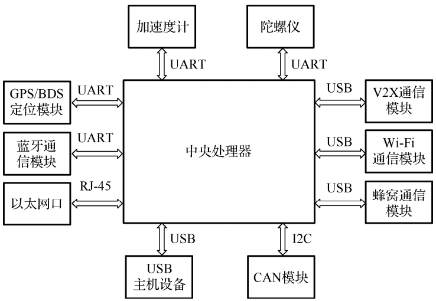
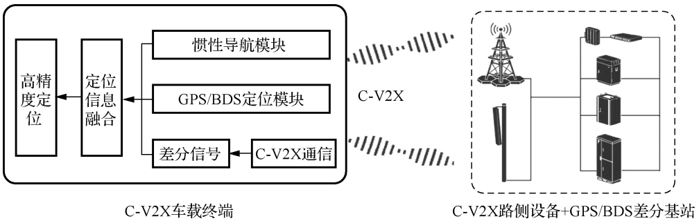
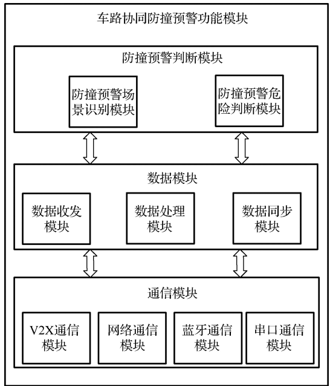

# 第7章 车路协同防撞预警模型及其设计

本章首先分析车路协同防撞预警的系统结构，然后设计车载终端方案，再对系统结构的功能设计进行详细分析，包括通信模块功能分析、数据模块功能分析、防撞预警模块功能分析。作者在车路协同防撞预警模型和改进安全距离模型设计的基础上，研究设计了一种改进的隐马尔可夫模型预警预测算法。

## 7.1 车路协同防撞预警系统架构

### 7.1.1 车路协同防撞预警车载终端硬件架构

车路协同防撞预警硬件设备主要实现基于V2X通信的数据交互、车辆位置数据获取、车辆姿态数据获取，以及其他车载设备、网络平台的网络通信等功能。

车载终端可从硬件上根据数据来源划分为GPS/BDS定位模块、加速度计、陀螺仪、V2X通信模块;可从软件上根据数据获取、转换格式、处理与预测等功能划分为车辆数据获取/收发模块、车辆状态数据分类模块、防撞预警预测模块及预警观测数据模块。其中,车辆数据获取/收发模块包括V2X通信功能模块、定位/惯性导航功能模块、车辆姿态功能模块。V2X通信功能模块用于车辆之间进行无线通信,发送和接收车辆行驶数据,以及超视距范围内周围车辆的探测、识别;定位/惯性导航功能模块包括GPS/BDS定位模块、加速度计、陀螺仪,其中GPS/BDS定位模块用于定位本车位置及获取位置数据,加速度计、陀螺仪用于获取本车的姿态数据,并进行高精定位[1-2];车辆姿态功能模块通过陀螺仪来进行感知识别。

车载终端通过车载传感器获取本车数据，V2X通信芯片会广播本车数据到周围车辆。如图7.1所示，车路协同防撞预警车载终端硬件架构分为中央处理器、GPS/BDS定位模块、V2X通信模块、加速度计、陀螺仪，蓝牙通信模块、蜂窝通信模块、CAN模块、Wi-Fi通信模块等。

#  7.1.2基于C-V2X通信的高精度定位与惯性导航技术

在未来智能网联汽车与智能交通的应用中，C-V2X应用主要覆盖三大类应用场景：交通安全、交通效率和信息服务。典型的交通安全应用场景包括交叉路口碰撞预警、紧急制动预警等；典型的交通效率应用场景包括车速引导、协作式自适应巡航智慧停车等。这些应用都需要高精度定位和惯性导航技术的支持。

考虑到成本和可行性,本书采用“C-V2X路侧设备+GPS/BDS差分基站”的方法来传输定位差分信号。如图7.2所示,C-V2X路侧设备同时作为差分基站,利用C-V2X通信时延较低的特点,将差分信号通过C-V2X通信发送给通信范围内的车载终端。C-V2X车载终端通过C-V2X通信获得区域内的高精度定位差分信号,该信号与本地高精度定位模块信号相结合,计算得出高精度定位信息。同时,作者研究设计了惯性导航模块高精度定位插补与误差补偿方法,将其与高精度定位结合起来,以解决卫星定位信号和C-V2X信号被遮挡导致定位不准确的问题。

通过这种方法，可以在道路交通比较复杂的区域布置 5G基站与定位差分基

站,以解决车辆车道高精度定位问题,也可以降低高精度定位技术部署成本,为车辆辅助安全和交通对象准确定位提供支持。

#  7.1.3 车路协同防撞预警模块功能分析

单车智能是目前智能网联汽车、自动驾驶、智能交通的主要研究和应用方案，但是单车智能存在的计算能力要求高、传感器数量多、硬件成本高等缺点制约了其普及应用。相比单车智能，车路协同可以实现车、路、网的实时数据交互，车-车之间的数据互联，将路侧端、云端的交通信息推送到车辆，可以极大地降低单车成本，推进智能车的推广应用。

车路协同防撞预警主要基于V2V通信和V2I通信，通过车载终端和路侧设备实现车-车通信、车-路通信。在C-V2X车联网中，车辆是车联网功能实现的载体，通过搭载车载设备实现数据通信、消息推送、娱乐休闲等功能。车路协同防撞预警功能模块架构如图7.3所示。

##  1.通信模块功能分析

车路协同防撞预警的通信模块负责车载设备与其他车载设备、网络设备、云端、功能设备进行信息交互，将本车数据发送到其他设备上，同时获取其他设备的数据，以用于防撞预警危险判断、交通信息推送、实时路况推送、交通调度，其通信模块主要包含以下几部分。

###  1) V2X通信模块

V2X通信模块中的车载设备与路侧设备采用中信科智联的LTE-V2X模块,

V2X 通信模块的主要功能是通过 V2X 通信的方式实现车-车通信、车-路通信。V2X 通信模块会感知周围车辆，扫描超视距范围内的车辆信息，接收周围车辆发送的车辆数据，包括位置、速度、加速度、航向角、海拔等数据，同时将本车的数据发送给其他车辆以用于防撞预警；接收周围路侧设备转发的车辆信息以及路侧设备转发的交通信息，如道路状况、限速状况、交通标志、道路危险等信息，可以在一些特殊、危险路段实现防撞提醒，提高驾驶安全。

##  2)网络通信模块

网络通信模块主要负责通过4G/5G网络通信将车辆数据发送到云端或者接收到云端推送的交通信息，以及推送给车载显示设备进行防撞预警提醒、交通信息推送、道路信息提醒等。车载终端与云端的通信主要是将车辆数据信息，包括位置、速度、加速度、航向角、海拔等发送给云端进行处理，同时接收云端推送的交通信息，如路段事故情况、恶劣天气情况、前方拥堵情况等。网络通信模块与车载显示设备的通信主要包含推送防撞预警提醒、交通信息、道路信息提醒等，提醒驾驶员谨慎驾驶，降低事故发生率。

##  3)蓝牙通信模块

蓝牙通信模块的主要功能是通过蓝牙通信与车载OBU设备进行连接以读取车身数据，或者通过其他蓝牙通信设备进行数据交互。

##  4)串口通信模块

串口通信模块主要用于车载设备通过串口通信方式读取GPS/BDS定位模块、加速度计及陀螺仪等的数据。

#  2. 数据模块功能分析

数据模块用于实现数据的处理、转换及线程间的数据同步。数据模块通过硬件架构中的通信模块接收数据,由数据模块进行相应的数据处理。数据模块包含以下部分。

##  1)数据收发模块

数据收发模块的主要功能是将硬件架构中通信模块接收到的数据交由业务线程进行处理，或者将业务线程处理后的数据传输到硬件架构的通信模块中进行发送，实现数据在硬件和软件业务逻辑中的传输。

##  2)数据处理模块

数据处理模块的主要功能是对原始数据进行处理，将其转换为软件架构中的基本数据，以进行防撞预警等功能的逻辑运算，包括V2X数据、GPS/BDS定位数据、JSON格式的网络数据、加速度计数据和陀螺仪数据。

##  3)数据同步模块

数据同步模块的主要功能是实现业务逻辑中多线程之间的数据同步，由于不

同数据的收发频率不同，因此不同线程的处理数据存在数据不同步的问题，通过加入读写锁、互斥锁等，可使数据各个业务线程的数据同步。

#  3.防撞预警判断模块功能分析

防撞预警判断模块分为防撞预警场景识别模块、防撞预警危险判断模块，主要实现数据获取、车辆状态数据分类、预警观测数据分析、防撞预测等功能。如图7.4所示，防撞预警判断模块通过防撞预警场景识别模块判断当前防撞预警场景，选择合适的防撞预警模型实现应用，包括改进的安全距离模型和改进的隐马尔可夫模型，通过防撞预警判断模块对车辆数据进行分析判断得出当前场景中的车辆危险状况，并推送到驾驶端，提醒驾驶员安全驾驶。

图7.4 防撞预警判断模块功能判断流程图

#  7.2 车路协同防撞预警模型设计

在车辆行驶过程中，车辆运动速度过快、控制不稳定、驾驶员注意力不集中等都可能造成严重的交通事故。车辆在行驶过程时，驾驶员对车速、安全距离的控制不到位，车辆行驶速度较快，汽车车流量大，遇到变道、超车等时，大多数情况下是驾驶员根据自身的驾驶经验以及对当前的交通状况的观察来进行决策的，整个决策过程存在巨大的模糊性，没有判断危险状况的指标，也无法精确地进行危险判断。

##  7.2.1 防撞预警模型设计

如图7.5所示,作者根据车辆跟驰理论、改进的安全距离模型和隐马尔可夫模型,设计了一种可以客观、精确计算、评估交通危险状况的防撞预警方案,包括改进的安全距离模型和改进的隐马尔可夫模型,以分析车辆制动过程中不同阶段的制动行为,通过分析车辆制动的不同阶段的特征和车辆跟驰行为的特点对安全距离模型进行优化。防撞预警模型功能流程如图7.6所示。为了优化根据单一时刻车辆数据进行危险判断准确率低的问题,这里采用隐马尔可夫模型根据周期过程观测序列进行危险判断。同时,采用改进的安全距离模型进行车辆数据状态标记,采用k-means算法观测数据分类离散化。预警场景用于统计该路段车辆航向角的数值,根据航向角数值种类的不同,判断出当前处于弯道、直道或路口等场景。

图 7.5 防撞预警模型

(a)隐马尔可夫模型训练流程

(b)隐马尔可夫模型预测流程

图7.6 防撞预警模型功能流程

#  1.改进的安全距离模型

改进的安全距离模型基于车辆跟驰理论，通过分析车辆制动过程中每个阶段的运行状况，借助车联网的互连互通的通信优势采集路段上的车辆数据，提高了传统的安全距离模型的预测准确率，在驾驶员反应时间、消除制动间隙时间、“looming 效应”$^{[3]}$方面进行了改进，结合V2X通信的防撞预警技术，可以有效地进行驾驶提醒，安全合理地控制车距、车速，提高驾驶安全。

改进的安全距离模型基于 Berkeley(伯克利)模型,通过V2X车联网通信技术感知并获取周围车辆数据,并引入碰撞时间倒数对模型进行优化,充分考虑了安全时距对驾驶员的影响,实时地计算安全预警距离,对驾驶员进行危险提醒,辅助驾驶员合理控制车速和车距,提高驾驶安全。

#  2.改进的隐马尔可夫模型

在车辆进行跟驰行驶时，当前交通状况的危险程度不仅与当前车辆的运动状态和目标车辆的运动状态有关，还受驾驶员上一时刻的驾驶操作行为的影响。

改进的隐马尔可夫模型应用于交通状况复杂的车辆跟驰行驶场景时，通过采集驾驶员的车辆行驶数据，训练隐马尔可夫模型参数，以表征驾驶员的驾驶特征。

作者使用了改进的隐马尔可夫模型，通过改进的安全距离模型标记车辆数据危险状态，可以进一步提高预测准确率；同时，设计引入k-means算法对车辆数据进行分类离散化，提高模型预测的实时性。

#  7.2.2车辆跟驰原理分析

车辆跟驰理论是微观交通流理论中的一个重要理论分支，主要研究单一车道上后方车辆跟随前方车辆行驶的过程。在进行跟驰行驶时，受交通流、路况、环境的影响，后方车辆会一直保持合理的安全距离；根据交通流的特性，在前方车辆改变行驶状态时，后方车辆会相应地改变车辆行驶状态使车辆间保持安全距离，又因为需要紧跟前方车辆，致使前后两车距离基本保持在驾驶员认定的安全距离范围内${}^{[4-6]}$。

车辆跟驰模型大量应用于交通流研究和交通仿真领域,主要跟驰模型有GHR模型①、安全距离模型、线性距离模型、心理模型及基于模糊理论的模型等。

1981年，Gipps提出了一种安全距离模型[4]，该模型在交通领域得到了广泛认可，成为研究微观交通流域常见的模型之一。Gipps 安全距离模型能够很好地研究车辆跟驰行驶的特征，同时，基于该模型的众多车辆跟驰模型能够在研究交通流理论时对车辆的跟驰行为进行还原、仿真。Gipps 安全距离模型能研究车辆跟驰行为的一个重要优势是模型的参数都基于车辆行驶时驾驶员和车辆的特点，可以通过车辆网、数据分析等方法，通过统计、分析驾驶员的驾驶行为极大地简化模型建立时参数的标定。Gipps 安全距离模型充分考虑到了驾驶员反应时间、车辆限速、车辆加速度等，模型参数的有效标定使得模型可以更加精确地对跟驰行为进行还原[7]。

Gipps安全距离模型充分考虑了车流量较大和车流量较小这两种情况:当车流量较大时,车辆行驶速度较低,道路拥挤,车辆之间的行驶距离较小,车辆紧急制动时需要较小的安全距离;当车流量较小时,车辆行驶速度较高,车辆之间的行驶距离较大,车辆紧急制动时需要较大的安全距离,如式(7.1)[4,7]所示。

$$v_h(t+\tau)=\min\left\{\begin{aligned}&v_h(t)+2.5a_h\tau\left(1-\frac{v_h(t)}{V}\sqrt{0.025+\frac{v_h(t)}{V}}\right)\\&-h_h\left(\frac{\tau}{2}+\theta\right)+\sqrt{b_h^2\left(\frac{\tau}{2}+\theta\right)^2+b_h\left\{2\left[x_h(t)-x_h(t)-d\right]-\tau v_h(t)+\frac{v_f^2(t)}{b_f}\right\}}\end{aligned}\right. \quad (7.1)$$

式中，$v_h$表示前车速度；$t$表示行驶时间；$\tau$表示驾驶员反应时间；$a_h$表示跟驰车加速度；$V$表示其他车辆速度；$h_h$表示车辆之间的时间间隔；$\theta$表示反应滞后时间；$b_h$表示跟驰车减速度；$x_f$表示前车位移；$x_h$表示跟驰车位移；$d$表示制动后车辆最小安全距离；$b_f$表示前车减速度。

Berkeley 模型也是车辆跟驰原理中的一个重要模型,该模型主要研究在最大制动力和制动减速度的情况下,前后两车所需要的最小安全距离。该模型通过对安全距离模型的研究可以有效地避免车辆在行驶时因安全距离不足而造成的制动追尾等事故,能够有效地提高驾驶安全。Berkeley 模型安全距离如式(7.2)[8-9]所示。

$$s = v_h \left( t_1 + t_2 + \frac{a_{t_3} t_s}{a_{\max}} \right) + \left( v_h + \frac{a_{t_3}^2 t_s}{2a_{\max}} \right) \left( t - t_1 - t_2 - \frac{a_{t_3} t_s}{a_{\max}} \right) \\ - \frac{1}{2} a_{t_3} \left( t - t_1 - t_2 - \frac{a_{t_3} t_s}{a_{\max}} \right) - \left( v_f t + \frac{1}{2} a_f t^2 \right) + d \quad (7.2)$$

式中，$a_h$表示跟驰车加速度；$a_{t_3}$表示$t_3$时刻车辆减速度；$t_s$表示制动系统的响应时间；$v_f$表示前车速度；$v_h$表示跟驰车速度；$t_1$、$t_2$表示特定时间点；$t$表示当前时间点；$a_{max}$表示车辆能达到的最大加速度；$a_f$表示前车减速度；$d$表示制动后车辆最小安全距离。

该模型充分考虑了车速、最大制动减速度、驾驶员反应时间、制动延迟时间等因素，可以准确地反映出车辆跟驰行为。然而，该模型在进行安全距离计算时采用最大制动减速度计算安全距离，这在一定程度上限制了该模型的广泛运用。车辆在进行制动时一般不会一直处于最大制动减速度状态，该模型未有效考虑车辆数据的准确性和驾驶员驾驶倾向的不同对安全距离的影响，使得其得到的安全距离与实际安全距离存在较大偏差，防撞预警系统准确率下降，从而影响驾驶安全。

#  7.2.3车辆制动行为分析

车辆跟驰理论为分析车辆制动状态来判断碰撞可能提供了理论依据。通过分析车辆的制动行为，可对车辆的制动行为进行分解，分析车辆制动的每一个过程${}^{[10]}$。

如图7.7所示,在车辆运行时,当驾驶员发现前方危险状况而进行车辆制动时,右脚踏下制动踏板直至本车与前方车辆的距离在驾驶员可以接受的最小安全距离,整个车辆制动过程完成。车辆制动过程指的是驾驶员踏下制动踏板进行制动,直至车辆脱离危险状态制动结束的整个过程[11]。

图 7.7 汽车制动过程

其中，$F_p$、$a_b$为车辆制动力和减速度。车辆制动过程分为驾驶反应阶段、消除制动间隙阶段、制动力增长阶段、持续制动阶段和放松制动器阶段。该过程的划分依据为制动器的作用程度和作用效果。

驾驶反应阶段:当危险出现时,驾驶员观察到危险的出现并意识到存在危险的这段时间为$t'_1$,驾驶员意识到危险的存在并对车辆进行制动使车辆脱离危险的这段时间为$t''_1$。整个驾驶反应时间为$t_1 = t'_1 + t''_1$,不同人的驾驶习惯、驾驶倾向和反应时间不同,所以整个过程的时间也不同,一般为0.3~1.0s[12-13],饮酒驾驶、疲劳驾驶、驾驶员年龄较大、道路环境较为恶劣等因素都会增加驾驶反应时间,造成该阶段用时较长,增加发生交通事故的概率。

消除制动间隙阶段:主要是指驾驶员在进行车辆制动操作时,由于车辆制动器本身的设计特性,在驾驶员进行制动开始的一段时间,制动器存在一段执行制动操作和制动产生效果的间隔时间$t_2$。在这段间隔时间里,驾驶员进行了制动操作,但是车辆制动器并没有产生制动效果。

制动力增长阶段:驾驶员进行制动的同时车辆制动器产生制动效果,因为制动原理本身的设计特性,在制动过程中,制动器的制动力呈线性增加,不断增大制动器的制动效果,车辆制动时的减速度也呈线性增加。此制动过程的制动时间为$t_3$。

制动力增长阶段:消除制动间隙阶段和制动力增长阶段都是制动器起作用的时间,在这两个阶段中,车辆制动开始产生制动效果,制动力也开始呈线性增加,车辆进入一个变化的制动过程中,这两个过程一般为$0.2~0.9s^{[12-13]}$,但具体制动时间受车辆性能、道路状况、环境状况及驾驶员状态等多种因素影响[6]。

持续制动阶段:主要是车辆制动器达到稳定效果的阶段,此时车辆的制动力基本稳定为$F_p$,制动加速度也稳定为$a_b$,直到车辆静止。在车辆制动过程中,由于车辆性能不同、制动时对制动器施加压力不同,产生的最大制动力也不同,同时,恶劣天气(如结冰、雨雪)、沙石路面都会影响车辆制动过程中的最大制动减速度,使最大制动减速度变小,制动距离增加,增大了事故发生的概率。持续

制动阶段是整个制动过程中最重要的阶段,制动过程中的大多数制动效果都是在该制动阶段完成的。该阶段的制动时间为$t_4$,是车辆性能评估中的重要指标[4]。

放松制动器阶段:即制动停止阶段,驾驶员解除制动,整个过程中制动力随着驾驶员逐渐松开制动踏板而逐渐减小。可以认为此阶段中制动力线性减小,记放松制动器阶段的制动时间为$t_5$。由于驾驶员、路况、环境、车况等因素不同,放松制动器阶段的制动时间也不同,一般为$0.2\sim1.0s^{[13-14]}$。放松制动器阶段的车辆制动力存在但车辆已经静止,车辆制动距离没有增加,其只是在驾驶员进行制动操作的过程中,制动完成后消除制动效果的一个过程。

制动过程主要集中在持续制动阶段,该过程制动力稳定,车辆减速度保持不变,汽车做匀减速运动。在持续制动阶段,初速度为$u_{t_3} = u_0 - \frac{a_b}{2}t_3$,并在该时间段内做匀减速运动,直至车辆速度减到安全的跟驰速度。因此,车辆从$t_4$时间开始到减速到$u_2$时所驶过的距离为$S_3^{[12,15]}$,且

$$S_3 = \frac{u_{t_3}^2 - u_2^2}{2a_b} = \frac{u_0^2}{2a_b} - \frac{u_0 t_3}{2} + \frac{a_b t_3^2}{8} - \frac{u_2^2}{2a_b} \quad (7.3)$$

式中，$u_2$表示安全跟驰速度；$u_0$表示本车初始速度；$u_{t_3}$表示$t_3$时刻的车速。

驾驶反应阶段、消除制动间隙阶段这两个阶段是驾驶员进行制动反应并产生制动效果的阶段，作者将这两个阶段中车辆的运动状态视作匀速直线运动。记车辆初始速度为$u_0$，期间所驶过的距离为$S_1$[16]。

$$S_1 = u_0(t_1 + t_2) \qquad (7.4)$$

在制动力增长阶段,驾驶员采取有效的制动手段使得车辆的制动力不断增加,车辆的减速度也在不断变大。$\frac{du}{dt} = kt$,且$k = -\frac{a_b}{t_3}$,其中$a_b$是最大制动减速度,因此车辆在制动力增长阶段的速度表达式[16]为

$$u = u_0 - \frac{a_b}{2t_3} t^2 \quad (7.5)$$

记$t_3$时间内所驶过的距离为$S_2$

$$S_2 = \int_0^{t_3} u dt = u_0 t_3 - \frac{a_b}{6} t_3^2 \quad (7.6)$$

车辆从出现危险状况($t_1$时间开始)至车辆速度减为$u_2$时,所驶过的距离为车辆的总制动距离,记为$S^{[4,15]}$:

$$S = S_1 + S_2 + S_3 = \frac{t_1 + t_2 + t_3}{2} u_0 + \frac{u_0^2 - u_2^2}{2a_b} - \frac{a_b t_3^2}{24} \quad (7.7)$$

式中，$t_3$为制动力增长阶段的作用时间。在该阶段中，车况和驾驶员状态不同，作用时间也不同，但是该阶段时间较短，式(7.7)中$\frac{a_b t_3^2}{24}$项较小，在精度要求的范围内，可采用一个统计平均值常数项$C$来代替该项，这样既可以降低公式复杂度，又可以提高计算速率。最后，得到总制动距离$S_L$为

$$S_L = S_1 + S_2 + S_3 = \frac{t_1 + t_2 + t_3}{2} u_0 + \frac{u_0^2 - u_2^2}{2a_b} - C \quad (7.8)$$

防撞预警模型依据获取到的车辆数据进行防撞危险判断，而随着车联网技术的快速发展，车-车通信技术实时性显著提高，车辆位置和姿态传感器的精确度也变得越来越高。

#  7.3改进的安全距离模型

改进的安全距离模型在驾驶员反应时间、消除制动间隙时间、looming 效应方面进行了改进，同时通过V2X通信的防撞预警技术，建立车辆行驶坐标模型，将目标车辆统一至本车的行驶坐标系中，计算车辆安全距离，实现车辆行驶过程中的防撞预警危险判断，提醒驾驶员及时进行制动，保持车辆安全距离、合理车速，并基于车辆跟驰原理为驾驶员提供跟驰建议车速。

##  7.3.1车辆行驶坐标模型设计

车联网中的车辆位置通过接收V2X消息、提取车辆位置数据来获取,获取的车辆位置数据是GPS/BDS芯片采集到的基于地球坐标的经纬度、海拔数据,而要将这些数据用到防撞预警模型中需要将车辆位置数据统一到位置坐标系中,作者设计并提出了基于车辆自身位置和车辆航向角建立车辆行驶坐标系的方法来统一车辆的位置数据。车辆行驶坐标模型可以保障防撞预警计算的有效性、统一性,避免因坐标系不统一而出现位置误差。

车辆经纬度坐标系以本车的位置为坐标原点,正北方向为坐标系y轴,正东方向为坐标系x轴,记为xOy坐标系。但是该坐标系是以车辆的经纬度为基础的,无法直接得到防撞预警功能所需的距离、角度等。

车辆行驶坐标系以本车的位置为坐标原点,本车的航向角方向为坐标系y轴,右手垂直方向为x轴,记为x'Oy'坐标系。

采用车辆行驶坐标系可以有效地实现车辆位置坐标系的一致性，同时可以直接计算车辆间的距离、角度等，用于防撞预警判断。

将车辆按照 $\theta_1$ 进行坐标转换即可得到车辆的行驶坐标系。车辆行驶坐标系与车辆经纬度坐标系的转换关系如式(7.9)和式(7.10)[17]所示。

$$ \begin{cases} y' = x \sin \theta_1 + y \cos \theta_1 \\ x' = x \cos \theta_1 - y \sin \theta_1 \end{cases} \qquad (7.9) $$

或者

$$ \begin{cases} y = -x' \sin \theta_1 + y' \cos \theta_1 \\ x = x' \cos \theta_1 + y' \sin \theta_1 \end{cases} \qquad (7.10) $$

式中, $\theta_1$ 表示车辆航向角方向与 $y$ 轴的顺时针夹角。

通过坐标转换将其他车辆映射到本车车辆行驶坐标系中，如式(7.11)和式(7.12)所示。

$$ \begin{cases} y'' = x' \sin(\theta_2 - \theta_1) + y' \cos(\theta_2 - \theta_1) - L \sin(\theta_2 + \theta_3) \\ x'' = x' \cos(\theta_2 - \theta_1) - y' \sin(\theta_2 - \theta_1) - L \cos(\theta_2 + \theta_3) \end{cases} \qquad (7.11) $$

或者

$$ \begin{cases} y' = x'' \sin(\theta_1 - \theta_2) + y'' \cos(\theta_1 - \theta_2) - L \sin(\theta_1 + \theta_3) \\ x' = x'' \cos(\theta_1 - \theta_2) - y'' \sin(\theta_1 - \theta_2) + L \cos(\theta_1 + \theta_3) \end{cases} \qquad (7.12) $$

式中, L表示两车的直线距离; x'、y'表示车辆经纬度坐标系; x"、y"表示其他车辆的车辆行驶坐标系; $\theta_1$表示车辆航向角方向与y轴的顺时针夹角; $\theta_2$表示其他车辆航向角方向与y轴的顺时针夹角; $\theta_3$表示其他车辆相对于本车的航向角的偏差。

#  7.3.2改进的安全距离模型设计

作者通过对车辆制动过程的分析,借鉴 Berkeley 模型${}^{[14-15]}$通过模拟车辆当进行车辆制动时在车辆制动减速度最大的情况下的车辆安全距离(图7.8),来判断车辆当前危险状态。Berkeley 模型未能有效考虑车辆数据的准确性和驾驶员驾驶员倾向的不同对安全距离的影响,使得模型得到的安全距离与实际安全距离存在较大偏差,影响驾驶体验。

改进的安全距离模型基于 Berkeley 模型，结合 V2X 车联网通信技术，以车辆的实时制动减速度作为车辆制动时的减速度，充分考虑安全时距对驾驶员的影响。同时，该模型引入了 Berkeley 模型中驾驶员反应时间参数、车辆制动时间参数进行优化，并可以实时地获取危险车辆的速度、减速度等数据，可以实时地计算安全预警距离。改进的安全距离模型提高了传统的安全距离模型的预测准确率，可以有效地进行驾驶提醒，安全合理地控制车距、车速，极大地提高了驾驶安全。

图7.8车辆安全距离

d:本车与前车之间的纵向距离; $d_1$ :本车与本车在不同时间段的纵向距离;

$d_2$：前车与前车在不同时间段的纵向距离；$u_1$：本车特定时间的速度；

$u_2$ : 前车特定时间的速度; $u'_1$ : 本车特定时间的加速度; $u'_2$ : 前车特定时间的加速度。

当车辆进行跟驰时,正常行驶状态下两车之间的距离满足正态分布,均值为车辆安全距离。但根据交通反应时间模型,后方车辆会根据前方车辆的操作相应地进行驾驶操作以保持车辆距离满足车辆安全距离。驾驶员在进行安全距离判断时主要基于个人经验进行模糊判断,判断结果误差较大,准确性较低,会影响驾驶安全。

#  1. 驾驶员反应时间数据处理

驾驶员反应时间受驾驶员状态、年龄,以及道路状况、环境状况等因素的影响。驾驶员反应时间在数值上满足正态分布,根据辛钦大数定律,通过采集大量驾驶员反应时间数据计算驾驶员平均反应时间,平均反应时间会根据数据量的不断增大而趋近于均值,可作为驾驶员反应时间均值的估计值。辛钦大数定律如式(7.13)[4]所示:

$$ \lim_{n \to \infty} \left\{ \left| \frac{1}{n} \sum_{k=1}^{n} X_k - \mu \right| < \varepsilon \right\} = 1 \quad (7.13) $$

#  2. 消除制动间隙时间数据处理

消除制动间隙时间受车辆、驾驶员等因素的影响，根据辛钦大数定律，通过采集大量消除制动间隙时间数据计算驾驶员平均反应时间，并采用均值以消除制动间隙时间。

#  3. looming 效应优化处理

在车辆驾驶过程中，looming 效应普遍存在于驾驶员感知前方车辆、行人或障碍物的情况中，即目标物在驾驶员眼中的投影取决于目标物与驾驶员之间的距

离,距离越大,目标物在驾驶员眼中的投影就越小。looming 效应由式(7.14)表示:

$$w = \theta R \qquad (7.14)$$

式中, R表示驾驶员与目标物之间的距离; w表示目标物在驾驶员眼中的大小; $\theta$表示 looming 效应参数。

本书使用碰撞时间倒数 $T_c^{-1}$ 来表征 looming 效应,可以有效反映出 looming 效应对驾驶员驾驶反应的影响状况。

$$T_c^{-1} = \lambda \frac{v_h - v_f}{R} \qquad (7.15)$$

式中，$\lambda$ 表示 looming 效应参数；$v_h$ 表示本车速度；$v_f$ 表示跟随车速度；$R$ 表示两辆车之间的相对距离。

通过获取前车数据可以得到前车的车速$v_f$和前车减速度$a_f$，由此可以推算出前车的位移$s_2$为

$$s_2 = \int_0^T v_f + a_f t dt \quad (7.16)$$

在驾驶员反应时间$t_1$和消除制动间隙时间$t_2$[18]内,任务车辆处于匀速行驶状态,后方车辆位移$D_1$为

$$D_1 = v_h(t_1 + t_2) \qquad (7.17)$$

式中，$v_h$ 表示后方车辆速度。

在制动力增长时间$t_3$内,车辆制动系统持续增加制动效果,车辆减速度也在逐渐增大,但该阶段时间较短,在模型中可将该阶段认定为匀速行驶状态。这样可以在保证准确性的条件下,降低计算难度,提高系统计算实时性。该阶段的位移$D_2$为

$$D_2 = v_h t_3 \qquad (7.18)$$

在持续制动阶段,车辆制动力保持稳定、车辆加速度也保持稳定,车辆维持匀减速运动状态,$v_{t_4}$为车辆速度$v_h$经过$t_3$阶段加速后的车辆速度,即$v_{t_4} = v_h - a_h t_3$,则该段时间后车减速位移$D_3$[19]为

$$D_3 = v_{t_4} t_4 + \frac{1}{2} a_h t_4^2 \quad (7.19)$$

式中，$t_4$为本车减速时间。

在车辆的反应、制动过程中后方车辆的位移 $s_1$ [20] 为

$$s_1 = D_1 + D_2 + D_3 \qquad (7.20)$$

整个车辆的反应、制动过程中车辆的安全距离 $s$ 为

$$s = s_1 - s_2 + d \qquad (7.21)$$

式中，d表示驾驶员设定的车辆应保持的最小安全距离。

在该模型中,将前车视为匀加速运动或匀减速运动,并引入looming 效应参数对模型进行优化,可以得到车辆安全距离s为

$$s = (1 + T_c^{-1})v_h(t_1 + t_2 + t_3) + (v_h - a_h t_3)t_4 - \frac{1}{2} a_h t_4^2 - v_f(t_1 + t_2 + t_3 + t_4) + \frac{1}{2} a_f(t_1 + t_2 + t_3 + t_4)^2 + d \quad (7.22)$$

式中，$a_h$表示本车减速度；$v_f$表示前车速度；$v_h$表示本车速度；$a_f$表示前车减速度；$d$表示制动后车辆最小安全距离；$t_1$为驾驶员反应时间；$t_2$为消除制动间隙时间；$t_3$为制动力增长时间；$t_4$为本车减速的时间。如图7.9所示，在车速较小时，改进的安全距离模型的优化效果较小，而随着车速的不断增加，改进的安全距离模型的优化效果越来越明显，防撞预警效果越来越好[21-22]。

图7.9 不同车速下的安全距离对比

改进的安全距离模型在驾驶员反应时间、消除制动间隙时间以及车驶过程中的looming 效应方面进行了优化，使其预测更加准确。另外，通过采集大量驾驶员驾驶数据可以更好地估计出驾驶员反应时间、消除制动间隙时间以及车辆驾驶过程中的looming 效应参数，进一步提高模型的预测准确率。

如图7.10所示,结合V2X车联网通信技术,通过对前方车辆的驾驶分析,

判断车辆的危险状况，可以提前对驾驶员进行危险提醒。采用防撞预警技术可以有效地降低驾驶员的反应时间，并通过提前制动降低车速，减小车辆制动距离，提高驾驶安全。

图7.10 有/无防撞预警模型所需安全制动距离

#  7.4基于改进的隐马尔可夫模型预警预测算法设计

改进的安全距离模型在判断车-车防撞预警时，单一地通过车辆当前时刻的数据进行危险判断，无法充分量化驾驶员驾驶员行为与驾驶习惯，存在判断准确性不高的问题[23-24]。

车辆行驶过程中，车辆间的危险状态可视作马尔可夫过程，满足马尔可夫性，可采用隐马尔可夫模型对车辆间的危险状态进行预测。

针对连续车辆数据处理实时性较差的问题，作者提出了一种通过k-means算法对车辆数据进行分类的方法[25-26]。该方法通过获取车辆行驶数据（包括速度、加速度、航向角、与前车距离、经纬度等），设计采用改进的安全距离模型对车辆数据进行危险标记，以车辆实际距离与安全距离的比值$d_v$对车辆状态进行标记，估计隐马尔可夫模型的转移概率矩阵A、观测概率矩阵B[27-28]，最终通过维持比算法对车辆危险进行预测。在进行防撞预警模型应用设计时，设计实现了一种根据本车速度自适应观测序列长度的方案，即根据车辆速度及时改变观测序列的长度以进行危险状态预测，该方案可以有效地保证预测的实时性。

##  7.4.1 车辆危险状态的马尔可夫性分析

在一段连续时间内，车辆间的危险状态依赖于上一时刻驾驶员的驾驶操作，

且车辆交通状况观测值依赖于当前时刻的车辆间的危险状态。可将车辆行驶过程中车辆间的危险变化过程视作马尔可夫过程。由此引入了隐马尔可夫模型，通过车辆数据训练模型参数预测车辆危险状态。

根据车辆行驶过程中的特征，驾驶员当前时刻的驾驶行为决策依赖于上一时刻的驾驶行为，即驾驶员根据当前时刻车辆间的危险状态进行相应的驾驶操作，而这决定了下一时刻的车辆间的危险状态[4,6,17]。根据以上特征，车辆行驶过程可视作马尔可夫过程，将车辆驾驶过程危险状态视作马尔可夫状态，设任意时刻$t$的车辆危险状态在马尔可夫链中的状态为$i_t$。车辆行驶过程中，$t$时刻的车辆危险状态$P$只依赖于$t-1$时刻的车辆危险状态，与其他时刻的车辆危险状态和观测无关。

$$P(i_t | i_{t-1}, o_{t-1}, \dots, i_1, o_1) = P(i_t | i_{t-1}) \quad (7.23)$$

式中，$i_t$ 表示 t 时刻车辆间的危险状态；$o_t$ 表示 t 时刻车辆间的观测。

根据马尔可夫过程的性质,车辆行驶状态中的车辆状态数据作为马尔可夫过程的观测值,设任意时刻$t$车辆行驶状态的观测为$o_t$,该观测只依赖于当前时刻车辆间的危险状态,即该马尔可夫过程中的状态$i_t$与其他时刻的观测无关。

$$P(o_t | i_t, o_t, i_{t-1}, o_{t-1}, \dots, i_1, o_1) = P(o_t | i_t) \quad (7.24)$$

式中，$i_t$表示$t$时刻车辆间的危险状态；$o_t$表示$t$时刻车辆间的观测。

根据车辆行驶过程中的马尔可夫性，可以通过使用车辆数据的观测值以及改进的安全距离模型标记危险状态的方法来训练改进的隐马尔可夫模型参数，并由观测序列通过模型预测车辆间的危险状态。车辆行驶时，改进的隐马尔可夫模型可以高效预测车辆间的危险状态，充分考虑车辆上一时刻的状态，提高改进的安全距离模型单一通过计算车辆危险状态时的准确性。

#  7.4.2改进的隐马尔可夫模型优化设计

针对车辆行驶时，车辆速度变化较大、对实时性要求较高的情况，改进的隐马尔可夫模型采用了改进的安全距离模型进行行驶数据标记，根据数据充分分析驾驶员的一系列驾驶行为[29-30]，通过维特比算法预测当前时刻的预警状态，提高预测的准确率。改进的隐马尔可夫模型防撞预警功能流程如图7.11所示。

(a)改进的隐马尔可夫模型训练流程

(b)改进的隐马尔可夫模型预测流程

图7.11改进的隐马尔可夫模型防撞预警功能流程

#  1.改进的安全距离模型标记危险状态

通过改进的安全距离模型对跟驰状态的车辆危险状态进行标记,状态值分类方法如式(7.25)所示,$d_v$通过计算车辆间实际距离和安全距离的比值表征当前危险状态。

$$d_v = f(L,s) = \begin{cases} 1, & \frac{L}{s} \ge 1.2 \\ 2, & 1.1 \le \frac{L}{s} < 1.2 \\ 3, & 1 \le \frac{L}{s} < 1.1 \\ 4, & 0.8 \le \frac{L}{s} < 1 \\ 5, & 0 \le \frac{L}{s} < 0.8 \end{cases} \quad (7.25)$$

式中,s表示车辆安全距离;L表示车辆实际距离。

采用改进的安全距离模型标记车辆状态后，可通过观测序列和状态序列训练

得到模型的状态转移概率矩阵A、观测概率矩阵B,优化车辆危险判断的准确性。改进的隐马尔可夫模型基于标记数据采用监督学习方法训练模型参数,可以有效利用改进的安全距离模型在判断危险状态方面的优势,同时,考虑上一时刻车辆的危险状态,通过观测序列预测当前时刻车辆的危险状态。

本节中的模型参数训练采用监督学习对参数进行估计[27],该方法能够有效地发挥改进的安全距离模型危险判断的优势,极大地提高模型预测的准确率。改进的隐马尔可夫模型参数在模型参数初始值的基础上,对训练数据集通过监督学习算法进行反复迭代,估计状态转移概率矩阵A、观测概率矩阵B中的元素值,使状态转移概率矩阵A、观测概率矩阵B达到最优解[31-34],即

$$ \hat{a}_{ij} = \frac{A_{ij}}{\sum_{j=1}^{N} A_{ij}} \quad (i=1,2,\dots,N; j=1,2,\dots,N) \qquad (7.26) $$

$$ \hat{b}_j(k) = \frac{B_{jk}}{\sum_{k=1}^{M} B_{jk}} \quad (j=1,2,\dots,N;k=1,2,\dots,M) $$

式中，$A_{ij}$ 表示从状态 $q_i$ 转移到状态 $q_j$ 的频数；$B_{jk}$ 表示从状态 $q_i$ 转移到状态 $o_k$ 的频数。

通过上述算法求得状态转移概率矩阵A、观测概率矩阵B,完成模型参数的估计。

隐马尔可夫模型通过训练数据中的防撞预警分类,进行模型参数的独立训练,得到状态转移概率矩阵A、观测概率矩阵B,模型通过维特比预测算法进行当前场景的预警预测[35-36]。

#  2. k-means算法分类观测数据

改进的k-means算法对获取的车辆行驶数据按照相对速度、相对距离、相对加速度、相对航向角、两车相对角度进行聚类,对多维连续观测数据进行离散化及分类,并将其作为改进的隐马尔可夫模型的观测序列值。

车辆行驶状态数据$\{x^1, x^2, x^3, x^4, x^5\}$包括相对速度、相对距离、相对加速度、相对航向角、两车相对角度,通过k-means算法进行聚类,将数据分类为由质心$c^{(i)}$表征的k种类别的车辆驾驶状态数据,通过类别质心$c^{(i)}$快速识别当前时刻的交通状况类别。

在车辆状态数据分类模块中，通过对当前路段中的车辆相对航向角进行统计，分析当前路段中车辆航向角的分布情况，判断当前路段航向角的类别，以识

别当前路段的预警场景，并判断出识别车辆所属的预警场景，通过k-means算法对车辆行驶数据进行聚类，同时使用聚类类别与车辆的预警场景判断结果标记当前状态数据，用于预测模型的学习。

隐马尔可夫模型的 V2X 车联网防撞预警系统基于获取到的本车以及周围车辆的车辆状态数据选取两车的相对距离 d、相对速度 v、相对加速度 a、相对航向角 h 和角度 angle 作为 k-means 算法的特征,将车辆状态数据聚类为 k 类,每个聚类中心为 $C = \{c_1, c_2, \dots, c_k\}$,通过反复迭代聚类,寻求最优聚类中心,直至聚类准则函数收敛。采用平法误差作为聚类准则函数[25],即

$$E = \sum_{i=1}^{k} \sum_{j=1}^{n} (f_{ij} - c_i)^2 \quad (7.27)$$

式中，$f_{ij}$表示车辆状态数据集中的数据元素。

通过$k$-means算法分类车辆数据,对模型训练和预测中的观测数据进行离散化,有利于特征提取,提高模型的稳定性、处理效率,可以有效地提高模型预测的实时性。

#  3. 隐马尔可夫模型预测危险状态

如图7.12所示,先通过大量训练数据集来训练模型参数,包括初始状态概率向量 $\pi$ 、状态转移概率矩阵 $A$ 、观测概率矩阵 $B$ ,得到隐马尔可夫模型。在进行防撞预警模型应用设计时,设计实现了一种根据本车速度自适应观测序列长度的方案,根据车辆速度的大小及时变化观测序列的长度以进行危险状态预测,该方法可以有效地保证预测的实时性,即 $\lambda = (A,B,\pi)^{[26-27]}$。

$$A = [a_{ij}]_{N \times N} \qquad (7.28)$$

式中，$a_{ij}$ 表示从状态 $i$ 转移到状态 $j$ 的概率。

$$a_{ij} = P(i_{t+1} = q_j | i_t = q_i) \quad (i=1,2,\dots,N; j=1,2,\dots,N) \quad (7.29)$$

式中，$q_j$表示车辆危险状态。

$$ \mathbf{B} = [b_j(k)]_{N \times M} \qquad (7.30) $$

$$b_j(k) = P(o_t = v_k | i_t = q_j) \quad (i=1,2,\dots,M; j=1,2,\dots,N) \quad (7.31)$$

式中，$k$表示观测序列中的时间步；$o_t$表示$t$时刻车辆间的观测；$v_k$表示时间步$k$观测到的车辆速度；$i_t$表示$t$时刻车辆间的危险状态；$q_j$表示车辆观测数据。

(a)各隐状态之间的转移过程

(b) 隐状态到观测之间的转移过程

图7.12各隐状态之间和隐状态到观测之间的转移过程

如图7.13所示,隐马尔可夫模型的维特比预测算法对该驾驶状态时间序列数据进行分析计算,应用动态规划高效地求解出当前驾驶状态时间序列数据支持下的当前时刻的最大概率的预警类别,即系统在$t$时刻处于状态$q_i$,而在系统到达$t+T$时刻时的状态为$q_j$,则系统从$q_i$转移到$q_j$状态的所有可能路径中,计算概率最大的路径作为模型预测的最优路径,继而得到当前时刻的预测状态。

图7.13 维特比算法预测过程

根据模型的状态转移概率矩阵A、观测概率矩阵B得到时刻t时状态$q_i$进行状态转移的所有路径中的最大概率$\delta_t$:

$$ \delta_t(q_i) = \max P(i_t = q_t, i_{t-1}, \dots, i_1, o_t, \dots, o_l \mid \lambda) \quad (i=1, 2, \dots, N) \quad (7.32) $$

式中，P表示t时刻状态q进行状态转移的路径的概率; o_t表示t时刻车辆间的观测; $\lambda$表示looming 效应参数。

对$t+1$时刻路径最大概率进行递推:

$$ \begin{aligned}\delta_{t+1}(q_i)&=\max_{i_1,i_2,\dots,i_{t-1}}P(i_{t+1}=q_i,i_t,\dots,i_1,o_t,\dots,o_1\mid\lambda)\qquad(i=1,2,\dots,N)\\&=\max_{1\le j\le N}\left[\delta_t(q_i)a_{ji}\right]b_i(o_{t+1})\qquad(i=1,2,\dots,N;t=1,2,\dots,T-1)\quad(7.33)\end{aligned} $$

同时得到$t$时刻$q_i$状态最优路径的$t-1$节点为

$$ \psi_t(i) = \arg \max_{1 \le j \le N} [\delta_{t-1}(j)a_{ji}] \quad (i = 1, 2, \dots, N) \quad (7.34) $$

最后通过动态规划思想对结果进行迭代计算得到当前T时刻的状态:

$$i_T^* = \arg \max_{1 \le i \le N} [\delta_T(q_i)] \quad (7.35)$$

将该模型预警结果提示给驾驶员，实现提前预警，可以优化采用单一驾驶状态时间序列长度作为观测序列进行预测时在速度差异较大的情况下预测实时性较差的问题，提高车辆驾驶安全，降低交通事故发生率。

改进的安全距离模型是基于Berkeley模型提出的一种改进模型,参考了Mazda 模型(马自达株式会社开发的技术模型)、Time to Collision 模型(碰撞时间模型)等,考虑了车辆数据的准确性和驾驶员驾驶倾向的不同对安全距离的影响。

改进的隐马尔可夫模型通过获取、处理车辆状态数据集,并对数据进行去噪、滤波等处理,通过 k-means 算法对当前时刻驾驶状态时间序列进行聚类得到驾驶状态数据集;通过改进的安全距离模型对当前时刻驾驶状态进行标记,分析当前时刻的预警场景;采用监督学习方法,根据驾驶状态数据集对模型进行参数估计得到隐马尔可夫模型 $\lambda = (A', B', \pi)$;采集当前时刻驾驶状态时间序列,通过速度自适应方法合理调整预测序列的长度。本节隐马尔可夫模型采用维特比算法进行预测,得到当前时刻预警状态,通过改进的安全距离模型表征车辆的危险状态,反馈预测结果,不断优化模型参数。

#  7.5测试与验证

本节针对各防撞预警场景的性能和指标要求,通过IPG CarMaker对车路协同防撞预警功能进行测试,包括预警的准确性和实时性,在遵守交通法规的前提下,对部分防撞预警场景进行外场环境测试。

##  7.5.1 防撞预警仿真测试平台环境搭建

在车路协同防撞预警开发测试过程中,仿真测试平台由IPG CarMaker平台、Simulink 工具、信道仿真器、V2X车载终端、V2X路侧设备组成。IPG CarMaker平台负责仿真场景的搭建及仿真参数的配置; Simulink 工具负责搭建信道模型、仿真场景和真实场景映射模型、控制模型及通信模型等;信道仿真器用于对C-V2X通信协议进行性能测试;V2X车载终端通过与 Simulink 工具的通信模型建立连接获取场景信息实现在环仿真;V2X路侧设备将获取到的真实场景的信息

导入到仿真场景中实现外场环境测试。各个模块相辅相成,形成一个完善的在环仿真系统,为车联网应用提供一个良好的测试与验证平台,如图7.14所示。

图7.14车路协同防撞预警仿真测试平台

如图7.15所示,在进行外场环境仿真测试时,车辆作为真实场景中V2X终端的载体,产生车辆控制与运行参数并输入终端,通过终端上传到仿真场景中控制仿真车辆,动态显示场景中车辆的实际状态;同样,交通对象作为真实场景中V2X路侧设备的管理单元,实时地把产生的状态、位置等参数输入到路侧设备,再通过路侧设备上传到仿真场景中控制仿真的交通对象[37]。另外,在进行车联网应用功能和标准一致性测试验证时,可运行车联网应用,接收仿真环境的交通信息,对不同场景进行在环测试验证。

图7.15 V2X车载终端实物

车联网是一个庞大的网联系统，其中包含车辆、行人、信号灯等交通对象，

IPG CarMaker 平台用于设计一种车联网仿真场景。其可针对不同的测试环境建立不同的道路类型和道路信息，其中道路类型包括城市道路、乡村道路、高速公路等，道路信息包含直道、弯道、丁字路口、十字路口等。IPG CarMaker 平台还可以根据真实的经纬度将仿真场景与谷歌地图进行映射，模拟出真实的道路场景，如图 7.16 所示。图 7.17 所示为 IPG CarMaker 平台。

图7.16 IPG CarMaker 平台与谷歌地图同步映射

图 7.17 IPG CarMaker 平台

如图7.18所示,车联网涉及的主要交通对象有车辆、行人、信号灯、房屋、电子设备等信息。这些交通对象可以根据实际需要放置在场景中指定的位置,并设定不同的功能。IPG CarMaker平台拥有更强大的驾驶员模型,场景中设置的任何车辆都可以控制自己的行驶行为和行驶路径,这为车联网仿真系统的搭建奠定了基础[38]。

图7.18 车路协同防撞预警仿真测试平台结构

针对真实场景中的运动对象,把它们的位置、速度、方向角参数传入到仿真场景中对应的运动对象上,并通过信息交互使真实运动对象和仿真运动对象的参数保持同步。此外,其还可以将运动对象的位置、速度和运动方向信息,交通灯的位置、状态和剩余秒数信息模拟到仿真场景中。

如图7.19所示,IPG CarMaker平台中的交通道路模型库可以在场景中设置弯道、直道、斜坡、十字路口等道路类型,可以在场景中设置交通灯。通过调用这些模型库可以进行仿真环境的参数配置,这些参数既可以实时显示在仿真场景中,又可以通过场景输入输出实时传递到 Simulink 环境中,为 Simulink 模型的搭建提供数据基础。

图7.19车路协同防撞预警仿真测试平台使用流程

#  7.5.2 车路协同防撞预警功能测试与验证

车路协同防撞预警仿真测试平台可以对防撞预警场景进行仿真,按照标准要求,提供数据支持、场景支持,模拟真实的驾驶环境。该仿真测试平台可以实现车路协同防撞预警功能、防撞预警模型实时性、防撞预警系统实时性、防撞预警模型准确性等多个方面的测试和验证。

##  1. 防撞预警场景功能测试与验证

车路协同防撞预警场景分为V2V和V2I两种预警类型,主要包括前向/后向碰撞预警、紧急制动预警、交叉路口防撞预警、道路危险状况提醒、限速预警、车内标牌、交通信息显示及闯红灯预警、前方静止/慢车提醒、异常车辆提醒。作者将通过车路协同预警仿真测试平台模拟各预警场景并进行测试、验证。

考虑到交通安全和交通规则,对部分场景进行了外场测试和验证工作,通过多台车辆模拟预警场景并验证预警功能。

为了更好地提醒驾驶员安全驾驶，注意前方危险状况，有效地避免交通事故发生，本章中的防撞预警设计方案在驾驶员端采用了弹出图片和语音同时进行的方式。

###  1)前向/后向碰撞预警

在车路协同防撞预警仿真测试平台中，IPG CarMaker 平台可仿真车辆前向/

后向碰撞场景; Simulink 工具通过与IPG CarMaker平台同步，为车载终端提供数据支持，通过计算机串口通信将车辆的定位仿真数据和加速度计、陀螺仪仿真数据发送到车载终端，模拟真实的驾驶环境。

如图7.20所示,车路协同防撞预警仿真测试平台对前向车辆碰撞预警场景进行了仿真测试,测试结果如图7.21所示,在前方或后方出现碰撞危险时,根据改进的隐马尔可夫防撞预警模型对当前的危险状况进行判断,并通过驾驶员端设备以图片和语音的形式对驾驶员进行预警,提醒驾驶员安全驾驶,可以有效降低碰撞危险。同时,也对该防撞预警场景进行了外场测试,验证防撞预警功能的实现。

图 7.20 向前车辆碰撞预警场景仿真测试

图 7.21 前向车辆碰撞预警场景仿真测试结果

#  2)紧急制动预警

紧急制动预警场景的测试和验证:通过车路协同防撞预警仿真测试平台中的IPG CarMaker 仿真车辆前向/后向碰撞场景,同时按照车辆实际状况对前方车辆进行紧急制动,Simulink 工具通过与IPG CarMaker平台同步,为车载终端提供实时车辆数据,如图7.22所示。车载终端通过计算机串口读取车辆数据,通过防撞预警模型判断危险状况并提醒驾驶员安全驾驶,避免交通事故发生。如图7.23所示,对紧急制动预警进行了外场测试,进一步验证了该预警功能。

图7.22 紧急制动预警仿真测试

图 7.23 紧急制动预警外场测试

#  3)交叉路口防撞预警

交叉路口防撞预警场景的测试和验证:同样采用车路协同防撞预警仿真测

试平台进行环境仿真,由IPG CarMaker平台和 Simulink 工具共同提供预警场景和数据仿真。图7.24所示为交叉路口防撞预警仿真测试,图7.25所示为交叉路口防撞预警外场测试。防撞预警应用准确地完成了车辆防撞预警的功能,通过弹出图片和语音的方式及时提醒驾驶员安全驾驶。

图7.24 交叉路口防撞预警仿真测试

图7.25 交叉路口防撞预警外场测试

#  4)道路危险状况提醒

车路协同防撞预警仿真测试平台的IPG CarMaker平台和Simulink工具可以仿真预警场景和车载终端设备数据，并可以仿真路侧设备数据。Simulink工具通过TCP/IP网络通信将道路危险状况数据发送到路侧设备，路侧设备通过V2X通信广播到周围车辆，如图7.26所示。

图 7.26 道路危险状况提醒仿真测试

#  5)限速预警

限速预警同样通过车路协同防撞预警仿真测试平台的IPG CarMaker平台和Simulink工具仿真预警场景和车载终端设备数据。Simulink工具通过TCP/IP网络通信发送限速数据到路侧设备,路侧设备通过V2X通信广播到周围车辆,如图7.27所示。

图 7.27 限速预警仿真测试

#  6)车内标牌

车内标牌同样通过车路协同防撞预警仿真测试平台的IPG CarMaker平台和Simulink工具进行预警场景和车载终端设备数据仿真。Simulink工具通过TCP/IP网络通信发送车内标牌数据到路侧设备,路侧设备通过V2X通信广播到周围车辆,如图7.28所示。

图7.28 车内标牌仿真测试

#  7)交通信息显示及闯红灯预警

交通信息显示及闯红灯预警同样通过车路协同防撞预警仿真测试平台的 IPG CarMaker 平台和 Simulink 工具进行预警场景和车载终端设备数据仿真。Simulink 工具通过 TCP/IP 网络通信发送相关数据到路侧设备,路侧设备通过 V2X 通信广播到周围车辆,如图 7.29 所示。

图7.30所示为交通信息显示及闯红灯预警外场测试,根据该场景功能要求车辆在V2X通信范围内接收并显示交通信息,并根据信号灯的剩余时间、车速、距离等判断车辆能否通过该路口,进行闯红灯预警。

图7.29 交通信息显示及闯红灯预警仿真测试

图7.30交通信息显示及闯红灯预警外场测试

#  8)前方静止/慢车提醒

前方静止/慢车提醒由车载设备V2X广播本车车辆数据，周围车辆接收到数

据后分析、提醒驾驶员前方有静止/慢车，防止交通事故发生。车路协同防撞预警仿真测试平台仿真车辆静止或者慢速行驶状态，通过串口通信将车辆数据发送给车载终端，来模拟实际驾驶状况下的前方静止/慢车提醒，如图7.31所示。

图7.31 前方静止/慢车提醒仿真测试

#  9)异常车辆提醒

异常车辆提醒由车载设备检查车辆异常,通过V2X通信向周围车辆广播提醒。车路协同防撞预警仿真测试平台仿真车辆异常情况,通过串口通信将车辆异常数据发送给车载终端,以模拟实际驾驶状况下的车辆异常提醒,如图7.32所示。

图7.32异常车辆提醒仿真测试

#  2. 防撞预警模型准确性测试

在改进的安全距离模型中,模型对安全距离的判断在不同车速情况下的优化效果不同,前后车速度差值越大,改进的安全距离模型的性能越好,改进的安全距离模型整体安全距离大于原始的安全距离模型,即对车辆危险的判断更准确。在车辆速度差较小时,这两种模型的安全距离判断基本一致。根据图 7.33 可知,改进的安全距离模型在速度或速度差较大时,预警效果优于原始的安全距离模型。

(a)本车车速为40km/h时的安全距离

(b)本车车速为60km/h时的安全距离

(c)本车车速为80km/h时的安全距离

(d)本车车速为100km/h时的安全距离

图7.33 不同速度下的改进的与原始的安全距离模型对比

如图7.34所示,引入防撞预警功能后,改进的安全距离模型在同样情况下所需的安全距离更短,车辆在进行制动时相对更安全。

如图7.35所示,与原始的安全距离模型相比,随着车速的增大,改进的安全距离模型的效果更好。这表明改进的安全距离模型在处理车辆高速运行的防撞预警判断时,安全性更高,性能更好;而在处理车辆低速运行的防撞预警判断时,改进前后的安全距离模型的预测效果相近。

(a)本车车速为40km/h时的安全距离

(b)本车车速为60km/h时的安全距离

(c)本车车速为80km/h时的安全距离

(d)本车车速为100km/h时的安全距离

图7.34 防撞预警与非防撞预警情况下不同速度所需的安全距离

图7.35车辆安全距离差值图

在改进的隐马尔可夫模型中采用速度自适应的时间序列，可以有效地缓解在速度较高时因模型时延而造成的安全距离增加、碰撞危险增加的问题。

如图7.36所示,使用隐马尔可夫模型在进行预测分析时,观测序列长度增加后,模型的预测准确率也会增加。如图7.37和图7.38所示,采用速度自适应算法适当调节时间序列长度的方法,可以在速度较高时有效地降低时延,与此同时,模型的准确率会略有下降。考虑到车辆运行时实时性的重要性,在保证准确率较高的前提下适当地提高系统的实时性可以有效提升系统的性能。

图7.36 准确率和时延与观测序列长度的变化关系

图7.37 交通信息显示仿真测试

图7.38 速度自适应算法时延测试

在前向/后向碰撞预警、交叉路口防撞预警、紧急制动预警等场景中进行危险判断时,改进的安全距离模型和改进的隐马尔可夫模型性能对比,如表7.1所示。改进的安全距离模型实时性较好,准确率较低,对交通驾驶影响过大,危险判断过于谨慎,在以上场景中采用先进的安全距离模型进行危险判断容易在车流量较大的路段造成交通拥堵。

表7.1改进的安全距离模型和改进的隐马尔可夫模型性能对比

| 性能指标 | 改进的安全距离模型 | 改进的隐马尔可夫模型 |
| --- | --- | --- |
| 准确性 | 较低 | 0.66~0.88 |
| 系统时延/ms | 70~110 | 80~150 |
| 预测模型时延/ms | <2 | 10~18 |
| 对交通的影响 | 较高 | 较低 |

#  3. 防撞预警系统实时性测试

表7.2所示为改进的安全距离模型和隐马尔可夫模型的性能对比,根据《合作式智能运输系统 车用通信系统应用层及应用数据交互标准》(T/CASE 53-2017)的要求,该系统满足系统时延小于100ms的要求,包括V2X通信和数据采集/处理的时延为70~90ms,符合各场景的系统时延要求。其中,部分场景中采用改进的安全距离模型时,防撞预警判断模块时延较小;采用改进的隐马尔可夫模型系统时,防撞预警判断模块时延较大。

表7.2改进的安全距离模型和隐马尔可夫模型性能对比

| 性能指标 | 性能指标 | 时延/ms |
| --- | --- | --- |
| V2X 通信 | V2X 通信 | 20~30 |
| 数据采集/处理 | 数据采集/处理 | 50~60 |
| 系统整体功能 | 改进的安全距离模型 | 60~80 |
| 系统整体功能 | 改进的隐马尔可夫模型 | 70~110 |

#  参考文献

[1]曾素华，蒋建春.一种基于DSRC车车通信技术的防撞预警方法:CN105427669B[P].2019-05-31.

[2] 蒋建春，杨允新，一种基于HMM的V2X车联网车辆防撞预警系统：CN109686125B[P].2021-05-18.

[3]陈山枝，胡金玲，时岩.LTE-V2X车联网技术、标准与应用[J].电信科学，2018，34(4):1-11.

[4] 减利国，滕飞，彭志洋.改进 Berkeley 模型的汽车防碰撞预警算法[J].机械科学与技术，2018，37(7):1082-1088.

[5]张荣辉,游峰,初鑫男.车-车协同下无人驾驶车辆的换道汇入控制方法[J].中国公路学报,2018,176(4):184-195.

[6] 柴琳果,蔡伯根,王化深.车联网关键指标对车辆安全影响仿真测试方法[J].汽车工程,2017,39(11):1316-1324.

[7]杨达，蒲云，祝俪菱.改进的基于安全距离的车辆跟驰模型[J].北京工业大学学报，2013，39(9):1335-1342.

[8]余朝蓬，王营，高峰。车辆跟驰安全距离的区间分析方法[J].农业机械学报，2009，40(11):31-35.

[9] 王登贵,张敬东,张健.车辆纵向安全距离算法及其防撞预警系统研究[J].计算机测量与控制,2014,22(7):2203-2205.

[10]马雷，陈珂，王明露。车路协同环境下驾驶员行为识别方法研究[J].汽车工程，2018，40(11):1330-1338.

[11] 刘志强，吴雪刚，倪捷.基于HMM和SVM级联算法的驾驶意图识别[J].汽车工程，2018，40(7):113-119.

[12]宋保林,周汽一.汽车主动防撞系统的规避控制研究[J].汽车技术,2014(8):28-32.

[13]罗文慧，董宝田，王泽胜.基于车路协同的车辆定位算法研究[J].西南交通大学学报，2018，53(5):198-203.

[14] QIN L J, WANG T. Design and research of automobile anti-collision warning system based on monocular vision sensor with license plate cooperative target[J]. Multimedia tools and applications, 2017, 76(13): 14818-14828.

[15]余朝蓬，王营，高峰。车辆跟驰安全距离的区间分析方法[J].农业机械学报，2009，40(11):31-35.

[16]王登贵,张敬东,张健.车辆纵向安全距离算法及其防撞预警系统研究[J].计算机测量与控制,2014,22(7):2203-2205.

[17]王立锋，李正熙.基于车辆跟驰理论的交通流动力学模型与数值仿真[J].东南大学学报(自然科学版)，2005(s2):165-167.

[18]蔡晓禹,蔡明,张有节.基于车联网环境的驾驶员反应时间研究[J].计算机应用,2017,37 (s2):270-273.

[19]刘庆华,邱修林,谢礼猛.基于行驶车速的车辆防撞时间预警算法[J].农业工程学报,2017,33(12):107-114.

[20]李占利，陈佳迎，李洪安.安全时间模型下的井下运动目标防撞预警方法[J].西安科技大学学报，2016，36 (6):875-881.

[21] HAGIWARA T, UCHIBORI D, HAMAOKA H, et al. Data transmission performance of DSRC(5.8GHz) typed pedestrian-vehicle communication to avoid conflict between right-turn vehicles and pedestrians, part2[J]. International journal of intelligent transportation systems research, 2010, 13(2): 75-83.

[22] HU M, WU J, QIN H, et al. Coordinated collision avoidance for connected vehicles using relative kinetic energy density[J]. International journal of automotive technology, 2017, 18(5): 923-932.

[23] MA LU, YAN X D, LIU X Y. Exploring multi-stage driving behaviours prior to potential vehicle-pedestrian collisions[J]. Proceedings of the Institution of civil engineers-transport, 2018, 171(4): 216-224.

[24] BIAN C T, YIN G D, XU L W, et al. Active collision algorithm for autonomous electric vehicles at intersections[J]. IET intelligent transport systems, 2019, 13(1): 90-97.

[25] WANG Z Q, CATHERINE D C, MATHIEU R, et al. Comparison of K-means and GMM methods for contextual clustering in HSM[J]. Procedia manufacturing, 2019, 28: 154-159.

[26]艾倩楠.基于驾驶员指标的驾驶员风险感知水平评价[J].中国安全科学学报,2018,28(12):144-149.

[27] 宋晓琳,郑亚奇,曹昊天.基于HMM-SVM的驾驶员换道意图辨识研究[J].电子测量与仪器学报,2016,30(1):58-65.

[28] 刘志强，吴雪刚，倪捷.基于HMM和SVM级联算法的驾驶意图识别[J].汽车工程，2018，40(7):113-119.

[29]肖献强，任春燕，王其东.基于隐马尔可夫模型的驾驶行为预测方法研究[J].中国机械工程，2013，24(21):2972-2976.

[30] XIONG X X, CHEN L, LIANG J. A new framework of vehicle collision prediction by combining SVM and HMM[J]. IEEE transactions on intelligent transportation systems, 2018, 19(3): 699-710.

[31] MARWA K, HEMANT S, HUSSEIN A, et al. Automatic estimation of differential evolution parameters using hidden Markov models[J]. Evolutionary intelligence, 2018, 10(3): 77-93.

[32] WANG C L, WU J D, WANG X, et al. Application of the hidden Markov model in a dynamic risk assessment of rainstorms[J]. Stochastic environmental research and risk assessment, 2018, 32(7): 2045-2056.

[33] MALEKINA R, KAVISHE A F, MAHARAJ B T, et al. Smart vehicle navigation system using hidden Markov model and RFID technology[J]. Wireless personal communications. 2016, 90(4): 1717-1742.

[34]李四辉,上官伟,蔡伯根.车路协同系统仿真实时性优化方法[J].中南大学学报(自然科学版),2015,46(10):3944-3953.

[35]王相海，丛志环，方玲玲．基于HMM的车辆行驶状态实时判别方法研究[J].自动化学报，2013，39（12）:2131-2142.

[36]王小妮.具有资源约束的自适应聚类算法[J].计算机工程与设计，2015，36(1):246-249.

[37]杨允新.基于V2X的车路协同系统防撞预警研究与实现[D].重庆邮电大学,2019.

[38] 蒋建春，白杰文，一种V2X车联网在环仿真系统：CN107728491B[P].2020-09-29

