项目一    V2X技术认知

V2X技术概述认知
1
V2X技术路线认知
2
目 录
CONTENTS
V2X应用场景认知
3

任务一 V2X技术概述认知

V2X的基本定义
1
V2X的常见功能
2
V2X主要设备简介
3
目 录
CONTENTS
V2X在自动驾驶领域的意义
4
5G+V2X的自动驾驶新趋势
5

| 本节目标 |  |
| --- | --- |
| 知识目标 | 1.掌握V2X的基本定义； 2.认知V2X的主要设备。 |
| 技能目标 | 1. 具有描述 V2X 通信模式的能力。 2. 具有描述 V2X 常见功能的能力。 |
| 素养目标 | 1.提升综合学习能力； 2.培养思维构建能力。 |

第一部分
V2X的基本定义

V2X技术是采用先进的无线通信和新一代互联网等技术，实现车与各交通要素的直接交互，综合实 现碰撞预警、安全预防及通报、辅助驾驶等多种应用；
同时，通过与云端的交互，车辆也能实时获取全局交通网络的状态并作出及时反应，从而形成安全、 高效和环保的智慧交通有机体系。

V2X的基本定义
V2X（Vehicle to Everything）指的是车跟万物进行互联，属于物联网中的一个范畴，是车与车、车与人、车与交通设施、车与网络进行信息交换的一种技术。简单地讲，V2X就是将车辆与一切事物相连接的新一代信息通信技术。

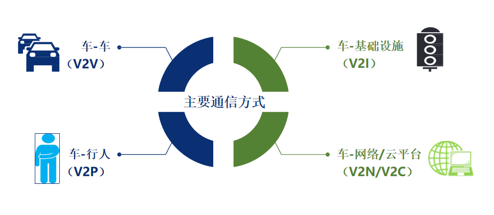

第二部分
V2X的常见功能

V2X的常见功能

降低道路交通事故
提高交通效率
缓解交通拥堵
实现节能减排
为自动驾驶技术进步提供重要支撑

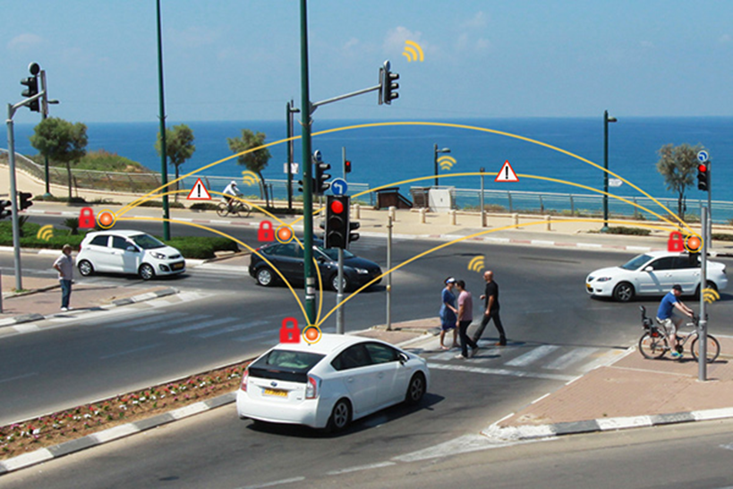

V2X的常见功能
1.降低道路交通事故

（1）避免与弯道盲区处的车辆碰撞

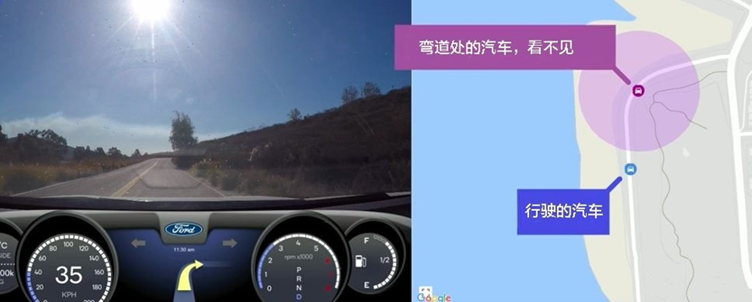

V2X的常见功能

（2）避免与直道盲区的车辆碰撞

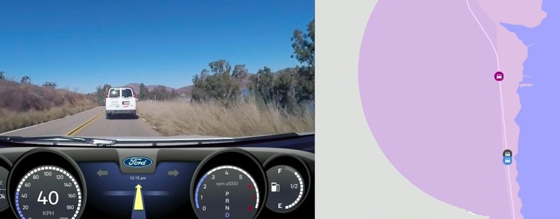
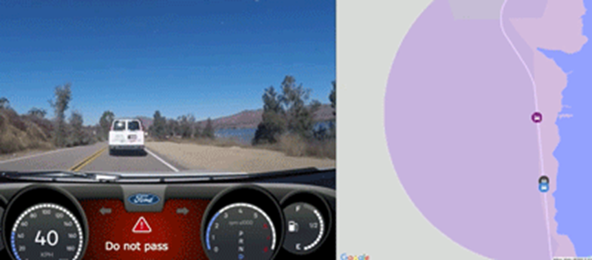

V2X的常见功能
（3）避免与交叉路口盲区车辆碰撞

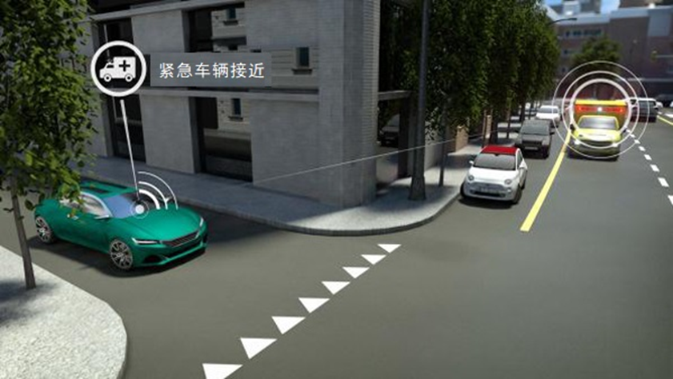

V2X的常见功能
2.提高交通效率

（1）高效通过复杂交叉路口

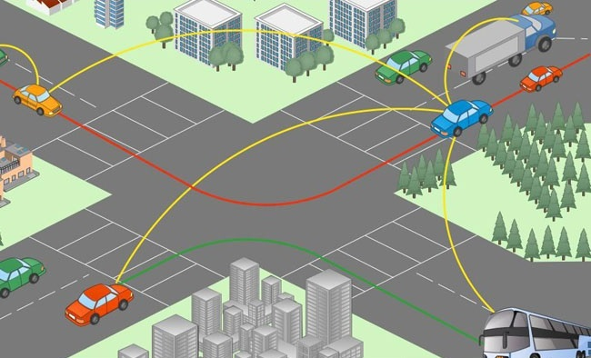

V2X的常见功能

<!--  -->
（2）减少等待红灯时间

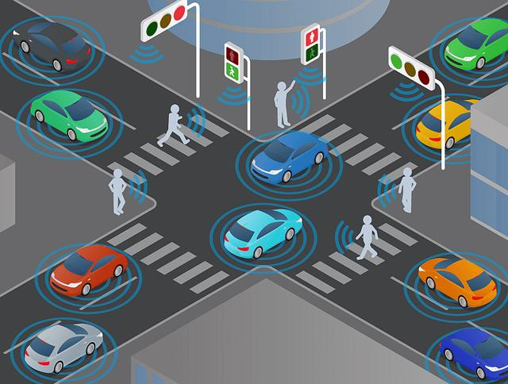

V2X的常见功能

3. 缓解交通拥堵
4. 实现节能减排

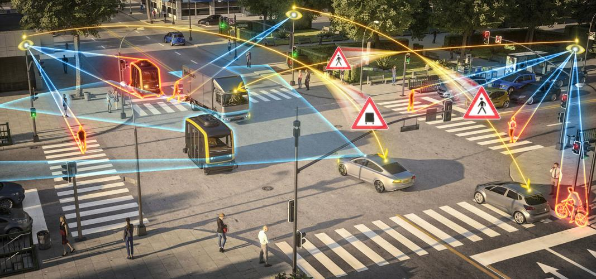
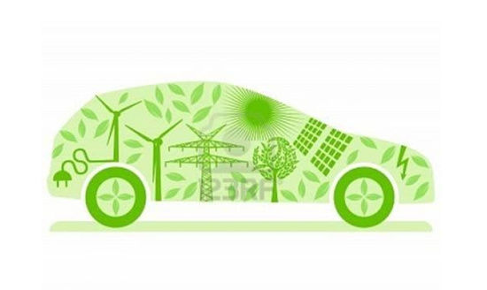

V2X的常见功能
5. 其他常见功能
（1）闯红灯预警功能
（2）行人碰撞预警功能
（3）紧急制动预警和侧向来车预警功能

<!--  -->

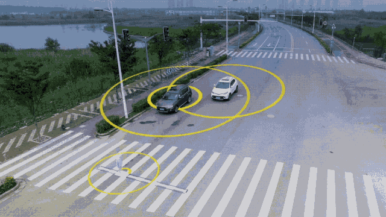

第三部分
V2X主要设备简介

V2X主要设备简介
V2X的主要设备包含车载单元（On Board Unit，OBU）、路侧单元（Road Side Unit，RSU）、激光雷达、信号灯、智能摄像头、边缘计算单元等。

<!--  -->

<!--  -->
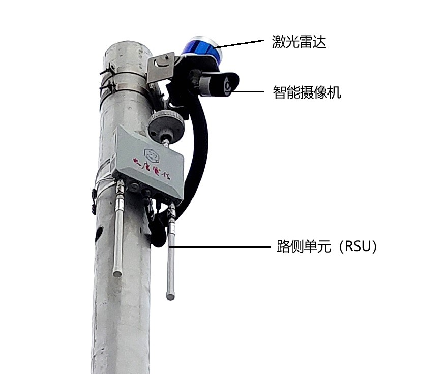

V2X主要设备简介
1. 路侧单元

路侧单元（RSU）是V2X的重要组成部分，也是突破车路协同技术的关键所在。

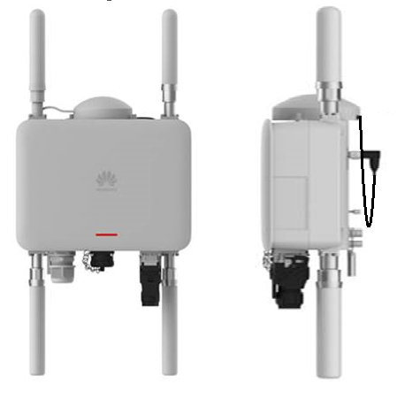

V2X主要设备简介
2. 激光雷达

激光雷达作为“人工智能之眼”，是V2X路侧感知设备的核心部件。

<!--  -->

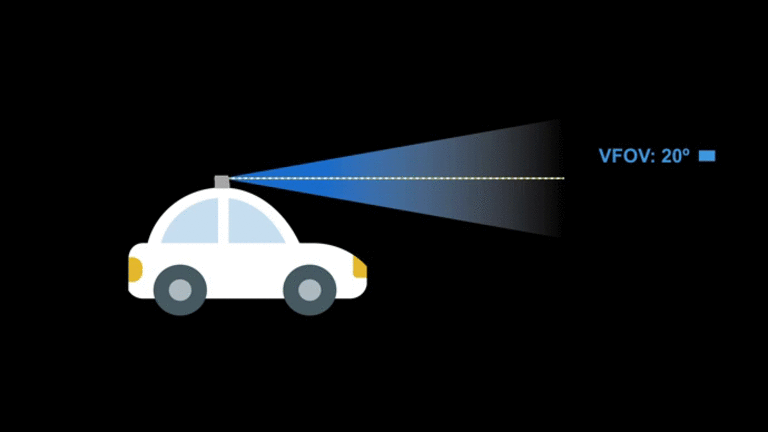

V2X主要设备简介
3. 智能信号灯

智能信号灯是实现车辆与交通信号的网联通信的设备。常见的路口信号灯通过红绿灯的控制，在时间上分离车流。

V2X主要设备简介
4. 智能摄像头

智能摄像头除具备实时拍摄高清图片并进行图像数据传输的基本功能外，还可获取各方向车流量、排队长度等信息，是V2X必不可少的装置。

<!--  -->

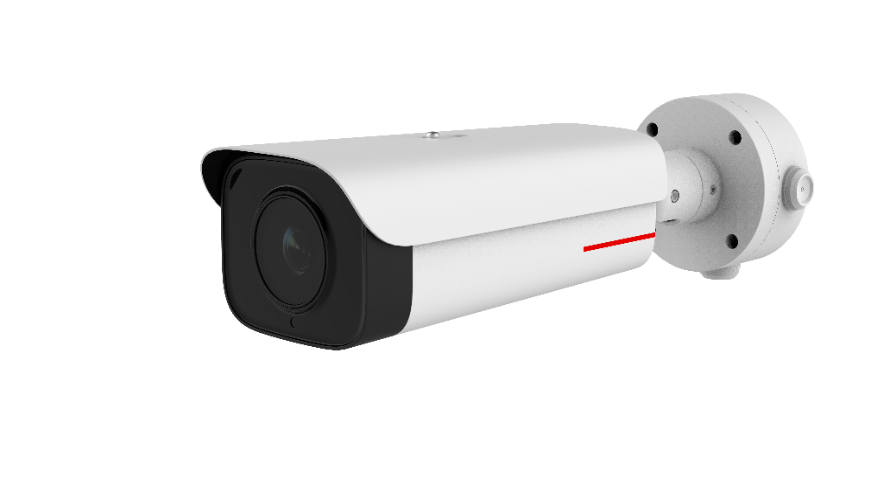

V2X主要设备简介
5. 边缘计算单元

V2X可以通过车辆边缘计算节点以及道路侧边缘计算节点之间的交互，对车辆密度、速度等的感知，来引导道路上的车辆规避拥堵路段，实现交通的高效调度。

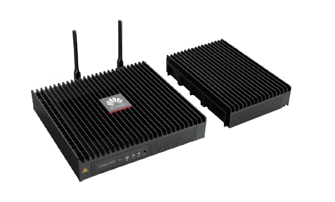

第四部分
V2X在自动驾驶
领域的意义

V2X在自动驾驶领域的应用
1. V2X是自动驾驶的关键技术

1）可大幅降低未来自动驾驶和车联网部署成本。
2）能够有效补充单车智能的信息盲点、加速反应效率。

<!--  -->

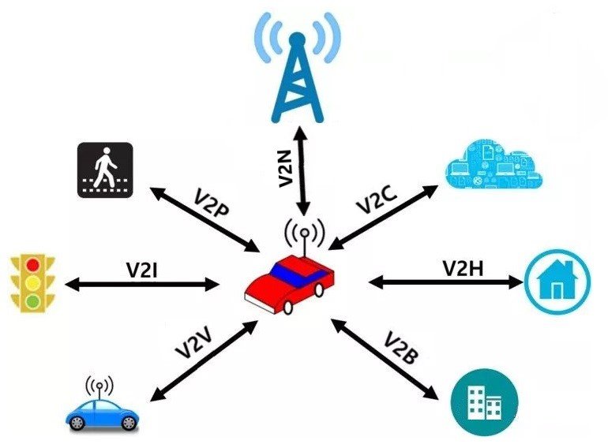

V2X在自动驾驶领域的应用
2. V2X与自动驾驶之间的关系

1）自动驾驶技术的核心是车，不搭载V2X技术，仅靠单车智能也能实现自动驾驶。
2）当前的自动驾驶系统，基于传感器、雷达和摄像头的各种信息输入，通过人工智能技术决策，单车本身在一定程度上即可以自动驾驶。
3）获取比单车能得到的更多的信息，大大增强对周围环境的感知

2）V2X与自动驾驶汽车传递的是周边车辆和交通环境信息。

V2X在自动驾驶领域的应用
3. V2X与自动驾驶的通信逻辑

1）V2X与自动驾驶系统不交互决策信息，决策主体是自动驾驶汽车本身。

2）V2X与自动驾驶汽车传递的是周边车辆和交通环境信息。

V2X在自动驾驶领域的应用
4. 自动驾驶需要的V2X通信模式

（1）V2V是车企的首选
（2）V2N同样不可或缺，完全没有网络辅助的V2V，在拥塞、干扰管理和覆盖上有很多的问题。

<!--  -->

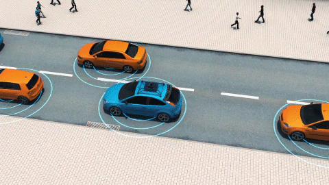

5G+V2X的自动驾驶
新趋势
第五部分

5G+V2X的自动驾驶新趋势

<!--  -->
1. 5G将加速V2X技术落地

5G技术可以提供低延时高可靠的网络基础，目前已经逐渐被一些城市应用到车路协同的场景当中。

5G+V2X的自动驾驶新趋势
2. 5G优势贴合自动驾驶需要
3. 5G会成为自动驾驶关键技术

【情智课堂】

<!--  -->

近些年来，随着智能网联汽车技术、自动驾驶技术的不断发展，我国企业展现了超强的技术能力和制造水平，逐渐实现了自主化、国产化。这都离不开我们国家一批批的科研工作者的努力和汗水，他们这种强国有我的敬业精神以及爱国情怀使我们学习的榜样。

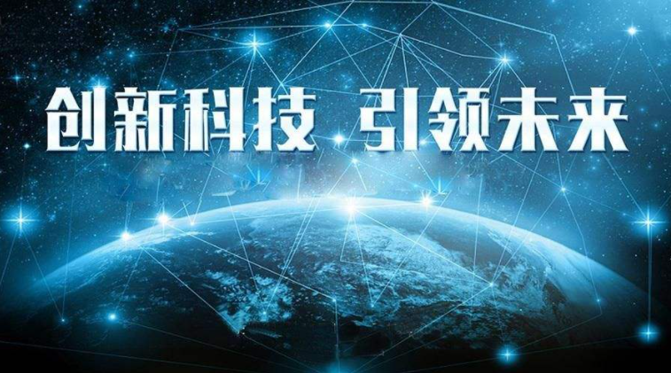

任务二 V2X技术路线认知

V2X技术动态
1
DSRC技术
2
LTE-V2X技术
3
目 录
CONTENTS
DSRC与LTE-V2X对比
4
车联网主要的标准组织
5
C-V2X技术应用
6

第一部分
V2X技术动态

V2X技术动态
V2X 目前有 DSRC 与 LTE-V2X 两大技术路线，前者是基础深厚的先行者，后者是后来居上的挑战者。DSRC 技术和 LTE-V2X 技术很好区分，可以把 DSRC 技术类比为在家用 Wi-Fi 上网，LTE-V2X 技术类比为在外面用数据流量上网。DSRC发展较早，目前已属于非常成熟的技术，不过LTE技术已横空出世，并得到应用推广，未来在智能网联汽车领域也将有广阔的市场空间。

第二部分
抢占先机的DSRC技术

抢占先机的DSRC技术
1. DSRC 技术的优势

DSRC 能提供高速的数据传输，并保证通信链路的低  时延和低干扰。以 WAVE/DSRC 为例，它的优势是低时延、 远传输距离（相对其他 DSRC 技术）、相对高的带宽。

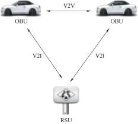

抢占先机的DSRC技术
2. DSRC 技术的硬件设备

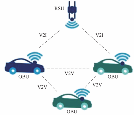
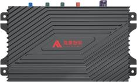

抢占先机的DSRC技术
3. DSRC 技术标准
主要基于三套标准：第一个标准是 IEEE 802.11p，它定义了汽车相关的专用短程通信（DSRC）物理标准；第二个是 IEEE 1609，标题 为“车载环境无线接入标准系列（WAVE）”，定义了网络架构和流程；第三个是 SAE J735 和 SAE J2945，定义了消息包中携带的信息，该数据将包括来自汽车上的传感器信息，例如位置、行进方向、速度和制动信息。

抢占先机的DSRC技术
4. DSRC 技术典型应用
广泛地应用在电子不停车收费（ETC）、出入控制、车队管理、信息服务等领 域，并在车辆识别、驾驶人识别、路网与车辆之间信息交互、车载自组网等方面具备优势

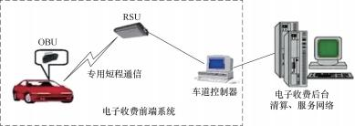

后来居上的LTE-V2X技术
第三部分

后来居上的LTE-V2X技术
1. LTE 技术简介
长期演进技术（Long Term Evolution，LTE）是应用于手机及数据卡终端的高速无线通 信标准，该标准基于旧有的 GSM/EDGE 和 UMTS/HSPA 网络技术，并使用调制技术提升网络 容量及速度。

后来居上的LTE-V2X技术
2. LTE-V2X 技术概况

（1）LTE-V2X 定义及通信模式
（2）PC5 接口
（3）Uu 接口

后来居上的LTE-V2X技术
3. LTE-V2X 技术的优势
LTE-V2X 技术能够在高速移动环境中提供低 时延、高可靠性、高速率、高安全性的通信能力，满足车联网多种应用的需求，并且基于TD-LTE 通信技术，能够最大限度利用 TD-LTE 已部署网络及终端芯片平台等资源，节省网 络投资， 降低芯片成本。

后来居上的LTE-V2X技术
4. LTE-V2X 的两种工作模式

（1）集中式工作模式

（2）分布式工作模式

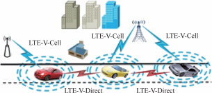

第四部分
DSRC和LTE-V2X对比

DSRC与LTE-V2X对比

<!--  -->

<!--  -->

<!--  -->

<!--  -->

<!--  -->
1. 建设成本对比
2. 覆盖距离对比
3. 通信时延对比
4. 支持车速对比
5. 发展趋势对比

DSRC与LTE-V2X标准对比
1. 国际上的标准
2. 国内使用的标准

DSRC 标准
LTE-V2X 标准
02
01

第五部分
车联网主要的标准组织

车联网主要的标准组织
1. 国际上的主要标准组织
车联网主要的标准组织和联盟包括电气和电子工程师学会（IEEE）、欧洲电信标准协 会（ETSI）、第三代合作伙伴计划（3GPP）、日本电波产业协会（ARIB）、韩国电信技术协会 （TTA）、新加坡资讯通信媒体发展局（IMDA）、5G 汽车协会（5GAA） 等
2. 国内的主要标准组织
我国车联网主要标准组织和联盟包括中国通信标准化协会（CCSA）、中国智能交通产  业联盟（C-ITS）、中国汽车工程学会（China-SAE）、全国汽车标准化技术委员会（NTCAS）、 车载信息服务产业应用联盟（TIAA）、全国智能运输系统标准化技术委员会（SAC/TC 268）、 全国道路交通管理标准化技术委员会、IMT-2020（5G） 推进组 C-V2X 工作组、中国智能网 联汽车产业创新联盟（CAICV） 等

第六部分
C-V2X技术应用

C-V2X技术应用

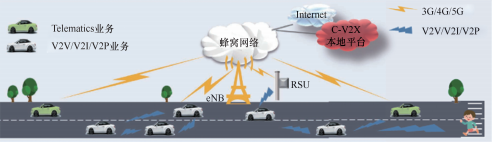

任务三 V2X应用场景认知

V2V安全应用场景
1

2
V2I安全应用场景
目 录
CONTENTS
3

V2N安全应用场景

4
V2P安全应用场景

V2X应用场景认知
V2V安全应用场景
V2V实现车与车之间的通信，安全应用场景包括前向碰撞预警、交叉路口碰撞预警、变道碰撞预警、隧道预警。

<!--  -->

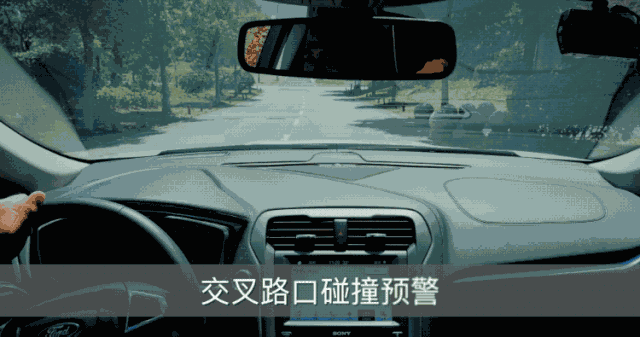

V2X应用场景认知
V2V安全应用场景
1. 前向碰撞预警
前向碰撞预警（Forward Collision Warning，FCW）是指主车（Host Vehicle，HV）在车道上行驶，与在正前方同一车道的车辆（Front Vehicle，FV）存在追尾碰撞危险时，FCW应用将提示HV驾驶人前方有碰撞风险，以便提前减速避让。FCW应用适用于城市道路或高速公路等车辆追尾碰撞危险的预警，可以辅助驾驶人避免或减轻追尾碰撞，提高道路行车安全。

<!--  -->
V2X应用场景认知
V2V安全应用场景

（1）FV位于HV前方  两车直行时，有三种主要场景:

1）HV与FV之间无车辆时

<!--  -->

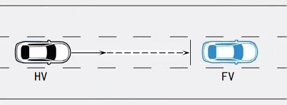
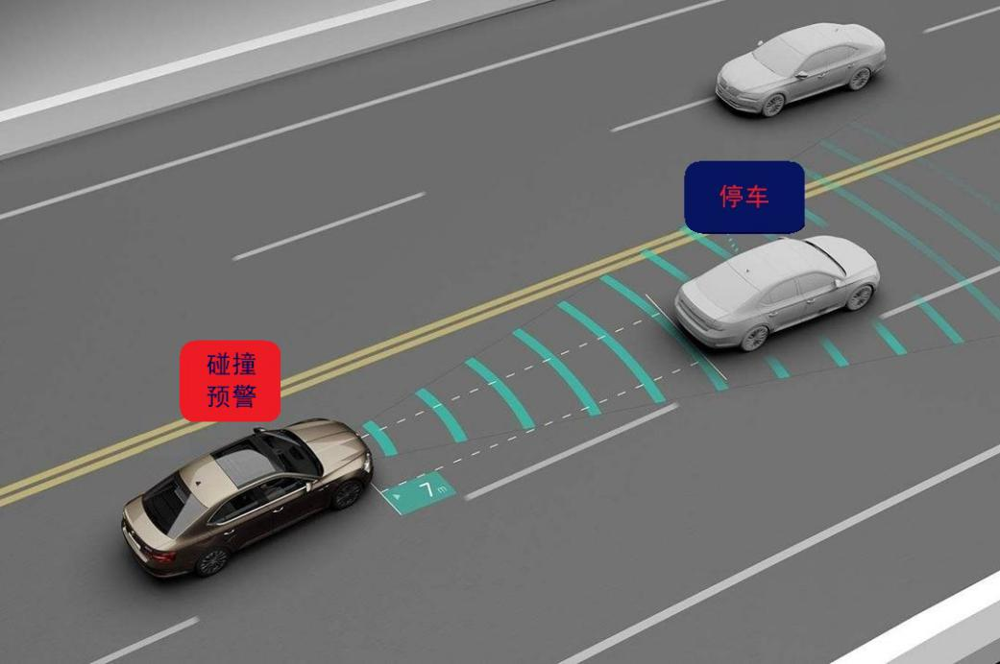

V2X应用场景认知

<!--  -->
V2V安全应用场景

2）FV在HV相邻车道上时

<!--  -->

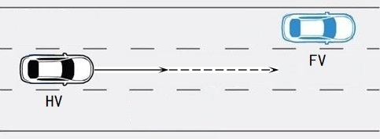
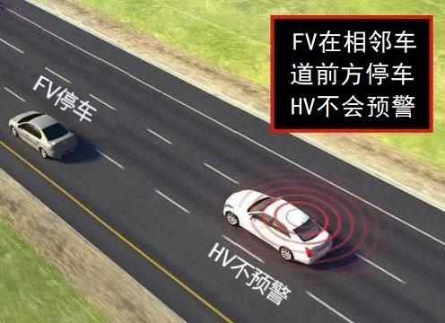

V2X应用场景认知

<!--  -->
V2V安全应用场景

3）HV与FV之间有车辆时

<!--  -->

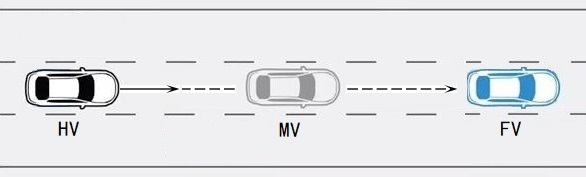
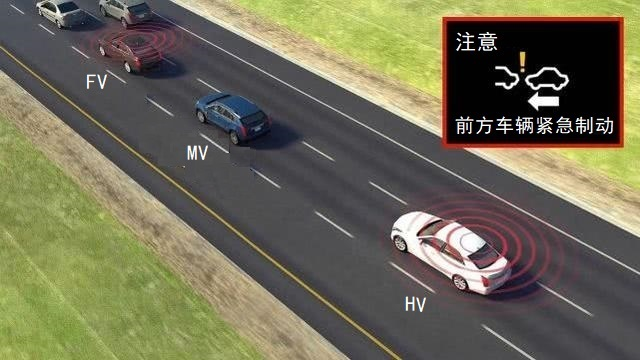

<!--  -->
V2X应用场景认知
V2V安全应用场景

（2）FV位于HV前方弯道上

<!--  -->

<!--  -->

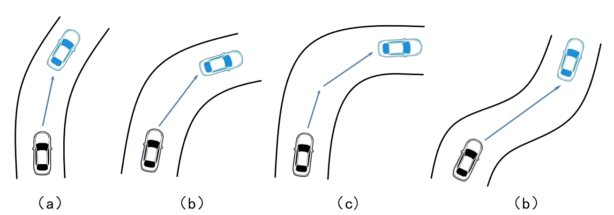
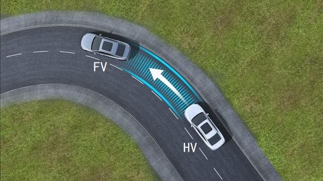
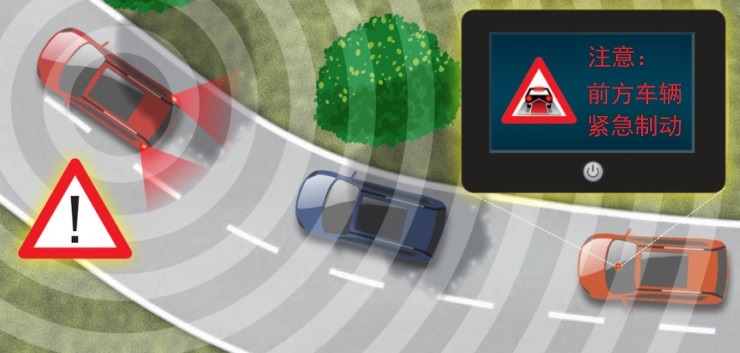

V2X应用场景认知
V2V安全应用场景

（3）FV在HV前方失控

1）当FV在HV前方突然失去方向控制

<!--  -->

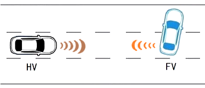

V2X应用场景认知
V2V安全应用场景
（3）FV在HV前方失控

2）当BV在HV后方突然制动失灵并快速靠近HV时

<!--  -->

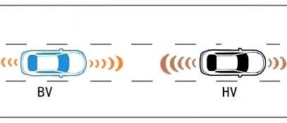

V2X应用场景认知
V2V安全应用场景

2. 交叉路口碰撞预警
交叉路口是交通事故高发区，车辆驶向如图所示的复杂路口时，交叉路口碰撞预警（Intersection Collision Warning，ICW）功能被触发，及时提醒驾驶人注意路口周边车辆，减少事故发生的概率。ICW适用于城市及郊区普通道路及公路的交叉路口、环道的入口、高速公路入口等交叉路口的碰撞预警。

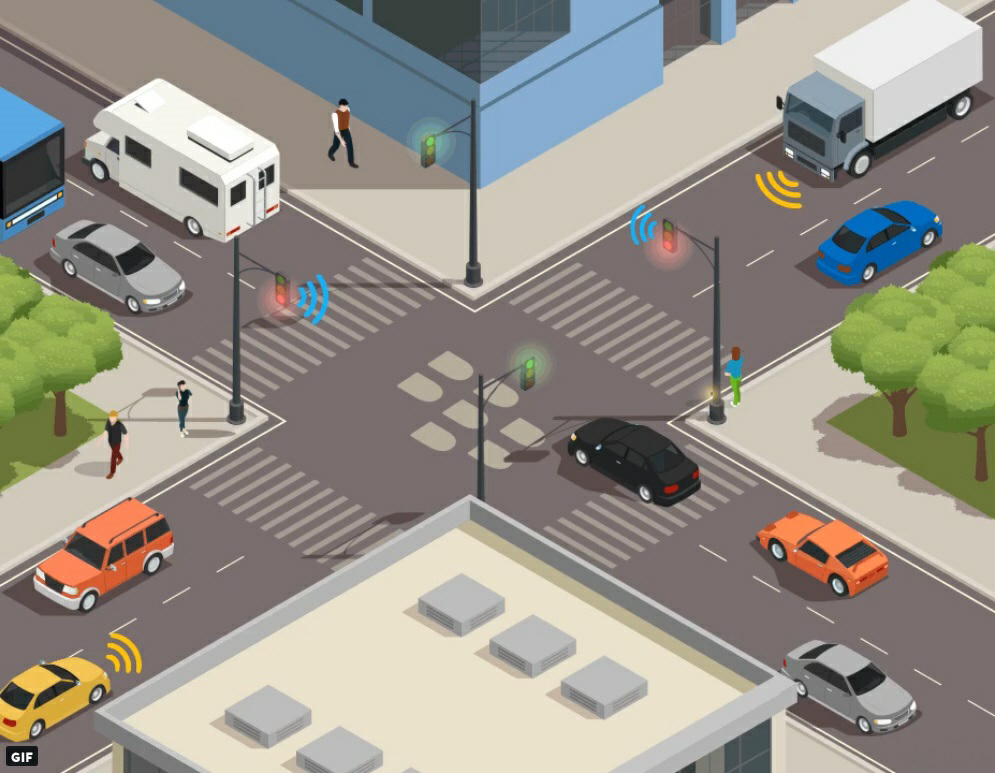

V2X应用场景认知
V2V安全应用场景

3. 盲区变道预警
由于车体和内外后视镜在设计上与生俱来的角度问题，导致驾驶者在驾驶车辆的时候，在车身的左右后侧方都存在一个无法根除的视觉盲区，驾驶人很难察觉到视角盲区的车辆，借助于V2V技术，驾驶人变道前能够及时察觉到盲区车辆，减少事故的发生，如图所示。这项功能与通过雷达、红外、摄像头实现变道辅助系统功能类似。

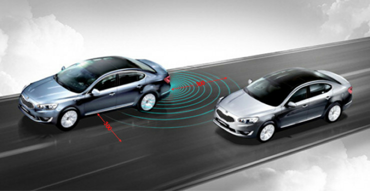

V2X应用场景认知
V2V安全应用场景

4. 隧道预警
隧道内需要安装激光雷达、摄像头等传感器，检测隧道交通情况，并将隧道内车辆检测结果发送给即将进入隧道的车辆，让驾驶人提前了解隧道内交通信息。这些安装在隧道内的路端设备可对隧道内所有车辆的运动轨迹进行跟踪，判断是否有车辆超速、违章变道等违法行为。

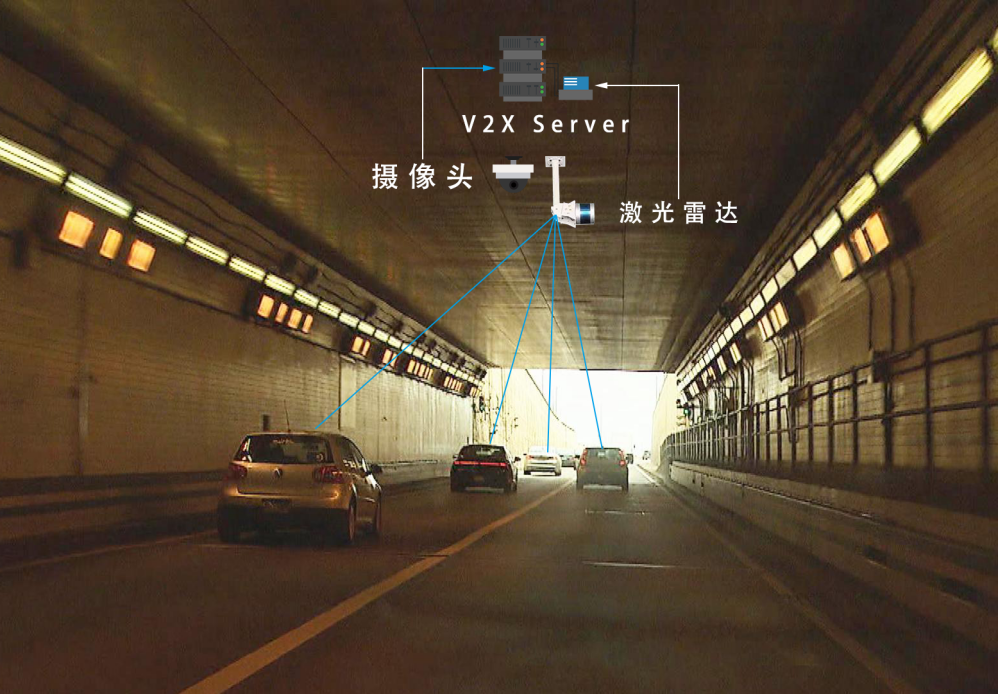

V2X应用场景认知
V2P安全应用场景

5、紧急车辆提醒
紧急车辆（Emergency Vehicle，EV）指的是消防车、救护车、警车或其他紧急呼叫车辆。紧急车辆提醒（Emergency Vehicle Warning，EVW）是指主车（HV）行驶中，收到EV提醒及时让行。EWV应用V2V短程信息交互模式，主要应用场景有两个，分别为单行车道让行和多行车道让行。

V2X应用场景认知
V2P安全应用场景

五、紧急车辆提醒

1. 单行车道让行

<!--  -->

<!--  -->

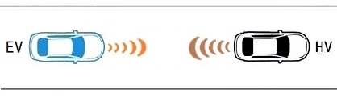
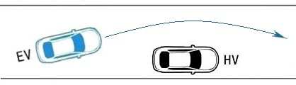

V2X应用场景认知
V2V安全应用场景

2. 多行车道让行

<!--  -->

<!--  -->

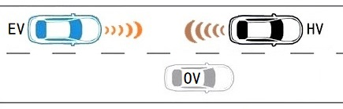
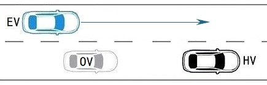

V2X应用场景认知
V2V安全应用场景

六、转向碰撞预警

1. 禁止超车预警

<!--  -->

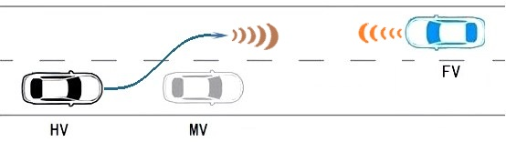

V2X应用场景认知

<!--  -->
V2V安全应用场景

2. 向左转向预警

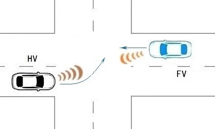
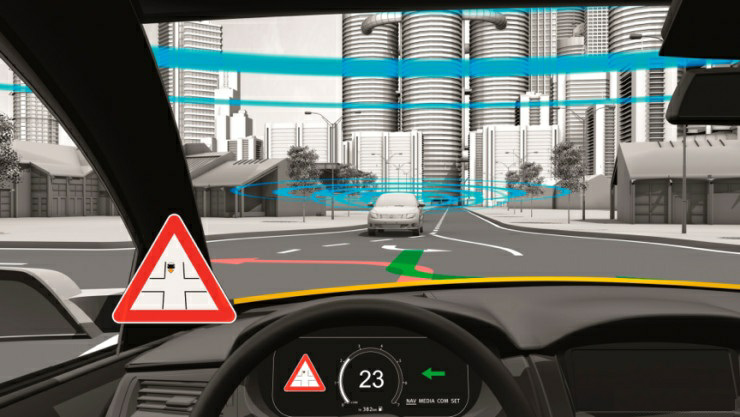

V2X应用场景认知
V2I安全应用场景
V2I是车与智能交通设施之间的通信连接，主要有红灯预警、弯道限速预警、道路施工预警、天气预警、人行横道预警。
1. 红灯预警

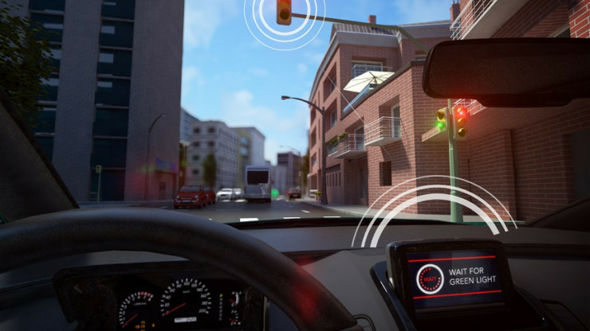

V2X应用场景认知
V2I安全应用场景

2. 弯道限速预警

<!--  -->

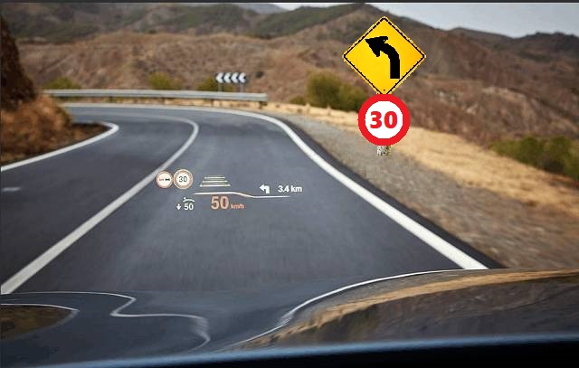

V2X应用场景认知
V2I安全应用场景

3. 前方道路施工预警

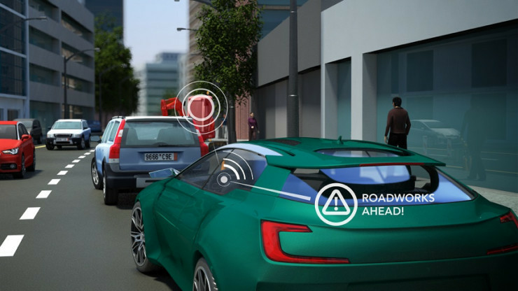

V2X应用场景认知
V2I安全应用场景

4. 天气预警
5. 人行横道预警

V2X应用场景认知
V2N安全应用场景

V2N主要是实现车辆与云端信息共享，车辆既可以将车辆、交通信息发送到云端交警指挥中心，云端也可以将广播信息如交通拥堵、事故情况发送给某一地区相关车辆。V2V和V2I都是代表的近距离通信，而通过V2N技术实现远程数据传输。

V2X应用场景认知
V2P安全应用场景

V2P通过手机、智能穿戴设备（智能手表等）等实现车与行人信号交互，在根据车与人之间速度、位置等信号判断有一定的碰撞隐患时，车辆通过仪表及蜂鸣器，手机通过图像及声音提示注意前方车辆或行人。

V2X应用场景认知
V2P安全应用场景

1. 道路行人预警

<!--  -->

V2X应用场景认知
V2P安全应用场景

2. 倒车预警

<!--  -->

## 📄 相关教材扫描

- [项目一任务一.pdf](/教材扫描/项目一任务一.pdf)
- [项目一任务二.pdf](/教材扫描/项目一任务二.pdf)
- [项目一任务三.pdf](/教材扫描/项目一任务三.pdf)