路端设备的认知

1
路端设备的认知
路端设备的常见功能
2
目 录
CONTENTS
学习检测
3
内容总结
4

对于实现高级别的自动驾驶，目前主要包括单车智能和车路协同两个实现路径。单车智能路线是以国外的特斯拉的视觉感知和Waymo的摄像头+激光雷达的融合感知为代表，在我国则是大力倡导车路协同，即在单车智能的基础上加入了网联的赋能，形成人、车、路在云端的交互协同。

一只蜜蜂、一只蚂蚁很渺小，但形成了蜂群、蚁群，大家协作起来，就形成了群体的强大力量。车路协同的理论内涵是群体智能，是单车智能的进阶。单车智能面临的复杂路况带来的感知盲区、算力不足、决策困难等问题，以及传感器规模化量产难度大、成本高等问题，都可以通过车路协同来有效解决。
在实现自动驾驶的过程中，车路协同采用“单体智能+网联赋能”的策略，作为单车智能感知系统的一部分，促进汽车和交通服务的新模式新业态发展，提高交通效率、节省资源、减少污染、降低事故发生率、改善交通管理。

为与国际先进智能网联汽车技术水平保持同步发展，开发具有自主知识产权的智能网联汽车产品和技术，积极推进行业亟需的智能网联汽车技术规范与标准，在国家相关部委支持下，中国汽车工程学会联合包括汽车整车企业、科研院所、通信运营商、软硬件厂商等30多家单位共同发起成立了“智能网联汽车产业技术创新战略联盟”。联盟成立后，通过协同创新和技术共享，在智能网联汽车领域完善相关的标准法规体系，搭建共性技术平台，促进形成示范试点工程，推动建设可持续发展的智能网联汽车产业发展环境，为我国智能网联汽车产业发展奠定良好基础。

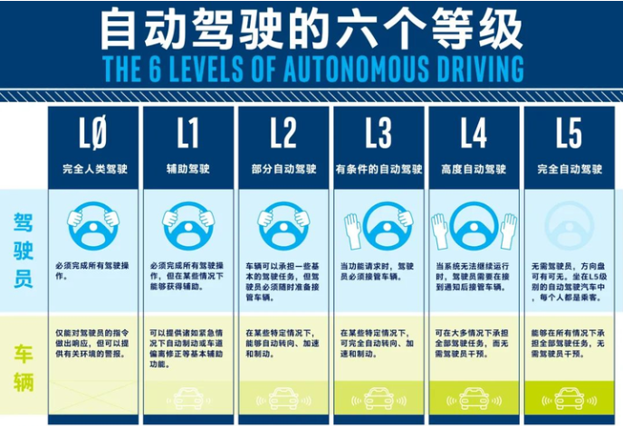

路端设备是车路协同系统当中重要的一部分。在车路协同系统中，可以通过路侧设备（来获取相关信息）感知路端车流量、获取车辆行驶速度、方位等信息，辅助智能汽车安全行驶。

根据相关报告，在2023年初，中国L2级智能网联乘用车的市场渗透率达到30%，L3级自动驾驶车型已经在部分量产车型上配备。高精度摄像头、激光雷达等感知设备已达到国际先进水平、为多款主流车型供货，智能驾驶（MDC）计算平台、车规级AI芯片在多个车型上进行装车应用。多地加快部署5G通信、路侧联网设备等基础设施，加大交通设备数字化改造力度，开展车路协同试点，支持企业进行载人载物示范应用，车路协同技术已经得到了快速发展和广泛应用。

第一部分
路端设备的认知

<!--  -->

任务导入
目前，全国多个城市建设成了车路协同应用示范区，有科创企业客户来示范区参观，你作为示范区讲解员，如何既生动又形象的让来访者快速地了解示范区内的路侧设备技术及主要组成？

任务分析
完成本次任务，首先要对路端设备具有一定的了解，通过对“任务资讯”小节的学习，达到如下所列的知识目标、技能目标和素养目标的要求。
| 知识目标 | 1.掌握路端设备的组成；2.认知路端设备的功能。 |
| --- | --- |
| 技能目标 | 1.具有能够描述路端设备的能力；2.具有能够描述路端设备常见功能的能力。 |
| 素养目标 | 1.具备综合学习能力；2.具备思维构建能力。 |

<!--  -->
路端设备定义及作用
路端设备是指部署在道路上，用于实现车路协同功能的各类设备。
路端设备的作用是实时感知道路交通状况，收集并处理交通数据，通过无线通信将信息发送给车辆和云平台，实现车路协同和智能交通管理。路端设备的作用是实时感知道路交通状况，收集并处理交通数据，通过无线通信将信息发送给车辆和云平台，实现车路协同和智能交通管理。

看图识物

<!--  -->

<!--  -->

<!--  -->

<!--  -->

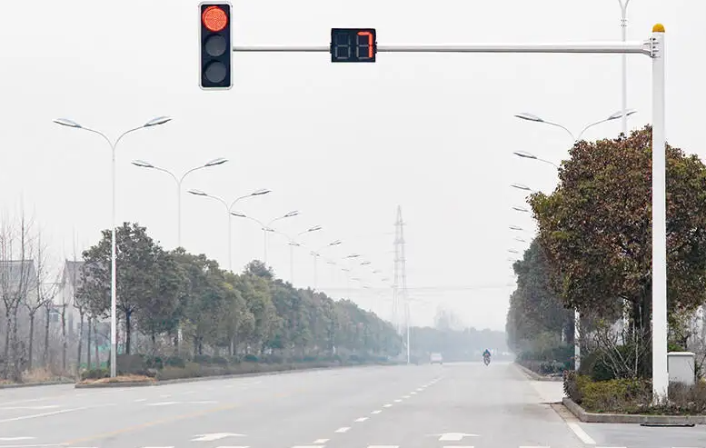
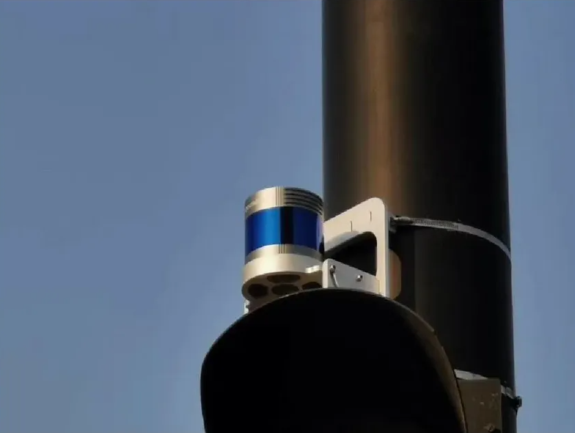

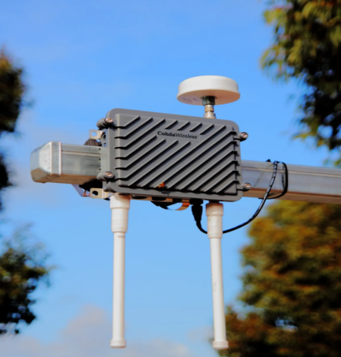

路侧系统负责采集交通流信息（车流量、平均车速等）和道路异常信息、道路路面状况、道路几何状况等。
路端设备的基本组成
路端设备在车路协同系统中扮演着关键角色，它们负责采集道路信息、发布交通信号、与车辆进行通信等任务，是实现车路协同的重要保障。
路侧系统负责采集交通流信息（车流量、平均车速等）和道路异常信息、道路路面状况、道路几何状况等。
添加标题

信号灯

添加标题
激光雷达

添加标题
摄像头

添加标题
路侧单元

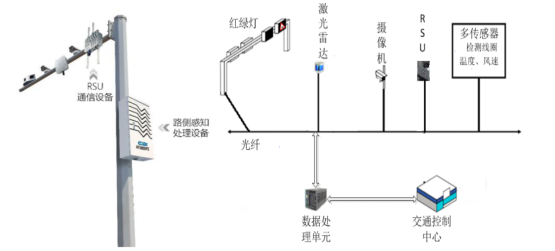

第二部分
路端设备的常见功能

激光雷达

<!--  -->

激光雷达
是激光探测及测距系统的简称，是用发射激光束探测目标的位置、速度等特征量的雷达系统。它利用光波频段的电磁波先向目标发射探测信号，然后将接收到的从目标反射回来的信号与发射信号进行比较，从而获得目标的距离、方位、运动状态等信息。

摄像头

<!--  -->

摄像头
又称为电脑相机、电脑眼、电子眼等。可分为数字摄像头和模拟摄像头两大类。数字摄像头可以将视频采集设备产生的模拟视频信号转换成数字信号；模拟摄像头捕捉到的视频信号必须经过特定的视频捕捉卡将模拟信号转换成数字模式，并加以压缩后才可以运用。

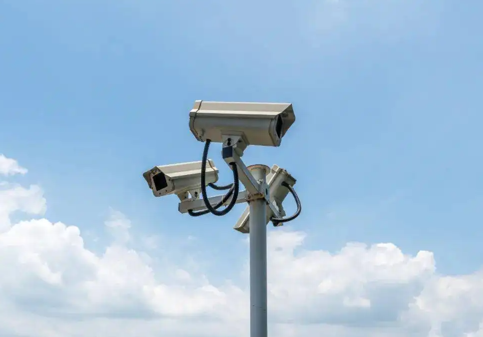

RSU

<!--  -->

RSU
RSU（Road Side Unit）指的是路测单元，需要安装在路测。在使用过程中与车载单元交互通讯，采集车辆运行状态信息和道路状况信息等。

第三部分
学习检测

路侧设备各组成结构功能的认知实操评分表

| 序号 | 作业内容 | 配分 | 作业项目 | 分值 | 扣分 | 备注 |
| --- | --- | --- | --- | --- | --- | --- |
| 1 | 正确识别路侧设备各组成实物 | 20 | □正确识别RSU | 5 |  | 如有未完成的项目，根据情况酌情扣分 |
|  |  |  | □正确识别激光雷达 | 5 |  |  |
|  |  |  | □正确识别信号灯 | 5 |  |  |
|  |  |  | □正确识别摄像头 | 5 |  |  |
| 2 | 叙述路侧设备各组成功能 | 80 | □正确叙述RSU功能 | 20 |  | 如未按照规定时间完成，根据情况酌情扣分 |
|  |  |  | □正确叙述激光雷达功能 | 20 |  |  |
|  |  |  | □正确叙述信号灯功能 | 20 |  |  |
|  |  |  | □正确叙述摄像头功能 | 20 |  |  |
| 合 计 |  |  |  | 100 |  |  |
| 备注：路侧设备各组成结构功能的认知 |  |  |  |  |  |  |
| 考核成绩：\_\_\_\_\_\_\_\_\_\_\_\_\_\_\_\_ 教师签字：\_\_\_\_\_\_\_\_\_\_\_\_\_\_\_\_ |  |  |  |  |  |  |

路侧设备的安装调试

1
交通信号灯的安装调试
激光雷达的安装调试
2
目 录
CONTENTS
摄像头的安装调试
3
4
路侧单元RSU的安装
5
实操预演

# 课程引入
：来访者在经过你的介绍后已经初步了解了路侧设备技术及其主要组成和功能，但对于这些组成如何安装及如何确保安装后能够正常运行抱有足够的好奇心。那么你会怎样介绍并满足他们的好奇心呢？

# 一、交通信号灯的安装调试

<!--  -->
1. 交通信号灯的安装
交通信号灯通过滑动螺栓、抱箍等连接配件固定于杆件上，采用悬臂式安装时须保证距离路面 5.2m 以上。
交通信号灯装好后应对信号灯的可视最佳角度、高度等进行检查、调整，使之达到规定的要求。
2. 交通信号灯的调试
交通信号灯及控制设备安装完毕后，通电使灯亮起来，并利用计算机软件设计要求调控交通信号灯控制设备，使交通信号灯按设计要求运行。

# 二、激光雷达的安装调试
1.  激光雷达的安装
路侧激光雷达在安装部署时主要考虑两个场景：城市道路和高速公路。城市道路交叉口，采用对角线布置的两台基于路侧的 3D 雷达，能实时准确地识别行人、非机动车等弱势交通群体的行为状态。在高速公路端，可以将激光雷达布设在高速公路出入口处及事故多发地段，可以对周边区域一定半径范围内的信息进行实时采集。实际操作时，需要按照激光雷达的覆盖面积计算激光雷达在场景的安装数量，同时根据场景需要决定激光雷达的安装方式。
2.  激光雷达的调试
激光雷达工作时，每一组采样数据都通过通信接口输出。输出的数据具有统一的报文格式。外部系统可以通过请求、停止等指令控制激光雷达的输出数据或者对其格式进行配置。
应用设备和调试软件连接激光雷达，可以获得雷达的实时数据点云图、实时数据流等参数，通过观察这些数据采集的情况，可以明确安装、通信、标定等步骤是否准确完成。

### Notes:

# 三、摄像头的安装调试

<!--  -->

<!--  -->

<!--  -->

<!--  -->
1.  摄像头的安装和接线步骤
1） 将抱柱安装支架固定于横杆上，将装有摄像头的护罩固定于支架上。
 2）卸下镜头接头盖，旋进镜头并拧紧，直至牢固。若要使用 C 形接口镜头，需使用附带的 C 形装配转接器。
3） 将镜头控制线插头插入摄像头自动光圈镜头插座。
4） 取出护罩中的固定底板，用螺钉将摄像头固定于底板上。将底板和摄像头固定在护罩内。
5） 将底板和摄像头固定在护罩内，调节镜头焦距并进行聚焦，将相应的连接线与摄像头接好并从护罩的底部孔位处穿出。
6） 调整好后固定调节螺钉，并关上护罩，锁紧螺钉。

### Notes:

1.  交通信号灯的安装
交通信号灯通过滑动螺栓、抱箍等连接配件固定于杆件上，
采用悬臂式安装时须保证距离路面 5.2m 以上，交通信号灯安装
示意图如图 3-7所示。
交通信号灯装好后应对信号灯的可视最佳角度、高度等进行
检查、调整，使之达到规定的要求。
2.  交通信号灯的调试
交通信号灯及控制设备安装完毕后，通电使灯亮起来，并利
用计算机软件设计要求调控交通信号灯控制设备，使交通信号灯
按设计要求运行。
禾赛激光雷达点云图

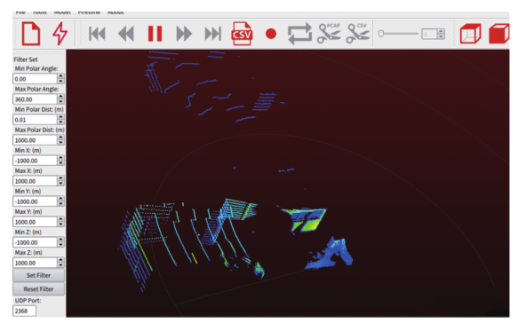

1.  交通信号灯的安装
交通信号灯通过滑动螺栓、抱箍等连接配件固定于杆件上，
采用悬臂式安装时须保证距离路面 5.2m 以上，交通信号灯安装
示意图如图 3-7所示。
交通信号灯装好后应对信号灯的可视最佳角度、高度等进行
检查、调整，使之达到规定的要求。
2.  交通信号灯的调试
交通信号灯及控制设备安装完毕后，通电使灯亮起来，并利
用计算机软件设计要求调控交通信号灯控制设备，使交通信号灯
按设计要求运行。
摄像头安装示意图

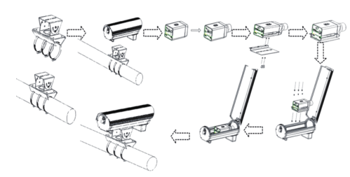

# 三、摄像头的安装调试

用便携式计算机通过网线连接设备箱内的交换机，或直接将摄像头网线插入计算机网口。在通过网络访问网络摄像头之前，首先需要获取它的 IP 地址，用户可以通过设备网络自动搜索软件（SADP 软件） 来搜索网络摄像头的 IP 地址。
运行随机光盘里面的 SADP 软件，单击“进入”，软件会自动显示出当前局域网中正在运行的网络摄像头的 IP 地址、端口号、子网掩码、设备序列号以及软件版本等信息。
若搜索出来的 IP 地址和计算机的 IP 地址不在同一网段，可以通过 SADP 软件修改网络摄像头的 IP 地址、子网掩码和端口号等参数。

### Notes:

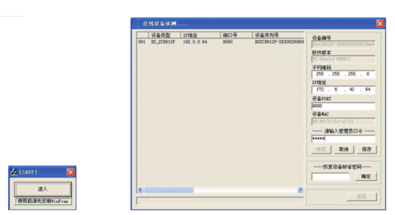

# 四、路侧单元RSU的安装（以华为RSU5201为例）
1.  RSU 的介绍

### Notes:

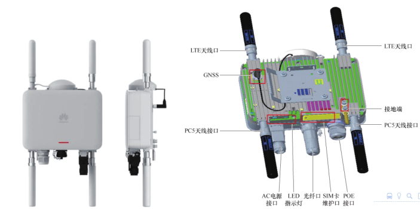

# 四、路侧单元RSU的安装（以华为RSU5201为例）

### Notes:

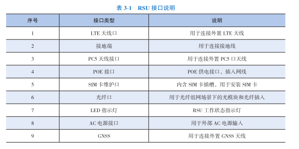

# 四、路侧单元RSU的安装（以华为RSU5201为例）
2.  RSU 安装组件的介绍

### Notes:

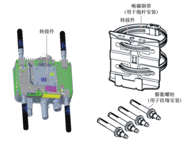
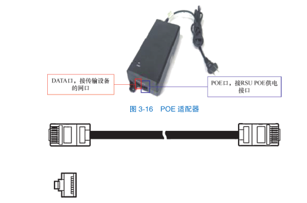

# 四、路侧单元RSU的安装（以华为RSU5201为例）
3.  RSU 设备的安装

### Notes:

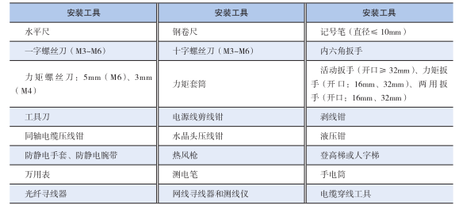

# 五、实操预演

<!--  -->

<!--  -->
1、工具设备介绍
2、实操步骤

步骤一：进行激光雷达的参数设定。
步骤二：进行摄像头的调试。
步骤三：进行路侧单元（RSU） 的操作维护。

### Notes:

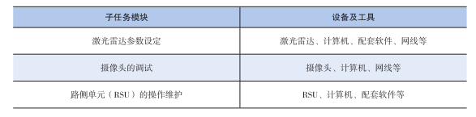

<!--  -->

<!--  -->
# 检测评价

### Notes:

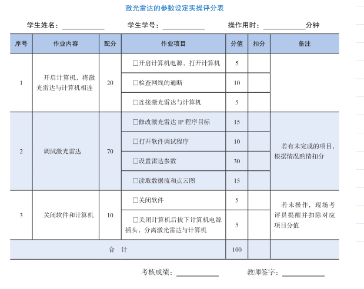

<!--  -->

<!--  -->
# 检测评价

### Notes:

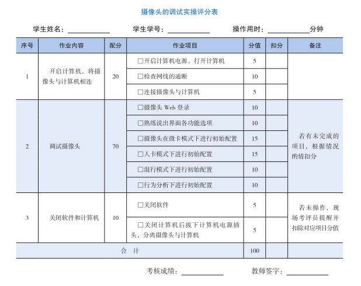

<!--  -->

<!--  -->
# 检测评价

### Notes:

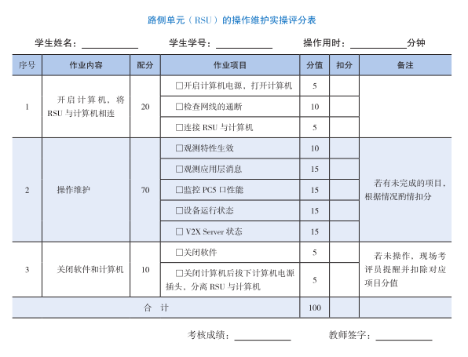

路端系统的测试与应用

1
路端系统的测试
路端系统的应用
2
目 录
CONTENTS
实操预演
3

# 课程引入
来访者已经了解了路侧设备的组成安装与调试的方法以及需要注意的事项，由此产生了
一个问题，组装完成后该系统如何广泛地应用到实际道路中，同时该系统又具备哪些实质性
的功能？针对来访者的疑问，你将如何向其进行介绍？

# 一、路端系统的测试

目前，路端系统的测试分为 3 类，分别为虚拟仿真测试、封闭测试场测试和开放道路测试，对应的进行实验测试的场所主要为实验室、试验场、封闭道路和开放道路。其中虚拟仿真测试是非常重要的，它可以保证测试的安全，提高测试效率。封闭测试场测试也具有安全性高的特点。开放道路测试的优点是实际的测试场景丰富，并且测试验证能否上路最终是需要通过道路测试来实现的。

# 1.  虚拟仿真测试

虚拟仿真测试即在实验室的环境下进行模拟测试，检验软件和硬件系统的功能情况、可靠性和资源占用情况等，包括车辆在环测试等。利用真实车辆和虚拟仿真联合，实现快速的场景和系统的测试，可以完成端到端性能的测试和车路资源的消耗情况，有利于降低实车测试的难度和风险，减少对场地、真实交通和试验车辆的要求，为后续在道路上的测试节省成本和时间，提高测试效率。

<!--  -->

### Notes:

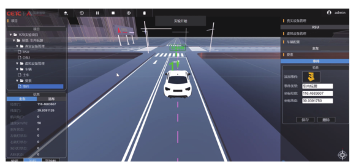

# 2.  封闭测试场测试
封闭场地一般都集成了多种测试场景，拥有自动驾驶测试道路，涵盖典型的城市道路和普通公路基础设施，道路沿线通过布设协同交通信号、模拟城市街景等设施，可以灵活搭建路端系统测试所需的封闭场地测试场景，同时允许测试者根据测试目的进行相关设备安装和场景的布置，拥有很强的自主性和多样性。封闭场地测试可以开展功能及性能评估测试，试验精度可控，能最大限度地保障系统的真实性能，可用于验证仿真测试和开放道路测试的准确性。

<!--  -->

### Notes:

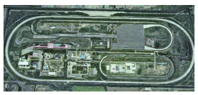

# 3.  开放道路测试

开放道路是指社会车辆和行人通行的道路，场景随机多变，交通状况复杂。开放道路测试是最终也是最重要的必经环节。开放道路上复杂实际的交通场景，可以覆盖日常所需的典型场景，具备充分的随机性，更能防范漏洞的出现，因此，开放道路测试更能评估路端系统应对真实交通状况的能力，以及对危机情况的化解能力，能对系统工作状况、各模块功能等各维度进行全方位的综合测试。

1.  道路标识识别

4.  紧急车辆避让服务应用

<!--  -->

二、路端系统的应用
2.  前方道路施工预警

<!--  -->

<!--  -->
5.  红绿灯车速引导

<!--  -->

<!--  -->
3.  人行横道预警

<!--  -->

<!--  -->

### Notes:

<!--  -->

<!--  -->

<!--  -->

路端系统的应用图示

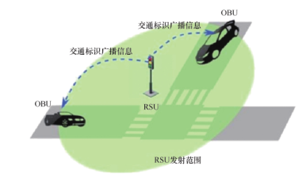
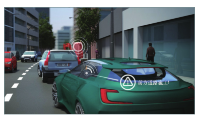
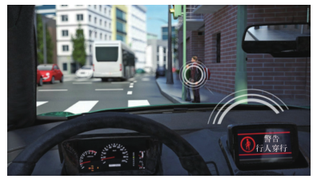

<!--  -->
# 紧急车辆通行时其他车辆避让示意图

车辆被大型车遮蔽时识别红绿灯

### Notes:

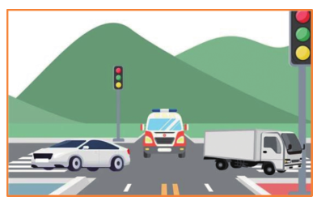
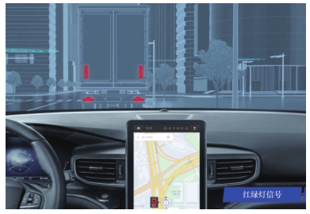

# 三、实操预演

<!--  -->

<!--  -->
1、工具设备介绍
2、实操步骤

步骤一：正确打开虚拟仿真软件。
步骤二：进行路端系统应用场景认知。

### Notes:

<!--  -->

<!--  -->
# 检测评价

### Notes:

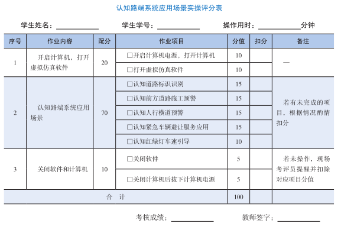

## 📄 相关教材扫描

- [项目三任务一.pdf](/教材扫描/项目三任务一.pdf)
- [项目三任务二.pdf](/教材扫描/项目三任务二.pdf)
- [项目三任务三.pdf](/教材扫描/项目三任务三.pdf)

感谢观看
汇报人：孙琳
时间：2024年
