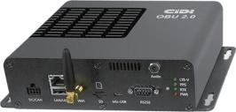
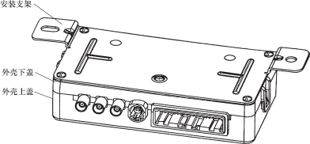
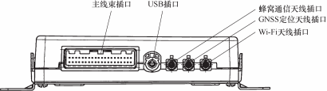
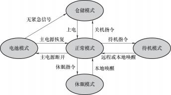
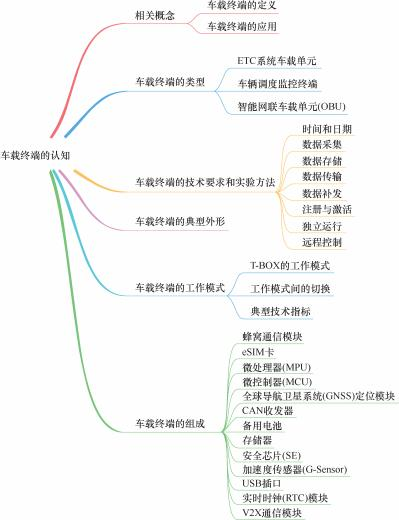

项目二

车载终端的装调与应用

任务一
车载终端的认知

| 本节目标 |  |
| --- | --- |
| 知识目标 | 1. 掌握车载终端的定义。 2. 理解车载终端的应用。 3. 了解车载终端的类型。 4. 了解车载终端的技术要求。 5. 掌握车载终端的工作模式。 6. 掌握车载终端的组成。 |
| 技能目标 | 1. 具有描述车载终端组成部分的能力。 2. 具有描述车载终端工作模式的能力。 |
| 素养目标 | 1. 培养学生的综合学习能力。 2. 培养学生的工匠精神。 |

V2X技术是采用先进的无线通信和新一代互联网等技术，实现车与各交通要素的直接交互，综合实 现碰撞预警、安全预防及通报、辅助驾驶等多种应用；
同时，通过与云端的交互，车辆也能实时获取全局交通网络的状态并作出及时反应，从而形成安全、 高效和环保的智慧交通有机体系。

一、车载终端的相关概念

1.车载终端的定义
2.车载终端的应用

车载终端是安装在汽车上，采集和保存整车及系统部件的关键状态参数，并与车联网后 台及其他对象进行通信的装置或系统。

车载终端主要借助对周边环境的感知、对障碍物及危险的识别、与云服务平台的通信以 及与其他车辆和路侧设备的互联等获取信息，通过智能控制、人机交互等方式提高安全性， 改善驾驶体验。

二、车载终端的类型

ETC 系统车载单元
车辆调度监控终端
智能网联车载单元
车辆调度监控终端主要由车载视频服务器、 LCD 触摸屏、外接摄像头、通话手柄、 汽车防盗器等各种外接设备组成。
ETC 系统采用车辆自动识别技术完成车辆与收费站之间的无线数据通信，进行车辆自动 感应识别和相关收费数据的交换。ETC 系统是采用计算机网络进行收费数据的处理，实现不 停车、不设收费窗口也能全自动电子收费的系统。
智能网联车载单元（OBU） 除了原有的信息服务外，还承担着车辆与外界通信（V2X） 的桥梁作用，并具有高精度定位、车云协同计算、远程升级、车辆控制、故障诊断等功能，用以满足车辆智能化和网联化的应用要求。

<!--  -->

三、车载终端的技术要求和实验方法
GB/T 32960.2—2016《电动汽车远程服务  与管理系统技术规范 第 2 部分：车载终端》 规定了电动汽车远程服务及管理系统车载终端  的技术要求和试验方法。

三、车载终端的技术要求和实验方法
下面主要介绍车载终端功能要求，其他具体细节可查阅该标准文档。

时间和日期

数据采集
01
02
数据存储
数据传输
03
04
数据补发
注册与激活
05
06
独立运行
远程控制
07
08

四、车载终端的典型外形
目前，车载终端主要有两种形态：
 一种是单体式车载终端，独立于其他部件；
另一种是 集成式车载终端，是将车载终端功能和车机等进行集成设计。
下面重点介绍第一种形态，即 单体式车载终端。

图1
四、车载终端的典型外形
单体式车载终端
车载终端外壳一般采用 PC+ABS 的材料。典型的智能车载终端外形如图1 所示。
车载终端外接口一般分为主线束插口、USB 插口、天线插口等。典型的车载终端外部插 口布局如图 2 所示。

图1
图2

五、车载终端的工作模式
1. T-BOX 的工作模式
正常模式

休眠模式
待机模式

电池模式
仓储模式

### Notes:
（1）正常模式  指T-BOX各模块均处于正常供电，各项功能均正常工作的模式。例如车辆行驶、充电等工况下，一般均处于该模式。
（2）休眠模式  指T-BOX各个主要模块均退出了工作状态，只有本地的唤醒检测电路处于工作状态。当车辆处于长时间下电且不需要远程唤醒时，一般处于该工作模式。
（3）待机模式  指T-BOX的远程通信模块处于待机状态，可被远程唤醒，其他模块均处于关机或休眠状态。例如具有远程唤醒功能的车辆，在长时间下电后，处于该工作模式。
（4）电池模式  指T-BOX的主电源因为异常等情况处于断开状态，T-BOX切换到电池供电模式。当车辆发生严重碰撞事故时，主电源被异常断开，T-BOX 会进入该工作模式。
（5）仓储模式  指T-BOX所有模块均处于关机状态，除非重新上电才能进入正常工作模式。当车辆从生产线下线，在销售到市场前的过程时间较长，T-BOX可以根据需要进入该工作模式。

五、车载终端的工作模式
 2. 工作模式间的切换
T-BOX 可在上述 5 种典型的工作模式之间进行切换，如图所示。

五、车载终端的工作模式
 3. 典型技术指标
在上述 5 种工作模式中，T-BOX 典型的平均电流、工作状态及唤醒时间见表。其中，平均电流 是指以 T-BOX 工作在 12V 的车载电源系统下的情况 为例。
| 序号 | 模式 | 平均电流 | 工作状态 | 唤醒时间 |
| --- | --- | --- | --- | --- |
| 1 | 正常模式 | <150mA | WAN 打开（空闲） Wi-Fi 打开（空闲） | — |
| 2 | 电池模式 | <150mA | WAN 打开（空闲） Wi-Fi 打开（空闲） | — |
| 3 | 待机模式 | <3mA | WAN 休眠 （可接收短消息和电话） Wi-Fi 打开（空闲） | <100ms |
| 4 | 休眠模式 | <1mA | WAN 打开（关闭） Wi-Fi 打开（关闭） | <200ms |
| 5 | 仓储模式 | 10μA | 关机状态 | <200ms |

六、车载终端的组成
蜂窝通信模块
备用电池

eSIM 卡
存储器

微处理器（MPU）
安全芯片（SE）

车载终端的组成
微控制器（MCU）
加速度传感器
（G-Sensor）

全球导航卫星系统GNSS定位模块
USB接口

CAN收发器
实时时钟（RTC）模块

V2X 通信模块

任务准备
一、工具设备介绍
| 子任务模块 | 设备及工具 |
| --- | --- |
| 车载终端实物功能认知 | 车载终端 |

步骤一：依次指认蜂窝通信模块、eSIM卡、微处理器、微控制器、全球导航卫星系统定位模块、CAN收发器、备用电池、存储器、加速度传感器；
步骤二：描述各个组成部分的作用和功能特点。

任务准备
二、实操预演
步骤一：依次指认蜂窝通信模块、eSIM卡、微处理器、微控制器、全球导航卫星系统定位模块、CAN收发器、备用电池、存储器、加速度传感器；

步骤二：描述各个组成部分的作用和功能特点。

步骤一：依次指认蜂窝通信模块、eSIM卡、微处理器、微控制器、全球导航卫星系统定位模块、CAN收发器、备用电池、存储器、加速度传感器；
步骤二：描述各个组成部分的作用和功能特点。

任务实施
能够理解车载终端的相关概念、组成和特点，加深对车载终端认识。车载终端设备的品牌和型号有很多，本次任务选用福田智科的ZKC02B车载终端设备。如果实训设备充足，可直接进行基于实物的实训。如果不具备基于实物的实训条件，可应用车模开展实训。

步骤一：依次指认蜂窝通信模块、eSIM卡、微处理器、微控制器、全球导航卫星系统定位模块、CAN收发器、备用电池、存储器、加速度传感器；
步骤二：描述各个组成部分的作用和功能特点。

任务实施
能够理解车载终端的相关概念、组成和特点，加深对车载终端认识。车载终端设备的品牌和型号有很多，本次任务选用福田智科的ZKC02B车载终端设备。如果实训设备充足，可直接进行基于实物的实训。如果不具备基于实物的实训条件，可应用车模开展实训。

任务实施
一、前期准备
准备好学生实训的车载终端；
准备好学生实训的工单。

任务实施
二、实操演练
车载终端实物功能认知

<!--  -->
<!--  -->
<!--  -->

任务小结

## 📄 相关教材扫描

- [项目二任务一.pdf](/教材扫描/项目二任务一.pdf)

感谢观看
