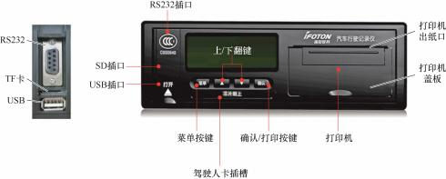
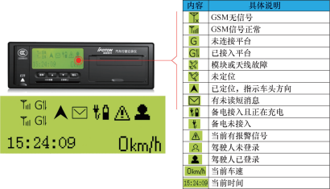
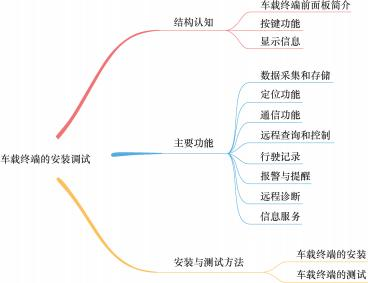

项目二

车载终端的装调与应用

任务二
车载终端的安装调试

| 本节目标 |  |
| --- | --- |
| 知识目标 | 1. 掌握车载终端的结构。 2. 了解车载终端各个模块的主要功能。 |
| 技能目标 | 1. 具有安装车载终端设备的能力。 2. 具有调试车载终端设备的能力。 |
| 素养目标 | 1. 培养学生的综合学习能力。 2. 培养学生的工匠精神。 |

一、ZKC02B车载终端结构的认知

1. 车载终端前面板简介
（1）液晶屏  点阵式液晶屏，显示车辆和终端信息。
（2）按键  〖菜单〗、〖上〗、〖下〗、〖确定〗，用于操作主机。
（3）USB接口  插入U盘，进行存储数据的导出和本地升级。
（4）TF卡接口  用于存储大量的音频和图像数据。
（5）RS232接口  用于终端调试连接计算机。
（6）驾驶人卡插槽  用于驾驶人登录时插入驾驶人卡。
（7）打印机  内嵌热敏打印机，用户可随时打印车辆信息、驾驶人信息、停车前15分钟内每分钟的平均车速、停车时间和超时驾驶记录等行驶记录数据。
为方便驾驶人及安装维修人员使用车载终端，在车载终端前部布置有前面板，包括液晶屏、插接口、按键和打印机等。

一、ZKC02B车载终端结构的认知

2.按键功能
（1）菜单键  用于菜单界面的进入和退出：用于返回上级菜单。
（2）上下三角键  在列表中用于选中上/下行；在输入数字时，用于当前数字加/减；在显示页面用于向上/下翻页。在主菜单，用于查看各功能工作状态。
（3）确定键  用于进入下级菜单；在输入信息时，用于向右移位，在最后一位，确认输入内容；用于操作确认。
（4）打印快捷键  长按确定键3-5秒钟，可直接打印。
（5）重启快捷键  按住菜单键、上键、再按一下确定键，车载终端重启。
为方便驾驶人及安装维修人员使用车载终端，上面设置有各个按键，下面依次对按键使用功能进行介绍。

一、ZKC02B车载终端结构的认知

3.显示信息
显示屏主界面如图所示。显示GRS信号强度、联网状态、定位及其天线接线状态、供电状态、短消息（如有未读短消息）、故障提醒、驾驶人登录状态内容、当前时间和车速。

二、车载终端的主要功能

数据采集和存储
定位功能
01
02
通信功能
远程查询和控制
03
04
行驶记录
报警与提醒
05
06
远程诊断
信息服务
07
08

三、车载终端的安装与测试方法
1.车载终端的安装
前装的安装，需要与主机厂确定安装位置，各类线束接口布线、散热、干扰方案，还要根据车型3D钣金图，设计对应的支架，固定位置，相对来说，工序比较多，一旦确定位置，不轻易更改。烦琐的地方在于，不同款式的车，安装的位置可能有不一样，各厂家的标准也有不同，需要做长期的沟通和确认。
后装的安装相对来说，更加容易确定下来，排除线束、散热和干扰都达标以外，基本是以稳定性好，不容易脱落、摇晃、松懈为准，能保证T-BOX正常稳定运行就可以了。天线的位置也是自由选择，因此，比较简单，网络上有安装视频文件，大多的T-BOX厂商会提供对应车型安装的SOP文件。
2.车载终端的测试
T-BOX测试有多种方式，主要是主机、软件、信号，分功能性测试和性能测试。
主机的功能测试，可以采用模拟器，数据发生器等各类夹具满足测试。软件测试主要是固件，测试用APP，及串口数据检测多种方式。
性能测试包涵耐压、阻抗、霜雾、跌落、EMC等各种实验室测试，可委托第三方实验室测试并出具测试报告。

任务准备
一、工具设备介绍
| 子任务模块 | 设备及工具 |
| --- | --- |
| 车载终端设备的安装 | 汽车（车模）、车载终端 |
| 车载终端设备的调试 | 计算机、车载终端、调试软件 |

步骤一：依次指认蜂窝通信模块、eSIM卡、微处理器、微控制器、全球导航卫星系统定位模块、CAN收发器、备用电池、存储器、加速度传感器；
步骤二：描述各个组成部分的作用和功能特点。

任务准备
二、实操预演
步骤一：正确安装车载终端设备；
步骤二：正确调试车载终端设备。

步骤一：依次指认蜂窝通信模块、eSIM卡、微处理器、微控制器、全球导航卫星系统定位模块、CAN收发器、备用电池、存储器、加速度传感器；
步骤二：描述各个组成部分的作用和功能特点。

任务实施
能够利用所学知识与技能完成车载终端设备的安装与调试，加深对车载终端设备的认识。车载终端设备的品牌和型号有很多，本次任务选用福田智科的ZKC02B车载终端设备。如果实训设备充足，可直接进行基于实物的实训。如果不具备基于实物的实训条件，可应用车模开展实训。

任务实施
一、前期准备
准备好学生实训的汽车（车模）、车载终端、计算机、调试软件；
准备好学生实训的工单。

任务实施

二、实操演练
（一）GTL车型车载终端设备的安装
不同车型由于设计、结构的不同，车载终端的安装位置也不尽相同。该车型车载终端安装于驾驶室上部，需要拆卸内饰，安装布置天线，连接主机线束及安装主机，最后需要装回顶棚内饰。

<!--  -->
<!--  -->

任务实施
二、实操演练
（二）ETX车型车载终端设备的安装
该车型车载终端安装于驾驶室上部顶柜位置，需要拆卸仪表台，安装布置天线，连接主机线束及安装主机，最后仪表台及内饰。

<!--  -->

任务实施
二、实操演练
（三）车载终端设备的调试

<!--  -->

任务实施
二、实操演练
（三）车载终端设备的调试

<!--  -->
<!--  -->

任务小结

## 📄 相关教材扫描

- [项目二任务二.pdf](/教材扫描/项目二任务二.pdf)

感谢观看
