Application of High-Precision Maps
项目五  高精度地图的应用

高精度地图的认知
任务一
目 录
CONTENTS
高精度地图的信息采集
任务二
高精度地图的测试与应用
任务三

任务一
Cognition of High-Precision Maps
高精度地图的认知

1
高精度地图的定义
与普通电子导航地图的区别
2
高精度地图的数据元素
3
高精度地图的特点
4
高精度地图的作用
5

第一部分
高精度地图的定义

<!--  -->

高精度地图的定义
高精度地图（High Definition Map，HD Map） 是指绝对精度和相对精度均在厘米级 （10~20cm） 的高分辨率、高丰富度要素的导航地图。

高精度地图示意图

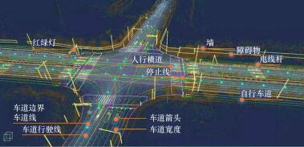

<!--  -->

规则信息与实时信息
高精度地图提供了一个自动驾驶车辆所处的环境模型，包含了最底层的静态高精度地图以及其他动态信息。静态高精度地图中包含了车道模型、道路部件、道路属性和其他的定位图层。车道模型包含道路细节信息，如车道线、车道中心线、车道属性变化等，此外车道模型中还需要包含道路的曲率、坡度、航向、横坡等数学参数。动态信息是指智能网联体系下所有的动态信息，一般包括地图动态信息、传感器信息、驾驶行为、交通动态信息管控等方面。

车道模型、道路部件、道路属性和其他的定位图层
静态高精度地图

自动驾驶车辆所处的环境模型

地图动态信息、传感器信息、驾驶行为、交通动态信息管控等方面
其他动态信息

第二部分
高精度地图
与普通导航电子地图的区别

<!--  -->

高精度地图与普通导航电子地图的区别
高精度地图与普通导航电子地图的主要区别是服务的对象不同，所以对其中内容的要求 也不同。普通导航电子地图的用户是人类驾驶人，而高精度地图的使用者是自动驾驶系统。
普通导航电子地图不会把道路形状的细节完全展现，而高精度地图为了让自动驾驶系统 更好地识别交通情况，从而提前做出行驶方案，会把道路形状的细节进行详细、精确展示， 和真实道路完全一致。

普通导航电子地图与高精度地图对比

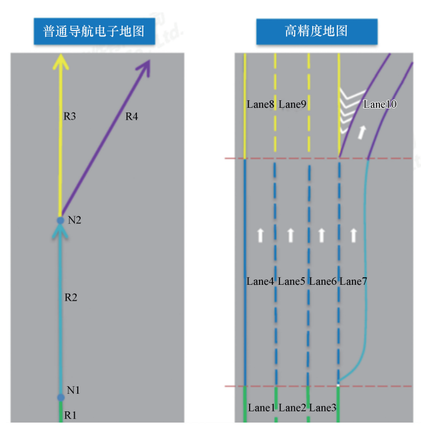

第三部分
高精度地图的数据元素

<!--  -->

高精度地图的数据元素
不同于传统导航地图，高精度地图的适用对象是汽车，为了保证自动驾驶汽车的安全 性，地图数据需要保持“高精度、高动态、多维度”等特点。

那么一张高精度地图到底是由哪些元素构成的呢？

<!--  -->

高精度地图的数据元素
一般而言，高精度地图是通过不同的图层去描述，然后将图层叠加来进行表达。在一张电子地图里，水系、铁路、街区、建筑物可能会分别位于不同图层，每一个图层可以理解 为一张透明薄膜，多图层被绘制叠加后，即可得到一张完整的地图。

高精度地图元素分析

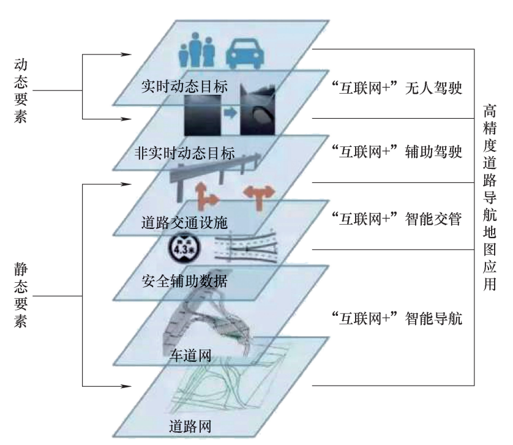

<!--  -->

高精度地图可分为地图图层、定位图层和动态图层
1. 地图图层
地图图层主要是道路的信息，比如道路的路沿、车道线、路口信息。
2. 定位图层
定位图层主要是具备独特的目标或特征，比如红绿灯、交通标志、道路的点云数据等。
3. 动态图层
主要是一些实时路况，如修路或者封路等需要实时推送或者更新的数据。
在点云地图校准→地图标注加工→高精度地图的加工流程中，首先需要生成一张原始地图，这里使用实点云生成的原始数据，点云数据每 0.1s 采集一帧，在大部分情况下前后两 帧数据有重合的部分，这样就有了点云拼接的基础。将所需要的每一帧数据进行拼接就可以 得到一张原始的采集路段的地图。

<!--  -->

高精度地图可分为地图图层、定位图层和动态图层
       其次，点云拼接好形成原始地图之后可以在道路上标出路沿、车道线、红绿灯、路口、 交通标识等道路信息，这些工作大部分需要深度学习结合图像的方法进行解决，部分深度学  习场景无法实现时需要人工进行标识，例如：路口停止和红绿灯关系、一些较为特殊场景的 车道线（十字路口）。
       最后，一张高精度地图就这样生成了。当然加工过程中首要的目标是提高效率和质量， 地图厂家可以尽量地采用算法自动化处理的方式来提高效率和质量。

第四部分
高精度地图的特点

<!--  -->

高精度地图的特点
1. 以自动驾驶车辆为服务对象
传统的导航电子地图是为行人和驾驶人服务的，而高精度地图是为智能网联汽车的自动驾驶系统提供服务。
2. 精度更高
普通导航电子地图精度一般达到米级，高精度地图精度达到厘米级。
3. 表达内容更具体
普通导航电子地图会将道路抽象为一条直线或曲线，高精度地图需要尽量还原道路真 实的现场状况，建立精度极高的车道模型，以及道路通行空间范围边界区域内的精细化对象 模型。
4. 地图鲜度更高
自动驾驶车辆需要实时掌握车辆周边的设施变化情况和交通状态，因此，高精度地图需 要提供日更新的高现势性的地图和以分钟、秒为更新频率的动态交通信息。

第五部分
高精度地图的作用

<!--  -->

高精度地图的作用
随着汽车智能化和网联化的普及，自动驾驶汽车技术不断发展，高精度地图受到了越来 越多的关注。高精度地图的充分运用能够辅助智能网联汽车获取先验参数、超视距感知、高 精度定位、优化驾驶行为、精准控制执行器操作、辅助路线规划，为自动驾驶提供诸多数值 化的决策依据。

 不同驾驶自动化分级对地图数据的需求

<!--  -->

高精度地图的作用

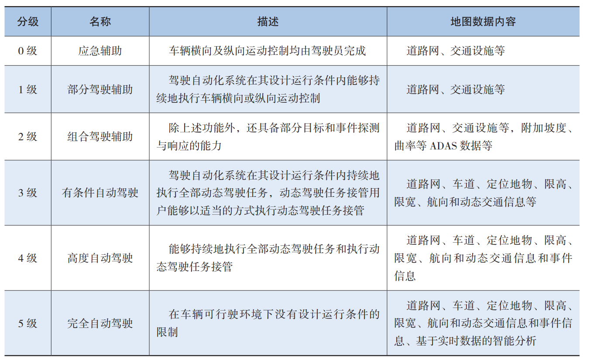

<!--  -->

1. 辅助高精度定位
通过基于高精度地图的辅助感知，自动驾驶汽车能准确地知道周边的物体（对象）的高 精度位置坐标，同时能通过传感器得到车辆与周边物体的相对距离。自动驾驶汽车可基于探测到的物体（对象）高精度坐标和相对距离反向计算出车辆的高精度位置坐标，从而实现对 自身位置的持续修正。
2. 先验感知识别
高精度地图能够辅助汽车超视距感知，当车辆道路环境遇到被其他物体遮挡、转弯或 者超出了汽车电子设备感知范围的问题时，高精度地图能够帮助车辆对行进方向进行环境的 感知。
高精度地图能够辅助车辆快速识别道路环境周边固定物体及车道标线，既能够提高自动 驾驶车辆数据处理效率，又能提供先验知识给自动驾驶汽车感知重构周围三维场景，这样减 少了数据处理时的搜索范围。高精度地图还能为车辆提供各种危险区域信息，车辆可以提前 做出应急方案。

<!--  -->

3. 支持驾驶决策
高精度地图能提供道路曲率，当车辆转弯时可以根据曲率进行提前减速。高精度地图能 提供隧道等遮蔽物中的信息，车辆在进入前可以提前开启前照灯或调整传感器感光参数。高 精度地图能提供坡度，能够辅助车辆控制加速踏板，从而节省能源。高精度地图的限速信 息能精确到车道和车型，可以辅助智能网联汽车精准控制执行器，并能辅助相关车型合规 运行。
4. 车道级路径规划
基于高精度地图的车道级动态路径规划及辅助感知成果最终都将作为参考信息提供给 决策单元，决策单元在已知固定环境、线路和动态目标的基础上通过算法能生成车道级控制 指令。

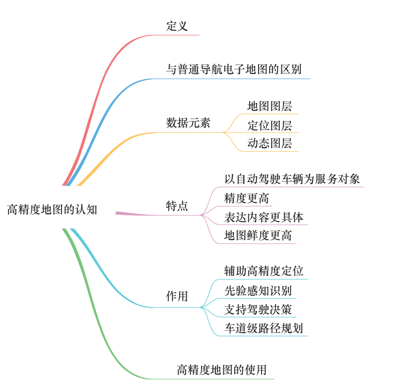

任务二
Information Collection of High-Precision Maps
高精度地图的信息采集

1
高精度地图的信息分类
采集方式
2
采集车介绍
3

信息分类
第一部分
道路信息
规则信息
实时信息

<!--  -->

道路信息
道路信息包含车道模型、道路部件、道路属性三部分；
作用：自动驾驶汽车与汽车辅助系统执行决策的基础，是静态高精度地图的层级信息。

车道模型

道路属性—车道数量、方向

道路部件—防护栏

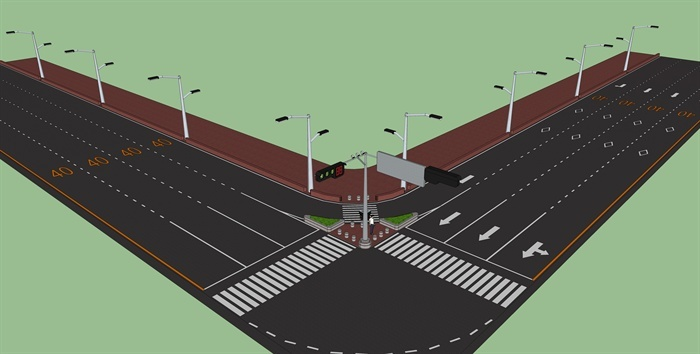
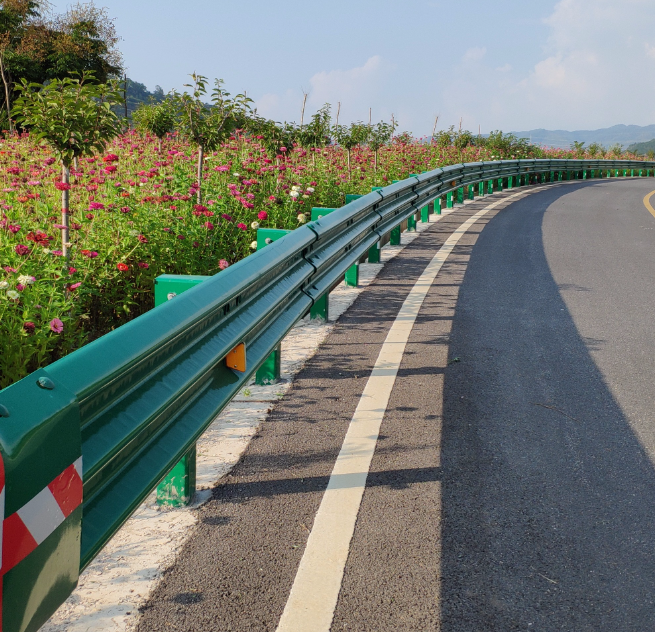
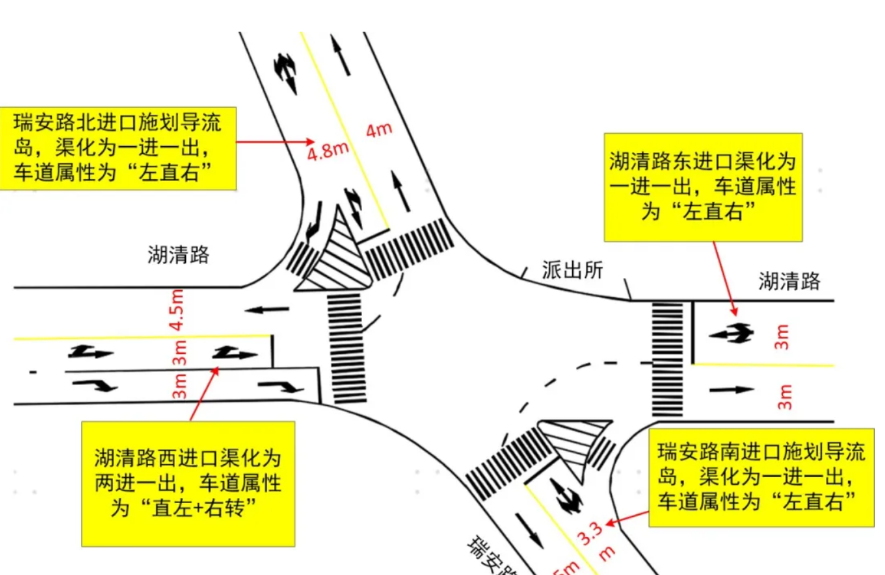

<!--  -->

规则信息与实时信息
规则信息与实时信息：
在道路信息的基础上，也是建立在静态高精度地图基础之上的动态高精度地图的层级信息，包含对驾驶行为的限制以及从车联网获取的实时道路信息，既有其他交通参与者的信息（如道路拥堵情况、施工情况、是否有交通事故、交通管制情况、天气情况等），也有交通参与物的信息（如红绿灯、人行横道等）。

道路拥堵情况
施工情况
是否有交通事故
交通管制情况
天气情况.....
驾驶行为的限制

车联网获取的
实时道路信息
静态高精度地图基础之上
道路信息

动态高精度地图的层级信息
红绿灯
人行横道
......

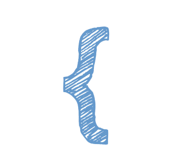

高精度地图信息的分类
| 道路信息 | 车道模型 | 车道数量、车道中心线、道路分离点、车道分离点、车道连接关系 |
| --- | --- | --- |
|  | 道路部件 | 交通灯、交通标志、斑马线、停止线、路缘石、防护栏、桥梁 |
|  | 道路属性 | 车道数、车道变化属性、车道曲率/坡度、车道连接关系、车道分组、 交通区域、人行横道、GPS信号减弱/消失位置、加速点及刹车点 |
| 规则信息 | 车道限速、高速收费信息、限行限号信息 |  |
| 实时信息 | 实时交通、道路施工、交通事故、停车场服务、危险区域预警、基于坡度的节能减排、道路天气/能见度 |  |

高精度地图的数据量庞大——自动驾驶车辆想要变换车道
以想要变换车道的自动驾驶车辆为例，高精度地图的信息包含车辆当前在哪条车道上以及当前车道在地图中的具体位置；当前车道是否有隔壁车道，如果没有车道也就无法变道，只能采取本车道避障；当前车道是否允许变道，车道的类型，车道线是虚线还是实线，变道距离是否足够长，变道后是否能够达到终点等。

区别于传统导航地图只提供路网结构信息和粗略的几何点位置信息，高精度地图包含的信息如此之丰富也就意味着高精度地图的数据量将极其庞大，仅仅一条道路的就需要采集数以十几亿计的数据点，若想最终实现高精度地图的商业化落地，庞大的覆盖范围带来的数据量将是一个不小的挑战。

<!--  -->

### Notes:

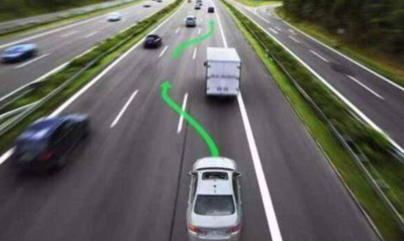

高精度地图的数据量庞大——宽凳科技

以宽凳科技的高精度地图为例，在一天的时间之内，通过众包采集的车辆的摄像头采集道路数据，上传至云端之后再进行初步预处理得到的数据就能达到600-800GB。

### Notes:

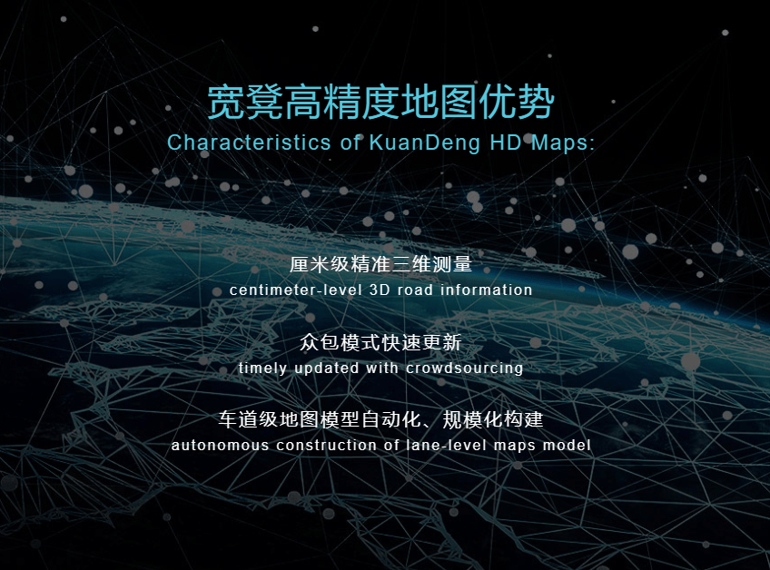

高精度地图的数据量庞大——Waymo公司
Waymo公司的地图测绘车在一天的时间内采集的数据大小为1TB左右，覆盖的范围大约为8小时车程的道路。而且，此类数据主要包含的是静态高精度地图图层信息，并不包括实时交通参与者等动态高精度地图的信息。

 另外，需要注意的是，高精度地图在实际使用的时候并非包含周遭所有的环境信息。以自动驾驶汽车需求的导向为例，高精度地图不包括具体地点属性和信息、障碍物属性、建筑模型，只关注车辆行驶道路及其周边场景，其余场景如公园、商场、景区等非驾驶地图信息不在高精度地图的考虑范围之内。

### Notes:

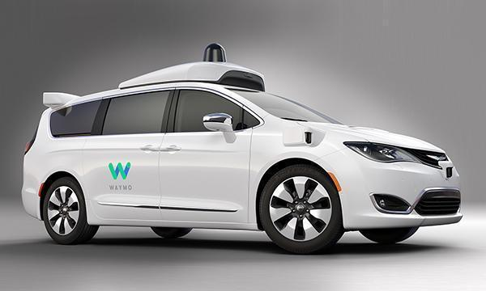

信息采集的方式
第二部分
高精度地图的制作流程
高精度地图的信息采集方式

高精度地图的制作流程
   高精度地图的生产遵循着严格规范的流程，一般是先根据自动驾驶的级别和用户的需求，制定明确的生产计划，然后进行地图数据的采集、处理、编辑和绘制过程，最后对数据进行转换编译和检查，以确保高精度地图的准确性。目前，高精度地图的制作流程主要分为3个环节：采集环节、数据处理和识别环节和人工验证发布环节。

采集环节
人工验证发布环节

自动融合和识别环节

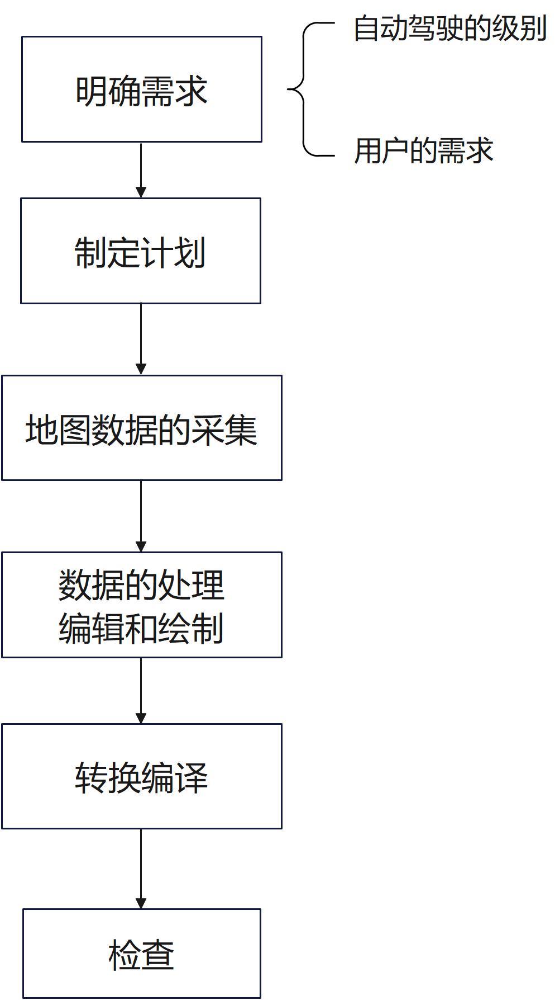
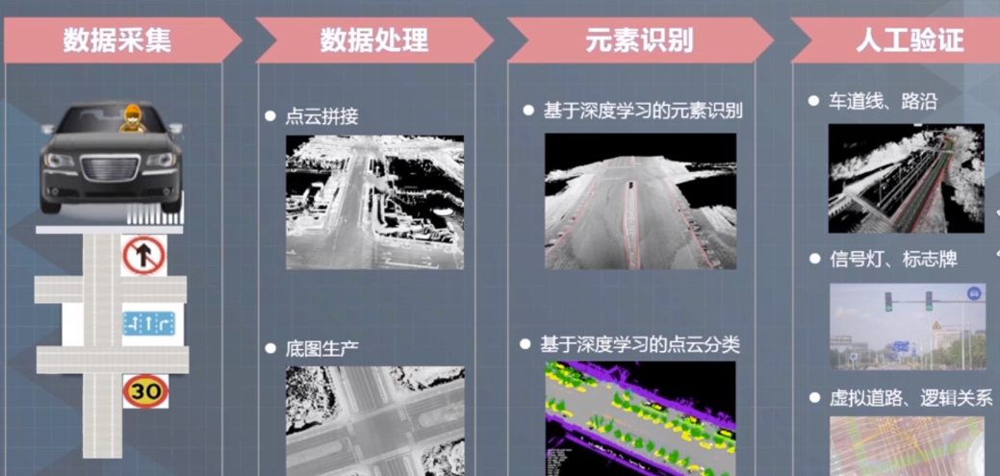

采集环节

<!--  -->

<!--  -->

高精度地图的数据采集方法
主要有两种：激光雷达和摄像头配合GPS
                    摄像头和GPS配合计算距离算法
在数据采集过程中，装有摄像头等采集设备的采集车会以60~80km/h的速度在道路上行驶，同时采集员需要实时监控采集系统和设备的工作状态，并且根据周围的环境情况适当调整摄像头的参数。

采集环节

       以百度Apollo2.5采集车为例，采集点云数据的激光雷达装置，进行高精定位的RTK装置，获取车辆角度和加速度的惯导系统等，其硬件配置性能包含64线激光雷达采集道路路面、16线激光雷达斜向上装检测高处红绿灯和标牌信息、GPS采用RTK、长短焦相机、监控传感器状态的多个传感器、一键式采集方案、一次采集行为会把所有结果都放在一起储存和处理、采集结束之后会把数据传输给平台制图。

<!--  -->

<!--  -->

采集环节

<!--  -->

       以高德高精度地图使用的采集车为例，一种为搭载6台CCD相机的采集车，CCD相机环形分布5个，车顶部一个，每个摄像头像素500万，总像素3000万，采集数据精度约50cm。另外，车辆后备箱内配备了存储和处理拍摄回的相关道路数据的工具。该种摄像头组合的采集车是目前高德数据采集车的主力，6个摄像头能采集到道路相关信息的全景画面。

<!--  -->

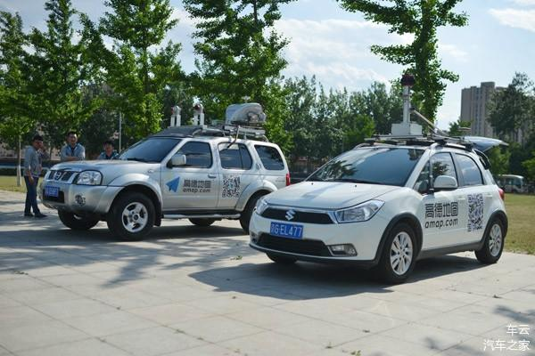
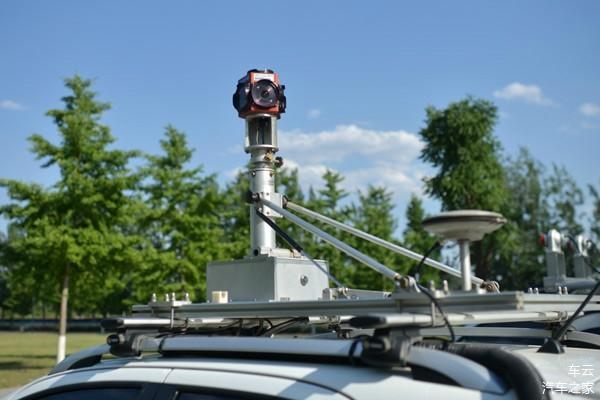

采集环节

<!--  -->

       另一种采集车搭载2个激光扫描仪和4个CCD相机，采集精度约10cm，除了道路信息外，对人、车等信息的采集也更精准。在实际工作过程中，4个CCD相机和2个激光扫描仪相互补充，CCD主要负责拍摄标识标牌等道路属性，激光扫描仪主要拍摄边缘线、车道线等道路信息。另外，CCD主要拍平面，激光扫描仪主要扫三维，当线和面叠加时，就可以形成三维模型。

<!--  -->

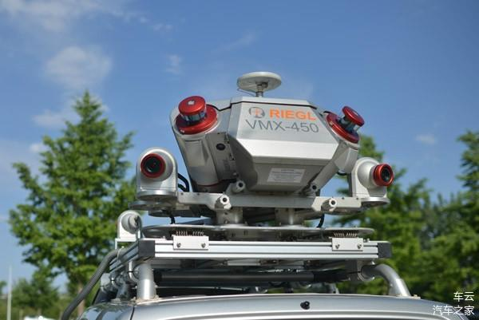

自动融合和识别环节

       采集到的多种传感器的数据会被融合，即点云数据、图像数据、GPS数据等会被叠加到一起。在这个过程中，道路的标线、人行横道、交通标识牌等特征物体会被标识出来，而对于采集到的重复数据也会在这个环节进行整合和冗余处理。在实际的操作过程中，专业人员会在电脑上输入大量的数据并进行AI训练。
       基于深度学习的地图要素识别有两个层面：一是否能基于点云分割，从点云里提取特征；二是尝试从点云中提取车道线、灯杆、红绿灯等；在保证高度自动化的同时，精度也在考核范围内。

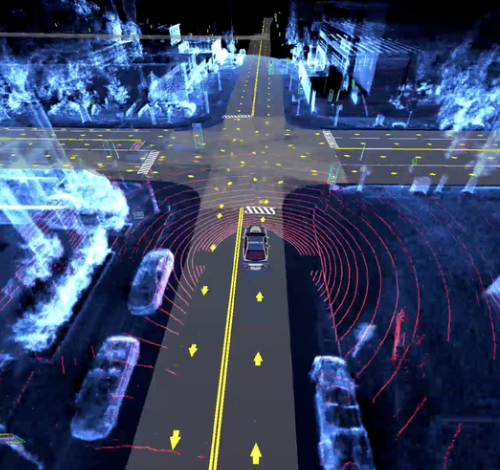
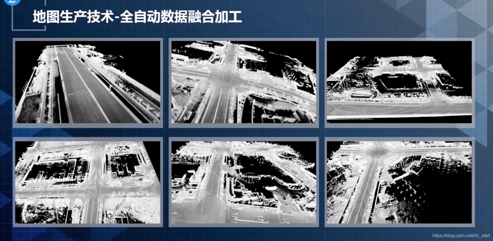

人工验证发布环节

专业人员通过对比采集的视频信息，核对和确定电脑自动化处理的数据是否准确，并进行相应的数据修正后，上传数据到云端，最终获得具有详细道路信息的高精度地图。

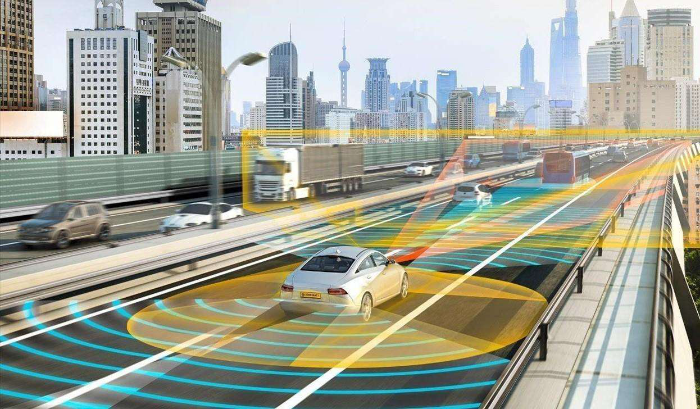
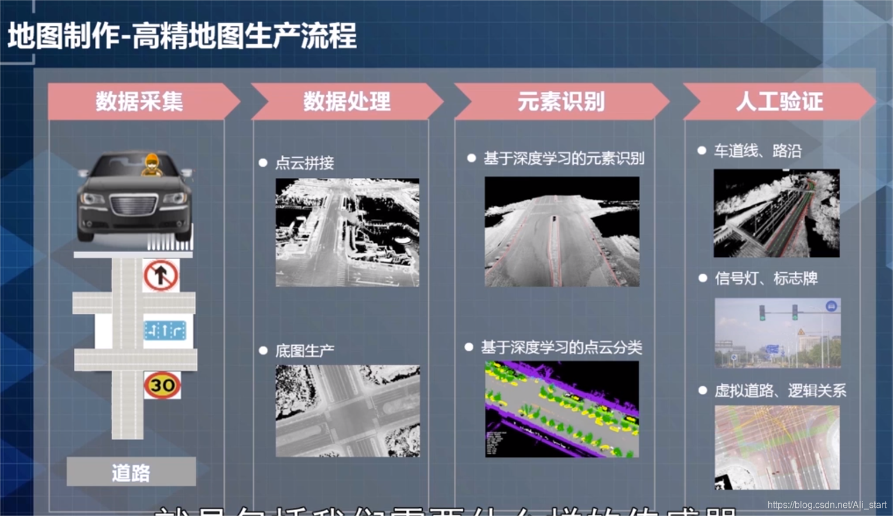

高精度地图的信息采集方式
在数据信息收集的过程中，采用专业的采集车采集和众包设备采集，与此同时，用户的反馈信息、互联网信息、卫星影像等信息也要采集上来。为了数据生产的准确性和节省数据生产的成本，数据采集一般采用专业队伍进行规模化采集与众包采集相结合，这样的方式不仅可以提高数据生产的速度，还可以节省人力成本。
专业队伍规模化采集模式
高精度地图生产运营一体化闭环采集模式
众包采集模式

专业队伍规模化采集模式

        一个专业数据采集小队会配备一台采集车和数个差分基站，一般专业采集车都配有惯性导航系统、摄像头和激光雷达设备等，这些设备会经过专业的参数标定，以确保数据的准确性。采集的数据包括高精度轨迹、图像、激光点云数据。其中轨迹包括经度、纬度、海拔、倾角、俯仰角及速度等信息。数据采集完成后利用人工智能技术对数据进行解算、时空配准、要素提取、矢量化。采用专业的高精度地图采集车来进行道路数据采集是前期更主流的方式，是主流图商像高德、百度、四维图新等企业前期主要应用的方式，此种方式的最大优点是采集精度高，生成的高精地图更为可靠，缺点则是前期采集设备和人力成本较高。

<!--  -->

众包采集模式

对于高达数百万的采集设备，以及高要求的采集速度，无限的扩张数据采集队伍是不切实际的。因此，考虑到金钱成本和时间成本，目前，市场上大部分企业采用的都是众包采集制图模式。众包采集技术即在众包采集的大量可靠数据中，发现数据变化的范围，然后根据数据变化的可信信息，派专业采集车进行核实和专业测量。这种采集模式一般是图商和车厂在合作过程中，利用后装的传感器收集道路信息，并上传到图商的云端数据库，再经过后续的数据处理更加迅速地制作高精地图。众包模式深得初创企业青睐，其突出优势是更快速地更新和完善道路数据，其缺点是采集精度不如专业采集车。目前，主流图商在前期进行道路数据的专业采集后，普遍也会采用众包模式再对地图实现不断更新。

高精度地图生产运营一体化闭环采集模式

伴随着智能网联汽车的发展，车辆本身不仅可以作为高精度地图的消费者，更是可以成为高精度地图数据的提供者。在车辆运行的过程中，车辆的实时位置、各类传感器数据、实时交通数据可以上传至地图云端，云端可以对这些实时大数据进行深度挖掘分析，从而达到更新高精度地图的目的。由此可见，智能网联车辆已经成为高精度地图采集、生产、应用、更新闭环中的一个重要环节，最终形成一套智能网联汽车体系下的高精度地图生产运营一体化闭环运营模式。

<!--  -->

<!--  -->

高精度地图的采集车介绍
第三部分
四维图新、百度、高德采用的采集车
HERE、TomTom采用的采集车

国内三大主流图商使用的采集车

<!--  -->

<!--  -->

四维图新
百度
高德

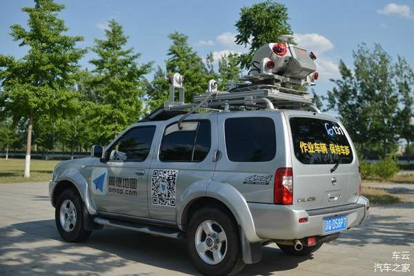

欧美图商使用的采集车

<!--  -->

HERE
TOMTOM

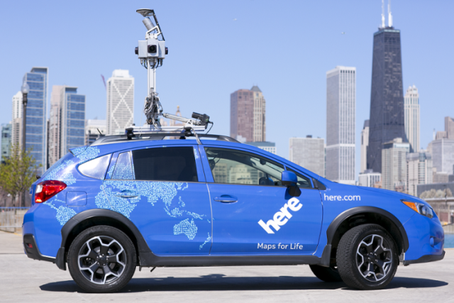
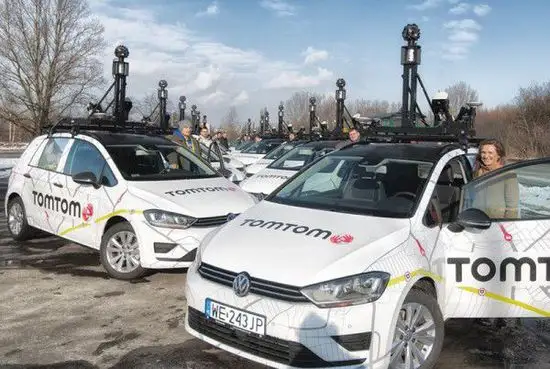

视觉+GNSS”的方案
目前，市面上应用最广泛的众包采集方案是采用“视觉+GNSS”的方案。
由以色列Mobileye公司生产的EyeQ视觉芯片，截至2020年年底，其占据了市场的垄断地位，为近30家车厂的300余种车型ADAS功能所采用。EyeQ芯片可以支持REM地图，即路网采集管理系统的快速搭建。具体的工作原理是利用视觉神经网络抓取变化的车辆、车道标线、路牌等信息，将收集的信息匿名化加密，再上传到云端，生成REM地图，然后生成地图信息分配到自动驾驶汽车中。
不含激光雷达的低成本高精度采集设备成本大约在5万~8万元，带有16线激光雷达的成套采集设备大约在10万~16万元，虽然用于众包更新成本仍然较高，但是作为地图供应商用于快速更新采集却非常合适。用于众包的设备，成本控制到千元级，才可能大批量装配到出租车、分时租赁车等服务性车辆上；成本控制到3000元以下，才能批量前装到所有车辆。

激光雷达+惯导系统+全景相机+GNSS+差分基站的方式
他们普遍采用这种昂贵的激光雷达+惯导系统+全景相机+GNSS+差分基站的方式。
单套设备价格从100万元到几百万元不等，每家采集车的数量从几套到二十几套不等。之所以采用如此成本高昂的设备，是因为要满足自动驾驶车辆对高精度地图的绝对精度、相对精度、识别率等指标的要求。

“车辆动态上传+动态地图自动下发”模式
“车辆动态上传+动态地图自动下发”模式中，每辆行驶中的自动驾驶汽车，是地图云中心数据成果的使用者，同时也是地图云中心数据的提供者。车端的运营状态数据（如实时位置、车身姿态、驾驶行为、各类传感器数据、实时交通数据等等）通过路测设备或蜂窝网络传送至地图云中心，云中心对这些实时大数据进行深度挖掘分析，形成对高精度地图的有效更新并通过空中激活（OTA）等形式下发到车端，如此循环往复，不断对高精度地图进行实时更新优化，形成一套智能网联汽车体系下的高精度地图生产运营一体化闭环运营模式。该闭环生态模式已经成为业界共识，是较为理想的高精度地图生产与更新的技术模式。四维图新是国内第一家基于该模式开发完成了“车辆/车厂-图商-车厂/车辆”的闭环模式验证，百度和TomTom联合开发的AutoStream也是“车辆动态上传+动态地图自动下发”模式。
初创企业

对于初创企业来讲，该方法设备成本低，采集效率高，成图快，但是需要大量研发资源提升采集精度和传感器识别率。经过最近几年发展，国内以Momenta和宽凳科技为首的初创企业，已经在轻量化采集的基础上形成了高精度地图制作的突破，其他企业也在轻量化设备和整体解决方案上做了大量尝试，各种技术百花齐放。

仿真场景的建立

打开地图模拟仿真软件
菜单栏中选择Apollo开放平台——>仿真平台

进入页面后，选择在左侧导航栏中，选择仿真——>创建/删除分组进入场景管理页面
在新建分组标签页，输入场景分组的名字，选择相应的场景集等选项，建立新的场景。

选择在左侧导航栏中，选择仿真——>现有分组，查看新建立的场景

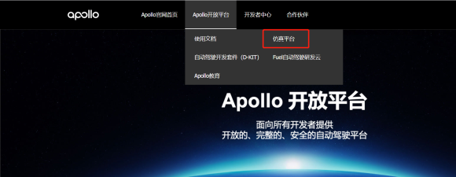
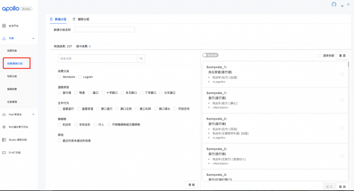

<!--  -->

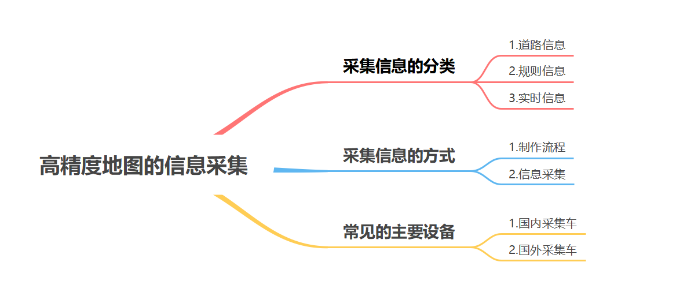

任务三
Testing and Application of High-Precision Maps
高精度地图的测试与应用

1
高精度地图在车路协同系统中的应用原理
高精度地图在自动驾驶系统中的应用原理
2
高精度地图的应用实例
3

高精度地图
在车路协同系统中的应用原理
第一部分

<!--  -->

高精度地图如何应用在在车路协同系统中呢？
         一般来说，图商会把采集到的整个城市、区域或者高速公路的高精度地图存放在云端， 通过云对外提供数据服务，通过核心网分发局部高精度地图到各移动边缘云进行边缘存储和 计算，经由 RSU 借助 Uu 接口或 PC5 接口支持实现“人 - 车 - 路 - 云”协同交互，为车辆的安全驾驶、高精度定位和自动驾驶以及精准信息等提供服务。

<!--  -->

高精度地图辅助车路协同示意图图

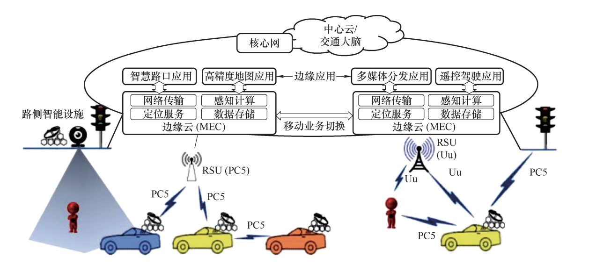

 车路协同反哺高精度地图示意
 车路协同反哺高精度地图示意
MEC 存储动态高精度地图，向车辆分发高精度地图信息，减少时延并降低对核心网传 输带宽的压力。车辆通过高精度定位模块获取位置向 MEC 发送，部署在 MEC 的地图服务提 取相应位置的高精度地图信息发送给车辆。
众包高精度地图更新数据的方式除了根据车载设备自动识别上传与云端高精度地图比 对，还可以由车路协同系统中的路侧智能设备和路侧单元来完成。当路侧摄像头、激光雷 达、车速检测仪等智能设备或装有 OBU 的车辆检测到现实路况与高精度地图存在偏差时， 可将自身传感信息上传至 MEC 用于对地图进行更新，随后 MEC 的地图服务可选择将更新后 的高精度地图回传至中心云平台。车路协同反哺高精度地图示意如图所示。

<!--  -->

### Notes:

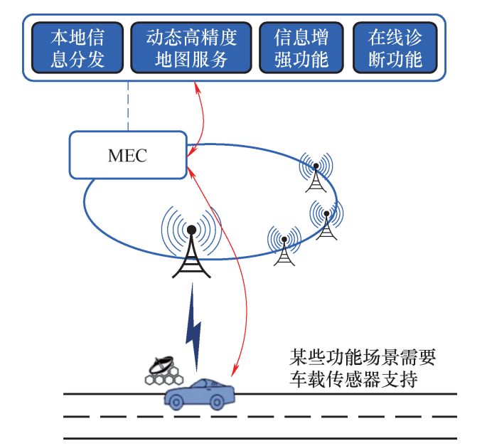

高精度地图
在自动驾驶系统中的应用原理
第二部分

感知层
规划 / 识别层

高精度地图在自动驾驶中的应用
   自动驾驶系统可相应归纳为环境感知、决策控制、动 作执行三个阶段。根据信息的流向，也可相应地划分为感知 层、规划 / 识别层和决策控制层。高精度地图在自动驾驶中的应用如图所示，在自动驾驶系统中的高精度地图主要 被应用在前两个阶段，即感知层和规划 / 识别层。

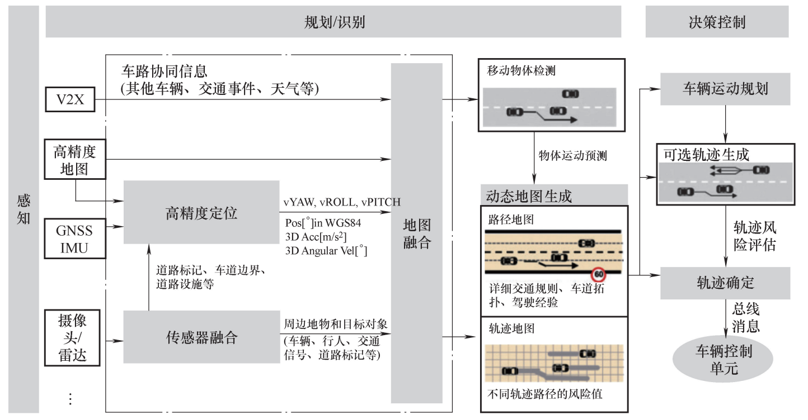

1. 感知层

高精度地图的感知层
通常情况下，感知指使用车辆配备的雷达、摄像头等视 觉传感器结合定位传感器检测周边物体。高精度地图可视为 车辆除了视觉传感器外的另一个虚拟数字传感器，它能提供 完整的静态地物描述，延伸已有视觉传感器的感知边界，经 数据融合得到高质量的感知结果，实现车辆对周围道路环境
的精确认知。通过将检测到的特征物与高精度地图数据进行匹配，不断修正全球导航卫星 系统（Global Navigation Satellite System，GNSS） 中卫星定位的不确定性和航迹推算的累积误 差，能实现车辆自身位置和姿态的精确感知。

例如当车辆在行驶时，系统可以根据车辆当前位置，对前方感知范围内会出现的车辆进 行集中排查，而无须过多关注该范围之外的车辆，如此将很大程度上降低计算资源的消耗。

<!--  -->

<!--  -->

2. 规划 / 识别层

       通过输入感知层不同数据融合的结果，可以预测车辆周围物体的行为，约束与引导动态地图生成，包括路径规划和轨迹规划。
高精度地图主要用来辅助车辆定位和控制决策。车辆定位使用多传感器融合方案（使用 视觉传感器、毫米波雷达等传感器），通过传感器结果和高精度地图的匹配来实现横向、纵向的高精度定位。控制决策也少不了高精度地图提供的信息，比如地图的曲率、坡度、侧倾 角度等，这些要素都是控制决策需要考虑的。

<!--  -->

<!--  -->

2. 规划 / 识别层

       路径规划首先是基于绝对定位和道路拓扑，计算车辆当前位置至终点的全局路径，其次 是结合交通事件、天气等实时数据以及驾驶经验数据集，基于全局路径进行局部的车道级路 径规划。
轨迹规划则是尽量按照路径规划结果，考虑移动障碍物、交通信号实时状态、车辆速 度、动力学约束等，生成无碰撞风险、平滑轨迹路径集合，供车辆决策控制模块使用，解决 自动驾驶车辆“如何走”的问题。
例如当车辆位于主路，马上要进入匝道时，车道会从一道直接分成两道，出现一条新的 车道线，对于车道线感知的挑战非常大。而当车辆到达匝道分流区域之前，高精度地图会发 出一条引导线，车辆会沿着引导线一直通过这个区域，直到进入车道线清晰的位置为止。

高精度地图的应用实例
第三部分
国外高精度地图领域中的“领头羊”
国内高精度地图的“三大巨头”

大家见过这些车吗？

<!--  -->

<!--  -->

四维图新
百度
高德

高精度地图技术比较有名的初创公司有 DeepMap、CivilMaps、Carmera 等，此外还有 Here、TomTom、Waymo（原 Google 地图）等国外老牌图商，它们都在高精度地图领域不断 升级改造。国内则有四维图新、百度、高德等诸多资深图商。

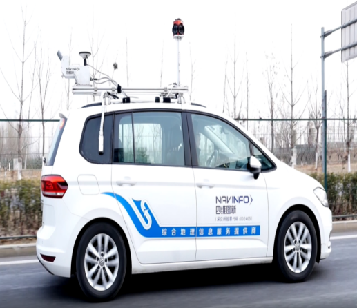
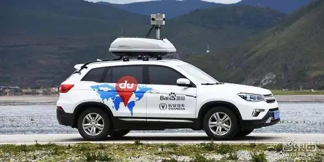

欧美图商使用的采集车

<!--  -->

HERE
TOMTOM

国外高精度地图领域中的“领头羊”
Waymo、Here、TomTom 是国外高精度地图领域中的佼佼者，拥有专业的测绘车队， 主要采用集中制图模式，强调创建完整的 3D 高精度地图，支持自动驾驶汽车完全独立驾 驶。Waymo 在高精度地图方面多服务于自家自动驾驶车队，对外公布的信息较少。Here 和 TomTom，一个是有车企巨头依靠，一个是传统图商，目前双方的高精度地图均已经覆盖了 几十万平方千米。

Waymo 和 Google Map 团队开发的高精度地图如今已经可以支持 L4 级别的自动驾驶车辆， 在美国凤凰城等多个城市运行。Waymo 在绘制高精度地图上采用两种策略：一是利用现在 的自动驾驶车辆搭载传感器逐渐绘制高精度地图；二是先利用自己的测绘车队，为无人驾驶 汽车创建好丰富、详细的高精度地图，然后再运用到无人驾驶导航中。

TomTom 测绘车队是应用自动化数据采集的图商，通过搭载一个 Velodyne 激光雷达，一 个 360。全景相机，两台 SICK 雷达，还有兼容 GPS 和 GLONASS 的高精度天线的福特翼虎 汽车即可完成采集任务。TomTom 开发了 RoadDNA 技术来提供高度优化的 3D 横向和纵向 道路视图，它可以将原本的 3D 地图数据压缩成 2D 视图，同时还能保留道路上的关键要素。 TomTom 也和百度、Zenuity 合作推出了一款自动驾驶地图交付服务。TomTom 与全球第一大 汽车技术供应商德国博世公司合作，联合开发能够用于自动驾驶汽车的高精度地图。沃尔沃  旗下 Drive Me 自动驾驶项目正使用 TomTom 地图。

国外高精度地图领域中的“领头羊”
Here 被奥迪、宝马、戴姆勒三家德国车企巨头收购后，开始深耕高精度地图领域。 Here 的高精度地图 Here HD Live Map 建立在基础地图的基础上，配备激光雷达的 Here True 车辆每天奔波在大街小巷，结合卫星图像绘制车道路径、车道标记、道路边缘等多种短时间  内相对不变的环境信息。对于那些动态数据的更新则主要依赖通用等众包车辆，借助 Here HD Live Map 的云端能力，当车辆传感器检测到的道路信息变更时，这些新特征将会上传到  地图数据中，并下发到所有车辆。Here HD Live Map 已经完成了超 50 万 km 道路的地图测绘， 精度达到亚米级别，因此也成为宝马下一批具有高度自动驾驶功能的量产汽车的专用地图。

国内高精度地图的“三大巨头”
百度 ·长地万方已在北京、上海和广东顺德建立了三个高精度地图生产采集基地，有着 庞大的测绘车队和大量的人才储备。百度地图的采集车队已有 288 台车，其中具备高精度地  图采集能力的车辆 40 多台。搭载着 Velodyne 的 32 线激光雷达、自主研发的摄像头和 IMU 惯性导航的百度高精度地图测绘车每天至少采集 150km 的道路数据，早已经完成 30 万 km 的高速公路和部分城市道路测绘，相对精度达到 10~20cm。这些收集到的道路数据通过人工  智能自动识别，并由人工验证信息后再上传至云端，目前百度高精度地图数据自动化处理程  度达到 90% 以上。百度也利用 Learning-Map 平台以众包模式收集更新道路数据，只要安装  了百度地图和传感器，车内手机、后装硬件和车端传感器采集到的环境数据，都会发送到该 平台。百度现已和福田、 一汽、比亚迪、大众等诸多车企达成合作，共同研发高精度地图。 百度和博世集团、TomTom 等相关产业巨头打造起一个“AI based Map”，融汇基础数据、出  行方式、智慧交通等信息，共同构建起“地图大脑”。

国内想要开展地图导航服务需要获得相应的导航电子地图制作资质。互联网公司也纷纷 开始了在高精度地图市场的争夺，如今百度 ·长地万方、阿里 ·高德、腾讯 · 四维图新已在 国内高精度地图领域占据高地。

国内高精度地图的“三大巨头”

2014 年，腾讯以超过 11 亿元的价格收购了四维图新 11.28% 的股份。四维图新已经  和博世达成合作，博世公司硬件传感器所收集的道路特征数据，将通过四维图新的云计算 服务平台，聚集到四维图新的高精度地图服务器，从而生成自动驾驶需要的高精度地图。 四维图新也同 Mobileye 签署协议，将在我国开发和发布 Mobileye 的路网采集管理（REM） 产品。其制作的高精度地图是可以投入量产阶段的、可以应用于主流车厂的自动驾驶  汽车。
阿里 ·高德的 HAD 级别高精度地图的采集车主要通过 2 个激光雷达和 4 个摄像头采集 道路信息，精度可达 10cm。高德和精准位置服务商千寻位置合作，提供“高精度地图 + 高 精度定位”综合解决方案。目前双方在车道级定位上的解决方案可以实现普通道路条件下 横向误差和纵向误差在 7cm 以内，高速 / 城市环路条件下横向误差 6cm 以内，纵向误差 5cm 以内。高德先后和博世、英伟达、凯迪拉克合作研发高精度地图中定位图层和数据更新方 案。其高精度地图已经应用在凯迪拉克的 Super Cruise 系统，这也是全球首个实现高速公路 释放双手驾驶的量产智能驾驶系统。

仿真场景的建立

打开地图模拟仿真软件
菜单栏中选择Apollo开放平台——>仿真平台

进入页面后，选择在左侧导航栏中，选择仿真——>创建/删除分组进入场景管理页面
在新建分组标签页，输入场景分组的名字，选择相应的场景集等选项，建立新的场景。

选择在左侧导航栏中，选择仿真——>现有分组，查看新建立的场景

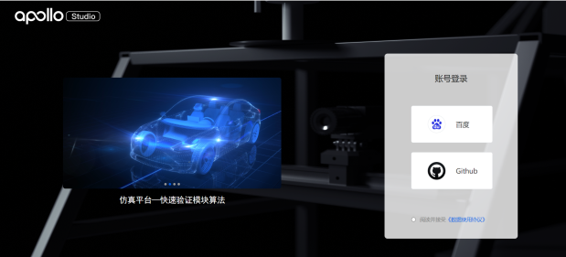

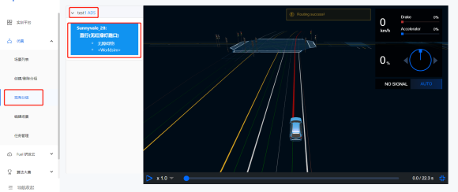

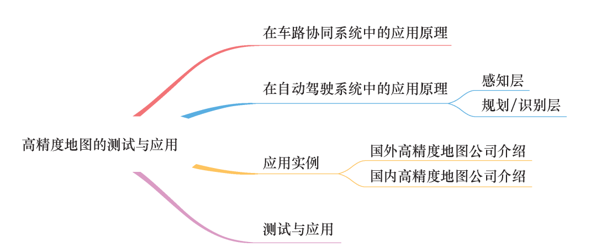

## 📄 相关教材扫描

- [项目五任务一.pdf](/教材扫描/项目五任务一.pdf)
- [项目五任务二.pdf](/教材扫描/项目五任务二.pdf)
- [项目五任务三.pdf](/教材扫描/项目五任务三.pdf)

Teaching Design Template
感谢观看
