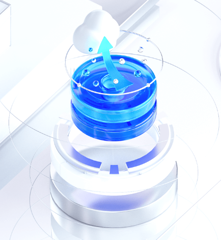
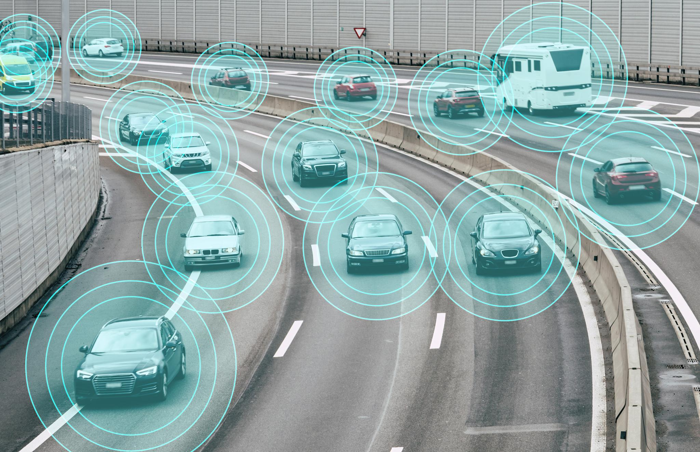
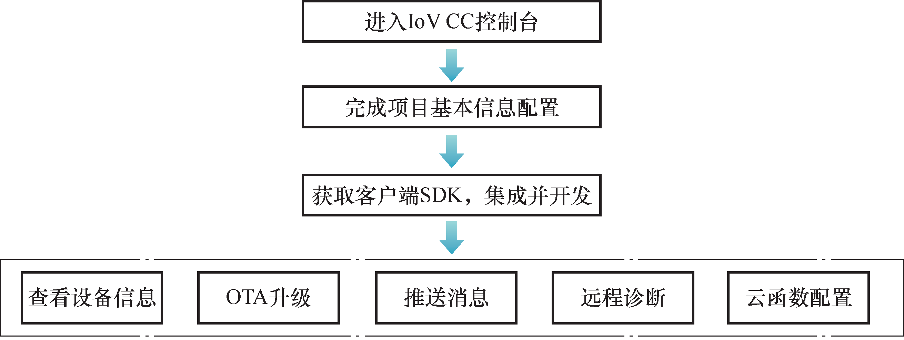
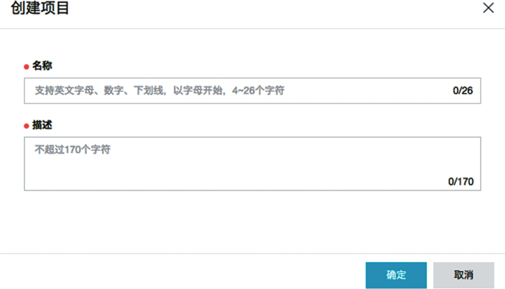
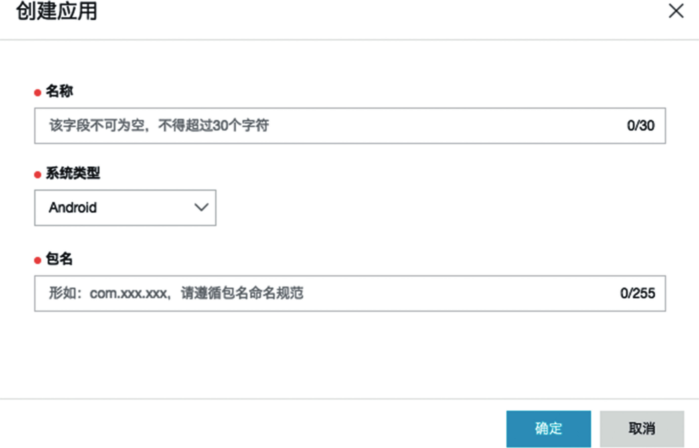
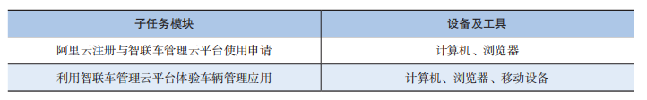
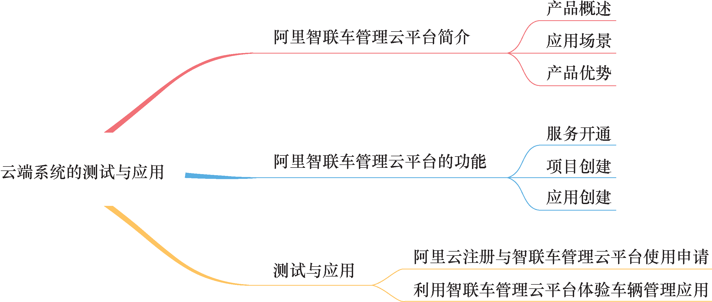

云端系统的测试与应用
主讲人：陈舒畅
时间：2024年9月

阿里智联车管理云平台

 产品概述

        阿里智联车管理云平台（IoV Command Center，IoV CC） 是阿里云为智能网联汽车领域 提供的完整解决方案。它提供了无线升级（OTA）、运程协助、在线虚拟车（Virtual Car）、多  端数据同步、消息服务等内容。

应用场景

无线升级
相比传统汽车，智联车在车辆售出后，厂商还可通过无线升级（OTA） 的方式触达用户，解决问题。

远程协助
在智联车的使用过程中，当车辆出现软件问题时，维修人员可通过远程指令下发，诊断车辆设备问题原因。

在线虚拟车
获取车辆激活状态、查看车辆实时信息等。

应用场景

多端数据同步
实现同一 个用户手机与车机设备上车辆信息的实时同步，以便用户可在手机上查看车辆信息，或进行一些远程操作。

消息服务
消息服务（CMNS） 是 IoV CC 的底层服务之一，无线升级（OTA）、远程协助（RA） 都会依赖 CMNS 长连接通道能力，实现消息的下发和回传。

平台功能

服务开通
1

要使用阿里智联车管理云平台，需要先进入产品页进行开通。

项目创建
2

项目可用于数据和服务的隔离。不同部门之间、不同产品线之间，要做到数据及服务的隔离，可以通过创建不同的项目来实现。
应用创建
3

应用创建完成后，可以下载客户端 SDK（相关的 ak/sk以安全的方式植入），然后进行自主的应用开发。创建的应用，可以在 OTA 服务模块进行自主升级。

服务开通

接入步骤如下：
1） 登录账号，进入 IoV CC 控制台。
2） 根据不同的需求场景（例如：不同的车辆品牌、不同的部门、不同的销售大区，设备需要分别维护），可以通过创建不同的项目来实现。阿里智联车管理云平台会按照项目进行数据的存储和隔离。
3） 在项目下，下载客户端 SDK，集成到所需的设备端（例如：车机端系统内、移动端APP 内），并完成开发测试。
4） 当设备激活后，可以登录 IoV CC 控制台，进行设备信息的查看、为指定设备进行无线升级（OTA） 或推送消息、进行远程诊断、进行云函数的配置等工作。

### Notes:

项目创建

　在“项目 Project”—“项目列表”界面，单击“创建项目”按钮。按要求填写名称及描述，单击“确定”按钮，即完成项目的创建。

项目创建完成后，将在“项目 Project”的“项目列表”下看到该项目。
单击“详情”链接，将进入该项目的详情界面。

应用创建

在项目详情页面（“项目 Project”—“项目列表”—“详情”），找到“应用管理”—“自定义应用”，单击“创建应用”按钮，将展示如图所示界面，按要求填写名称、包名，单击“确定”按钮，即完成应用的创建。

任务实施

能够利用互联网搜索阿里智联车管理云平台，并完成账号注册与登录，能够利用智联车管理云平台体验车辆管理应用，掌握阿里智联车管理云平台的基本功能与操作，加深对车云远程数据交互系统原理与系统架构的认识。
步骤一：利用互联网搜索阿里智联车管理云平台。
步骤二：注册阿里云账号并进行智联车管理云平台公测申请。
步骤三：利用智联车管理云平台体验车辆管理应用。

小结

## 📄 相关教材扫描

- [项目四任务三.pdf](/教材扫描/项目四任务三.pdf)

感谢观看
