网络通信模块的安装调试
主讲人：陈舒畅
时间：2024年9月

网络通信模块的相关概念

定义
随着互联网与无线技术的发展，越来越多的车辆搭载了车载无线通信设备，无线通信 模块作为车载设备的核心，它决定了智能交通应用系统的通信能力、可靠程度及可普及的 规模。车联网用的通信模块还需要具备传统的电话和短信等通信功能。根据支持的通信制 式不同，可分 5G、4G、3G 和 2G 通信模块。目前主流的是全网通的 4G LTE 通信模块，一 般要求为车规级或工规级模块。5G 通信模块正在快速发展中，为 V2X 提供更为快速的通信 支持。

网络通信模块的相关概念

车联网系统的组成
1

车联网系统由主机、车载终端、手机 APP 及后台监控系统四部分组成。 它具有“事前监督与事后核查并举”的功能，可提高道路运输安全系数。
车载终端网络通信模块
2

车载终端 T-BOX（Telematics BOX） 作为车辆与云端的信息交互点，扮演着重要的角色。T-BOX 通过 4G/5G 远程无线通信、GPS 卫星定位、加速度传感和 CAN 通信功能，实现 车辆远程监控、远程控制、安全监测和报警、远程诊断等多种在线应用。

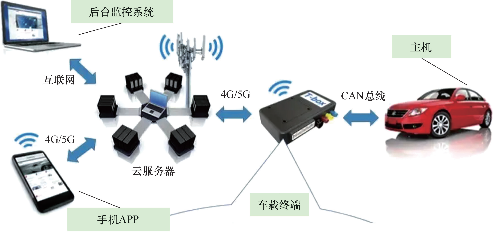
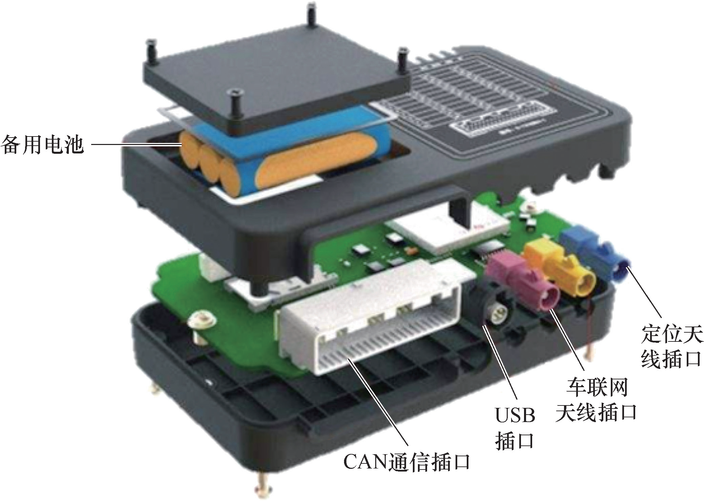

车载终端网络通信模块的原理架构

       车载 T-BOX 与主机通过 CAN 总线通信，实现指令与信息的传递，包括车辆状态信息、 按键状态信息、控制指令等；通过音频连接，实现双方共用麦克与喇叭输出。
       ACC 熄火后，为了保证车载 T-BOX 工作电流更低，通信模块将会断开数据链路，仅保留短信接收和电话打入功能。仅当需要远程控制时才需要发送短信，信息查询的是客服中心 熄火前的数据，不需要发送短信。

       T-BOX 与手 机 APP 是通过后台系统以数据链路的形式进行间接通信（双向）。T-BOX 与后台系统通信还 包括语音和短信两种形式，后者主要实现一键导航及远程控制功能。

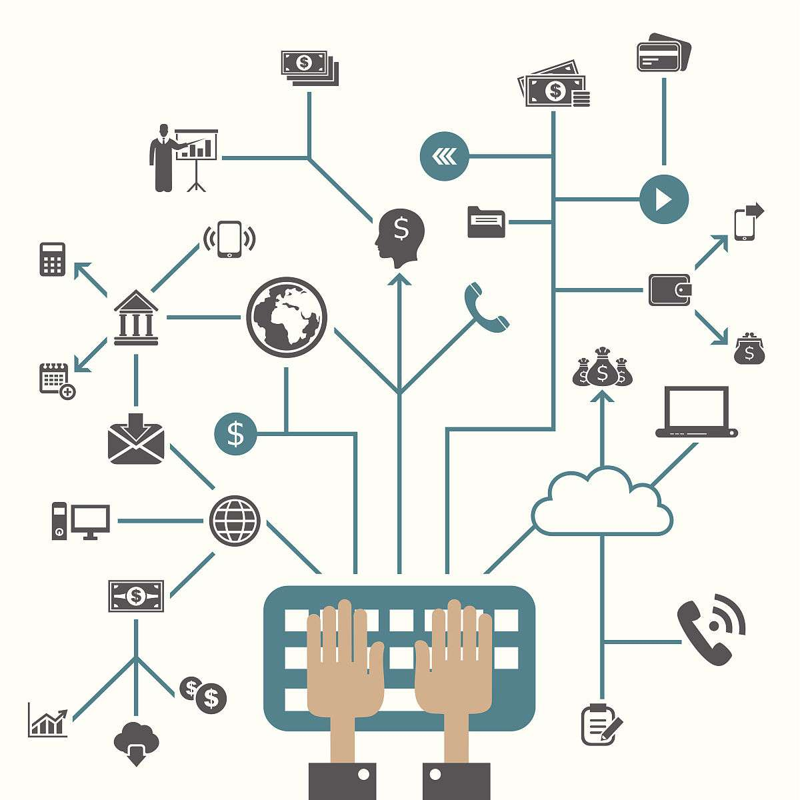

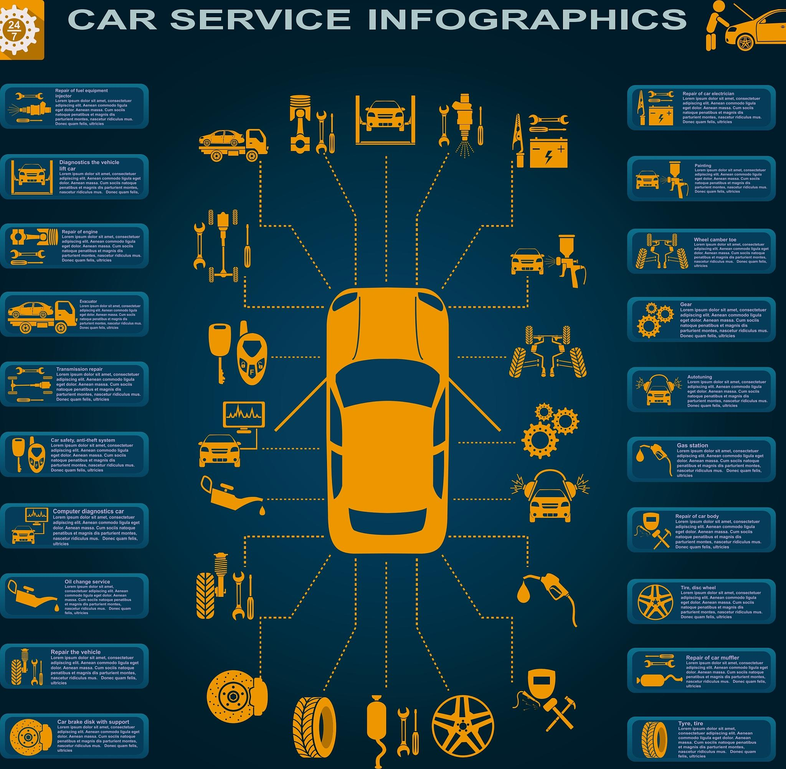

网络通信技术

汽车上承载着各种各样的通信技术.

一部分是用于与车外通信，比如 Wi-Fi、USB、4G 等.

而另一部分通信技术是用于车内各个零部件之间通信，即车内网络通信技术。

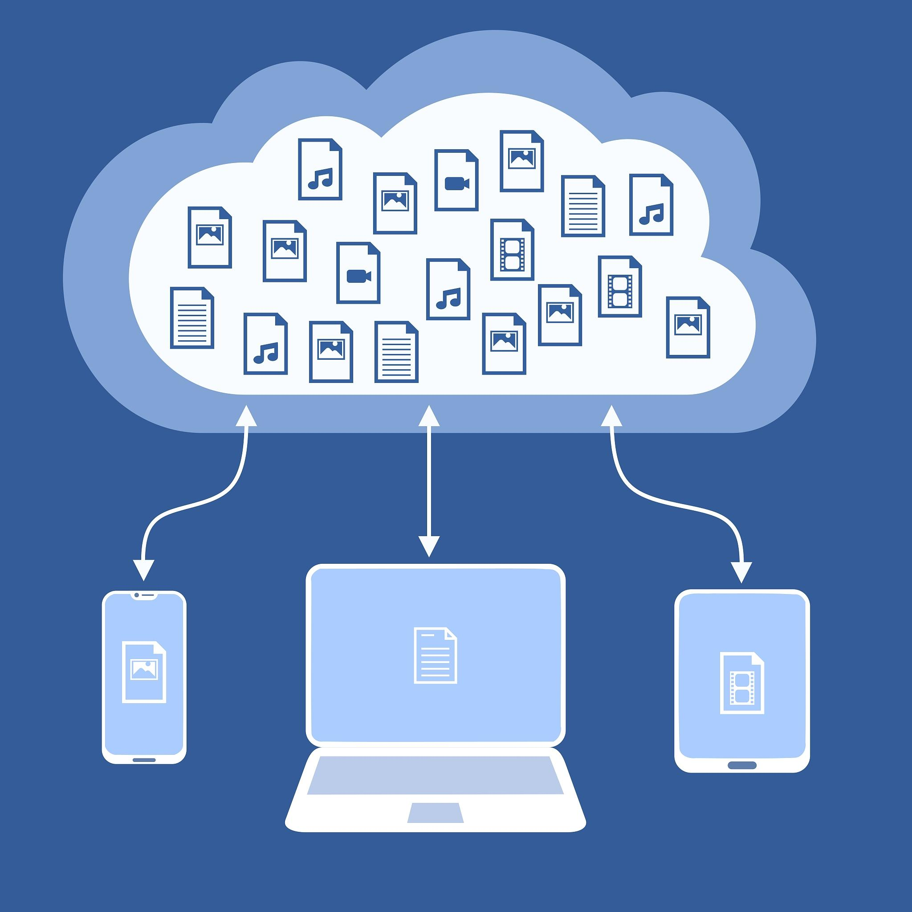
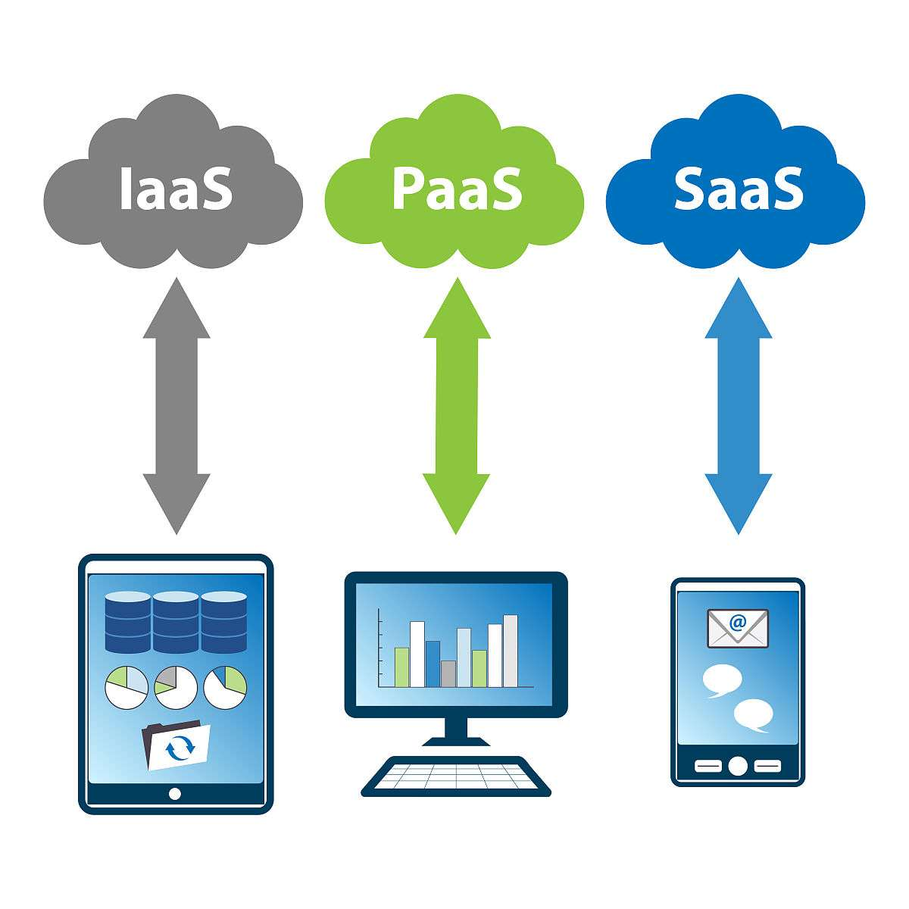
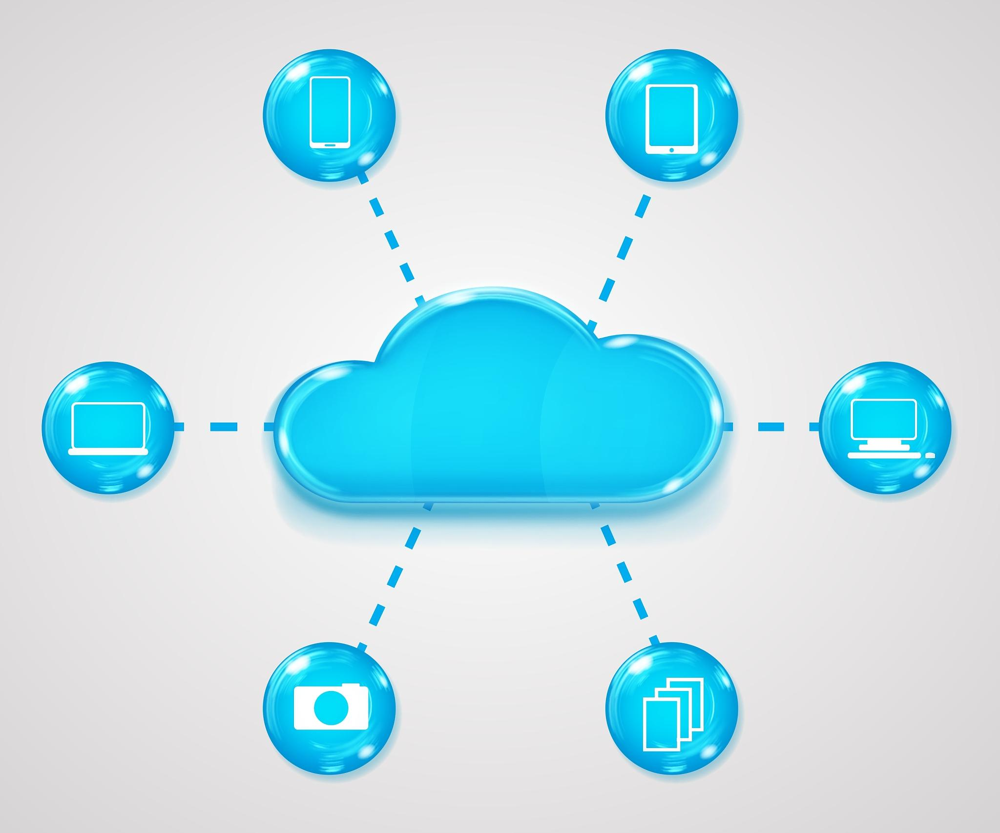

无线通信技术

定义

无线通信技术（Wi-Fi），又称为“移动热点”，它以 Wi-Fi 联盟制造商的商标作为产品 的品牌认证，是一个创建于 IEEE 802.11 标准的无线局域网技术。
定义

无线通信技术不同于传统通信技术，其依靠电磁波与光波等介质实现信息数据传播，完 全不需要天线来实现通信。

移动通信技术

第一代移动通信系统
01

第一代移动通信系统是基于模拟传输的，其特点是业务量小、质量差、安全性差、没有加密和速度低。1G 主要基于蜂窝结构组网，直接使用模拟语音调制技术，传输速率约 2.4kbit/s。
第二代移动通信系统
02

主要包括客户化应用移动网络增强逻辑（CMAEL），支持最佳路由 （SO）、立即计费、GSM 900/1800 双频段工作等内容，也包含了与全速率完全兼容的增强型 话音编解码技术，使得话音质量得到了质的改进；半速率编解码器可使 GSM 系统的容量提高近一倍。但是语音质量不能达到用户满意的标准，数据通信速率太低，无法在真正意义上 满足移动多媒体业务的需求。

移动通信技术

第三代移动通信系统
03

第三代移动通信系统（3G），也称为 IMT 2000，其最基本的 特征是智能信号处理技术，智能信号处理单元将成为基本功能模块，支持话音和多媒体数据 通信，它可以提供前两代产品不能提供的各种宽带信息业务。
第四代移动通信系统
04

第四代移动通信系统（4G） 是集 3G 与 WLAN 于一体并能 够传输高质量视频图像且图像传输质量与高清晰度电视不相上下的技术产品。4G 系统能够 以 100Mbit/s 的速度下载，比拨号上网快 2000 倍，上传的速度也能达到 20Mbit/s，并能够满 足几乎所有用户对于无线服务的要求。
第五代移动通信系统
05

第五代移动通信系统（5G），通俗讲就是第五代移动通信技 术，但与 4G、3G、2G 不同的是，5G 并不是独立的、全新的无线接入技术，而是对现有无 线接入技术（包括 2G、3G、4G 和 Wi-Fi） 的技术演进，以及一些新增的补充性无线接入技 术集成后解决方案的总称。

CAN 总线

定义

控制器局域网络（Controller Area Network，CAN） 具有优秀的实时性、可靠性、抗干扰 性以及低成本等特性，从众多的控制总线协议中脱颖而出，并通过国际标准 ISO 11898 以及 ISO 11519 进行标准化，最终成为汽车网络的标准协议之一。
定义

无线通信技术不同于传统通信技术，其依靠电磁波与光波等介质实现信息数据传播，完 全不需要天线来实现通信。

CAN 总线

CAN 总线数据传输原理

CAN 总线使用传输相反信号的两条导线构成双绞线进行 通信，这两条导线分别称为 CAN-High 线和 CAN-Low 线，用两条导线上的不同电压差值表 示不同的电平信号来提高抗干扰性，因为外界干扰总是比较均匀地作用在绞在一起的两条线 上，使得两条导线的电压差在干扰下依旧能够保持稳定，然后通过在接收端使用差动信号放 大器进行干扰过滤，因此 CAN 总线具有优秀的可靠性和抗干扰性。

CAN 总线通信模型

与传统以太网不同，CAN 总线协议没用使用源地址和目标地 址来区分发送方和接收方，而是使用唯一标识符（称为 CANID） 对报文进行标识区分，当 节点检测到总线上传输的报文的 CANID 在自己接收报文的名单内时则接收并进行处理。

以太网

定义

随着汽车各种功能的丰富，汽车上接入越来越多的多媒体设备，与外界网络信息交流也愈发频繁，车载网络对带宽和网络通用性的需求也越来越高，作为传统局域网络的以太网技术自然成了汽车相关行业厂商们的首选目标，但传统以太网因为抗干扰性差、延迟高等缺点，不能直接应用在汽车上，因此一些厂商对以太网进行了改造工作。
定义

自 2011 年起，由博通（Broadcom）、恩智浦（NXP） 以及宝马（BMW） 公司联合创建的 OPEN（One-Pair EtherNet） 联盟，开始推动以太网在车载网络上的广泛应用，并着手制订一系列的车载以太网的规范，以太网在汽车行业开始得到应用。

边缘计算在车联网的应用

作为云计算的补充，移动边缘计算在靠近用户的网络节点部署具有一定数量的计算、存储等资源的服务器，通过计算卸载和数据卸载等方式，使用户可以充分利用边缘资源，强化了网络边缘的支撑力量，避免了大量数据从移动设备经由核心网至远端云的传输，缓解了核心网的带宽压力，减少了网络的不确定性和服务响应延迟，实现更好的网络服务质量。

在靠近网络接入的路侧基础设施上进行边缘计算，它的好处是非常明显的：第一，有利于准确度的提升；第二，不需要占用过多的核心网或者骨干网络带宽；第三，有效降低时延，在网络的边缘侧只要通过基站就可以直接将消息分发给路上的终端，数据传输路径比互 联网到无线核心网再到无线接入网的路径短了很多。

### Notes:

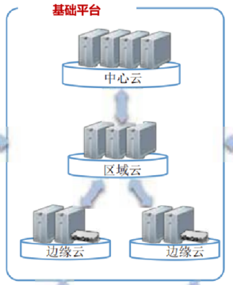

任务实施

能够利用所学知识与技能完成车载终端设备网络通信模块的安装与调试，加深对车载终端设备网络通信模块原理与功能的认识。
步骤一：正确安装车载终端设备网络通信模块。
步骤二：正确调试车载终端设备网络通信模块。

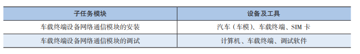

安装车载终端设备网络通信模块

知己知彼

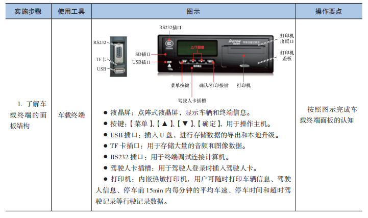
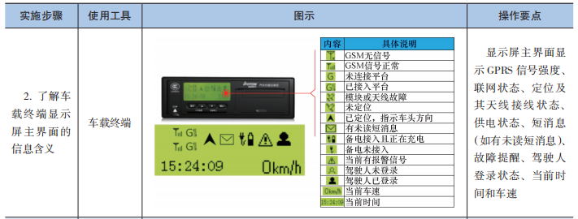

安装车载终端设备网络通信模块

知己知彼

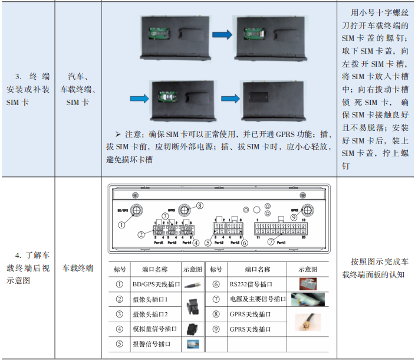

调试车载终端设备网络通信模块

连接计算机和终端
运行调试软件
设置参数
检查基本功能
检测 CAN总线通信功能

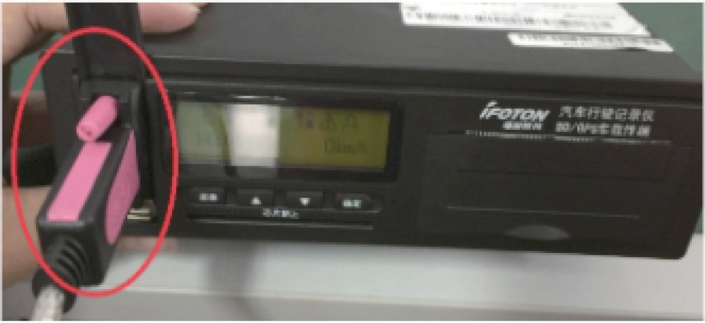
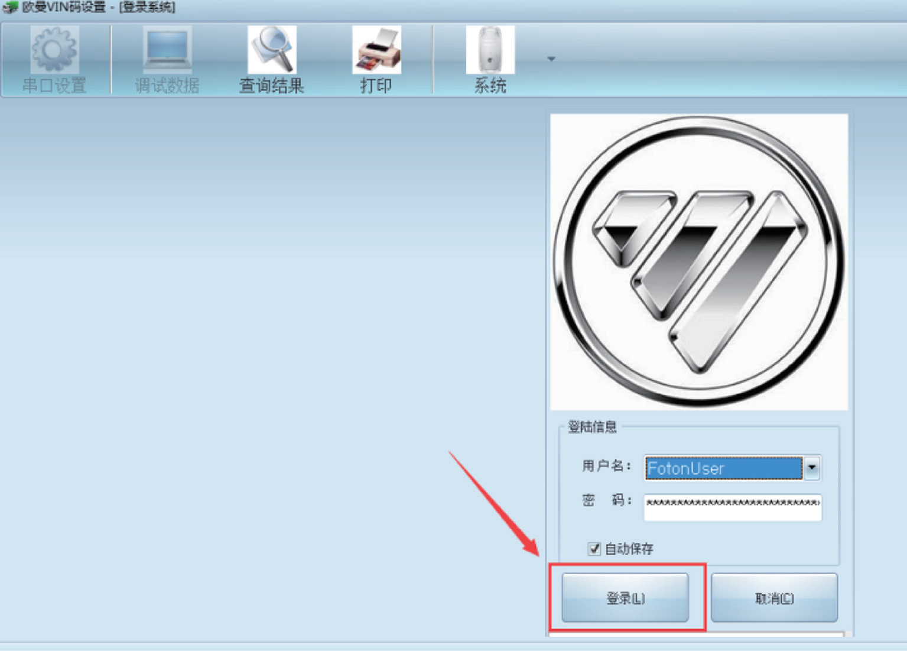
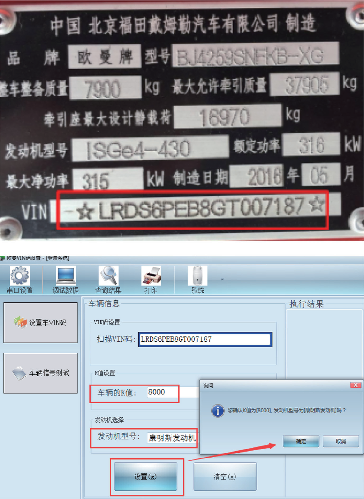
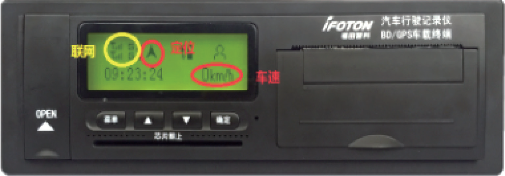
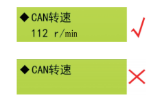

小结

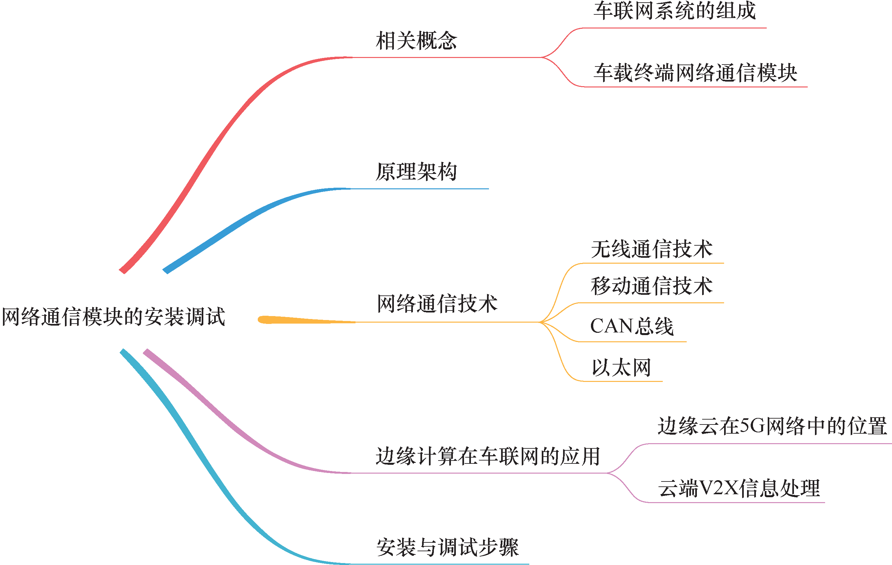

## 📄 相关教材扫描

- [项目四任务二.pdf](/教材扫描/项目四任务二.pdf)

感谢观看
